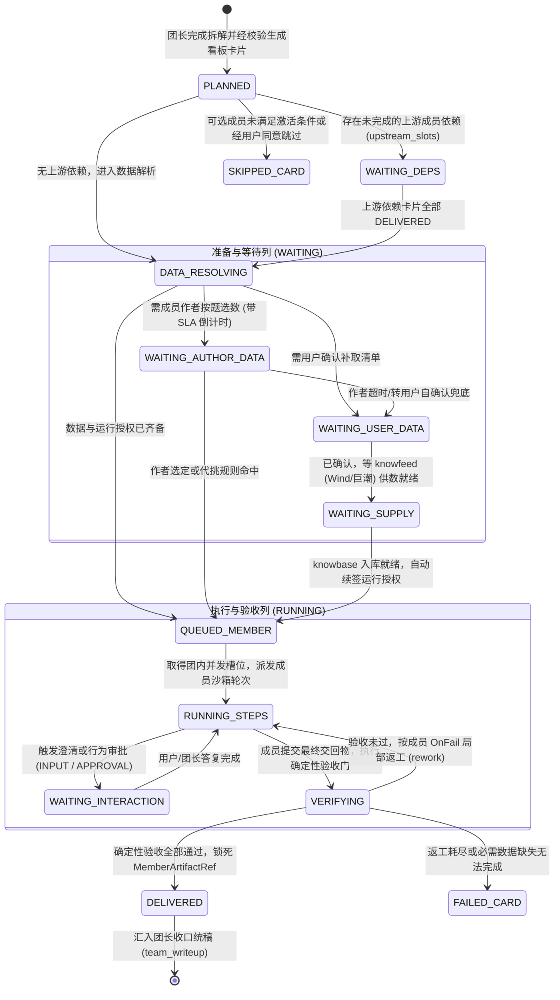
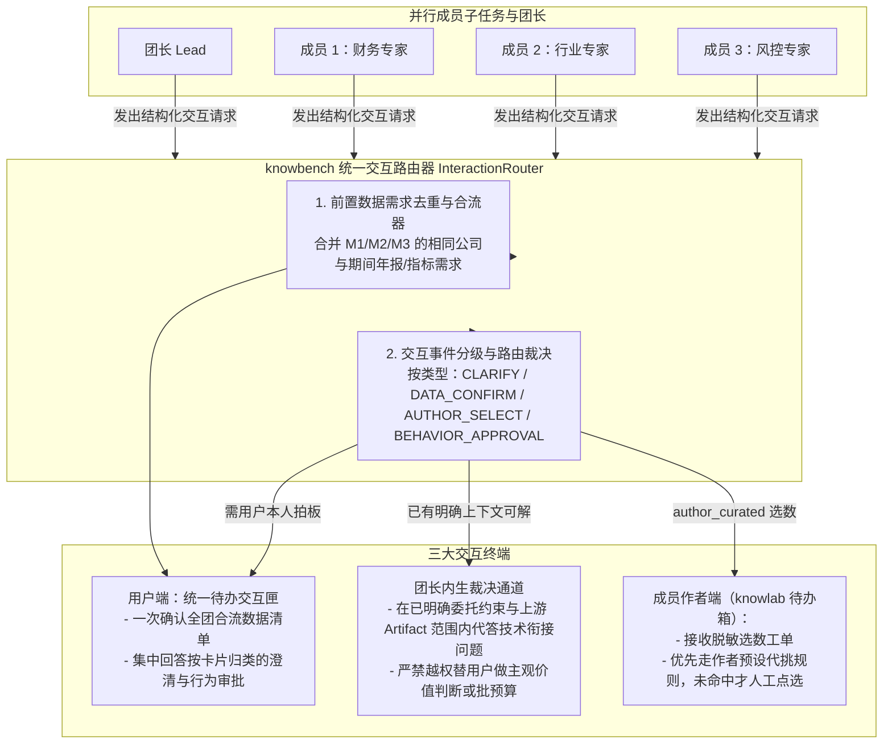

# 专家团使用方案（knowbench）：确定性任务看板、四方统一交互与受控并行执行

> **作者**：`argon`（独立第一手调研与代码走查稿）  
> **创建日期**：2026-11-09  
> **所属模块**：`knowbench`（专家团使用方案）  
> **设计依据**：所有者决定记录（[decisions.md](../../../../design/decisions.md) 10-28、11-08、11-09，尤其是所有者 10-28 原话「工作机制是任务看板，还要有交互机制」与七个待定核心问题）、[数据拓扑](../../数据拓扑.md)、[专家使用方案](../../专家方案设计/专家使用方案/argon/专家使用方案.md)、独立一手竞品研究（[四家产品一手对照](../../专家方案设计/参考资料/agent-team-argon.md)、[WorkBuddy 深度调研](../../专家方案设计/参考资料/workbuddy-argon.md)）及 `knowbench-app` 状态机与账本架构。  
> **状态**：方案设计稿（定稿前不动代码）。

---

## 一、核心设计目标与对七大关键问题的正面回答

所有者在 2026-10-28 提出：「更适用的场景可能是逻辑和数据都是活的，这可能演变成 WorkBuddy 的专家团，工作机制是**任务看板**，还要有**交互机制**」，并列出了动手前必须定清的**七个核心问题**。

结合我们对腾讯 WorkBuddy（`138797` 计划看板、`137017` Agent Teams）、OpenAI dots、Grok Bot、Meta Muse 的一手官方资料拆解与 `knowbench` 现有代码基线，本方案先给出这七个问题的总纲决断，再分节详述工程设计：

| 序号 | 所有者提出的待定问题 | 本方案的核心架构回答 |
| :--- | :--- | :--- |
| **问题 1** | **谁拆解、谁挑专家？** | 用户请入一个「专家团」（或由 AI 匹配推荐专家团）后，由**团长（Team Lead）按团作者固化的拆解规则将母问题拆解为任务看板上的子任务卡（`BoardCard`）**；成员专家在团孵化编译时已钉死确切版本 `(knowbot_id, version, digest)`，团长在运行期只决定**激活哪些可选成员槽位、传什么子问题与参数**，绝不去全市场盲挑未知专家。 |
| **问题 2** | **作者挑数据时能看到什么？** | 当某成员槽位启用「成员作者按题选数据」时，为保护请专家用户的隐私，成员作者**看不到用户的原始聊天上下文、本地项目文件或未脱敏商业机密**；只能看到系统生成的**结构化《脱敏选数工单》**（目标主体代码、报告期间窗口、所调用的能力卡 ID、待选数据槽位要求）。 |
| **问题 3** | **作者不在线怎么办？** | 看板卡片标明 `等待成员作者选数据（剩余 XX 分钟）`，**无依赖的其他成员卡片照常并行推进，绝不整团停摆**；超出作者响应 SLA 时自动触发预设兜底（① 转由预先写好的选数规则自动匹配；② 或由用户一键切换为「我自己确认数据」/「跳过该可选成员」）。 |
| **问题 4** | **能不能事先写规则代挑？** | **不仅能，而且定为主推首选路径**。成员作者可在 `knowlab`/`knowbase` 预先配置确定性**代挑规则（Selection Rule）**（按主体/行业/期间自动映射作者授权给该专家的专属数据集 + 公开披露原件）；规则命中时 0 秒完成绑定，仅在规则无法覆盖的特例题才转人工在线选数。 |
| **问题 5** | **同一项目「一次一位」怎么改？** | 将单专家时代的「1 个项目 = 1 个运行任务粗锁」升级为**「父委托持有项目租约 + 团内最多 $N$（默认 3）个成员子任务受控并发 + 文件系统写隔离」**：各并行成员只能在 `.knowbench/team/<task_id>/members/<slot_id>/` 专属子目录写中间文件，**唯有团长最终统稿步（`team_writeup`）才拥有项目正式交付路径的写权限**，彻底杜绝并发踩踏。 |
| **问题 6** | **成员之间传的产出算什么？** | 成员间及成员向团长交接的是**任务内经过确定性验收的结构化交回物引用（`MemberArtifactRef`）**，附带 `sourced`（数据格地址）、`computed`（计算收据 `compute_id`）与 `quoted`（原文页码引文）证据链。它**不自动写入 `knowbase` 第一区充当事实真源**（守数据拓扑第十四节「产出是结果，不是来源」），下游成员只在显式声明的 `upstream_slots` 契约下按已验成果消费。 |
| **问题 7** | **费用怎么算？** | 分为**专家团聘请费（市场交易层）**与**运行期模型/数据费（执行预算层）**。运行前用户设定一个**全团总预算上限（`TeamBudget`）**，系统按 `团长预留（lead_reserve）+ 各激活成员槽位配额（slot_reserve）+ 机动池` 切分；多成员共用的相同数据需求在前置阶段自动去重合流，**绝不重复查询或重复扣费**。 |

---

## 二、确定性任务看板（Task Kanban Board）架构设计

### 2.1 对标与超越 WorkBuddy 看板：用引擎状态机取代「靠提示词让模型改状态」

在对 WorkBuddy 官方文档（`138797` 与 `137017`）的一手调研中，我们发现其看板存在一个致命工程缺陷：它的卡片状态流转依赖 Lead 模型主动调用 `TaskUpdate` 工具，一旦模型遗漏调用，子成员明明已跑完，看板却永远卡在「进行中」，甚至需要用户发消息催促。

因此，`knowbench` 的专家团任务看板采用**「模型只负责生成拆解提案，卡片状态流转 100% 由后端确定性状态机（`Ledger` + `TurnDriver`）强制驱动」**：

### 2.2 任务看板的四列视图与卡片信息规范

在 `knowbench` 项目工作台中，当专家团委托启动后，主视图顶部与右侧展开**「专家团任务看板（Task Kanban）」**，包含四列：

1. **第一列：待启动 / 等前置（`PLANNED` / `WAITING_DEPS`）**
   - 展示团长拆解出的全部成员子任务卡及团长最终统稿卡，用有向连线标明依赖关系（如：`[统稿卡] 依赖 -> [财务基本面卡, 行业格局卡]`）。
2. **第二列：等数据 / 等交互（`WAITING`）——卡片直接亮出「等谁、等什么」**
   - 每张处于等待态的卡片必须用醒目徽章标明**责任主体与具体事项**：
     - `【等你确认数据】`：列出本卡所需补取的财务指标或年报清单，点击即可在统一交互匣中确认；
     - `【等 knowfeed 取数】`：实时显示 Wind 查询或巨潮 PDF 抽取进度，就绪后自动跳入下一列开跑；
     - `【等成员作者选数据（剩余 18:42）】`：显示作者选数倒计时，并向用户常驻提供「立即改用默认规则 / 我自己确认」按钮；
     - `【等你回答澄清 / 审批】`：显示具体问题或行为审批摘要。
3. **第三列：执行与核验中（`RUNNING` / `VERIFYING`）**
   - 实时显示该成员专家内部的当前步骤游标（如 `步骤 3/5：核心财务指标计算`）、工具调用次数、已读期间数与当前卡片已消耗费用。
4. **第四列：已交回 / 已收口（`DELIVERED` / `SKIPPED` / `FAILED`）**
   - 成员通过确定性验收后立即移入此列，用户可随时点开卡片预览该成员的结构化交回物（`MemberArtifactRef`）、计算收据与原文引文；待所有必选卡片进入 `DELIVERED` 后，团长统稿卡自动激活并生成最终综合报告。

---

## 三、统一交互机制（Unified Interaction Protocol）：四方协同不乱套

### 3.1 为什么必须做「统一交互机制」

在单专家模式下，交互只有「用户 $\leftrightarrow$ 单一专家」。而在专家团模式下，同时存在四个角色：**请专家的用户（User）**、**团长（Team Lead）**、**多位并行运行的成员专家（Member Experts）**、以及**特定成员背后的专家作者（Member Author）**。如果每个成员专家各自弹窗提问、各自索要数据确认，用户会被杂乱无章的弹窗彻底淹没。

因此，`knowbench` 建立**「统一交互总线与待办抽屉（Unified Interaction Bus & Inbox）」**：

### 3.2 统一交互的四条核心工程规则

1. **全团前置数据需求「合流去重、一次确认」**：
   - 当团长拆解完任务、多个初始成员卡片同时进入「定数据」阶段时，`knowbench` 收集所有激活成员提出的数据需求，按 `(主体, 期间, 科目编码/文献类型, 口径, 读法)` **自动去重合流**。
   - 例如：财务专家和风控专家都需要某公司 2022–2024 年报全文与资产负债表，`knowbench` 在向 `knowbase` 解析和向用户展示待确认清单时**合并为同一批条目**。用户只需点击**一次确认**，签发的团级委托运行授权即可供团内获准的多个成员共同按权读取，**绝不让用户点三次确认，也绝不向 Wind 或巨潮发起三次重复查询**。
2. **「团长可代答」与「必须问用户本人」的严格界限**：
   - **团长可内部解答的事项**：成员子任务关于「上游成员交回物中某个字段的格式对齐」或「用户原问题中已经写明、但子任务切分时未带全的客观范围参数」，由 `InteractionRouter` 先交团长根据原问题记录与已验收上游 `ArtifactRef` 补齐。
   - **必须由用户本人拍板的事项（严禁团长越权代签）**：① 任何涉及新增费用或扩大预算的决定；② 任何数据清单的首次确认与外部采集授权（守数据拓扑 12.4 守则 1）；③ 改变用户明确指定的方法、核心业务假设或缩减必交成果的行为审批；④ 成员专家 `ask_before` 中标记为 `must_ask_user=True` 的业务判断问题。
3. **非阻塞异步挂起（局部等待不冻结全团）**：
   - 当成员卡 M2 因等待用户澄清或等待成员作者选数据而进入 `WAITING` 时，状态机只挂起 M2 及其直接下游卡片；**与 M2 无依赖关系的成员卡 M1、M3 继续在各自的沙箱子尝试中全速执行**。
4. **交互幂等与上下文锚定**：
   - 统一待办交互匣中的每一条待办都精准绑定 `(team_task_id, card_id, attempt_id, interaction_id, revision)`，并在旁边直接高亮对应的看板卡片与来源成员名称，支持用户一次性批量提交答复。

---

## 四、「作者按题选数据」完整机制（视野隔离、预设规则代挑与离线兜底）

针对所有者 10-28 专门提出的第二档场景——「有些专家需要使用作者持续维护的专有知识库，且需要根据每道题的具体情况从作者知识库中挑对口的几份数据」，我们设计完整的三层机制：

### 4.1 第一层：隐私保护视野——成员作者能看到什么？

当请专家的用户甲在 `knowbench` 发起专家团委托，其中成员槽位引用了作者乙的行业专家并配置为 `data_policy = "author_curated"` 时，**严禁将用户甲的原始私有会话或本地文件暴露给作者乙**。系统仅向作者乙生成一张结构化的**《脱敏选数工单（DataSelectionTicket）》**：

| 作者乙在选数工单中**看得见**的字段 | 作者乙**绝对看不见**的内容 |
| :--- | :--- |
| 1. **目标主体标识与名称**（如 `600519.SH 贵州茅台` 或行业分类码） 2. **分析期间窗口**（如 `2022Q1 - 2024Q4`） 3. **本次调用的公开能力卡 ID 与子任务标准类型** 4. **该成员专家的输入数据槽位要求**（如：需要 1 份白酒行业渠道调研汇总表 + 1 份消费税政策汇编） 5. **作者乙自己 `knowbase` 第一区中已标为「可以经专家给别人用」的候选资料列表** | 1. 用户甲是谁（匿名化任务脱敏号） 2. 用户甲的原始提问全文（防泄露甲的商业意图或内部头寸） 3. 用户甲自己电脑项目目录里的任何本地文件 4. 用户甲自己上传到 `knowbase` 第一区的私有资料 5. 专家团内其他成员专家的产出或对话 |

### 4.2 第二层：事先写规则代挑（Pre-Configured Selection Rules，零等待主路径）

如果每次运行都要等作者乙真人在线点选，响应速度将无法满足高频分析需求。因此，我们在 `knowlab` / `knowbase` 为成员作者提供**「确定性选数规则表（Author Data Selection Rules）」**：

- **规则表达**：作者乙在发布专家时，可配置按 `主体行业 / 证券代码集合 / 报告期间 / 调用的能力卡 ID` 到 `作者名下特定资料 ID（或带受控词表标签的最新已确认版本）` 的确定性映射规则。
- **运行期自动命中**：委托执行到该成员的定数据阶段时，`knowbench` 先用《脱敏选数工单》匹配作者乙预设的选数规则表；只要规则唯一命中且所指资料版本处于有效 `shareable` 状态，**毫秒级自动完成绑定并签发受益人运行授权**，无需人工介入。

### 4.3 第三层：作者人工在线选数与离线超时兜底（Offline Fallback）

仅当某道题超出了预设选数规则的覆盖范围（或作者显式要求人工复核）时，才向作者乙的 `knowlab` 待办箱推送实时选数通知，并启动 **SLA 倒计时（默认交互任务 30 分钟，异步大任务可设 4 小时）**：

- **等待期间**：看板卡片显示倒计时，用户甲无需干等，其他并行成员照常运行。
- **作者在线响应**：作者乙在待办箱勾选对应资料并提交 $\rightarrow$ 系统核验所选资料满足 `shareable == True` $\rightarrow$ 自动签发受益人运行授权并唤醒该成员卡片继续运行。
- **作者离线或超时未答的三种兜底（用户在等待期间也可随时手动提前触发）**：
  1. **退回预设回退包 + 用户自己的数据（默认推荐）**：自动退回该专家版本冻结的基础绑定数据（`FrozenBinding`）加用户甲自己确认的公开/自有数据继续执行，并在成果中标注「未使用作者按题特挑扩展包」。
  2. **若该成员为可选槽位（`required=False`）**：经用户甲一键同意后将该成员卡片置为 `SKIPPED_CARD`，团长在统稿时如实说明该视角未纳入。
  3. **若该成员为必选核心槽位且无回退包**：暂停该卡并允许用户甲免责取消该成员（不扣该成员的专家聘请费）。

---

## 五、成员间成果交接（`MemberArtifactRef`）、并发文件隔离与统一预算治理

### 5.1 成员间成果交接契约：结构化交回物与 `knowbase` 真源边界

针对「成员之间传的产出算什么」，我们严格贯彻 [数据拓扑](../../数据拓扑.md) 第十四节（「产出是结果，不是来源」）与 `knowbench` 确定性验收原则：

1. **交接载体是 `MemberArtifactRef`，而非自由聊天记录**：
   - 成员 A 执行完毕并通过其自身全部 `AcceptanceRule` 后，产出一份不可变的 JSON 交回物，登记为 `MemberArtifactRef(slot_id, instance_id, knowbot_id, version, artifact_digest, payload, provenance_receipts)`。
   - **上下文隔离（防 Token 爆炸）**：成员 A 内部执行过程中的多轮工具调用、原始长表分页读取记录**全部留在成员 A 自己的子尝试（Sub-Attempt）上下文中，绝不塞进团长或下游成员 B 的上下文窗口**。下游成员 B（其 `upstream_slots` 声明了依赖 A）和团长只读取 `MemberArtifactRef` 中经 Schema 校验的精简结构化结论与证据收据。
2. **证据链穿透校验（Provenance Penetration）**：
   - `MemberArtifactRef` 中的每个关键数值都保留其来自 `knowbase` 的 `sourced` 地址（`fact:...`）或 `compute` 工具生成的 `compute_id` 收据，每条引文保留 `{material_id, page, text}`。
   - 当团长在最终 `team_writeup` 中引用成员 A 的数值或引文时，`knowbench` 验收器直接穿透核对成员 A 的原始收据，确保团长在统稿时**既不能篡改成员算出的数，也不能把成员未验证的推测冒充成已核验事实**。
3. **与 `knowbase` 的边界**：
   - 成员的中间交回物（`MemberArtifactRef`）保存在 `knowbench` 委托账本中，**不写进 `knowbase` 第一区，也不参与后续任务的自动数据解析**。
   - 只有当整个专家团完成最终统稿交付时，才由 `knowbench` 经 `knowbase:user-data-output` 接口将全团最终成稿及各成员底稿汇总包写入用户的 `knowbase` **产出区（第四类「产出」）**；其许可上限取全团各成员实际读过数据的最严许可交集。用户若想将其作为未来任务的数据源，仍须本人在 `knowbase` 点击「转为数据」。

### 5.2 项目内受控并发与文件系统写隔离（解决「一次一位」限制）

在单专家架构中，一个项目同一时刻只允许一个任务处于 `RUNNING`，以防多个沙箱进程同时修改项目目录里的同一份文件。升级到专家团后，我们采用**「父委托独占项目租约 + 团内子任务分目录沙箱并发」**：

| 层级 | 并发与锁规则 | 本地/远程项目目录读写权限 |
| :--- | :--- | :--- |
| **项目级（Project Lease）** | 同一项目同一时刻仍只允许 **1 个活动父委托**（可以是一个单专家委托，或一个专家团母委托），防止不同委托互相干扰 | 父委托持有项目级方向盘（`Wheel.advisor`） |
| **团内成员级（Intra-Team Concurrency）** | 在同一个专家团母委托内部，调度器允许最多 `max_parallel_members`（默认 **3 个**，可根据用户机器配置调为 $1 \sim 4$）无依赖关系的成员卡片同时处于 `RUNNING_STEPS` | 1. **项目根目录对并行成员只读（Read-Only）** 2. 每个成员实例分配独立隔离的临时写入目录：`.knowbench/team/<task_id>/members/<slot_id>_<instance_id>/` 3. 成员之间严禁直接读写对方的临时目录，只能通过后端的 `MemberArtifactRef` 传递数据 |
| **团长统稿级（Lead Synthesis）** | 所有激活成员卡片进入终态后，由团长独占执行 `team_writeup` | **仅团长统稿步拥有向用户指定的正式交付路径（如项目下 `reports/xxx.md`）写入最终报告的权限**，并将各成员附件归档至 `reports/attachments/` |

> 这一机制在彻底避免 WorkBuddy「多成员共享工作区并发写同一文件导致互相覆盖」缺陷的同时，将多维分析与多公司横比的端到端墙钟时间缩短 $50\% \sim 65\%$。

### 5.3 全团预算池切分与防透支熔断

用户在启动专家团委托前设定一个**全团模型与数据运行总预算（`TeamBudget.total_limit`）**，系统按如下确定性公式管控：

$$\text{TotalLimit} = \text{LeadDecompReserve} + \sum_{i \in \text{ActiveSlots}} \text{SlotBudget}_i + \text{LeadSynthesisReserve} + \text{ContingencyPool}$$

1. **前置预留锁**：拆解前先锁定团长拆解轮与统稿轮的保底预算（`LeadDecompReserve + LeadSynthesisReserve`），确保绝不会出现「成员把钱花光了，团长没钱写最终统稿报告」的烂尾现象。
2. **成员独立配额与机动池申请**：每个激活的成员卡片只能在分配给它的 `SlotBudget_i` 内派发轮次；若某成员因局部返工（`rework`）需动用 `ContingencyPool`，由引擎在锁内原子划拨；一旦超出总预算上限，该卡片进入 `WAITING (RESOURCE)` 请用户决定是否追加额度，绝不静默超支。

---

## 六、待所有者拍板确认的事项

1. **「成员作者按题选数据」的默认超时时间（SLA）**：
   - 当某成员槽位未能命中作者预设的自动选数规则、需要人工在线选数时，建议将默认等待超时设为 **30 分钟**（超时后自动切换为回退规则或交用户自确认），同时允许用户在看板卡片上随时点击「不等了，现在就用默认规则/我自己确认数据」。请确认 30 分钟默认时限是否合适？
2. **团内默认最大并行成员数（`max_parallel_members`）**：
   - 考虑到成員专家均运行在用户本机的 `sunmoon-link`（Codex 沙箱）及用户自己的模型 API Key 下，过高并发可能触发用户模型服务商的 RPM/TPM 限流或占满本机内存。建议将单个专家团委托内的默认最大并行成员数设为 **3**（用户可在高级设置中调为 $1 \sim 4$）。请确认是否按此定？
