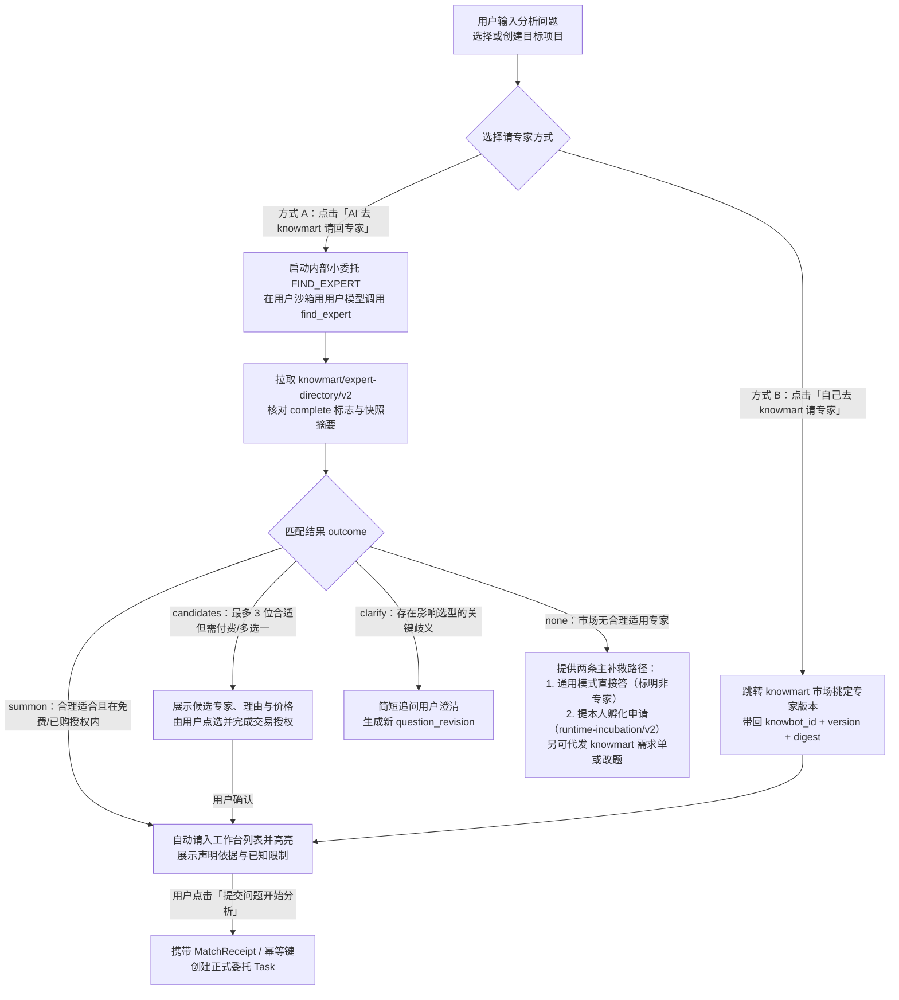
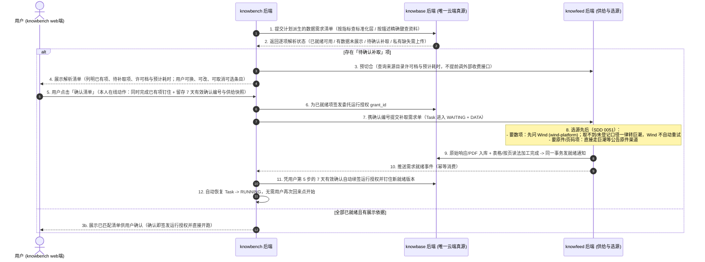

# 专家使用方案（knowbench）：声明匹配请入、统一执行架构与按计划定数据

> **作者**：`argon`（独立第一手调研与代码走查稿）  
> **创建日期**：2026-11-09  
> **所属模块**：`knowbench`（专家使用方案）  
> **设计依据**：所有者决定记录（[decisions.md](../../../../design/decisions.md) 10-26 至 11-09）、[数据拓扑](../../../数据拓扑.md)、[方法与专家包架构 SDD](../../../../design/SDD/architecture/methods.md)、`knowbench-app` 领域模型（`expert_match.py`、`method_plan.py`、`execution_plan.py`、`fixed_plan.py`、`states.py`、`tool_policy.py`、`compute.py`）及跨应用契约（`knowmart/expert-directory/v2`、`knowbench/dynamic-methods/v3`）。  
> **状态**：方案设计稿（定稿前不动代码）。

---

## 一、核心定位与四大架构决断

`knowbench` 是用户请专家、组织委托、在本人电脑（或 SSH 远程目录）沙箱中驱动 Codex 执行并交付成果的工作台。围绕所有者 2026-11-08 拍板的核心要求，本方案在 `knowbench` 侧确立四项关键设计决断：

1. **找专家回归「按公开声明合理选择」，不在匹配阶段替专家重排内部方法**：
   - 用户可通过「AI 去 knowmart 请回专家」或「自己去 knowmart 请专家」两种方式选定专家版本。
   - AI 匹配器只对照用户问题（目标、显式指定的方法、交付约束）与 `knowmart` 目录中的公开能力声明卡（`PublicCapability`）做有依据的适用性判断，生成不可篡改的 `MatchReceipt`；**不要求公开目录暴露私有方法组合图，也不把匹配成功包装成「数学证明 100% 能解出」**。
2. **一套统一执行引擎同时承载固定专家与动态专家（零双轨分叉）**：
   - 废除「固定专家一套运行器、动态专家另一套运行器」的割裂做法。
   - 固定专家（如 8 步固定版「财务分析与预测」）由平台直接按作者顺序构造 `FixedMethodPlan`（`knowbench/fixed-plan/v1`）回执，**不调规划模型、不花规划预算**；动态专家由规划轮在作者冻结方法目录内生成 `CapabilityMethodPlan`（`knowbench/method-plan/v2`）回执。两者经 `ExecutionPlan` 统一投影为相同的 `StepContract` 序列，共用同一套 `TurnDriver`、MCP 令牌鉴权、确定性数值/引文验收与账本。
3. **坚持「先定计划、再按入选方法定数据」与「需求只说要什么、选源归 knowfeed」**：
   - 动态专家先完成任务级方法规划，再只针对**本次入选计划的方法单元**提出数据需求（`要数` 或 `要资料`），绝不为未选方法索取多余年报或指标。
   - 模型在「定数据」步只描述业务上要什么（主体、期间、科目编码、口径、文献类型与读法），不写供应商渠道；由 `knowbase` 先查已有授权数据，缺项经用户一次确认后交 `knowfeed` 按 **「同一个数先问 Wind、巨潮公告原件保底，Wind 取不到一律转巨潮且不自动重试」**（SDD 0051）供给。
4. **过程可控、纠偏有据、三类困难分流清晰**：
   - 运行中通过「专家行为审批」在关键假设变更、方法调整或新增数据费用时请用户拍板；遇到**缺数据**、**专家能力不适合**、**平台/环境故障**三类不同困难时走严格区分的处理与成果转交路径（转通用模式聊天或带上下文发起本人孵化申请）。

---

## 二、用户入口与「请专家」机制设计

### 2.1 一个入口组件，两种请法

`knowbench` 首页「专家」模式与项目页「请专家」共用同一个输入与请入组件，操作流清晰闭环：



关键交互与状态守则：

1. **请回高亮不等于自动开跑扣费**：无论是 AI 请回（`summon`）还是用户从市场手选返回，都在工作台专家列表中高亮该专家并保留原问题与项目选择；**必须由用户点击提交问题，才正式创建分析委托**。普通聊天模式绝不偷偷把用户的对话转成付费找专家任务。
2. **工作台专家列表管理**：每位已请入的专家旁提供「移除」操作，仅从当前账号的工作台常用列表中移除（服务端持久化），不删除 `knowmart` 上的专家包，也不影响历史委托、已交回报告或其他用户。

### 2.2 按公开声明匹配与收据核验（`MatchReceipt`）

在 `FIND_EXPERT` 内部任务中，模型读取 `knowmart/expert-directory/v2` 返回的 `PublicExpert` 列表（包含 `knowbot_id`、`version`、`digest`、`scope`、`public_capabilities`、`free`、`price`）：

- **匹配判断准则**：
  - 将用户问题拆解为核心目标结果（`result`）、边界约束（`constraint`）与用户点名要求的方法（`explicit_method`，如「必须用 DCF 估值」或「按季节性同比法预测」）。
  - **显式方法硬约束**：若用户明确指定了某种方法（`kind="explicit_method"`），匹配器不得将其降级为可选；若候选专家的 `exclusions`（不适用与不承诺）明确排除了该方法或目标，绝不能伪装成适合并请入。
  - **目录完整性防误导**：若 `DirectorySnapshot.complete == False`、分页截断或 `knowmart` 服务异常，必须向用户报「未完成查找 / 目录服务异常」，**严禁谎称「市场上没有合适专家」**。
- **从匹配到委托的事务边界**：
  - 匹配结果落盘为不可变的 `MatchReceipt`（含 `question_digest`、`directory_digest`、`question_revision`、模型输出与后端核验结论）。
  - 创建正式委托时，请求必须携带 `match_task_id`、`match_artifact_version`、`question_revision`、确切专家版本与幂等请求 ID；后端在事务锁内重核当前用户、项目占用锁、专家版本摘要与费用授权，拒绝前端拼装的未验载荷。

---

## 三、统一执行架构：一套引擎承载固定专家与动态专家

### 3.1 统一执行流水线（`ExecutionPlan` 投影机制）

为兑现所有者 11-08「原来的固定财务专家保留，但执行架构应该只有一套」的决定，`knowbench` 将固定专家与动态专家完全收敛到 `AcceptedMethodPlan` $\rightarrow$ `ExecutionPlan` $\rightarrow$ `StepContract[]` 单一路径上：

```mermaid
flowchart LR
  subgraph MANIFEST[已钉住的专家清单]
    V2[固定专家清单 knowbot-manifest/v2<br/>runtime_contract: knowbench/fixed/v1<br/>含作者固定顺序 workflow]
    V3[动态专家清单 knowbot-manifest/v3<br/>runtime_contract: knowbench/dynamic-methods/v3<br/>含 method_units + capability_bindings]
  end

  subgraph PLANNER[计划形成与确定性校验层]
    FP[fixed_plan.py 直接构造<br/>FixedMethodPlan (fixed-plan/v1)<br/>零模型调用 / 零费用 / 不可篡改]
    DP[规划步 __method_plan__ 模型生成<br/>CapabilityMethodPlan (method-plan/v2)<br/>按题选方法 + 填未选理由]
    VAL[validate_plan / validate_fixed_plan<br/>确定性结构、依赖、前缀与槽位校验]
  end

  subgraph ENGINE[knowbench 统一执行引擎]
    REC[服务端计划回执 AcceptedMethodPlan<br/>绑定 task_id / attempt_id / pack_digest / version]
    PROJ[ExecutionPlan 统一投影<br/>生成 StepContract 序列与条件验收门]
    DATA[共用模板前置：定数据与供给就绪<br/>knowbase 解析 -> 用户一次确认 -> knowfeed 补数]
    RUN[TurnDriver 逐步派发沙箱轮次<br/>按步签发 MCP 令牌 -> 批量 compute -> 确定性验收]
    DELIV[共用模板后置：收口成稿与交付<br/>写本地项目文件 + 写 knowbase 产出区]
  end

  V2 --> FP --> VAL
  V3 --> DP --> VAL
  VAL --> REC --> PROJ --> DATA --> RUN --> DELIV
```

### 3.2 固定专家与动态专家在同一引擎下的行为对照

| 维度 | 固定专家（如 8 步固定版财务专家） | 动态专家（如拆分后 5 方法动态版财务专家） | 共用底层机制 |
| :--- | :--- | :--- | :--- |
| **计划来源** | 平台调用 `fixed_plan(pack)` 直接生成 `FixedMethodPlan`（`planned_by_model=False`） | 规划轮调用沙箱模型生成 `CapabilityMethodPlan`（`planned_by_model=True`） | 均生成服务端 `AcceptedMethodPlan` 回执并记录 `accepted_plan_version` |
| **规划开销** | **0 Token、0 秒**（不调模型） | 消耗 1 轮轻量规划轮（受 `planning.reserve` 约束） | 均受委托总预算锁管控 |
| **产出物命名** | 保持作者原名 `step.output_artifact`（兼容全部既有测试断言） | 投影为 `__method_output__:<instance_id>`（支持同一方法多实例调用） | 均由 `ExecutionPlan.output_of(instance_id)` 统一寻址 |
| **可选输入槽** | 按固定 `input_refs` 全量连接 | 未选上游槽显式标为 `omitted_inputs: {"slot": "not_selected"}` | `project_plan()` 自动向 `method_text` 注入「未选槽不得补造」提示，并按 `when_input_present` 裁剪条件验收规则 |
| **重规划（Replan）** | `max_replans = 0`（严禁改序） | 允许在 `max_replans` 上限内申请前缀保护重规划 | 均由 `validate_plan()` 强制校验已执行前缀 `protected_prefix` 与已完成前缀 `completed_prefix` 不可篡改 |

### 3.3 计划确定性校验的六道铁闸（`validate_plan`）

规划模型交回的 `CapabilityMethodPlan` 绝不能发明新方法或放宽作者约束，后端 `validate_plan()` 逐条执行确定性拦截：

1. **方法冻结门**：每个 `PlannedStep.method_id` 必须存在于当前钉住专家包的 `method_units` 中，严禁跨包引用或读取方法库新版。
2. **必经与上限门**：作者标为 `selection.required == True` 的方法以及 `planning.final_units` 必须出现在计划中；每个方法的调用次数不得超过 `selection.max_calls`；总步数不得超过 `planning.max_steps`。
3. **能力承诺对齐门**：针对委托已承接的各项需求（`requirement_coverage`），对应的 `CapabilityBinding.required_units` 与 `evidence_outputs` 必须在计划中有明确实例承接；未选方法必须在 `unselected_methods` 中给出非空理由。
4. **输入槽完整性与 DAG 拓扑门**：目标方法的每个 `required=True` 输入槽必须绑定到上游已规划步骤的 `instance_id`；每个 `required=False` 的可选输入槽，要么绑定上游实例，要么显式列入 `omitted_inputs: {slot: "not_selected"}`（二者必居其一，严禁悬空或产生环路）。
5. **工具与权限子集门**：规划步为每个实例选择的 `tools` 必须是作者在该方法单元上允许工具列表的子集，且属于平台 `V2_TOOLS` 白名单。
6. **重规划前缀保护门（Prefix Preservation）**：发生运行中重规划时，`proposal.parent_version` 必须等于当前激活计划的 `version`；`0 <= completed_prefix <= protected_prefix <= len(proposal.steps)` 范围内的已执行步骤，其方法标识、顺序、工具与已完成产出引用严禁被替换。

---

## 四、按计划定数据与 Wind / 巨潮协同供给链

### 4.1 为什么必须「先形成计划，再定本次数据」

在动态专家下，如果先定数据再排计划，系统不知道本题究竟要用哪几个方法，只能把专家所有可能用到的数据（例如三年全部定期报告 PDF + 所有财务科目）一股脑全列出来让用户确认和采集。

因此，`knowbench` 严格执行 **「先排计划 $\rightarrow$ 再按入选计划定数据 $\rightarrow$ 数据就绪后按步执行」**：

1. **按入选方法精准提数**：在「定数据」步，模型只读取用户问题与**当前已接受计划（`AcceptedMethodPlan`）中包含的方法单元**，提出最小必要数据清单（一次最多 20 项）。
2. **两种标准提法，绝不写渠道（11-07 决定）**：
   - **要数（Structured Metric/Fact）**：写明主体代码、期末日、统一科目表编码（如 `IS.REVENUE`、`IS.NET_PROFIT_PARENT`）、口径（合并/母公司；全年/半年/单季/年初至今；当期原始披露/最新调整后，默认当期原始披露）。
   - **要资料（Document/Rendition）**：写明主体代码、文献类型（年报、半年报、一季报、三季报等）、报告期间、版本形态及所需读法（`table` 抽好的表、`index` 文字检索、`pages` 原文按页）。凡计划中包含需要 `quoted` 原文页码引文的方法（如 `fin_mda_crosscheck` 对照管理层讨论），必须显式提出「要资料（年报全文 + 按页/检索读法）」。

### 4.2 解析、一次确认与「Wind 优先、巨潮保底」自动续跑闭环



数据与供给侧的四条硬约束：

1. **Wind 与公告原件的精度及冲突处理（SDD 0051）**：
   - Wind 返回的数值带供应商回执与字段名，进 `knowbase` 表格读法，**绝不伪造年报 PDF 页码**，也不拿亿元精度的供应商汇总数去做 1 元容差的四式恒等核验；单季还原、首次披露与追溯调整版本对照、四式勾稽以及需要页码引文的管理层讨论对照，一律使用从巨潮定期报告原件抽出的事实表与按页全文。
   - 若同一指标 Wind 与年报原件抽表都取过且数值不一致，两行均保留并标「待核」，由专家方法规则决定采用哪一源，平台绝不静默覆盖。
2. **确认不可跳过，补取齐了自动接着跑**：
   - 任何账号设置或模型调用都不能跳过用户的清单确认；但用户确认一次后（7 天内有效），后台补取完成时由 `knowbench` 凭该次确认自动续签运行授权并恢复执行，不再打扰用户二次点击。
3. **数据发现后的受控重规划**：
   - 若数据补取完成后发现某项可选资料确实无法取得，或数据形态要求改用作者允许的备选方法，可在步骤边界申请有限次重规划（消耗 `max_replans` 配额）；若需扩大数据范围，必须产生新修订并由用户再次确认，绝不随重规划自动扩大数据授权。

---

## 五、执行效率、行为审批、确定性验收与三类困难分流

### 5.1 批处理计算与确定性工具执行效率

为避免「算一个财务指标开一轮模型」导致的极高延迟与费用，`knowbench` 在每步执行中强制推行批处理与确定性计算：

- **多期事实批量读取**：同一方法所需的多年/多季科目数据，通过 `query_facts` / `read_facts` 一次性批量取回。
- **批量公式计算（Batch `compute`）**：单次 `compute` 调用支持 **1–50 个计算项**，并支持同批次内的前向引用（如先算各期毛利，同批引用毛利算毛利率与同比变化）；每个计算项独立生成带输入、算式、舍入规则与结果的 `compute_id` 收据。
- **同任务已验收计算复用**：同一委托内相同输入版本、相同表达式与舍入规则的计算结果可直接复用收据；跨委托绝不复用他人数据或授权。
- **真实进度呈现**：界面实时展示当前步骤的实际工具调用次数、已读取期间数、最近活动、已发生模型费用与等待原因（`INPUT` / `APPROVAL` / `DATA` / `RESOURCE` / `ENVIRONMENT`），无充足样本时不编造虚假剩余时间（ETA）。

### 5.2 专家行为审批：按实际影响纠偏，不搞弹窗轰炸

运行中复用 `knowbench` 既有 `Interaction / Approval` 机制（`TaskState.WAITING` + `WaitingReason.APPROVAL`），严格按行为影响分级：

| 行为类别 | 运行时处理方式 |
| :--- | :--- |
| **已授权范围与预算内的常规读取、计算、方法内推理** | 自动执行并记入审计账本，**不弹窗打扰用户**（作者显式配置了 `ask_before` 的除外） |
| **运行中追加新数据需求或产生新采集/查询费用** | 在步骤边界暂停（`WAITING + DATA`），展示新增数据用途、取得方式与费用，走标准数据确认链 |
| **需改变核心假设、缩小用户要求的必交成果或替换用户点名方法** | 弹出行为审批卡，清晰列出「原约定 $\rightarrow$ 拟调整内容 $\rightarrow$ 对结果的影响」，由用户选择**批准 / 调整 / 拒绝 / 停止** |
| **专家能力本身不适合当前问题（需创造作者未定义的新方法）** | **严禁靠一次行为审批临时扩权造新方法**；立即停下并引导用户走「转通用模式」或「提本人孵化申请」 |

- **审批安全守则**：用户未答复、关闭页面或超时绝不等于同意；用户批准某项行为调整只代表允许继续执行，**不豁免后续步骤的确定性数值与引文验收**。

### 5.3 三类运行困难的清晰分流与成果转交

当委托无法完整走完时，`knowbench` 严禁将所有异常笼统报为「执行失败」，也不新增非法的 `PARTIAL_SUCCESS` 状态词，而是严格沿既有合法状态机（`states.py`）分流并支持受控转交：

| 困难类别 | 触发判据 | 状态机落点与界面呈现 | 用户可选补救与转交动作 |
| :--- | :--- | :--- | :--- |
| **1. 缺数据** | 必需数据无法取回、供应商额度耗尽或私有资料未上传 | `WAITING (DATA)` $\rightarrow$ 超时或无法满足时停下报明具体缺项 | ① 重试或更换数据来源 / 直达 `knowbase` 上传<br/>② 用户主动选择「缩小任务范围」（生成委托需求修订，按缩小后的范围完成并标注「数据不全」）<br/>③ 取消任务 |
| **2. 专家能力不适合** | 执行中发现问题超出专家已冻结方法边界，或必要要求无法由现有方法承接 | 受理校验期走 `REJECTED`；已开跑任务走 `FAILED` 并完整保留已完成的中间交回物 | ① **转通用模式直接答**：在项目内开聊天会话，携带原问题与已确认背景，顶部标明「这是你的模型直接答的，不是专家，方法没经过测试」<br/>② **提本人孵化申请**：调用 `knowlab` `runtime-incubation/v2`，将原问题、已验条件与失败原因带入本人新创意草稿 |
| **3. 平台或环境故障** | 模型接口异常、解析器错误、用户 `sunmoon-link` 执行电脑断开 | 电脑断开进 `WAITING (ENVIRONMENT)` 等待重连；未捕获平台异常记 `FAILED (platform)` | 明确区分工程故障与方法不通过，如实显示已发生费用，支持从最后一次已提交的 `Attempt` / 计划前缀恢复重跑，不重复派发已结算轮次 |

---

## 六、待所有者拍板确认的事项

1. **找专家与正式委托的联合预算设定方式**：
   - 当前「AI 去 knowmart 请回专家」会消耗一轮轻量模型调用费用。建议在用户点击找专家前显示固定的单次查找费用上限（如默认不超过 0.50 元），或者允许用户一次设定「本次找专家 + 执行分析总预算上限」，正式委托启动时从总上限中自动扣减已发生的查找费用。请确认采用「查找固定小额上限 + 委托单独设预算」还是「查找与委托共用单次总预算」？
2. **不完整交付（用户同意降级）的报告显著标识**：
   - 当某项非核心数据缺失或用户批准缩小范围继续成稿时，任务状态记为完成，但建议在最终生成的 Markdown 报告首行及工作台结果边栏强制置顶醒目标签：`【范围缩减 / 数据不全交付：已省略 XXX】`。请确认该标识样式与文案要求。
