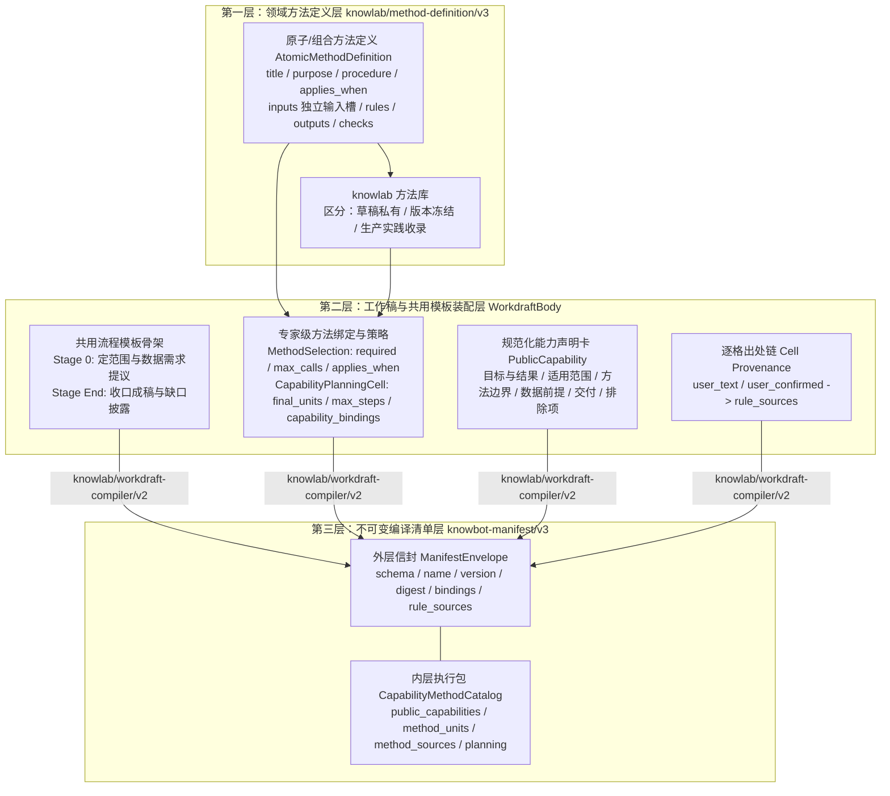
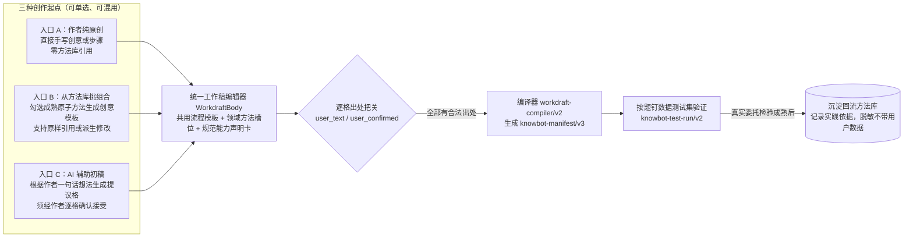
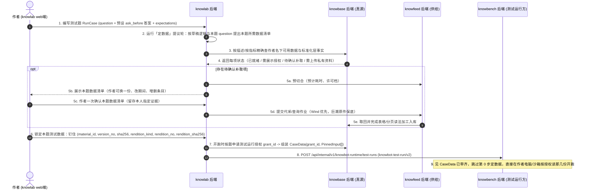

# 专家孵化方案（knowlab）：共用流程模板、原子方法装配与按题测试设计

> 当前分类以[方法主稿](../luna/专家及专家团孵化模板.md)为准（2026-11-14）：工具方法不调用其它方法；专家方法组合工具及零种或一种专家、不含专家团；专家团方法调用两种或以上专家，或已有专家团。按方法身份及冻结允许依赖分类，三类共用契约和调用治理；专家与专家团共用编排。以下历史正文、旧协议或评审结论保留原时点含义，“两类”“不设专家团类型”及独立团队引擎等旧表述不作为当前目标。

> **作者**：`argon`（独立第一手调研与代码走查稿）  
> **创建日期**：2026-11-09  
> **所属模块**：`knowlab`（专家孵化方案）  
> **设计依据**：所有者决定记录（[decisions.md](../../../../design/decisions.md) 10-26 至 11-09）、[数据拓扑](../../../数据拓扑.md)、[方法与专家包架构 SDD](../../../../design/SDD/architecture/methods.md)、`knowlab-app` 领域模型（`workdraft.py`、`atomic_methods.py`、`method_composition.py`、`compile.py`、`test_run.py`）及一等公民契约（`author-method/v3`、`knowbot-manifest/v3`、`knowbot-test-run/v2`）。  
> **状态**：方案设计稿（定稿前不动代码）。

---

## 一、要解决的核心问题与设计原则

### 1.1 现存的两类结构性矛盾

在第一轨（固定 8 步「财务分析与预测」专家）与第二轨（动态方法目录实验）的实践中，暴露出两类相反但同源的结构性矛盾：

1. **固定 8 步专家的「全有或全无」僵化**：
   - 原固定专家将 `scope`（定范围）$\rightarrow$ `inventory`（数据摸底）$\rightarrow$ `reconcile`（四式勾稽）$\rightarrow$ `series`（累计转单季）$\rightarrow$ `indicators`（核心指标）$\rightarrow$ `official`（对照管理层讨论）$\rightarrow$ `forecast`（两季同比预测与四季回测）$\rightarrow$ `writeup`（成稿）硬编码为单条不可跳过的线性流水线。
   - 当用户只问「帮我算贵州茅台过去三年营业收入的复合增长率（CAGR）」或「对比两期单季毛利率」时，固定流水线仍然强制索取三年年报全文 PDF、强制跑管理层讨论引文核验与未来两季预测，不仅耗时耗费，还常因非必要步骤的数据缺口导致整单失败。
2. **早期动态 20 方法实验的「过度拆碎与封闭拼装」**：
   - 把本属于所有分析任务共用的流程骨架（如「定主体和期间」「提数据需求」「收口写成稿」）与真正的领域分析方法（如「四式勾稽」「累计转单季」「季节性同比预测」）混为一谈。
   - 把「人 + AI 创作方法」窄化为「从平台预置的 20 个合成方法里勾选拼装」，且将未经生产检验的合成方法直接标为方法库成熟方法，违背了 `C-L1`（投资与业务判断逻辑只来自用户）和所有者 11-08 定下的创作原则。

### 1.2 所有者 11-08 核心定调与本方案的四大原则

围绕所有者 2026-11-08 拍板的四项决定，本方案确立 `knowlab` 专家孵化的四大基本原则：

1. **共用流程模板与领域方法彻底解耦**：
   - **共用流程模板（Shared Stage Skeleton）**：所有专家共用的过程阶段——**定范围与主体期间**、**定数据需求与供给就绪**、**收口成稿与局限披露**——下沉为平台统一提供的流程骨架模板，不再充当领域方法单元。
   - **领域方法（Domain Methods）**：只承载可独立解释、有明确输入槽与确定性验收规则的业务分析逻辑。在财务专家中，**勾稽验证（四式恒等核验）是领域方法**，**对照管理层讨论是可选领域方法**。
2. **固定专家与动态专家收敛到同一套孵化与编译底座**：
   - 固定专家不是另一套物种，而是**在共用流程模板上方法序列与输入连线完全锁定（零运行期规划自由度）的特例**；动态专家则是**作者授权运行期规划器在冻结方法子集与依赖槽位内按题选方法**的专家。
3. **创意是方法之源，方法库是实践沉淀，三种起点自由混用**：
   - 作者可以从 **① 纯原创（零方法库引用）**、**② 方法库挑选组合生成创意模板**、**③ AI 辅助起草初稿** 三种起点任意开始或混用。冻结版本不等于成熟方法，只有经真实委托检验的方法才由有权作者沉淀入库。
4. **测试集按题钉住数据，支持中间单实例方法精准断言**：
   - 测试集不再绑定模糊的「专家全局数据集」，而是**「每道测试题 + 作者确认钉住的 `CaseData`（`grant_id` + `PinnedInput[]`）」**，并通过 `knowbot-test-run/v2` 支持对单实例中间方法与最终成稿的双层确定性验收。

---

## 二、共用流程模板与领域方法的分层架构

### 2.1 三层解耦模型：方法定义层 $\rightarrow$ 工作稿装配层 $\rightarrow$ 编译清单层

在代码与契约层面，这三层严格分离、各司其职：

| 层次 | 权威模型与 Schema | 包含什么 | 严禁混入什么 |
| :--- | :--- | :--- | :--- |
| **1. 领域方法定义层** | `AtomicMethodDefinition` (`knowlab/author-method/v3`) | `title`、`purpose`、`procedure`（做法原文）、`applies_when`（适用条件）、`inputs`（显式声明形状与 `required` 的输入槽）、`rules`、`outputs`、`output_schema`、`checks`（含 `ConditionalCheckCell`） | 严禁混入具体专家的步骤序号、上游具体步骤 ID（必须用自身 `inputs` 槽名）、运行预算 `reserve`、工具白名单或重规划次数 |
| **2. 工作稿装配层** | `WorkdraftBody` (`workdraft.py`) | 共用模板首尾阶段配置、本专家引用的方法列表（含原创内联方法与库引用 `MethodReference`）、每个方法在本专家中的 `MethodSelection`（`required`、`max_calls`、`applies_when`）、`CapabilityPlanningCell`、`PublicCapability` 能力卡、作者冻结绑定数据 `bindings`、逐格出处 `sources` | 严禁在未获作者逐格确认（`user_text` / `user_confirmed`）的情况下让 AI 生成规则直接进入可编译状态 |
| **3. 编译清单层** | `KnowbotManifestV3` (`knowmart/knowbot/v3`) | 外层 `schema`、`name`、`version`、`runtime`、`bindings: FrozenBinding[]`、`rule_sources: RuleSource[]`；内层 `pack`（`public_capabilities`、`method_units`、`method_sources` 精确快照、`planning`） | 严禁混入单次任务的动态执行计划（`MethodPlan` 归 `knowbench` 按题生成），严禁在 `method_sources` 与 `method_units` 之间出现摘要不一致 |

### 2.2 共用流程模板（Shared Stage Skeleton）的标准结构

所有专家（无论是固定顺序还是按题动态规划，无论是财务领域还是其他领域）共享同一套由平台提供、参数可由作者配置的**三段式流程骨架**：

1. **前置共用阶段（Stage 0：定范围、定计划与提数据）**：
   - **定范围与关键澄清（Scope & Clarification）**：识别用户问题中的目标主体（调用 `find_subject` 核准证券代码或机构标识）、分析期间窗口、指定指标与显式方法要求。若存在影响专家适用性或核心口径的关键歧义，按作者配置的 `ask_before` 触发澄清。
   - **生成执行计划（Plan Construction）**：
     - 若专家为**固定模式**（作者锁定了唯一执行序列）：平台直接按作者顺序构造确定性的 `FixedMethodPlan`（`knowbench/fixed-plan/v1`），**零模型调用、零规划开销**。
     - 若专家为**动态模式**（作者启用了 `planning`）：运行期规划器在作者冻结的 `method_units` 内按题生成 `CapabilityMethodPlan`（`knowbench/method-plan/v2`），并记录每个未选方法的 `unselected_methods` 理由。
   - **按已选方法提出数据需求（Data Proposal）**：仅根据本任务实际排入计划的方法单元的数据语义前提，向用户提出结构化的数据清单（`要数`：主体 + 期末日 + 科目编码 + 口径；`要资料`：主体 + 文献类型 + 报告期 + 读法），绝不为未入选的方法索取多余数据。
2. **中段领域方法执行区（Stage 1..K：Domain Method Execution）**：
   - 按计划拓扑依次执行入选的领域方法单元（如勾稽验证、单季还原、指标计算、官方披露对照、同比预测）。
   - 每个方法单元只消费其显式声明的 `inputs` 槽位与已授权数据，交回符合 `output_schema` 的结构化 JSON，并当场接受 `knowbench` 确定性验收门（`sourced`、`computed`、`identity`、`quoted`、`covers` 等）的核验。
3. **后置共用阶段（Stage End：收口成稿与局限披露 `writeup`）**：
   - 作为 `planning.final_units` 的收口阶段，汇总上游各已执行方法的交回物，按 `output_file` 写出最终报告（如 Markdown 底稿），并交回结构化结论摘要。
   - **可选输入槽与条件验收机制**：对上游可选方法（如 `official` 对照管理层讨论、`forecast` 预测、`reconcile` 勾稽）声明为 `required=False` 的输入槽；对应的 `covers` / `quoted` 验收规则全部挂载 `when_input_present="<slot_name>"` 守卫。当某可选方法因用户问题不需要而未入选计划（标注为 `omitted_inputs: {"official": "not_selected"}`）时，`writeup` 自动跳过该槽位的覆盖性检查，并在报告「局限与说明」章节如实写出本次未执行该方法的范围说明。

---

## 三、财务专家的拆分示范：从固定 8 步到「共用模板 + 5 个领域方法」

按照所有者 11-08 的决定，我们将原固定 8 步「财务分析与预测」专家（准专家 4.10/4.11）拆解为**共用模板首尾阶段**与 **5 个高内聚、边界清晰的领域方法单元**，同时保留原固定 8 步专家作为锁定全流程的特例版本：

### 3.1 拆分对照总表

| 原 8 步序号与标识 | 在新架构中的归属 | 必选 / 可选属性 | 输入槽（`inputs`） | 核心职责与工具约束 | 确定性验收规则（`checks`） |
| :--- | :--- | :--- | :--- | :--- | :--- |
| 第 1 步 `scope` 第 2 步 `inventory` | **共用模板前置阶段** （`scope_and_data`） | **模板必经** （`required=True`） | 用户问题、委托修订 | 核准目标公司代码（`find_subject`）、基准期间与分析窗口；按入选方法提出所需财务事实或定期报告 PDF（`request_data`）；盘点已钉住数据的可用期间与口径 | `required_keys`、`non_empty`、`each_has`（主体代码、期间列表非空） |
| 第 3 步 `reconcile` | **领域方法 1**： **四式勾稽验证** （`fin_reconcile_4id`） | **按题可选方法** （全套财报分析与预测时必选；单指标快速查询时可不选） | `scope_data`（必填：目标主体与需核验的报告期集合） | 调用 `query_facts` / `read_facts` 与 `compute` 核验四条会计恒等式： ① 资产 = 负债 + 股东权益 ② 期末现金 = 期初现金 + 现金净增加额 ③ 利润表净利润与权益变动表/未分配利润勾稽 ④ 营收与利润表分项加总一致（容差按报表单位设定） | `sourced`（报表原值带 `fact:` 地址）、`computed`（差额由 `compute` 计算）、`identity`（左右端 `left_id` / `right_id` 在容差内相等） |
| 第 4 步 `series` | **领域方法 2**： **累计转单季序列还原** （`fin_quarterly_series`） | **按题可选方法** （凡涉及单季对比、季节性回测或季度预测时必选） | `scope_data`（必填）；`reconcile_out`（可选，`required=False`） | 将一季报（`Q1`）、半年报（`H1`）、三季报（`Q1-Q3`）、年报（`FY`）年初至今累计数，通过 `compute` 还原为单季序列（`Q1`, `Q2=H1-Q1`, `Q3=Q1_3-H1`, `Q4=FY-Q1_3`），并标记重述版本（当期原始披露 vs 最新调整后） | `sourced`（累计值溯源）、`computed`（单季差分算式核验）、`covers`（覆盖目标期间窗口） |
| 第 5 步 `indicators` | **领域方法 3**： **核心财务指标与增长率测算** （`fin_core_indicators`） | **按题可选方法** （历史业绩、盈利能力、成长性、现金流质量分析时选用） | `scope_data`（必填）；`series_out`（可选，`required=False`，单季指标时绑定） | 使用 `compute` 批量计算同比增速（YoY）、环比增速（QoQ）、复合增长率（CAGR）、毛利率、净利率、ROE、经营现金流与净利润比值等作者定义指标 | `sourced`（基础科目溯源）、`computed`（比率与增长率公式核验）、`each_has` |
| 第 6 步 `official` | **领域方法 4**： **管理层讨论与官方披露对照** （`fin_mda_crosscheck`） | **可选领域方法** （所有者 11-08 明确：**对照管理层讨论是可选方法**，`required=False`） | `indicators_out`（必填：待对照的指标结论）；`reconcile_out`（可选） | 调用 `search_evidence` / `read_input` 在已钉住的定期报告全文（管理层讨论与分析章节）中检索公司官方对业绩变动原因的阐述，提取带 `material_id`、`page` 和原文片段的引文并与量化结论对照 | `quoted`（每条官方说法必须附真实 `material_id`、`page` 与逐字匹配原文 `text`）、`covers` |
| 第 7 步 `forecast` | **领域方法 5**： **季节性同比预测与四季回测** （`fin_seasonal_forecast`） | **按题可选方法** （仅在用户要求预测未来季度营收/归母净利润时选用） | `series_out`（必填：单季历史序列）；`reconcile_out`（必填：预测基准期须经勾稽核验） | 先对最近 4 个已披露单季执行历史无前视偏差回测；再按「上年同季数 × (1 + 近四季同比中位数)」计算未来两季点预测，按「近八季同比最小/最大值」计算上下界区间 | `computed`（回测误差、中位数、点预测与上下界全部核对 `compute_id`）、`covers`（覆盖最近四季回测与未来两季预测） |
| 第 8 步 `writeup` | **共用模板后置阶段** （`writeup_and_deliver`） | **模板必经终态** （`final_units=["writeup"]`） | `scope_data`（必填）；`reconcile_out`、`series_out`、`indicators_out`、`official_out`、`forecast_out`（均为可选槽 `required=False`） | 汇总本任务所有已执行方法的交回物，写出结构化 Markdown 报告文件（`output_file`），对未选方法（`omitted_inputs`）及数据缺口如实披露局限，严禁投资建议（`no_positioning_advice`） | `required_keys`、`max_chars`、`no_positioning_advice`；各可选槽挂载 `ConditionalCheckCell(when_input_present=...)` |

### 3.2 典型用户问题的动态装配路径示例

通过上述「共用模板 + 5 个领域方法」的设计，同一个动态财务专家能够根据用户问题精准装配出最小完备执行链，而不会浪费算力或误报缺数据：

- **场景 A：用户仅问「计算某公司 2021–2024 年营业收入和归母净利润的三年 CAGR」**
  - **规划路径**：`scope_and_data` $\rightarrow$ `fin_core_indicators` $\rightarrow$ `writeup`（仅 3 步）。
  - **数据需求**：仅提出 2021、2024 年报合并口径 `IS.REVENUE` 与 `IS.NET_PROFIT_PARENT` 两个指标（`要数`），优先走 Wind 秒级取回，无需下载几百页 PDF 原件，也不跑单季还原、不查管理层讨论、不做预测。
- **场景 B：用户问「分析某公司近两年各季度营收与净利变化，并对照年报管理层讨论说明原因」**
  - **规划路径**：`scope_and_data` $\rightarrow$ `fin_reconcile_4id` $\rightarrow$ `fin_quarterly_series` $\rightarrow$ `fin_core_indicators` $\rightarrow$ `fin_mda_crosscheck` $\rightarrow$ `writeup`（6 步，跳过 `fin_seasonal_forecast`）。
  - **数据需求**：提出近两年定期报告结构化表与年报全文读法（因入选了 `fin_mda_crosscheck` 需要 `quoted` 页码引文，自动走巨潮公告原件渠道）。
- **场景 C：用户问「按季节性同比法预测某公司未来两个季度的营收和归母净利润，并给出四季回测与完整财务核验报告」**
  - **规划路径**：完整激活 5 个领域方法，等价于原 8 步全流程（若用户勾选「不含管理层讨论对照」则跳过 `fin_mda_crosscheck`）。

---

## 四、创意到方法的三种创作入口与方法库治理

### 4.1 三种创作基座在同一工作稿编辑器中自由融合

遵照所有者「方法本质上由人和 AI 提供，创意就是作者提出的方法；方法库是实践沉淀；装配服务于创意」的原则，`knowlab` 工作稿编辑器支持三种创作入口，且允许在同一专家草稿中混用：

1. **入口 A：纯原创方法（Original Authoring）**
   - 作者无需引用方法库中的任何 ID，直接在工作稿中定义方法单元的 `title`、`purpose`、`procedure`、`applies_when`、`inputs`、`rules`、`outputs` 与 `checks`。
   - 编译器将其编译为專家内联方法单元，与引用库内方法享有完全相同的运行器与验收能力。
2. **入口 B：从方法库挑选组合生成创意模板（Library-Backed Template）**
   - 作者在新建创意或编辑工作稿时，可从本人有权访问的方法库中勾选若干经过检验的原子方法（如勾选 `fin_quarterly_series` + `fin_core_indicators`），一键生成带输入槽连接关系的创意模板。
   - **区分「原样引用」与「派生修改」**：
     - **原样引用（Exact Reference）**：在 `WorkdraftBody.method_refs` 中记录 `MethodReference(method_id, version, digest, inputs, execution)`，编译时嵌入 `method_sources` 快照并由 `validate_sources` 校验字节级一致；保留原方法的实践成熟度记录。
     - **派生修改（Derived Modification）**：作者在模板基础上修改了某个方法的规则、算式或验收条件时，自动解绑原不可变摘要，生成带 `derived_from: {method_id, version, digest}` 溯源标记的新定义；**派生修改版不自动继承原方法的「已通过生产验证」成熟度标签**，必须重新通过本专家的测试验收。
3. **入口 C：AI 辅助起草与缺口问答（AI-Assisted Drafting）**
   - 作者写下自然语言创意（`seed`），由辅助孵化模型拆解出方法格提议与缺口问题（`question`）。
   - **严格出处门禁（Provenance Gate，`C-L1`）**：AI 提议在未获作者逐格点击「接受」或修改保存前，仅作为待确认提议存在，绝不能直接编译出版本。只有当每一个非空方法格都具备合法出处（`user_text` 指向 `record:<编辑/导入/复制>` 或 `idea:<版本>:<起>+<长>:<sha12>`；`user_confirmed` 指向 `record:<接受记录>` 或 `question:<答复记录>`），`compile.py` 才允许生成准专家清单。

### 4.2 方法库的准入与成熟度分级（拒绝「合成即成熟」）

为防止未经实战检验的合成方法冒充生产级常用方法，`knowlab` 将方法定义生命周期明确划分为三级状态：

| 级别 | 状态标识 | 判定标准 | 可见性与复用规则 |
| :--- | :--- | :--- | :--- |
| **L1：草稿/内联级** | `draft_inline` | 作者在工作稿中原创或 AI 辅助生成、已确认出处但尚未单独沉淀入库的方法 | 仅随所属工作稿存在，不进入公共或个人方法库目录 |
| **L2：版本冻结级** | `frozen_version` | 已通过 `AtomicMethodDefinition` Schema 校验与所在准专家工程测试，生成不可变 `sha256` 摘要 | 作者本人可在自己的其他工作稿中引用；界面明确标示「工程测试通过，尚无生产委托沉淀记录」 |
| **L3：实践成熟级** | `practice_curated` | 所在专家已上架并在真实委托中成功执行、验收通过，由有权作者整理适用边界与实践依据后正式收录入库 | 进入成熟方法库供后续创意挑选组装；**沉淀时只提取方法定义与脱敏后的适用说明，严禁夹带任何原任务的用户私有数据或运行授权** |

---

## 五、测试集机制：作者按题选数据与双层确定性验收

### 5.1 为什么测试集必须「按题钉住数据」

根据 [数据拓扑](../../../数据拓扑.md) 第九节，专家清单只包含「逻辑 + 作者绑定的自带背景数据（如行业词典、科目对照表）」，不包含被分析公司的业务数据。但在 `knowlab` 测试一位专家（尤其是包含多个按题可选方法的动态专家）时：

- 不同测试题考察的能力路径不同（题 1 考单指标计算、题 2 考勾稽异常拦截、题 3 考季节性预测与管理层讨论引文核验），所需的公司、期间、报表与年报全文各不相同；
- 同一套测试集必须能跨专家版本（第 1 版、第 2 版、第 3 版）反复重放对比，因此**每道测试题的数据一旦由作者确认，必须按「内容版本 + 读法版本 + SHA256 摘要」不可变钉死**，重测时绝不重新触发自动解析或换成最新披露的数据。

### 5.2 按题选数据（Per-Case Data Pinning）的工作流

核心工程不变量：

1. **平台绝不替作者挑公司**：测试题中的目标公司与期间只能由作者在题目中写出，并在「定数据」解析清单上由作者本人点击确认；平台不提供「随机推荐几家上市公司测试」的功能（守 `C-L1` / `C-L2`）。
2. **测试集版本与准专家版本解耦**：修改工作稿的方法逻辑产生新的准专家版本时，原测试集的 `CaseData` 摘要保持冻结不变，直接复用同一批钉住的数据版本测新版逻辑；只有当作者主动修改测试题或点击「更换本题测试数据」时，才生成新版测试集。
3. **缺数据测试题的确定性构造**：为测试专家在「缺关键报表或缺少管理层讨论读法」时的诚实披露与降级行为，作者可以在某道测试题的确认清单中**主动勾掉某份可选或必需资料**（甚至传入空 `CaseData`），用来验证专家是否严格按 `ConditionalCheckCell` 降级或如实报缺，而非编造数字。

### 5.3 双层确定性验收：单步即时门禁 + 用例期望断言（`knowbot-test-run/v2`）

测试执行在作者本人的 `sunmoon-link` 执行环境与模型 Key 下运行（不论自助测试还是平台测试，均守 `decisions.md` ⑯），通过两层确定性检查判定通过与否：

1. **第一层：方法步内确定性验收门（Step-Level Acceptance Rules）**
   - 每执行完一个方法实例，`knowbench` 立即核验该方法的 `acceptance` 规则：
     - `sourced`：交回的 `{address, value}` 必须与 `knowbase` 对应 `fact:` 格子的原值在容差内一致；
     - `computed`：交回的 `{value, compute_id}` 必须对应本步真实调用 `compute` 工具生成的收据，且输入与算式匹配；
     - `identity`：交回的 `{left_id, right_id}` 对应的两次 `compute` 结果差值必须在 `tolerance` 以内；
     - `quoted`：交回的 `quotes: [{material_id, page, text}]` 必须在对应资料版本的指定页码原文中逐字存在；
     - `covers`（带可选 `when_input_present` 守卫）：当上游输入槽存在时，本步输出列表必须完整覆盖上游列出的全部目标项。
   - 若某步未通过，按作者定义的 `OnFail`（默认 `rework` 重做 1 次，再不过停下或退回 `back_to`）处理。
2. **第二层：测试用例期望断言（Case-Level Expectations，`RunRequestV2`）**
   - 作者在 `RunCase.expectations` 中针对特定交回物（`artifact`）的点分路径（`path`）或表格行选择（`RowSelection(where, field)`）设定断言（`equals`、`approx` 相对误差、`contains`）。
   - **支持对单实例中间方法做断言而不污染规划**：在 `knowbot-test-run/v2` 中，`method_expectation_targets` 允许作者不仅对终态 `final_units`（如 `writeup`）设断言，还可以对 `selection.max_calls == 1` 的中间领域方法（如 `fin_reconcile_4id`、`fin_seasonal_forecast`）直接设数值断言；同时运行时**严禁因为测试题写了某个方法的断言就强迫规划器把不该选的方法塞进计划**——如果规划器漏选了本该入选的方法，断言因找不到该产出物而自然失败，从而真实检验出规划器的选法质量。

---

## 六、自助与平台双模式及上架前两道门

1. **孵化与测试四种组合自由切换（SDD 0046）**：
   - 作者可独立选择「自助孵化 / 平台孵化」×「自助测试 / 平台测试」，支持中途无跳转切换（平台转自助时，`platform:knowlab:incubate:<id>` 授权立即撤销；自助转平台走受理单并授予最长 30 天可一键续期的按过程授权）。
2. **能力声明卡与测试状态解耦（所有者 11-04 决定）**：
   - 作者在 `knowlab` 中按统一 8 栏规范（目标与结果、适用范围、方法与方法边界、数据前提、交付内容与形式、不适用与不承诺、条件不足处理、适用/不适用示例）填写 `PublicCapability` 能力声明卡。
   - **能力声明卡中不写测试状态，也不要求先绑定动态规划才能写结构化能力卡**；固定专家与动态专家使用同一套能力声明卡格式。
3. **交付上架前的两道门**：
   - **第一道门（用户同意门）**：测试通过后，作者在 web端审阅测试成稿与各步交回物，本人点击「要这一版」（`accept`）。
   - **第二道门（运营审核门）**：运营人员在管理端核验出处链完整性、能力声明卡真实性、类目归属与发布主体资质（若申请公开上架，还须预查所绑数据是否全部满足「可以经专家给别人用」；若为自助测试提交交付，系统在作者电脑上凭交付重跑授权自动重跑核验一次）。审核人与特批放行人严禁为作者本人。

---

## 七、待所有者拍板确认的事项

1. **固定 8 步专家与拆分后新专家的并存方式**：
   - 建议保留现有已交付的固定 8 步「财务分析与预测」专家版本不动（作为全流程固定基准），将按「共用模板 + 5 个领域方法（勾稽、单季还原、核心指标、可选管理层讨论对照、可选季节性预测）」孵化的版本作为同一专家名称下的新版本（或新设一个动态财务专家条目）发布。请确认采用「同一专家升版」还是「新专家条目并列」？
2. **方法库沉淀的最小实践门槛**：
   - 建议规定：一个原创或派生方法至少在 1 个已正式通过两道门交付的专家版本中稳定运行、且作者补充了「适用条件」与「不适用边界」说明后，方可标记为 `practice_curated` 收入成熟方法库。请确认是否需要设置更高的真实委托完成次数门槛？
