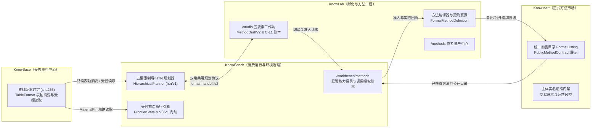
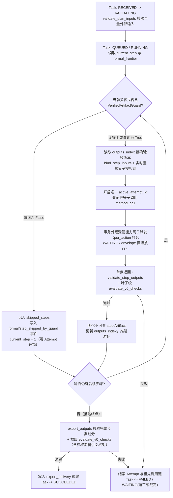

# 专家方法孵化与递归编排方案

本文是平台正式方法（工具方法与专家方法）契约定义、作者孵化、双端递归规划、受控前沿执行与统一市场闭环的唯一架构开发规范。配套交互与领域细化见[专家及专家团使用方案](../../专家使用方案/luna/专家及专家团使用方案.md)、[方法市场方案](../../专家市场方案/luna/方法市场方案.md)、[新财务专家孵化方案](新财务专家孵化方案.md)、[财务方法工具积木与模板提炼](财务方法工具积木与模板提炼.md)、[方法技能管理中心](../../../方法技能管理中心.md)与[连接器方案](../../../连接器方案.md)。

---

## 架构总览与设计原则

### 核心本体：统一方法模型

平台以**正式方法（Formal Method）**作为唯一可验证、可复用、可授权、可交易的业务能力单元。一切正式方法共享同一套外层契约结构、版本钉定规则、权限委派体系与公共调用账本，仅依据冻结定义中的内部做法（`procedure.kind`）划分为两类：

| 方法类别 | `method_kind` | `procedure` 判别式 | 定义与职责边界 |
| --- | --- | --- | --- |
| **工具方法** | `tool` | `ToolProcedure` (`kind: "direct"`) | 直接绑定单一受管技术实现源（受管 MCP/A2A 操作、受控隔离脚本、受控隔离指令或平台受管服务函数），是能力组合树的叶子节点；执行期间严禁再发起对其它正式方法的嵌套调用。 |
| **专家方法** | `expert` | `Orchestration` (`kind: "orchestration"`) | 由具名步骤构成的有向无环编排图，每个步骤恰好调用一个已准入冻结的工具方法或子专家方法；编排层只负责受控值传递、拓扑控制、确定性核验与角色隔离交接，严禁内嵌任意可执行业务代码。 |

多角色独立分析、盲审交叉复核、多级子专家递归委托均内化为专家方法 `Orchestration` 的局部编排拓扑与协作声明（`collaboration`），平台不单设第三类“专家团”契约，也不引入常驻模型的“团长”调度引擎。长期周期唤醒配置归属[连接器方案](../../../连接器方案.md#职责长期交代与周期唤醒)中的“职责”机制，每次唤醒均实例化为绑定精确方法版本的普通委托任务。

### “整体统摄局部”契约原则

架构采用**“五要素作者真源 + 程序实时派生两视图 + 双阶段宽进严出契约”**取代早期多级变量继承模板树、固定四框模板及按步骤类型拆分的零散表单：

1. **整体优先于步骤**：作者立项时首先确立方法整体的五要素契约骨架——**① 能力声明（`capability_declaration`）、② 所需权限（`access_requirements`）、③ 做法（`procedure`）、④ 结果校验（`how_to_validate`）、⑤ 审批要求（`what_requires_approval`）**；局部编排步骤、递归规划检索与运行期门禁均受整体五要素统摄。
2. **两视图纯函数派生**：对外调用所需的**公开输入视图（`public_inputs`）**与**返回产物视图（`what_to_return`）**完全由纯函数从五要素定义实时投影生成，禁止双份手写维护，从根源消除承诺、接口与步骤实现之间的脱节。
3. **双阶段宽进严出与公开安全脱敏**：创作期采用宽进草稿契约 `MethodDraftV2`（支持在尚未排定步骤前先行声明预期交付规格并保存中间进度），冻结期经编译器转化为严出不可变契约 `FormalMethodDefinition`（`knowlab/formal-method/v1`），面向市场与目录检索时再经单向投影输出零内部泄露的 `PublicMethodContract`。

### 四端职责边界与底层架构红线

四套应用严格遵循职责正交划分（`C-T1`）：



全链路开发与演进严守六条平台级架构不变量：

- **两层状态机不变量（`P0 / C-D11`）**：运行端严格维持 `Task` 与 `Attempt` 两层持久化状态机，零新增状态枚举；分支剪枝、前沿推进、盲审轮次及嵌套调用树统一收敛于 `pack_snapshot`、`execution_policy`、`Attempt.refs` 与 `Artifact` 账本。
- **后端零直调模型（`C-A9`）**：各应用后端进程均不直接请求外部大模型 API；HTN 规划轮次与受控指令型工具叶子一律经由受管沙箱会话或隔离指令网关按配额驱动与计量。
- **单任务单活跃尝试（`C-A10`）**：任一 `Task` 在同一时刻至多持有一个 `active_attempt_id`，通过确定性拓扑序与受控前沿游标（`current_step` + `formal_frontier`）逐步推进，不在单任务内并发分裂多个活跃 `Attempt`。
- **业务规则零内置与结构化作者溯源（`C-L1`）**：平台代码、词表预设与工程起草样板（`S1–S4`）仅承载通用工程结构，内置零行业主观口径与零财务判定阈值；所有非派生要素单元必须具备作者本人编辑或显式采纳的结构化出处记录（`knowbot_workdraft_entry`）。
- **主体资质门禁与输出合规风控（`C-L4 / C-L5`）**：公开挂牌强制核验发布主体实名认证及对应监管类目的有效证照（`PublisherLicense`）；方法输出在运行端 `V0` 门禁与市场端准入扫描双重拦截投资荐股及违规承诺词条。
- **跨服务调用禁持事务锁与契约单真源持锁**：严禁在打开数据库事务或行锁期间发起跨应用 HTTP 请求；跨仓共享结构遵循“唯一提供方脚本导出、消费方只读持锁、CI 字节级一致性门禁”。

---

## 一、统一方法契约模型：五要素、两视图与双态演进

### 1.1 方法分类、精确引用与不可变版本

每个正式方法拥有稳定的方法标识 `method_id: UUID`，每次通过准入核验并冻结后生成单调递增的整数版本号 `version >= 1` 及规范化定义摘要 `digest: sha256:<64hex>`。所有跨方法依赖、运行快照钉定与市场交付一律采用精确三元组 `MethodRef`：

```text
MethodRef = { method_id: UUID, version: int (>=1), digest: "sha256:..." }
```

- **版本不可变与升级隔离**：已冻结的 `knowbot_method_version` 严禁原位覆写。作者修订定义、更换实现源版本或调整步骤候选后，必须重新完成准入核验并冻结为 `head + 1` 新版本；在途委托任务与上层父专家继续钉定原 `MethodRef` 运行，绝不自动漂移至新版。
- **分类由冻结结构唯一决定**：编译器通过 `implementation_kind(definition.procedure.kind)` 判定 `tool` 或 `expert`。同一方法版本在不同调用上下文或条件分支下保持恒定类别；若将工具方法改造为多步编排（或反之），必须冻结为新版本并重核权限与市场类目。

### 1.2 受控层级语义词表与标准槽位预设

为消除步骤连线与跨方法检索时“只看基础 JSON 类型导致业务口径错配”或“自由手填字符串无法机器匹配”的缺陷，所有输入输出槽位 `ValueSlot` 统一采用**自包含 `Draft 2020-12` JSON Schema + 受控层级语义标识 `DomainId`** 双重约束。

#### 1.2.1 层级语义词表与前缀协变相容规则

语义字典 `meaning` 采用受控键 `domain_id`（正则 `^[a-z][a-z0-9_]*(?:\.[a-z0-9_]+){1,5}$`）与词表版本 `vocab_version: "1"`，内置通用工程域（`core.*`）与财务语义域（`fin.*`）纯结构目录 `SLOT_MEANING_CATALOG`：

| 域分组 | 受控 `domain_id` | 语义名称 | 说明 |
| --- | --- | --- | --- |
| `core` | `core.scalar.number` | 数值标量 | 通用有限数值参数或计算指标 |
| `core` | `core.scalar.ratio` | 比例或比率 | 无量纲比率、占比或变动率 |
| `core` | `core.scalar.text` | 纯文本参数 | 标识符、期间代码或受控文本输入 |
| `core` | `core.material.id` | 受管资料标识 | 指向 KnowBase 受管资料对象的引用标识 |
| `core` | `core.record.object` | 结构化记录 | 具名字段集合构成的单一业务对象 |
| `core` | `core.table.rows` | 结构化行集合 | 同构对象元素组成的二维表行数组 |
| `core` | `core.check.receipt` | 核验回执 | 含布尔通过结论、差异值与明细说明的回执结构 |
| `core` | `core.document.cited_markdown` | 带引文说明文稿 | 正文与精确受管资料定位引文数组绑定的文稿 |
| `fin` | `fin.amount.monetary` | 货币金额 | 携带金额数值、币种与可选期间的货币量 |
| `fin` | `fin.metric.ratio` | 财务比率指标 | 财务分析比率或增长率指标 |
| `fin` | `fin.statement.row` | 报表行项目 | 财务报表通用单行科目记录 |
| `fin` | `fin.statement.balance_sheet` | 资产负债表项目 | 资产负债表科目结构化数据 |
| `fin` | `fin.statement.income` | 利润表项目 | 利润表科目结构化数据 |
| `fin` | `fin.statement.cash_flow` | 现金流量表项目 | 现金流量表科目结构化数据 |
| `fin` | `fin.reconciliation.receipt` | 勾稽核验回执 | 跨表或表内勾稽恒等核验回执 |
| `fin` | `fin.disclosure.note` | 附注披露摘录 | 财报附注原文定位摘录与结构化要素 |

上游供给槽位 `provided` 与下游目标槽位 `target` 的语义相容性由纯函数 `slot_meaning_compatible(provided, target)` 判定：

1. **受控域前缀协变**：`provided.domain_id == target.domain_id`，或 `provided.domain_id` 以 `target.domain_id + "."` 为前缀（即更具体的子域产物可合法满足同族上层域输入要求，如 `fin.statement.balance_sheet` 可供给声明接收 `fin.statement` 的通用报表处理步骤，反之拒绝）。
2. **附加维度精确一致**：若目标槽位显式声明了 `currency`、`unit` 等附加语义属性，供给槽位必须逐键精确匹配，严禁隐式跨币种或跨数量级拼接。

#### 1.2.2 六类标准槽位预设与封闭本地 Schema 约束

平台提供 `build_slot_preset` 标准构造器，覆盖 `monetary_amount`、`ratio_or_rate`、`structured_record`、`tabular_rows`、`check_receipt`、`cited_markdown` 六种高频工程槽位预设，自动生成严禁额外未声明属性（`additionalProperties: false`）的规范 Schema。

所有 `ValueSlot(description, schema, required, meaning, on_missing)` 均强制执行以下封闭安全校验：

- **自包含本地解析**：Schema 树深度上限 `32`，序列化体积上限 `64000` 字节；禁止出现 `$id`、`$anchor`、`$dynamicAnchor`、`$dynamicRef`，`$ref` 仅允许以 `#/` 开头的文档内本地 JSON Pointer 且目标节点必须真实存在，杜绝孵化期与运行期发生任何外部网络 Schema 拉取。
- **缺失处置一致性**：`on_missing` 仅允许 `"pause"`、`"fail"`、`"omit"`；当 `required == True` 时严禁设为 `"omit"`，防止必填业务输入在缺失时被静默忽略。
- **物化槽位检索索引**：方法版本冻结落库时，其输入输出槽位同步展开写入 `method_version_slots` 表，建立 `btree ((meaning->>'domain_id') text_pattern_ops)` 前缀索引与 `gin (meaning jsonb_path_ops)` 索引，支撑毫秒级按交付域与输入域逆向检索。

### 1.3 双阶段契约演进与市场公开投影

方法全生命周期通过三层强类型契约模型衔接创作、执行与市场交易：

| 阶段模型 | 契约标识 | 核心职责与约束强度 |
| --- | --- | --- |
| **编辑态宽进草稿** `MethodDraftV2` | `knowlab/method-draft/v2` | 承载作者工坊全过程编辑状态。支持要素 ① 通过 `expected_deliverables` 独立于要素 ③ 先行落盘；支持保存未闭合草稿与待确认路径列表 `unconfirmed_paths`；内置 `S1–S4` 纯工程起草样板。 |
| **冻结态严出定义** `FormalMethodDefinition` | `knowlab/formal-method/v1` | 编译、准入核验、版本冻结与运行派发的唯一权威契约。强制 `unconfirmed_paths` 清零、要素 ③ 完整无环、要素 ① 承诺与要素 ④ 校验规则精确双射、导出产物满足预期语义域协变。 |
| **市场公开投影** `PublicMethodContract` | 由 `extract_public_contract` 派生 | 面向 KnowMart 商品详情、目录检索与 KnowBench 选法摘要展示的脱敏契约。完整呈现公开能力边界、两视图槽位摘要、`V0` 核验算子类型、独立盲审标记与逐次审批数，零泄露内部步骤图、私有子方法引用、脚本代码与指令正文。 |

为解决冷启动立项问题，平台提供四类不含任何行业主观阈值的纯工程起草样板（`build_engineering_archetype`）：

- **`S1`（确定性核算与核验）**：预置结构化核验回执槽位（`core.check.receipt`）与 `schema_and_range` 基础 `V0` 门禁，适用于参数计算、表内小计与跨表勾稽。
- **`S2`（受管资料解读与带引文交付）**：预置带引文文稿槽位（`core.document.cited_markdown`）及 `sourced_citation + prohibited_terms` 双 `V0` 门禁，适用于基于获权资料的摘录、归纳与说明。
- **`S3`（主笔成稿与独立盲审复核）**：预置主笔成稿与独立复核双轨验收框架及合规禁词扫描，适用于高严谨度交叉核验场景。
- **`S4`（核验门禁后逐次审批外部动作）**：预置外部动作回执槽位（`core.record.object`）、失败暂停策略（`on_failure: "pause"`）与单步审批框架，适用于外发通知、写库或提交外部单据。

样板生成的占位说明文本在创建时全部列入 `unconfirmed_paths`，作者未逐项改写或显式确认前，系统禁止提交准入验证或冻结发版。

### 1.4 五要素逐项结构规范

#### 1.4.1 要素 ①：能力声明（`capability_declaration`）

`CapabilityDeclaration` 回答“这个方法解决什么问题、承诺交付什么、在什么边界内成立”：

- `title` 与 `purpose`：方法名称及面向委托人的业务目的陈述。
- `applies_when`（`1..30` 条）与 `excludes`（`0..30` 条）：显式列明成立前提与不承接边界（如缺失原始披露时不作主观推算、不提供证券买卖建议）。
- `promises: dict[Name, Text]`（`1..30` 项）：具名交付承诺字典，每个键 `promise_id` 代表一项可独立核验的业务承诺。
- `conditions: dict[Name, PromiseCondition]`（可选）：针对按条件交付的承诺，声明触发条件描述 `when` 及依赖的公开输入槽位元组 `input_slots`（必须严格引用生成的 `public_inputs` 槽位名）。在编辑态 `MethodDraftV2` 中，由 `ExpectedDeliverableSpec(promise_id, summary, expected_domain_id, expected_schema, delivery_mode, condition_input_hint, condition_description)` 承载，并在 `to_definition()` 时编译收敛为正式 `promises` 与 `conditions`。

<a id="16-权限要求审批与运行授权"></a>

#### 1.4.2 要素 ②：所需权限（`access_requirements`）与连接委派上限

`access_requirements` 声明方法运行所需的受管能力上限集合（`tuple[AccessRequirement, ...]`），所有条目均受 KnowBench 唯一真源导出的受管能力目录（`managed_capabilities_generated.py`）强类型校验：

- **受管能力范围**：统一覆盖三类受管能力通道——外部连接器操作（`connector`，含受管 MCP 与 A2A 操作）、知识库受控读取（`knowbase` 的 `read_method_input`）以及受控沙箱隔离脚本执行（`isolated-script` 的 `execute`）。
- **细粒度权限维度**：每条 `AccessRequirement` 明确 `requirement_id`、`capability_ref`、`version`、允许的操作集合 `operations`、资源角色范围 `resources(resource_kind, resource_role, values)`、数据流向声明 `data_transfer(destination, purpose, argument_fields)` 以及需求时机 `required_when: "always" | "when_selected"`。
- **组合上卷与命名隔离**：工具方法的 `implementation.requirement_ids` 必须与自身声明的 `access_requirements` 精确相等；专家方法在组合多个步骤时，按 `<step_id>__<requirement_id>` 命名空间前缀汇总子方法的权限声明，避免多步复用同一连接器时的标识冲突。
- **私有内部叶子随公开专家整体交付规则**：同一作者名下已完成实跑核验且无未覆盖承诺（`execution != None` 且 `uncovered` 为空）的私有直接工具方法（`registered_script`、`registered_instruction`、`service_function`），虽自身保持 `visibility: "private"` 不单独在公开工具市场售卖，但允许被该作者本人的 `public` 专家方法作为内部步骤合法引用（`_allow_private_internal_leaf`），外部使用者仅获取整体专家交付服务而无法拆出或读取内部私有实现。

<a id="14-调用来源实现与-mcpskill"></a>

#### 1.4.3 要素 ③：做法（`procedure`）与工具实现载体

`procedure` 以 `kind` 判别式严格区分直接工具实现与专家编排图：

1. **工具方法做法（`ToolProcedure`，`kind: "direct"`）**：
   - 包含便携式实现引用 `implementation: ImplementationRef(kind, source, version, digest, entry, requirement_ids)`、输入槽位字典 `inputs`、输出槽位字典 `outputs`（至少 1 项）、执行说明 `instructions`、停止条件 `stop_conditions` 与模型轮次上限 `max_model_turns`。
   - **载体分类与有界推理铁律**：`kind` 支持 `mcp`、`a2a`、`skill_script`、`registered_script`、`skill_instruction`、`registered_instruction`、`service_function`、`platform`。其中确定性工具（连接器、隔离脚本、受管服务函数）强制 `max_model_turns == 0`；仅指令型载体（`skill_instruction`、`registered_instruction`）允许分配有界模型轮次（作为宿主固定计划叶子调用时强制 `max_model_turns == 1`），在无工具、无任意 Shell/Python 执行权的隔离推理网关中按输入槽位生成符合输出 Schema 的结构化结果。
   - **来源钉定与发行条款**：准入草稿 `FormalMethodDraft` 中的 `FormalMethodSource` 与 `ImplementationRef` 逐字段精确对齐，记录许可依据 `license_basis`；基于已安装 Skill 转化并拟公开发布的工具方法，必须附带经运营审核通过的 `SkillDeliveryTerms(origin, notices)`。
2. **专家方法做法（`Orchestration`，`kind: "orchestration"`）**：
   - 包含总体编排说明 `instructions`、有向无环步骤元组 `steps: tuple[MethodStep, ...]`、公开导出映射 `exports: dict[Name, Export]`、子树硬限额（`max_depth`、`max_expansions`、`max_steps`、`max_replans`），以及可选的根级批处理配置 `object_batch` 与局部协作角色配置 `collaboration`。步骤原语与值绑定规则详述于第二章。

#### 1.4.4 要素 ④：结果校验（`how_to_validate`）与五类确定性 `V0` 算子

`how_to_validate` 是与要素 ① `promises` 严格双射（每个承诺必有一条校验规则，每条规则必指向一个已声明承诺且绑定至少一项生成公开输出）的验收契约 `ValidationRule(promise_id, outputs, check, evidence, on_failure, v0_checks)`。

除记录自然语言验收判据 `check` 与证据说明 `evidence` 外，每条规则可声明最多 16 项由宿主在零模型参与下确定性执行的 **`V0` 核验算子（`V0CheckSpec`）**：

| `V0` 算子 `kind` | 模型类 | 确定性核验逻辑 |
| --- | --- | --- |
| `schema_and_range` | `SchemaRangeCheck` | 按本地 JSON Pointer 定位输出字段，校验非空性（`non_empty`）、受控枚举值域（`allowed_values`）及有限数值上下界（`min_value`、`max_value`）。 |
| `numeric_identity` | `NumericIdentityCheck` | 跨输入与输出上下文（`{"inputs": ..., "outputs": ...}`）解析左右两侧 JSON Pointer 数值，强制校验恒等关系 $|lhs - rhs| \le tolerance$（覆盖表内合计、跨表勾稽与重算一致性）。 |
| `sourced_citation` | `SourcedCitationCheck` | 校验指定输出路径下的 `citations` 数组非空，每条引文均具备非空 `material_id` 与原文定位 `locator`，且引用的 `material_id` 严格属于本次委托已授权的受管资料集合（及指定资料输入槽位交集），阻断伪造出处或越权引用。 |
| `collection_coverage` | `CollectionCoverageCheck` | 针对多主体批处理或清单核对输出，提取 `items_pointer` 数组中各元素的 `key_field`，校验主键无缺失、无重复，且集合与调用方输入槽位 `expected_keys_input_slot` 完全相等，杜绝漏项交付。 |
| `prohibited_terms` | `ProhibitedTermsCheck` | 对目标输出文本或序列化 JSON 扫描平台内置合规禁词表 `DEFAULT_PROHIBITED_TERMS`（如买卖推荐、保本承诺、目标价位等 `C-L5` 红线词条）及方法附加禁词 `extra_terms`，命中即判不通过。 |

#### 1.4.5 要素 ⑤：审批要求（`what_requires_approval`）与两级审批作用域

`ApprovalRule(requirement_id, operations, when, preview, on_denied, scope)` 必须指向要素 ② 已声明的权限项及其操作子集，并按操作副作用边界划分为两级审批作用域（`scope`）：

- **`envelope`（委托包络预授权）**：适用于纯计算隔离脚本执行、已钉定 `sha256` 摘要的 KnowBase 受管资料读取以及受控单轮模型推理。委托人在执行准备页确认 `ConsumerPlan` 时一次性审阅范围并完成包络授权（`envelope_approved: true`）；运行期只要实际调用摘要、资料版本与预算未超出已确认包络，宿主直接放行并记入审计事件，不在中途反复弹出低风险确认框。
- **`per_action`（逐次单步强审批，默认值）**：适用于一切外部写操作、消息/邮件外发、外部系统建单或资金/权限变更动作。即使委托人已确认整体执行计划，运行推进到该步骤实际派发前仍强制挂起 `Task` 至 `WAITING` 状态并创建 `Interaction`，向委托人展示真实目标连接账号、接收方与参数预览字段（`preview`），仅对当次精确参数摘要单次生效，拒绝或超时按 `on_denied` 暂停或终止。

### 1.5 程序实时派生的两视图与跨要素联动投影

`FormalMethodDefinition.interfaces()` 与 `project_contract_state()` 构成跨要素一致性守恒纯函数：

1. **公开输入视图（`public_inputs`）派生规则**：
   - 工具方法直接映射 `procedure.inputs`；
   - 专家方法遍历全部步骤输入，仅提取绑定源为 `CallerValue`（若挂有裁剪透镜则暴露其 `caller_slot`）或 `ObjectItem`（自动按 `max_objects` 投影为去重字符串标识数组 Schema）的外部参数，汇总记录 `used_by` 与必填步骤列表 `required_by`（仅当 `slot.required` 且 `step.always_required` 时列为无条件必填）；
   - 多个步骤共享同一外部参数名时，其槽位 Schema 与语义字典必须逐字一致，严禁同一公开参数名暗中合并相异结构或业务口径。
2. **返回产物视图（`what_to_return`）派生规则**：
   - 工具方法直接映射 `procedure.outputs`；
   - 专家方法严格按 `procedure.exports` 映射对应步骤的具名输出槽位及 `always_present` 属性，未列入 `exports` 的内部中间步骤产物对上层调用方完全隐藏；
   - 在编辑态早期（`MethodDraftV2.procedure is None`），`project_contract_state` 从要素 ① `expected_deliverables` 自动生成带 `preview_from_declaration: true` 标记的预览交付视图，确保契约立项首屏即可审阅完整两视图。
3. **七项闭合门禁实时核算**：`project_contract_state` 实时计算 `declaration_complete`、`provenance_confirmed`、`access_aligned`、`procedure_present`、`deliverables_aligned`、`validation_bound`、`approval_classified` 七项布尔检查及未对齐承诺列表 `missing_promise_sources`，全部通过时 `ready_to_freeze` 方为真。

### 1.6 结构化 `C-L1` 出处账本与工作稿持久化

KnowLab 在既有 `knowbot_workdraft` 与 `knowbot_workdraft_entry` 表上原位承载五要素创作状态，保持 `knowbot_method_version.source_workdraft_id` 外键链路完整：

- **方法先行持久化结构**：`knowbot_workdraft` 支持 `request_id` 可空（立项编辑期无需预先创建运行请求，首次发起准入验证或试跑时由 `ensure_runtime_anchor` 惰性挂载自用模式锚点 `RequestRecord`），并持久化 `method_id`、`draft_contract`（`MethodDraftV2` JSON）、`htn_state`（规划树快照）与 `parent_gap`（分形父缺口溯源链接）。
- **语义路径级不可变溯源**：`MethodDraftService` 将非派生定义拆分为 `element:declaration`、`element:access_ceiling`、`element:procedure`、`element:validation_rules`、`element:approval_rules` 及编译态 `formal_method` 等独立语义单元，对每次变更写入绑定作者身份的不可变 `knowbot_workdraft_entry`：
  - 作者手写或复制修订记为 `kind: "edit"`（来源标记 `user_text`）；
  - 采纳 HTN 规划提案或跨端交接草稿记为 `kind: "accept"`（来源标记 `user_confirmed`，强制校验非空 `suggestion_ref`，如 `handoff:<sha256>`）。
- **双重门禁校验与软退役保护**：`FormalMethodService._prepare` 在提交验证、有界试跑与版本冻结前，强制校验 `MethodDraftV2.to_definition().digest() == body.formal_method.definition.digest()` 且 `verify_provenance` 零异常。作者删除未冻结草稿时执行软退役（`retire_method_workdraft`：清空 `draft_contract`、递增 `revision` 并解除关联子草稿的 `parent_gap`），既从活跃草稿列表移除，又完整保全已发布历史版本的审计外键。

---

## 二、局部编排原语、封闭值处理与双端共用 HTN 递归规划

### 2.1 步骤结构与封闭四项值处理规则

专家方法 `Orchestration` 中的每个步骤 `MethodStep` 声明唯一 `id`、候选方法引用 `candidates: tuple[MethodRef, ...]`、显式前序依赖 `depends_on`、是否无条件必跑 `always_required`、输入绑定字典 `inputs: dict[Name, StepInput]`、输出槽位 `outputs` 及失败处置 `on_failure`。

为保证编排图完全可静态分析、可核权且不含隐藏业务规则，步骤间与父子间的值传递严格封闭为以下四项确定性操作，严禁任意算术运算、字符串模板拼接、条件表达式或脚本注入：

1. **无副作用宽度投影与重命名透镜（`ProjectionLens`）**：
   - 支持从源对象（或对象数组的元素）中挑选字段子集 `pick_fields` 并将指定源字段重命名为目标字段 `rename_fields`（禁止字段重名碰撞或引用不存在的源属性）。
   - 编译期由 `project_schema(source_schema, lens)` 确定性推导投影后的 JSON Schema，校验其与目标输入槽位精确相等且 `slot_meaning_compatible` 成立；运行期由 `apply_projection_lens` 执行深拷贝投影。凡涉及单位换算、科目合并、口径重算等实质转换，必须显式排入一个已孵化的转换工具方法步骤。
2. **受控判别联合来源绑定（`InputSource`）**：
   - `CallerValue(source="caller", name, lens, caller_slot)`：读取调用方传入的公开参数；
   - `StepValue(source="step", step, output, lens)`：读取显式声明在 `depends_on` 中的前序步骤已验收具名产物（可选产物不得直接绑定至下游必填输入槽）；
   - `LiteralValue(source="literal", value)`：绑定编译期通过目标槽位 Schema 与有限 JSON 核验的固定常量；
   - `ResourceValue(source="resource", requirement_id, role)`：指向要素 ② 已声明的权限资源角色；
   - `ObjectItem` 与 `ObjectRows`：专用于有界批处理映射（见 §2.2）。
3. **带状态多路结果收集包（`CollectPack`）**：
   - `CollectPack(source="collect_pack", items: tuple[PackMember, ...])` 将多个前序分支的具名产物按互异标签 `tag` 打包为结构化数组：运行期对已执行分支填入 `{"tag": tag, "status": "present", "value": ...}`，对受条件守卫合法跳过的分支（须显式声明 `allow_skipped: true` 且目标槽位值 Schema 允许 `null` 联合类型）填入 `{"tag": tag, "status": "skipped", "value": null}`，使下游汇总方法能明确区分“条件未触发跳过”与“前序执行异常”。
4. **多步骤独立公开导出（`exports` 与 `deliver_as`）**：
   - `Orchestration.exports: dict[Name, Export(step, output, always_present)]` 允许将编排图中任意多个不同步骤（包括中游核验步骤与末端成稿步骤）的具名产物直接导出为专家对外返回槽位，无需为透传前序回执而克隆修改末端工具的输出接口。声明 `always_present: true` 的导出项强制要求源步骤 `always_required == True` 且源输出槽 `required == True`。

### 2.2 四正交控制原语与可组合局部盲审复核

编排引擎提供四项正交拓扑控制原语，外加一项与拓扑解耦的局部协作复核机制：

| 原语或机制 | 契约表达 | 编译与运行语义 |
| --- | --- | --- |
| **顺序串联** (`sequence`) | 下游 `depends_on` 含前序步骤，输入采用 `StepValue` | 前序步骤产物通过 Schema 与 `V0` 核验落盘后，精确版本绑定至下游输入。 |
| **并行分叉与汇合** (`parallel_join`) | 多个互不依赖前序步骤共同喂给真实下游消费步骤（或 `CollectPack`），或根级多独立交付 `exports` | 无依赖步骤逻辑并行、运行期按确定性拓扑序推进；若委托要求多个彼此独立的交付结果且无需合并成单一文稿，直接按独立导出映射各自交付，不伪造空壳汇总步骤。 |
| **受控条件分支** (`branch`) | ① 调用方精确路由 `CandidateChoice(input, cases)`；<br>② 前序产物守卫 `VerifiedArtifactGuard(step, output, pointer, op, value)` | ① `CandidateChoice` 依据必填调用方字符串参数精确匹配唯一冻结候选 `MethodRef`（编译期静态核验全部分支候选）；<br>② `VerifiedArtifactGuard` 在前序步骤验收后无模型求值八种确定性谓词（`eq/ne/gt/gte/lt/lte/in_set/is_present`），未命中时将步骤标记跳过而不派发执行。 |
| **有界集合映射** (`bounded_loop / map`) | 根级二步 `Orchestration.object_batch` 或多步 DAG 内局部 `MethodStep.step_batch` (`max_objects: 1..99`) | 准备期 `expand_batch / expand_step_batches` 校验调用方传入的非空去重字符串标识清单，展开为确定性实例节点 `obj_<sha256>`（绑定 `BatchItem`），并将下游收集步骤的 `ObjectRows` 重写为保序 `BatchRows`（输出 `[{object_id, value}]`）。跨轮次状态累积 `fold / while` 必须封装在已独立孵化的工具或子专家内部，不在编排层动态循环。 |
| **局部独立盲审与返工** (`collaboration`) | `CollaborationRoles` 声明 `isolation_group`、`handoff_from`、`review_requirements` (`isolated_reviewer` / `different_model_family`) 与 `ReviewComparison(assessment_output, max_reworks=0..2)` | 支持嵌入任意多步 DAG 的局部子图（单主笔单复核，或双独立主笔汇合复核）。主笔先过 `V0` 确定性门禁（未过则零派发复核）；严格对照明审模式由 `strict_plan` 自动展开 `blind` → `comparison` → 可选 `revision` 阶段，强制跨沙箱线程/工作目录及可选跨模型家族物理隔离。 |

**严格两阶段盲审与有界自动返工流程**：当复核角色配置 `ReviewComparison` 时，主笔步骤必须同时输出业务成稿与独立的自评疑点槽位（`assessment_output`）：

1. **盲审封存阶段（`phase: "blind"`）**：宿主构造复核输入时物理剔除主笔的 `assessment_output`，复核方法在完全不可见主笔自评疑点、不可见主笔推理线程与临时文件的隔离环境中独立审阅成稿并封存发现产物。
2. **解封对照阶段（`phase: "comparison"`）**：宿主将已封存的独立发现（`finding_*`）连同主笔 `assessment_output` 一并注入复核角色，产出对照结论及结构化布尔字段 `needs_rework`。
3. **预算内有界返工与人工裁定（`phase: "revision"`）**：若 `needs_rework == True` 且当前迭代未超 `max_reworks`（上限 2 次）及任务剩余预算，运行端通过 `formal_review_rework` 将前次成稿（`prior_*`）与复核反馈（`feedback_*`）回传主笔重修并进入下一轮盲审；若达最大返工次数仍未收敛，任务转入 `WAITING` 状态并生成委托人裁定交互（`ADJUDICATE` / `CHANGE_ROUTE`），绝不静默放行带未决缺陷的成稿。

<a id="211-孵化与即时编排共用的递归规划"></a>

### 2.3 孵化与即时编排共用的五要素制导 HTN 递归规划

KnowLab 作者辅助编排（`INCUBATE` v2）与 KnowBench 使用者任务受理及即时自组（`FIND_EXPERT` v7）共用同一套五要素制导的层次任务网络规划器 `HierarchicalPlanner`（协议标识 `htn/v1`）。

#### 2.3.1 双端统一状态机与配额边界

| 维度 | KnowLab 作者孵化（`INCUBATE` v2） | KnowBench 即时受理与自组（`FIND_EXPERT` v7） |
| --- | --- | --- |
| **制导输入来源** | 作者草稿已填写的五要素指导（`target_deliverables`、`allowed_capabilities`、表轴摘要）与创意/修订指令 | 委托人当次问题描述、澄清答复、授权目录快照与已授权资料表轴摘要 |
| **候选目录范围** | 作者本人已冻结正式方法、已获孵化引用许可的共享工具、同源待测指令草案 | 委托人当前享有有效调用资格（自有或已从市场获取且未撤权）的冻结专家与工具方法 |
| **规划树硬限额** | 最大深度 `3`（局部节点拆分编辑时按节点层级顺延），最多 `12` 个节点（局部拆分编辑 `16` 个），最多 `24` 轮调用 | 最大深度 `2`，节点上限 `CONSUMER_MAX_NODES`，调用轮次上限 `CONSUMER_MAX_TURNS` |
| **规划产物去向** | 写入 `knowbot_workdraft.htn_state` 并投影为待作者审定确认的要素 ③ 编排图或分形缺口 | 命中单一专家则进入标准委托准备页；形成多步临时组合则生成 `ConsumerPlan(temporary=True)` 供确认执行，或经交接契约转孵化/提需求 |

#### 2.3.2 逆向超图可达性标注、表轴只读摘要与首轮 Top-K 预披露

规划器初始化时执行三项零模型开销的宿主预处理，大幅压缩无效探索轮次：

1. **逆向超图语义可达性（`_rank_by_target_domains`）**：对照目标交付物的 `expected_domain_id`，在内存中对获权目录做两跳逆向超图扫描——输出槽语义直接相容的候选标为 `direct_deliverable`，输出槽可供给 `direct_deliverable` 所需输入域的候选标为 `upstream_producer`，其余标为 `available`，并在目录索引中按可达性优先级排序。
2. **首轮 Top-K 契约预披露（`_pre_disclose_top_k`）**：将用户显式点名的方法（`chosen_method`）以及排名前列的 `direct_deliverable / upstream_producer` 完整接口契约，在 `16000` 字节（`TOP_K_PRE_DISCLOSURE_BYTES`）预算内直接注入首轮上下文窗口 `shown`，使常见单专家命中或两步组合无需额外耗费 `inspect` 轮次即可一轮成图。
3. **KnowBase 只读表轴摘要注入（`table_axes`）**：对于已授权的结构化表格资料，宿主仅注入 KnowBase 解析阶段提取的 `TableFormat` 元数据摘要（列名、推断数据类型、期间范围与主体键概览），既让规划器准确判断字段完备性与投影透镜写法，又严防规划阶段读取全量业务行数据。

#### 2.3.3 节点决策动作、LRU 契约窗口与禁忌防环

规划器每轮针对当前待解目标节点输出唯一结构化 JSON 决策（`DECISION` 判别联合）：

- **`inspect`**：点名查阅 `1..8` 个目录别名的方法完整契约。宿主维护上限 `128000` 字节（`DISCLOSURE_BYTES`）的 LRU 契约滑动窗口 `shown`，并通过 `compact_schemas` 将长度达到阈值的重复 JSON Schema 子树提取为 `$planning_part` 共享片段（若原 Schema 自身含同名键则原样保留以防歧义）。
- **`hit`**：当前目标可由目录中单一已准入方法完整承接（含适用前提、交付承诺与排除边界），直接锚定叶节点步骤。
- **`split`**：当前目标需多步协作完成。模型必须先将当前层的末端消费者或收集器锚定到一个真实获权方法，再按 `sequence`、`parallel_join`、`branch` 或 `bounded_loop`（`map` 模式强制原样引用委托人明确约定的数量上限 `limit_evidence`）派生更小的子目标 `children`，显式标注跨分支共享的外部数据源 `shared_inputs` 及多步独立公开导出 `deliver_as`。
- **`separate`**：当根请求要求多项彼此独立的交付结果且无需拼成单一综合报告时，在根节点 `n1` 将各公开导出名直接映射为独立子目标并分别为其绑定 `deliver_as`，禁止凭空捏造不存在的汇总器。
- **`clarify` 与 `gap`**：当存在影响选法的真实人类未决选择（`pending_choice`，如口径版本、责任主体或期间范围未定）或消费者分页目录需按 `search_goal` 补充检索时返回 `clarify`；当完整获权目录内确无能够生产目标产物的合格能力时如实返回 `gap`，严禁让模型自行编造工具或用提问掩盖能力缺失。

**防死循环与局部增量修订保护**：宿主对每次未通过静态契约检查的提案提取规范化签名记入该节点的 `tabu_signatures`（上限 16 条）并触发单节点回溯；当作者或委托人针对特定子树发起修订（如 `[n1_2] 改用按季口径`）时，`restore()` 保留其余已验证子树并按精确内容指纹（`pins`）重绑目录别名——若目标修订节点在最新规划树中已不存在，则标记 `stale_edit = True`，零 Token 消耗直接返回修订基线冲突提示。

#### 2.3.4 纯净封存规划线程与流式预算硬熔断

所有 HTN 规划与匹配任务均由 `is_sealed_planning` 强制纳入纯净封存执行边界：

- **无状态封存上下文（`SEALED_INPUT`）**：每次规划使用独立新建的无历史记忆线程与空隔离目录，禁止加载用户会话自由安装的外部插件、禁止读写沙箱文件、禁止发起任何外部工具调用，候选目录文本一律作为不可执行纯数据注入。
- **盘中流式预算熔断（`LookupGuard`）与剩余时限保护**：模型流式输出期间，`LookupGuard(remaining)` 实时累加底层推理用量并比对任务剩余预算，一旦超限立即主动中断底层流并安全结案；每轮开始前校验任务剩余可运行时间不低于 `MIN_HTN_TURN_SECONDS`（`25.0` 秒），不足时立即持久化当前 `PlanningTree` 检查点退出，杜绝长尾轮次因超时产生半截无效状态。

<a id="2114-可编译范围与演进顺序"></a>

#### 2.3.5 可编译范围与规划出口判定

规划树全部节点收敛后，后序遍历生成 `Selection` 提案，由宿主依次执行 `check_proposal`（核验目录别名、分支路由输入、批处理键值契约、独立复核隔离资格与投影透镜合法性）及 `check_delivery_targets`（核验要素 ① 每项预期交付物均有语义相容的公开导出源），按确定性规则进入四类出口：

| 规划出口 | 成立条件 | 宿主后续动作 |
| --- | --- | --- |
| **成图就绪** | 全部目标节点均为 `hit / split / separate` 且通过 `check_proposal` 与交付目标对齐核验，无未决人类选择 | KnowLab 投影写入工作稿供作者审定确认；KnowBench 进入委托准备确认页。 |
| **局部回溯续跑** | 某节点提案违反槽位契约、权限上限或禁忌签名，且节点回溯次数与全局轮次/预算仍有余量 | 记录 `tabu_signature` 重置该节点子树，在同一封存会话预算内继续下一轮。 |
| **等待澄清或补查** | 节点返回合法 `clarify`（含真实人类未决项，或部分目录待扩展检索） | 持久化规划树快照与已核实上下文，向作者或委托人展示结构化追问；收到答复后仅重算受影响子树。 |
| **保留缺口终止** | 完整目录内确缺必需方法（`gap`）、目标修订基线失效（`stale_edit`）或达到轮次/预算上限 | 如实保存已完成子树与精确缺口契约说明，在 KnowLab 支持一键派生子方法草稿，在 KnowBench 支持转工坊孵化或转市场提需求。 |

### 2.4 分形缺口原位派生与跨端交接闭环

1. **工坊内分形缺口孵化（`spawn_gap_child` → `bind_gap_resolution`）**：
   - 当父专家编排图某一步骤缺少现成工具或子专家时，作者在 `/studio` 直接对该步骤调用 `spawn_gap_child`。系统自动提取父步骤已声明的输入槽位与输出槽位，生成预填 `expected_deliverables`、对应 `ValidationRule` 及 `parent_gap` 血缘指针的子方法 `MethodDraftV2` 草稿。
   - 作者完成子方法的实现绑定、准入核验与版本冻结后，调用 `bind_gap_resolution` 将子方法的精确 `MethodRef` 钉回父草稿对应步骤的 `candidates` 槽位，自动触发父草稿 `project_contract_state` 重算闭合状态。
2. **KnowBench ⇄ KnowLab 正式交接契约（`knowbench/formal-handoff/v2`）**：
   - 当 KnowBench 受理委托遇到能力缺口，或委托人希望将经过当次执行验证的即时自组计划（`TemporaryPlanning`）沉淀为可复用的正式专家版本时，前端经预览确认后封装 `HandoffSeedIn(contract="knowbench/formal-handoff/v2", title, goal, archetype, method_kind, draft_contract, htn_state, origin)` 交接至 KnowLab `create_from_handoff`。
   - KnowLab 按交接包内容计算规范化摘要并登记 `suggestion_ref: "handoff:<digest>"` 出处；若目标 `method_id` 下已存在作者正在编辑的活跃草稿，系统原样返回既有草稿，绝不用运行端回流覆盖作者未发版的手工修改。无派生权限的使用者则可携带脱敏后的能力需求摘要一键跳转 KnowMart 需求大厅发布定制悬赏。

<a id="author-patterns"></a>

### 2.5 典型编排拓扑与作者草图构造范式

以下五类标准工程组合范式供作者在 `/studio` 构建编排图与 AI 辅助起草时对齐结构边界；所有范式均在同一 `Orchestration` 契约与受控前沿引擎上运行：

| 范式名称 | 典型业务场景 | 拓扑与值绑定构造方式 | 作者审定与治理要点 |
| --- | --- | --- | --- |
| **P1：前序取数与确定性转换** | 原始披露表格或外部连接器数据口径与下游核算工具输入不一致 | `read_step -> transform_step -> calc_step`（`sequence`）；纯字段裁剪/改名直接挂 `ProjectionLens`，涉及科目映射或单位换算排入独立确定性工具方法 | 核对转换工具无隐藏主观假设，外部参数仅暴露首次原始输入，不让委托人重复填写中间结果。 |
| **P2：多源并行采集与带状态汇合** | 同时核对多张报表或多路外部数据源并出具综合勾稽结论 | 多路采集步骤无相互依赖，下游核验步骤通过多端口 `StepValue` 或 `CollectPack` 接收全部前序产物；若仅需分别返回多份独立结果则直接配置多键 `exports` | 区分“必须合成一份结论”与“独立并列交付”；含条件采集分支汇入 `CollectPack` 时显式开启 `allow_skipped`。 |
| **P3：调用方判别路由与产物守卫分流** | 按准则口径切换不同核算方法，或仅在初审发现异常差异时触发深挖步骤 | 准则切换采用 `CandidateChoice` 绑定调用方必填枚举字符串；异常触发深挖采用 `VerifiedArtifactGuard`（如差异金额 `gt` 容差阈值）修饰 `always_required=False` 步骤 | 核对所有分支候选的权限均已上卷至要素 ②（条件步骤对应 `when_selected`），且无条件公开导出不依赖可能被跳过的步骤。 |
| **P4：有界多主体批处理映射** | 对同一批可比公司、多期报表或多个业务单元执行同构核算并汇总对比 | 根级二步采用 `Orchestration.object_batch`，复杂多步图内局部批处理采用 `MethodStep.step_batch`；工作步绑 `ObjectItem`，下游收集步绑 `ObjectRows` | 明确设定 `max_objects`（`1..99`）与缺项策略 `on_missing`，并在要素 ④ 配置 `collection_coverage` 算子防止漏算个体。 |
| **P5：主笔 `V0` 门禁 + 独立盲审与有界返工** | 严肃分析报告或重大判断需防止单一模型顺着主笔盲区自圆其说 | 主笔指令方法同时输出正文与 `assessment_output`；`collaboration` 为复核步骤配置 `isolated_reviewer` 或 `different_model_family` 及 `ReviewComparison(max_reworks=0..2)` | 主笔必须先绑定 `sourced_citation / numeric_identity / prohibited_terms` 等 `V0` 算子拦截硬伤，再进入独立盲审，控制最大返工轮次与预算上限。 |

---

## 三、编译验证、受控前沿递归执行与调用治理

<a id="164-组合检查与验收"></a>

### 3.1 编译期包络静态验证与权限收敛检查

方法版本在准入验证、试跑与冻结前，必须通过纯函数编译器 `compile_method` 与最坏包络静态验证器 `verify_envelope_graph` 的全量检查：

1. **无环性与全局包络硬上限**：
   - 沿调用图深度优先遍历全部步骤的全部候选引用（`step.candidates`），任何直接或间接自引用立即报错阻断；
   - 结合批处理乘数（`step_batch.max_objects` 或 `object_batch.max_objects`）静态核算最坏情况下的调用树深度、总展开节点数与实际工具叶子调用总数，强制满足：**调用树深度 $\le 16$、总展开节点 $\le 1000$、实际工具叶子调用总数 $\le 100$**，且不得超出任一祖先方法自身声明的 `max_depth / max_expansions / max_steps`。
   - 同一方法版本 `(method_id, version)` 在整棵依赖闭包内若被多处复用，其 `digest` 必须完全一致，严禁同名同版携带相异摘要。
2. **步骤接口契约守恒（`_step_interface`）**：
   - 子方法全部无条件必填公开输入必须被父步骤显式绑定，且父步骤不得绑定子方法未声明的输入端口，也不得将子方法的必填槽弱化为可选槽；
   - 输入与输出端口的 JSON Schema 必须精确一致（经 `ProjectionLens` 投影后），且语义字典满足 `slot_meaning_compatible`；
   - 子方法的条件性输出（`always_present == False`）在父步骤中严禁升级承诺为无条件必出（`required == True`）。
3. **父子权限包络收敛（`_permission_ceiling`）**：
   - 子方法声明的每一条 `AccessRequirement`，都必须在直接父方法的 `access_requirements` 中找到**单一一条**完整覆盖它的上限声明（`capability_ref`、`version`、数据外发 `destination` 与 `purpose` 完全相同，`operations`、`argument_fields` 与各资源角色的 `values` 均为父声明的子集，且必做步骤的子方法 `always` 权限在父方法上亦须为 `always`）。严禁靠拼凑父方法的多条不同账号或不同用途声明来凑齐单个子需求。

### 3.2 受控前沿惰性递归执行引擎

KnowBench 通过 `FormalOrchestrationExecution` 在既有 `Task / Attempt / Artifact` 账本上驱动固定计划、条件分支包络图、有界批处理图、严格盲审图及多层嵌套专家调用树：



执行引擎保持以下核心确定性保障：

- **受控前沿状态（`FrontierState`）与精确产物版本读取**：`Task.execution_policy.formal_frontier` 持久化维护已跳过步骤列表 `skipped_steps` 与已验收步骤产物索引 `outputs_index`。每个完成的步骤将其输出固化为 `kind="step"` 的不可变 `Artifact`，后续步骤读取前序输出时严格按 `outputs_index` 锁定的 `attempt_id + artifact_id + version + digest` 双重比对，即使中途发生重跑或同名新产物写入，也绝不串读未经当前轮次验收的数据。
- **惰性守卫剪枝**：当步骤带有 `VerifiedArtifactGuard` 且基于前序已验收产物的确定性求值为假时，引擎直接在事务内将该步追加至 `skipped_steps`、记录 `formal/step_skipped_by_guard` 审计事件并推进 `current_step`，不创建冗余 `Attempt`、不消耗外部调用或预算。
- **真正的多层递归树展开与祖先联动结案**：当专家步骤引用子专家形成深度 $>2$ 的调用树时，`expand_unique_plan` 保留完整路径节点 `PlanNode(path, parent_path, step, reference, definition, kind)`，`formal_recursive_runtime` 按路径摘要建立真实的多级父子 `method_call` 链；叶节点或中间层任一环节发生撤权拒绝、校验失败或用户取消时，`settle_ancestors` 沿祖先链自底向上同步结案状态，不留悬挂调用。
- **单步与根导出双层 `V0` 强制门禁**：不仅每个工具叶子返回时立即执行该工具方法自身的 `evaluate_v0_checks`，当全图推进完毕执行 `export_outputs`（强校验 `accepted_outputs ∪ skipped_steps` 精确覆盖全部拓扑步骤且互不相交，且无任何 `always_required` 步骤被跳过）后，宿主再次对照根专家定义的要素 ④ 与本次 `ConsumerPlan.materials` 获权资料清单执行根级 `evaluate_v0_checks`，任一算子未过均以 `v0_validation_failed` 阻断交付。
- **事务外异步 I/O 纪律**：数据库行锁（`get_task(..., for_update=True)`）仅在纯内存状态跃迁与账本写入的微秒级临界区内持有；连接器调用、隔离脚本运行与隔离指令模型往返一律在释放数据库连接后执行，并通过幂等 `step_call_key` 与 `active_attempt_id` 校验重入安全。

<a id="registry"></a>

### 3.3 会话能力与正式方法双径治理、调用身份及资源委派核权

平台在同一受管能力底座上严格隔离**原生会话即插即用路径**与**正式方法受控编排路径**：

1. **双径准入边界**：
   - **原生会话路径**：用户在普通对话或工作会话中安装配置 MCP 连接器或本地 Skill 后即可在会话内直接使用，无需经过方法孵化；该路径资产不自动进入正式方法目录，调用记录不伪造 `method_ref`。
   - **正式方法路径**：专家方法与公开工具方法只能引用已在 KnowLab 冻结并通过服务边界注册至 KnowBench 的 `FrozenFormalMethod`；未孵化的会话级资产严禁被专家步骤直接引用，专家及其后代也不能借当前用户的普通会话开关突破自身要素 ② 声明的权限上限。
2. **父绑定幂等调用身份与越级拦截**：
   - 每次正式委托启动时建立 `task:<task_id>` 根方法调用记录；每个编排步骤派发前由宿主按冻结快照摘要、步骤槽位、精确 `MethodRef` 及父路径摘要构造确定性 `step_identity / node_identity`，登记 `parent_call_id` 指向直接父调用的幂等子记录。
   - 工具方法叶子在执行期间若企图通过宿主接口再发起新的子方法调用，因缺少合法的编排父步骤槽位而被立即拒绝。
3. **实时父子授权链与 1..4 跳显式资源委派（`MethodAuthorization` & `ResourceDelegation`）**：
   - 委托人在确认页授予的 `MethodAuthorization` 绑定根调用 ID、连接修订号（`connection_revision`）、操作摘要（`operation_digest`）与明确时效（默认 `METHOD_SCOPE_HOURS`，深度 $>2$ 的递归计划显式指定 `scope_hours`）。
   - 跨层级委派受管外部资源时，除校验委托人确认外，还须独立核验资源方签发的 `ResourceDelegation` 有效记录：单层计划采用 `DelegationBinding(kind="accepted_plan")`（限 1 跳），多层嵌套正式专家调用树采用 `FormalTreeDelegationBinding(kind="formal_call_tree", root_method_id, root_method_version, root_definition_digest, allowed_method_ids)`（支持 `1..4` 跳受控深度，且子授权到期时间自动取父授权与资源凭证到期时间的最小值）。
   - **全时点实时复核与挂起撤权清理（`pending_denial`）**：不仅在准备页展示（只读投影 `permission_status`，绝不在渲染页面时暗中续期或建调用）和单步派发前复核整条祖先授权链，当步骤处于 `awaiting_approval` 等待逐次审批期间若发生根授权撤销、过期或连接修订变更，`pending_denial` 立即取消待决 `Interaction` 并将调用置为 `expired`，严防旧审批令牌放行已失权的外部动作。
4. **按步骤路径多账号绑定与精确资料钉版（`slot_sources` & `MaterialPin`）**：
   - 同一专家内若多个不同步骤使用同一类连接器（例如从来源邮箱 A 读取账单、向归档邮箱 B 投递回执），`ConsumerPlan.slot_sources` 支持按展开后的精确步骤槽位路径分别绑定各自的目标连接资产修订号。
   - 所有调用 `knowbase:read_method_input` 的读取步骤必须在 `ConsumerPlan.materials` 中一一绑定 `MaterialPin(material_id, version_no, sha256)`，运行期只读锁定的精确内容版本，杜绝中途因资料库更新发生口径漂移。
5. **未知外部副作用不自动重放与统一出站计量**：
   - 外部连接器请求在发出后若因网络中断或进程重启失去回执，调用状态记为 `unknown` 并暂停等待核实，严禁对可能产生外部写/发副作用的操作执行静默自动重试。
   - 受控隔离脚本执行费用（`task_script_cost`）与隔离指令单轮推理费用（派发前由 `leaf_quote` 校验任务剩余预算并冻结 `Attempt` 预留额度 `reserve`，完成后按 `instruction_receipt_cost` 实耗退多补少）统一记入同一 `Task` 预算账本。

---

## 四、作者准入核验、三端产品协同与统一方法市场闭环

### 4.1 作者准入核验与承诺覆盖证明

方法草稿从编辑态转化为可调用冻结版本，必须依次通过 KnowBench 受信任运行边界签发的静态治理准入契约（`knowlab/formal-method-validation/v1`）与有界实跑契约（`knowlab/formal-method-execution/v1`）：

1. **双层准入回执模型（`FormalMethodValidationReceipt`）**：
   - **七项必过静态与治理检查（`GOVERNANCE_CHECKS`）**：涵盖 `definition`（五要素两视图与 Schema 合法性）、`source`（实现源所有权、修订号与许可依据）、`dependencies`（全量依赖已准入且摘要匹配）、`authorization`（父子权限包络收敛）、`approval`（副作用与审批规则匹配）、`isolation`（隔离脚本/指令与盲审角色隔离能力就绪）及 `outcome`（执行出口与异常恢复完备）。
   - **业务承诺核验项（`business`）与未覆盖留证（`uncovered`）**：前端浏览器仅能提交运行标识 `run_id`，绝不能自行提交通过结论；唯有在受控运行端实跑冻结用例集并完整覆盖全部具名承诺后，回执才授予 `business` 检查项，否则必须将未覆盖范围逐条写入 `uncovered: tuple[UncoveredScenario, ...]`。
2. **独立版本冻结的准入用例集与评测隔离（`FormalTestSuite` & `FormalExecutionSpec`）**：
   - 作者维护独立带版本号与内容摘要的 `FormalTestSuite(suite_id, version, cases, digest)`（单套最多 50 个用例、累计最多 50 次重复执行，且至少包含 1 个期望成功的正向业务用例），并与指定运行器 `Runner`、硬预算 `Budget`、超时上限及可选模型调用方单轮探查限额 `ModelProbeLimits(max_turns=1, max_method_calls=1)` 封装为不可变 `FormalExecutionSpec`。
   - **判分断言与执行上下文物理隔离**：每条 `FormalExecutionCase` 通过 `execution_input()` 仅向被测方法传递业务输入值 `values`（及模型调用方场景下的触发提示语），而期望结局 `outcome`（`succeeded` 或精确拒绝码 `authorization_denied / approval_denied / input_invalid`）、通过次数门槛 `minimum_passes` 以及输出断言（精确相等 `EqualsAssertion`、数值容差近似 `ApproxAssertion`、子串包含 `ContainsAssertion`）严格保留在核验判分器内，绝不泄露进规划或方法执行上下文。
3. **逐项交付承诺覆盖核算（`covers_promises` & `uncovered_promises`）与公私冻结分流**：
   - `FormalMethodExecutionRequest.uncovered_promises` 对照要素 ① 声明的每项 `promise_id` 及其在要素 ④ 绑定的全部公开输出槽位，核对正向通过用例中 `covers_promises` 显式声明（单无条件承诺方法可自动归属）及对应的输出 JSON Pointer 断言与条件输入槽位完备性。
   - **冻结可见性门禁**：
     - 含条件交付承诺（`conditions` 非空）、声明允许模型调用方（`"model" in allowed_callers`），或直接源为 `registered_script`、`registered_instruction`、`service_function` 的方法，冻结时强制要求附带真实运行回执 `receipt.execution`（且后三类内部源仅允许冻结为作者 `private` 私有版本）；
     - 拟冻结为 `visibility: "public"` 面向市场公开交付的方法，必须同时满足 **`receipt.execution` 非空、`"business" in receipt.checks` 且 `receipt.uncovered` 完全为空**（若基于已安装 Skill 则还须具备审核通过的 `delivery_terms`），任何一项未覆盖承诺均硬性阻断公开冻结。

### 4.2 KnowLab 作者端：五要素工作坊与方法资产中心

KnowLab 前端收敛为清晰的四栏主导航（`概览 / 方法工坊 / 方法与技能 / 授权资料`）：

- **方法工坊（`/studio`）**：提供单一作者身份的一体化四步工程界面——① **契约立项与五要素定义**（选择 `S1–S4` 纯工程样板或承接跨端交接包，编辑能力声明、预期交付、权限上限、`V0` 核验规则与两级审批，右侧实时联动渲染派生两视图与 7 项闭合检查状态）；② **局部编排与 HTN 辅助起草**（可视化维护四原语步骤图、透镜与 `CollectPack` 连线、局部盲审角色配置，支持一键触发五要素制导 HTN 起草或原位派生/回填分形缺口子方法）；③ **准入核验与承诺试跑**（配置正向与边界拒绝用例、绑定受管测试资料、核对每项 `promise_id` 的断言覆盖进度并查看分步产物与盲审记录）；④ **版本冻结与自用/公开投递**（生成不可变 `MethodVersion` 同步注册至 KnowBench，并可一键发起自用审阅上架 `list_for_self` 或前往市场挂牌）。存量旧工作稿书签访问自动平滑接续至对应草稿上下文，未冻结废弃草稿支持一键软删除。
- **方法与技能中心（`/methods`）**：按三页签统一管理作者资产——① **自研正式方法**（查看各 `tool / expert` 方法的版本谱系、冻结摘要、公私可见性与市场挂牌状态）；② **共享孵化工具目录**（分页浏览并绑定已获跨作者孵化引用资格的公开工具方法接口）；③ **内联脚本与指令源登记**（经 KnowLab 认证服务代理在受控运行端版本化登记作者编写的 `registered_script` 与 `registered_instruction` 源码及摘要）。

### 4.3 KnowBench 消费运行端：方法与技能中心、渐进受理与执行准备

KnowBench 面向终端委托人提供统一的运行治理与任务委托体验：

- **侧边栏“方法与技能”中心（`/workbench/methods`）**：划分为三个业务视图——① **可用专家与工具**（以五要素两视图摘要卡统一展示自有及已从市场获取的正式专家与工具方法，清晰标示输入/返回语义域标签、`V0` 核验类型、是否含独立盲审及逐次审批动作数）；② **本地技能与连接器**（管理普通会话即插即用的外部连接器账号、OAuth 状态与本地 Skill 开关）；③ **调用与授权记录**（按调用树层级审阅历史及在途 `method_call / capability_call`、有效 `MethodAuthorization` 范围与一键撤权入口）。
- **渐进式专家匹配与同页澄清续接（`FIND_EXPERT`）**：
  - 检索层基于 PostgreSQL `workbench_capability_vector` GIN 索引（含安全 JSON 类型守卫与 `domain_id` 语义词元）检索候选，并以每批最多 100 条的分批核权管道过滤当前用户真实可调用版本。
  - 首轮优先匹配能整体承接当次交付的现成冻结专家；若存在影响选法或分支判别的业务歧义，同页生成关联原题的澄清卡片（`revises` 链，受单题澄清轮次与累计规划费用硬上限约束），用户作答后原位续接规划，不重开孤立任务。
  - 无现成单一专家匹配时，明确呈现缺口原因，由委托人自主选择**展开当次即时自组计划（`TemporaryPlanning`）**、**经 `formal-handoff/v2` 转入 KnowLab 孵化**或**跳转 KnowMart 提需求**。
- **统一执行前准备与确认页**：在创建正式执行 `Task` 前，同屏汇总本次调用的生成输入参数表单、`KnowBase` 受管资料精确版本选择器（生成 `MaterialPin`）、按步骤路径拆分的连接器多账号选择器（`slot_sources`，支持跳转外部 OAuth 授权后按准备修订号无损恢复草稿）、`envelope` 包络预授权确认项、`per_action` 逐次强批动作预告及任务总预算上限。委托人确认后持久化不可变 `ConsumerPlan`（`knowbench/formal-expert/v1`，绑定 `preparation_revision` 与 `preview_digest`），交由受控前沿引擎执行。

### 4.4 KnowMart 统一正式方法市场、双层类目解耦与交易闭环

KnowMart 通过 `FormalListing`（`formal_method_listing` 表）将工具方法与专家方法纳入统一的目录、资质、交易与风控体系：

1. **统一挂牌模型与公私隔离约束**：
   - `FormalListing` 同时承载作者自用登记（`scope = 'self'`，`publisher_id` 与 `delivery_digest` 为空）与公开市场挂牌（`scope = 'public'`，数据库约束 `ck_formal_listing_scope` 强制绑定已审发布主体 `publisher_id` 与运行交付包摘要 `delivery_digest`）。
   - 挂牌记录持久化脱敏后的 `public_contract`（`PublicMethodContract` JSON），驱动市场列表 `<FormalMethodCard>` 与 `/knowbots/formal/[listingId]` 详情页（能力与边界、输入与交付槽位、权限与审批要求、核验与盲审保障、版本与评价五视图）渲染，买家在购买前后均无法窥探卖家专家的内部编排步骤或私有脚本/指令正文。
2. **监管资质类目与目录发现类目双层解耦**：
   - `category` 字段承载**监管准入类目**，在公开上架、详情可见性判定及定时巡检时与发布主体的实名认证及未过期 `PublisherLicense` 严格核对（落实 `C-L4` 合规门禁；无权访问或主体证照失效的条目对外统一返回“不存在”以防探测）。
   - `directory_category` 与 `domain_tags`（自动提取自两视图槽位的受控 `domain_id` 集合）承载**目录发现与多维检索类目**，使工具区（`TOOL_CATEGORIES`）与专家区（`EXPERT_DIRECTORY_CATEGORIES`）既能提供精细的业务功能筛选，又不破坏底层牌照监管口径。
3. **跨作者孵化引用边界（`incubation_scope`）**：
   - 数据库检查约束 `ck_formal_incubation_tool_only` 与 `ck_formal_incubation_scope` 强制规定：仅公开挂牌的**工具方法（`method_kind = 'tool'`）**可声明 `incubation_scope IN ('acquired', 'platform')`，供其他作者购买获取后在 KnowLab 编排新专家时作为步骤引用；**专家方法（`method_kind = 'expert'`）**的 `incubation_scope` 恒为 `'none'`，买家获取后可在 KnowBench 直接委托运行，但不得拆解复制其私有编排步骤。
4. **小店、需求响应、幂等交易与运营风控闭环**：
   - **卖家中心合一（`MyShop`）**：每个用户在唯一小店（`Shop`）下统一管理自有正式专家、正式工具与知识商品的价格、上下架及版本状态。
   - **需求悬赏与成交评价**：买家在需求大厅发布定制需求（`Demand`），卖家可以已公开上架的正式专家或工具方法提交响应方案（`DemandResponse`）；买家直接购买或采纳响应后，原子写入获取凭证 `FormalAcquisition` 与交易订单 `Trade`（`kind IN ('formal_expert', 'formal_tool')`，受部分唯一索引 `ix_trade_buyer_formal_ref` 保护防重购，并固化成交时点的发布主体快照 `seller_publisher`），成交后支持双方在 `TradeReview` 留存评分与回复。
   - **运营审核与自动巡检回撤**：公开挂牌提交后先经 `C-L5` 违禁词扫描标记高风险项（`flagged`）供运营后台重点复审；平台定时巡检（`sweep`）遇到发布主体停店（`suspended`）或监管证照到期/撤销时，自动将受影响挂牌回撤为 `withdrawn` 并记录原因；运营强制违规下架（`take_down`）阻断新获取与新公开展示，已成交历史订单账本保持留存，涉及安全风险的调用阻断通过 KnowBench 实时核权链路即时生效。

### 4.5 跨仓契约单真源同步与事务边界防护

为保障四端在高复杂度编排契约下零协议漂移、零连接池死锁，工程层面建立两道自动化硬门禁：

1. **单真源契约生成与消费端锁校验**：
   - KnowBench 作为受管执行能力目录的唯一真源，通过 `export_method_capabilities.py` 导出 `managed_capabilities_generated.py` 及 `.lock.json` 供 KnowLab 消费；
   - KnowLab 作为正式方法五要素契约、编译器、计划核验与准入执行协议的唯一真源，通过 `export_formal_method.py` 分别向 KnowBench 后端导出只读 `formal_method_*_generated.py` 模块（`--consumer`）并向前端导出只读 TypeScript 契约模块（`--web-consumer`），同时维护 `.formal-method.lock.json` 摘要锁；
   - 跨仓 `ci/verify-contracts.py` 对所有生成文件头、导出物与锁文件摘要做字节级比对，严禁在消费仓手改任何生成契约。
2. **跨服务调用禁持事务锁门禁（`method_transaction_guard.py`）**：
   - 所有跨应用服务调用（KnowLab 请求 KnowBench 准入验证、有界试跑、注册冻结版本或拉取自用审阅样本，KnowLab 向 KnowMart 投递挂牌，KnowMart 向下游投递获取使用权）一律遵循“短事务读取锁定快照并提交/释放连接 → 无事务执行外部 HTTP 调用并校验回执摘要 → 短事务对比修订号与命令摘要幂等落库”的三段式协议，并由静态扫描门禁拦截任何在 `transaction()` 作用域内发起远程调用的代码路径。
