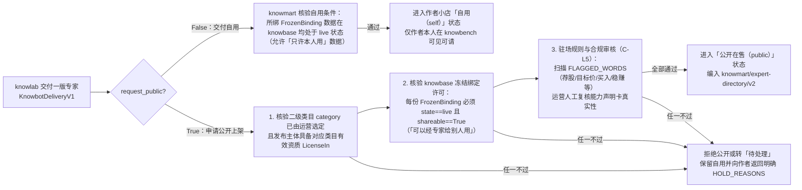

# 专家市场方案（knowmart）：统一能力声明卡、双層清单隔离与版本演进治理

> 当前分类以[方法主稿](../../专家孵化方案/luna/专家及专家团孵化模板.md)为准（2026-11-14）：工具方法不调用其它方法；专家方法组合工具及零种或一种专家、不含专家团；专家团方法调用两种或以上专家，或已有专家团。按方法身份及冻结允许依赖分类，三类共用契约和调用治理；专家与专家团共用编排。以下历史正文、旧协议或评审结论保留原时点含义，“两类”“不设专家团类型”及独立团队引擎等旧表述不作为当前目标。


> **作者**：`argon`（独立第一手调研与代码走查稿）  
> **创建日期**：2026-11-09  
> **所属模块**：`knowmart`（专家市场方案）  
> **设计依据**：所有者决定记录（[decisions.md](../../../../design/decisions.md) 10-20 至 11-09）、[数据拓扑](../../../数据拓扑.md) 第十至十三节、[动态专家实施方案](../../参考资料/动态专家实施方案.md) 第 10.1 节、`knowmart-app` 领域模型（`manifest.py`、`directory.py`、`delivery.py`、`market.py`、`catalog.py`）及契约（`knowmart/knowbot/v3`、`knowmart/expert-directory/v2`、`knowmart/knowbot-delivery/v1`）。  
> **状态**：方案设计稿（定稿前不动代码）。

---

## 一、核心定位与四大市场治理原则

`knowmart` 是全平台所有用户展示与交易「专家」和「知识」、发布与响应需求的供需市场（**每个登录用户拥有一家自己的小店**，首页展示小店列表，不做平台推荐榜或销量排序）。针对单个专家的上架、展示、匹配供给与生命周期治理，本方案确立四项核心原则：

1. **能力声明统一为结构化「能力声明卡」，与执行形态及测试状态彻底解耦**：
   - 废除早期仅靠三段自由文案（`scope/v1`：`does` / `does_not` / `elsewhere`）描述专家的做法，确立全平台统一的 **8 栏结构化能力声明卡（`PublicCapability` 扩展规范）**。
   - **固定专家与动态专家共用同一套能力声明卡格式**（解除「只有开启动态 `CapabilityPlanning` 才能写 `public_capabilities`」的耦合）；**能力声明卡中不掺杂测试状态或测试结论**（测试与特批记录独立归档于审核与交付记录）。
2. **公开目录投影与私有执行包严格双层隔离（保护作者方法资产）**：
   - `knowmart` 对外展示与供 `knowbench` 匹配查询的 `expert-directory/v2` 只暴露公开元数据与 `public_capabilities` 能力声明卡；作者私有的原子方法正文（`procedure`）、内部组合拓扑、系统提示词、规则出处（`rule_sources`）以及冻结数据绑定（`bindings`）严格封存在后端执行通道内，浏览与匹配阶段绝不外泄。
3. **固定专家与动态专家并列可选，版本只增不改、摘要不可变**：
   - 兑现所有者 11-08「原来的固定财务专家保留，和新的动态专家一样，都是可供选择的专家」的决定，支持固定全流程专家与按题动态装配专家在市场与工作台中同时供用户选择。
   - 每一版专家的 `knowbot_id + version + sha256 digest` 一旦交付即永久冻结；修改能力边界、方法逻辑或绑定数据必须发布新版本，已请入旧版本的任务与证据链不受影响。
4. **两道关审核与绑定数据许可硬校验（`C-L4` / `C-L5`）**：
   - 专家默认交付到本人小店「自用（`self`）」；申请「公开（`public`）」必须通过**发布主体与类目资质审核**、**禁词与合规审查（`C-L5`）**，以及 **`knowbase` 冻结绑定数据许可硬查（每份绑定数据必须具备 `shareable == True` 即「可以经专家给别人用」）**。

---

## 二、统一能力声明卡规范（8 栏结构化能力声明）

### 2.1 为什么要统一结构化能力声明卡

在早期实践中，自由文本式的简介导致两个严重问题：一是作者容易写出「全面分析公司财务」「解决各类投资问题」等无限承诺，或者把「第 1 步定范围、第 2 步摸底、第 8 步成稿」等内部流程步骤当成对外服务能力；二是 `knowbench` 的 AI 匹配器面对非结构化散文时，难以准确核对「用户要求的方法是否被排除」「所需数据前提是否具备」。

按照所有者 2026-11-04 要求，所有专家（不论底层是 `knowbench/fixed/v1` 还是 `knowbench/dynamic-methods/v3`）统一采用 **「平台只读头信息 + 作者逐项填写的 8 栏能力卡」**：

### 2.2 平台自动生成且只读的元信息

| 字段 | 来源与不可变规则 |
| :--- | :--- |
| **专家标识（`knowbot_id`）、名称（`name`）、确切版本（`version`）与清单摘要（`digest`）** | 由 `knowlab` 交付时经 `knowbot-delivery/v1` 传入、`knowmart` 按规范 JSON 计算 `sha256` 摘要锁死，作者不可手填覆盖 |
| **作者与声明确认记录** | 记录作者本人对能力声明卡的确认出处；AI 初稿或方法库模板生成的说明未经作者确认不得发布 |
| **服务类目（`category`）与市场价格（`price` / `free`）** | 二级类目由运营在交付审核时按方法内容核定（未分类专家不得公开上架）；价格由作者在 `knowmart` 小店设定（免费不代表无限适用，亦不免除运行时的模型与数据费用） |

> **关键红线**：能力声明卡内**不包含**「已测试 / 未测试 / 人工特批」等测试状态字段，也不以存在测试记录作为填写能力声明的前提。测试报告与发布审批记录独立存放在交付与审核台账中。

### 2.3 作者逐项填写的 8 栏能力声明卡结构

一位专家可包含 $1 \sim 30$ 张独立编号的能力卡（`PublicCapability`），每张卡对应一项可独立交付的服务承诺：

| 栏位序号与字段名 | 必填要求与填写规范 | 反例（严禁写法） |
| :--- | :--- | :--- |
| **1. 目标与结果**<br/>（`statement`） | 用**「动作 + 对象 + 直接结果」**表述一个明确目标（如：「测算一家中国 A 股上市公司未来两个季度营业收入与归母净利润的点预测及区间」） | 严禁写「全面分析财务状况」「回答任意财报问题」等无边界承诺 |
| **2. 适用范围**<br/>（`scope_conditions`） | 明确对象数量（如单公司）、所属市场/行业（如 A 股非金融企业）、期间窗口与口径范围；非金融专家无需强填金融维度 | 严禁留空并默认「全行业全市场通用」 |
| **3. 方法与方法边界**<br/>（`method_summary`） | 公开足以让用户和匹配器判断适用性的做法概要，写明方法是否固定、哪些部分允许按题调整；**严禁偷换用户点名要求的其他方法** | 严禁暴露私有方法提示词原文，也严禁只写「采用先进 AI 算法」 |
| **4. 数据及其他前提**<br/>（`data_prerequisites`） | 写明所需资料类型、读法（如抽好的表、按页原文）、期间窗口、口径及「须经用户确认」的前提；**只写数据条件，不绑定特定供应商名称** | 严禁把「可申请代采」写成「保证能取到所有历史数据」 |
| **5. 交付内容与形式**<br/>（`delivers`） | 逐条列出交付物中必含的计算结果、核验收据、引文证据、单位口径说明及文件格式（如 Markdown 报告） | 严禁只写笼统的「交付一份分析报告」 |
| **6. 不适用与不承诺**<br/>（`exclusions`） | 明确排除的任务、方法（如不做 DCF、不做五年预测、不给目标价与买卖评级）、不支持的对象（如银行/保险/证券）及方法固有局限 | 严禁靠漏填本栏来暗示「没有限制」 |
| **7. 条件不足时如何处理**<br/>（`insufficient_handling`） | 明确哪些歧义先追问澄清、哪些缺口走数据确认、哪些情况必须如实告知无法完成并停止或交用户决定 | 严禁写「条件不足时由模型自行估算或换题回答」 |
| **8. 适用 / 不适用示例**<br/>（`examples`） | 至少提供 1 条典型适用提问（`positive_example`）和 1 条近似但不适用的提问（`negative_example`） | 严禁把示例中的具体公司或年份固化为唯一可接受输入 |

专家顶层的 `tagline` 与 `scope`（`does` / `does_not` / `elsewhere`）由系统根据上述能力声明卡自动生成摘要投影，不再维护另一份容易与能力卡互相矛盾的自由文案。

---

## 三、双层清单隔离架构：外层信封、内层执行包与公开目录投影

### 3.1 数据结构隔离图

为同时满足「`knowbench` 匹配器能精准选型」与「作者辛苦沉淀的私有方法不被他人扒取克隆」，`knowmart` 对专家清单实行严格的三级视图隔离：

```mermaid
flowchart TB
  subgraph LAB_DELIV[knowlab 交付载荷 knowbot-delivery/v1]
    ENV[外层信封 KnowbotManifestV2 / V3<br/>schema / name / tagline / version / runtime / digest]
    PRIV_PACK[内层私有执行包 pack<br/>- method_units（含完整 procedure / rules / checks）<br/>- method_sources（原子方法快照与摘要）<br/>- planning（capability_bindings / max_steps / reserve）<br/>或固定专家 workflow]
    PRIV_BIND[冻结数据绑定 bindings: FrozenBinding[]<br/>material_id / version_no / sha256 / basis_ref]
    PRIV_RULE[规则出处链 rule_sources: RuleSource[]<br/>rule / source(user_text|user_confirmed) / ref]
  end

  subgraph MART_STORE[knowmart 后端权威存储]
    DB[(专家版本主档与不可变清单存储<br/>核验 canonical sha256 digest)]
  end

  subgraph PUB_VIEW[1. 公开目录与匹配视图 knowmart/expert-directory/v2]
    PUB[PublicExpert<br/>knowbot_id / version / digest / name / tagline<br/>declaration / runtime_contract<br/>public_capabilities (8栏能力声明卡)<br/>free / price / category]
  end

  subgraph EXEC_VIEW[2. 委托执行专享视图（仅在用户正式建委托后下发 knowbench 后端）]
    EXEC[完整 KnowbotManifest + FrozenBinding 授权引用<br/>仅进 knowbench 后端 TurnDriver 与 knowbase 授权核验]
  end

  ENV & PRIV_PACK & PRIV_BIND & PRIV_RULE --> DB
  DB -->|脱敏投影：剔除私有方法正文、组合图、绑定与出处| PUB
  DB -->|受控下发：凭有效委托与交易使用权| EXEC
```

### 3.2 解耦「结构化能力声明」与「动态规划运行契约」

在现有代码中（`directory.py` 第 85 行与 `manifest.py` 第 141 行），`declaration == "capabilities/v1"` 曾与 `runtime_contract == "knowbench/dynamic-methods/v3"` 强绑定。按照本方案：

- **`declaration`（声明格式）与 `runtime_contract`（运行契约）正交解耦**：
  - 固定专家（`runtime_contract: "knowbench/fixed/v1"`，外层为 `knowbot-manifest/v2`）同样支持 `declaration: "capabilities/v1"` 并携带完整的 `public_capabilities` 列表。
  - 动态专家（`runtime_contract: "knowbench/dynamic-methods/v3"`，外层为 `knowbot-manifest/v3`）除携带 `public_capabilities` 外，还在内层 `pack.planning.capability_bindings` 中将每项公开能力 ID 绑定到内部 `required_units` 与 `evidence_outputs`，供 `knowbench` 在运行期校验计划覆盖性。

---

## 四、版本演进与「固定财务专家 vs 动态财务专家」并存方案

### 4.1 固定 8 步财务专家与动态财务专家如何并存

根据所有者 11-08 决定：「原来的固定财务专家保留，和新的动态专家一样，都是可供选择的专家」。结合 `knowmart` 的身份与版本规则（[decisions.md](../../../../design/decisions.md) 10-20：「一个名称一生不变，详情页就是这个名称的一生；换一套完全不同的方法另起新名称」），我们设计如下**双专家条目并列 + 单条目内版本号只增**的机制：

| 专家条目 | `runtime_contract` | 适用场景与定位 | 能力声明卡特征 | 版本演进规则 |
| :--- | :--- | :--- | :--- | :--- |
| **条目 1：财务分析与预测（固定八步全流程版）**<br/>（保留原固定专家） | `knowbench/fixed/v1`<br/>（運行时由 `fixed_plan.py` 零开销构造 `fixed-plan/v1`） | 适合要求严格按「定范围 $\rightarrow$ 摸底 $\rightarrow$ 四式勾稽 $\rightarrow$ 单季还原 $\rightarrow$ 核心指标 $\rightarrow$ 管理层讨论对照 $\rightarrow$ 两季预测 $\rightarrow$ 成稿」一步不落跑完全套标准流程的用户 | 声明全套 8 步固定流程能力，明确标注「方法顺序固定，每次均执行完整八步核验与两季预测」 | 保留已验版本（如 4.11 版）；后续若仅微调固定步内文案或容差，在当前条目下递增版本号 |
| **条目 2：财务分析与预测（按题动态装配版）**<br/>（基于共用模板 + 5 领域方法孵化） | `knowbench/dynamic-methods/v3`<br/>（运行时按题生成 `method-plan/v2`） | 适合只问单项或多项子能力（如仅算历史 CAGR、仅做单季还原与指标对比、或选做管理层讨论对照与季节性预测）的用户 | 包含 5 张独立能力卡（四式勾稽、单季还原、核心指标、管理层讨论对照、季节性同比预测），明确标注「支持按问题目标动态选用所需方法组合」 | 独立 `knowbot_id`，版本号从 `1` 起递增；与条目 1 在作者小店及 `expert-directory/v2` 中并列展示、同时可请 |

> **为什么推荐「双条目并列」而非「用动态版直接覆盖固定版成为同一 `knowbot_id` 的下一版」**：  
> `knowmart` 目录默认向新用户展示每个 `knowbot_id` 的当前在架版本。如果将动态版作为同一 `knowbot_id` 的新版覆盖上架，新用户在市场上就只能看到动态版，无法直接选择原固定 8 步版；而采用双条目并列，两套专家在 `expert-directory/v2` 中同时在架，用户手选或 AI 匹配都能按需择一。

### 4.2 不可变版本与历史兼容守则

1. **版本号只增、摘要锁死**：每次从 `knowlab` 交付到 `knowmart`，`version`（正整数字符串 `^[1-9][0-9]{0,5}$`）严格递增，且 `(knowbot_id, version)` 唯一对应一个 `sha256` 清单摘要。
2. **交易与委托钉死版本**：用户在 `knowmart` 请入专家或购买知识、在 `knowbench` 创建委托时，钉住的是确切的 `(knowbot_id, version, digest)`。作者日后发布新版本，绝不自动篡改买家已请入的旧版本或正在运行的任务。

---

## 五、上架审核、绑定数据许可硬查与下架治理

### 5.1 自用与公开两档及上架审核链（`knowbot-delivery/v1`）



### 5.2 所绑数据的持续许可监控（`HOLD_REASONS`）

当一位专家绑定了作者自带的数据（如行业分类映射表、自定义分析准则，`basis_ref = "expert:<id>@<ver>"`）并公开在售时，`knowmart` 在接收交付时及后台巡检时向 `knowbase` 持续核查绑定状态（`delivery.py` 的 `binding_problem`）：

- **`binding_gone`**：作者失去了该数据版本的使用权或数据已被依法清除；
- **`binding_disabled`**：该数据被平台禁用；
- **`binding_deleted`**：作者或上游卖家删除了该数据；
- **`binding_not_shareable`**：数据许可档被降级，不再支持「可以经专家给别人用」。

一旦检出上述任一问题，在售公开专家立即自动转入**「待处理（hold）」**状态，暂停新买家请入并通知作者修复（解绑或重出新版本）。

### 5.3 正常下架 vs 违规撤回的生命期边界

| 动作类型 | 触发方 | 对市场目录与新请入的影响 | 对已请过用户与在跑委托的影响 |
| :--- | :--- | :--- | :--- |
| **作者主动下架（`delisted`）**<br/>或作者改低数据许可、关店 | 专家作者本人 | 立即从公开目录 `expert-directory/v2` 移除，停止新的购买与新委托创建 | **在跑的委托照常跑完**（运行授权在有效期内继续有效）；历史已生成的报告与证据链永久保留 |
| **资质到期失效** | 系统定时巡检（提前 30 天提醒） | 到期未续期则自动暂停公开上架，退回自用状态 | 在跑委托跑完即止，不再签发新的跨用户委托授权 |
| **平台违规下架 / 紧急撤回（`taken_down`）** | 平台运营 / 管理员（如涉非法荐股、侵权或恶意指令） | 立即从市场强制撤下并留存违规审计记录 | **连正在跑的委托也立即终止**，同步通知 `knowbase` 吊销相关运行授权与买家使用权 |

---

## 六、待所有者拍板确认的事项

1. **「固定八步版」与「按题动态版」财务专家的命名与展示区分**：
   - 本方案建议在作者小店与 `knowmart` 目录中将两者作为两个独立专家条目并列展示（例如分别命名为 `财务分析与预测（标准全流程版）` 与 `财务分析与预测（按需动态版）`，或在条目卡片上增加醒目的 `固定流程` / `按题选方法` 模式徽章）。请确认采用哪种命名与展示方式？
2. **历史 `scope/v1` 三段文字声明向 8 栏能力卡的迁移方式**：
   - 对已存在的旧准专家/专家，建议由 AI 根据其既有方法原文与 `scope` 三段文字自动起草一版 8 栏结构化能力卡草稿，放入 `knowlab` 待作者确认后随新版本发布，绝不后台静默改写旧版本摘要。请确认是否按此执行？
