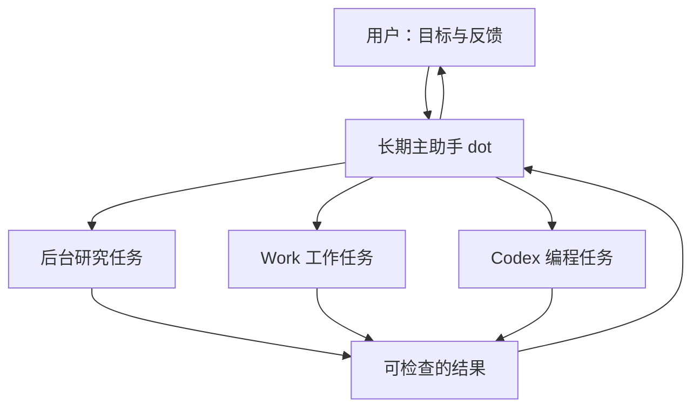
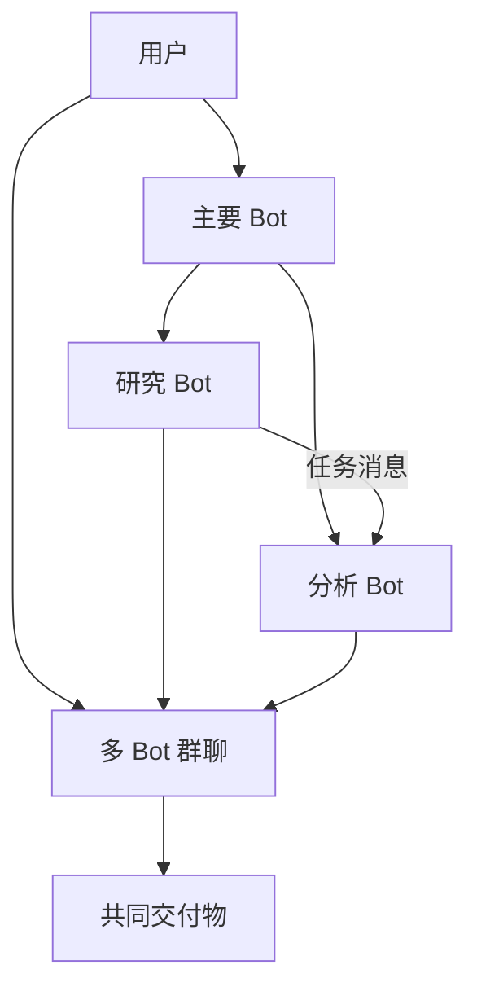
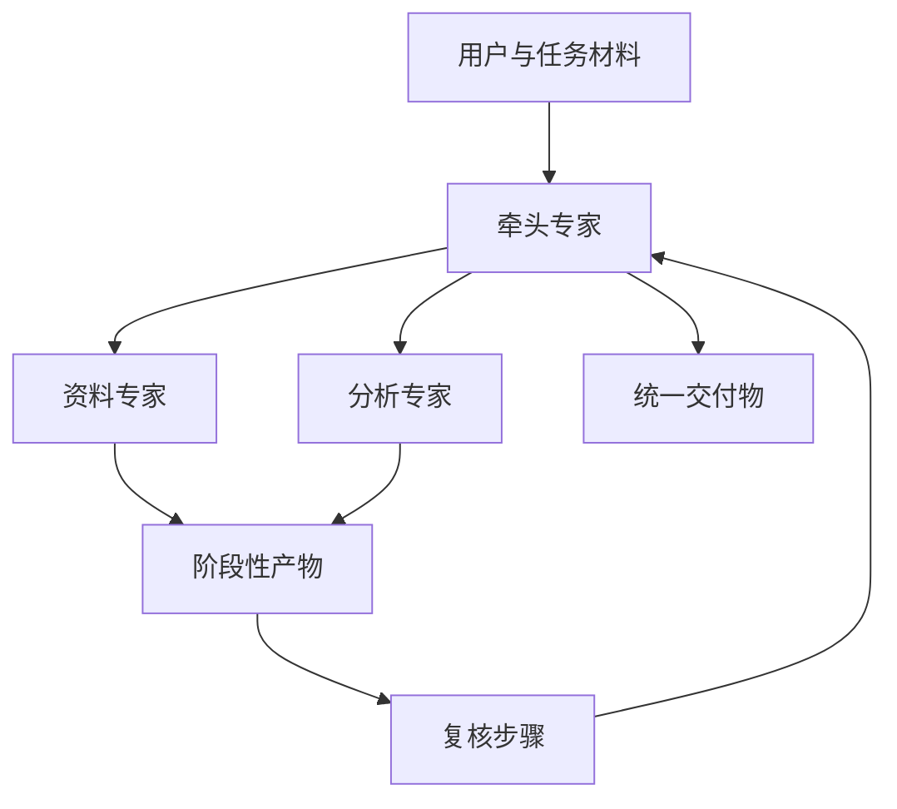
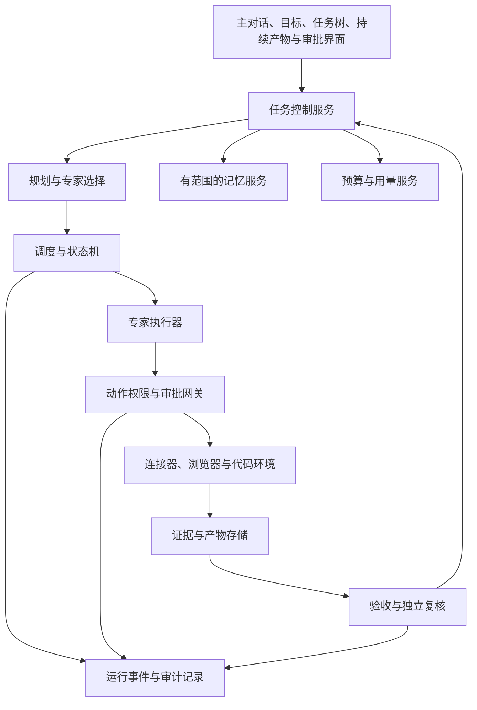

# 专家团与长期 Agent 产品研究：OpenAI dots、Grok Bot、腾讯 WorkBuddy、Meta Muse

> 本项目分类更新（2026-11-14）：[方法主稿](../专家孵化方案/luna/方法、步骤、组合与模板.md)采用工具方法、专家方法、专家团方法三类，共用契约；专家与专家团共用编排。本文的竞品术语与历史材料保留原义，早期本项目映射不替代主稿，不能据此恢复独立团队契约。


更新日期：2026-11-09。用途：为开发同类产品提供产品、交互、架构、商业化与验证依据。本次深入研究 Muse，并重写四方比较；前三家沿用 11 月 8 日研究材料，对 OpenAI 任务、记忆与控制等关键边界作补充核对，并非全部资料均于今日重新验证。

本文分五部分：前四部分逐一介绍四家产品，第五部分统一比较并提出研发建议。OpenAI 在本文对应的成品名称是 **dots**，不是把所有机器人统称为 bots。“专家团”是我们的研究类别，并非四家共同采用的正式产品名称。Muse 需与同名模型、Muse Code 和 Meta 企业平台分别讨论。

**阅读口径**：本文基于官方产品文档、开发者文档、价格说明与更新记录，未登录四家产品进行统一对照实测。“支持”“提供”表示有官方公开说明，不等于通过了我们的验收；“未确认”表示证据不足，不表示确定不支持。“产品分析”“工程分析”“建议”和拟议流程属于我们的判断，不是厂商内部实现披露。

**版本口径**：消费、团队、企业及开发者产品分开；中国站、国际站、套餐与部署版本分开。已宣布与已交付分开。dots 企业版 2026-11-18 的安排仍未生效；Muse Confidential VM 的推出计划及 Spaces 分享协作的探索，不作为当前全部账户已经可用的功能。

**研发结论**：WorkBuddy 仍是专家团资产和企业分发最直接的参照；Grok Bot 展示持久角色协作；dots 展示长期主助手与任务委派；Muse 补上长期目标、个人执行环境和持续工作界面的竞争视角。我们应比较它们如何完成同一项工作，而不是按角色数量或宣传中的模型能力排名。以下建议是竞品研究结论，不替代本项目已批准的 PRD 与架构决定。

## 第一部分：OpenAI dots——以长期主助手为入口的任务委派体系

### 1.1 产品定位：用户交付长期责任，主助手组织执行

dots 的核心对象是一个持续服务于用户的个人助手。它能够在两次交谈之间继续推进工作，保留相关上下文，并在需要判断时回来找用户；也可以把不同工作交给后台任务。产品重点是“持续替我负责一件事”，而不只是当前聊天中的一次回答。[官方概览](https://learn.chatgpt.com/docs/dots)

**产品分析**：dots 最值得研究的是责任连续性。用户不必反复说明同一项目的背景、已经做出的决定、当前等待谁回复。系统应当把这些信息转化为可持续推进的状态。专家数量是否显眼，是其次的问题。

适合用来理解这种定位的需求包括：持续准备一次活动、跟踪项目材料缺口、定期整理业务变化、协调调研与代码修改。这里的“持续”应包括知道何时等待、何时继续、何时向用户升级问题，而不等于不间断调用模型。

### 1.2 产品层次：dots、Work、Codex、插件与 API 各负责什么

| 层次 | 用户面对的对象 | 在产品体系中的作用 | 研究时要避免的混淆 |
| --- | --- | --- | --- |
| dots | 长期个人助手 | 接收目标、保持上下文、协调后续工作 | 不能把每个后台任务都当成永久专家 |
| ChatGPT Work | 被委派的工作任务 | 承接具体执行与产物制作 | Work 的功能不自动等于 dots 自身的管理接口 |
| Codex | 编程任务及其环境 | 承接代码工作 | 本地任务与云端任务的准备条件不同 |
| Skills / Plugins | 可复用方法和工具包 | 增加工作规范、资源与服务接入 | 安装能力包不等于取得外部账户权限 |
| Agents API / SDK | 开发者构建应用的基础设施 | 运行和编排自建 Agent | 不等于获得 dots 成品源码或内部控制面 |

前面三层的委派关系见 [Tasks and memory](https://learn.chatgpt.com/docs/dots/tasks-and-memory)；能力包概念见 [Skills & Plugins](https://learn.chatgpt.com/docs/skills-and-plugins)；开发者运行时的区分见 [Agents](https://developers.openai.com/api/docs/guides/agents)。本表是对这些公开产品边界的整理，不是内部系统架构图。

### 1.3 用户如何开始使用，第一次价值如何出现

官方入门流程允许用户从手机 App、桌面 App 或桌面浏览器创建 dot，设置名字和外观，再连接需要的服务；本地电脑连接是可选项。移动网页与移动 App 的支持不能混为一谈。[入门说明](https://learn.chatgpt.com/docs/dots/getting-started)

**建议用来拆解体验的首次任务**：让助手整理一组材料，指出缺失项，交付一份可以检查的文件，再约定后续关注什么。这个过程比一次性授予大量账户权限更容易让用户判断其价值。

对我们的启示是，把首次使用拆成三个可感知的成功：理解目标、交付首个产物、记住下一步。连接器安装数量、专家人数和配置项数量都不适合作为首次使用成功指标。

### 1.4 多 Agent 协作：后台委派比“专家群聊”更突出

dot 可以创建并行后台工作，继续与用户交谈，并检查自己委派任务的结果、追加指示。被委派任务具有单独的对话与选取的上下文；不能假定它读取了主对话的全部历史。云端编码还涉及预先准备好的 Codex 环境。[任务与上下文](https://learn.chatgpt.com/docs/dots/tasks-and-memory)

下面是产品关系示意，而非已验证的内部调度实现：



**架构分析**：这种模式需要解决上下文交接、任务关联、结果归并和父子任务生命周期。一个主助手即使能调用十个子任务，如果无法说明它们分别做了什么、依据什么、哪些还没有结束，也很难构成可靠的团队产品。

本次资料未确认 dots 提供与 Grok Bot 多个持久角色完全对应的个人专家名册，也未确认消费者可以定义任意专家通信拓扑。因此不能把“可以委派任务”扩大为“可以任意搭建长期多角色组织”。

### 1.5 长期记忆：要区分用户偏好、项目状态和原始证据

公开说明区分当前对话、相关 ChatGPT 记忆以及 dot 自己保存的工作笔记。它还可以只读研究已连接的信息，寻找可能值得跟进的事项；这些研究不自动授权后续写入或发送。[记忆与后台研究](https://learn.chatgpt.com/docs/dots/tasks-and-memory)

**产品分析**：对同类产品，至少应把以下五类信息分开管理：

| 信息类别 | 示例 | 建议的管理方式 |
| --- | --- | --- |
| 用户偏好 | 希望先看表格再看解释 | 用户可查看、纠正、删除 |
| 项目事实 | 已确认的交付日期 | 保留来源、确认人及有效期 |
| 工作状态 | 正在等待供应商回复 | 绑定任务，可进入等待与唤醒状态 |
| 方法知识 | 如何形成一份审查报告 | 版本化为 Skill，不混入个人记忆 |
| 原始证据 | 合同、邮件、查询结果 | 保留引用和访问权限，不靠模型复述替代 |

这个分类是我们的设计建议。公开文档不足以证明 dots 对每一类信息都提供独立管理界面、结构化存储或完整版本历史。

### 1.6 云端执行与本地执行：协调在哪里，动作在哪里

dot 有自己的云端电脑、浏览器与持久工作状态。云端登录与用户个人浏览器登录相互独立；用户可以查看运行过程，并接管需要手动处理的步骤。连接个人电脑后，才会增加访问该电脑资源的路径。[电脑与应用](https://learn.chatgpt.com/docs/dots/computers-and-apps)

企业文档进一步区分云端协调与本地动作执行。因此，“命令在本地运行”不能推导为“任务数据完全不离开本地”；还必须检查发送给云端协调与模型推理的内容。[本地访问边界](https://learn.chatgpt.com/docs/enterprise/cloud-local-access)

**研发启示**：我们的任务界面应显式显示执行位置、连接状态及执行身份。用户遇到电脑休眠时，要知道哪些云端工作仍能继续、哪些本地工作正在等待，不能只看到一个长期不变的“运行中”。

执行位置也应成为任务计划的一部分。若一个步骤必须访问本地文件，而另一步只需要公共网页，系统可以分别安排；不应在本地不可用时默默换到云端并假装输入、凭证和权限相同。

### 1.7 连接器与插件：通信入口、数据入口、执行入口彼此独立

官方文档明确区分消息渠道、已连接应用和本地电脑。能在某个消息渠道与 dot 交谈，不代表 dot 已获得该渠道背后的全部数据，也不代表允许访问用户电脑。[连接关系](https://learn.chatgpt.com/docs/dots)

Skills 提供工作方法，Plugins 可以组合 Skills、MCP 服务和其他受支持的扩展。平台提供公共插件发现与分发入口，但实际可用性仍取决于所在产品界面、工作区策略和服务授权。[插件说明](https://learn.chatgpt.com/docs/plugins)

**设计分析**：插件系统应分别记录“安装了什么”“可以调用什么”“调用时代表谁”。否则管理员删除一个消息机器人后，可能误以为它已经失去某项业务访问能力，而另一条连接器路径仍然有效。

### 1.8 权限与审批：让意图转化为具体动作边界

dots 的控制机制包括既有应用权限、自动审查和用户自定义规则。自定义规则可以要求特定操作先询问，但不能突破底层账户权限或安全要求。主动研究与后续行动也有不同边界。[控制说明](https://learn.chatgpt.com/docs/dots/controls)

企业安全文档特别提醒：浏览器、桌面和委派任务上的审查覆盖仍有待核实之处，不能用一条插件路径的验证结果代表所有执行路径。[企业安全说明](https://learn.chatgpt.com/docs/enterprise/dots-security)

**我们的设计建议**：审批必须绑定实际动作对象，例如收件人、附件版本、目标文件及允许的修改范围。用户批准“这封邮件”后，如果系统后来更换收件人或附件，原审批不应被无限复用。自然语言规则适合表达意图；执行前仍应有结构化策略检查。

同时要区别三个问题：是否允许使用邮件应用、是否允许生成邮件草稿、是否允许发送这封具体邮件。把三者合成一个“允许访问邮箱”的按钮，会使用户难以理解授权后果。

### 1.9 可观测性与人工接管

用户可以从活动入口检查委派工作，浏览器场景还可以接管电脑完成必要步骤。暂停主助手、停止某个子任务、取消周期工作是不同控制对象，不能默认一个操作自动覆盖全部对象。[任务与暂停说明](https://learn.chatgpt.com/docs/dots/controls)、[电脑接管](https://learn.chatgpt.com/docs/dots/computers-and-apps)

**交互分析**：后台工作产品至少需要回答六个问题：当前在做什么、已经完成什么、还缺什么、在哪个环境执行、已经产生哪些外部变化、如何停止后续动作。普通聊天记录适合解释过程，但不适合作为唯一的任务控制面。

我们的界面可以保留一个简洁主对话，再提供任务树与产物栏。主助手负责对用户解释；任务树负责呈现事实状态。两者不应该完全依赖同一段模型生成的文字。

### 1.10 企业治理、身份与生命周期

dots 的企业管理涉及角色授权、消息渠道、本地访问、云端电脑能力和插件策略。个人 dot 的行为身份与所有者相关；管理员可以管理访问和查看支持范围内的记录。开启产品入口不会自动打开所有数据源权限。[管理员指南](https://learn.chatgpt.com/docs/enterprise/dots-admin-guide)

删除需要跨对象考虑。企业文档分别讨论 dot 自身信息、ChatGPT 记忆、外部应用数据以及独立产物；断开数据源不会自动撤销已经产生的外部结果，也不能假定所有衍生记录随之消失。[数据与生命周期说明](https://learn.chatgpt.com/docs/enterprise/dots-security)

**研发启示**：需要一个资源关系图，显示助手、任务、记忆、文件、授权和定时任务的关联。删除助手之前可以给出可预期的影响清单；执行后留下删除回执。企业员工离职也应触发所有相关身份、凭证与任务的处理，而不是只隐藏聊天入口。

### 1.11 面向开发者：可以借鉴什么，不能直接获得什么

OpenAI 的开发者体系区分托管 Agents API、自行部署应用内的 Agents SDK，以及更底层的 Responses API。它们给自建产品提供不同程度的运行时控制，但不应被描述成 dots 的公开实现。[开发者运行时比较](https://developers.openai.com/api/docs/guides/agents)

SDK 文档提供两种值得借鉴的协作方式：把当前职责转交给另一专家，或由主 Agent 把专家作为工具调用并保留最终答复责任。另有跟踪模型、工具与交接过程的能力。[编排与交接](https://developers.openai.com/api/docs/guides/agents/orchestration)、[集成与可观测性](https://developers.openai.com/api/docs/guides/agents/integrations-observability)

**开发判断**：如果我们需要自有权限系统、行业数据模型和专家团交付协议，开发者基础设施更接近可复用底座；dots 更适合研究端到端体验。选用 SDK 仍需自建用户体系、记忆治理、预算、任务恢复、产物管理与运营后台。

本次未查到 dots 完整成品开源仓库，或让第三方完整管理个人 dot、内部记忆和任意子任务拓扑的公开 API。不能因此否定 OpenAI 在其他开发者产品上的开放能力。

### 1.12 商业模式、可用性与成本判断

本次文档显示 dots 具有套餐、地域与工作区条件。企业预览允许符合条件的管理员选择开启；官方计划从 **2026-11-18** 起调整默认访问并开始计费，委派给 Work 或 Codex 的任务另按相应标准计费。研究日仍处于该日期之前。[产品可用性](https://learn.chatgpt.com/docs/dots)、[企业预览与计费](https://learn.chatgpt.com/docs/enterprise/dots-admin-guide)

**成本分析**：一个主助手入口背后可能出现多种费用来源。我们不能只比较聊天订阅价，应分别核算协调成本、专家执行成本、云电脑时长、第三方工具费和人工复核时间。

如果产品让用户感觉“我买了一个助手”，账单却按多个隐藏产品分别增长，就需要提前给出预算解释。对我们的产品，委派前预算、运行中剩余预算以及最终成本归因，应在同一任务下可见。

### 1.13 对 dots 的整体判断及待验证事项

**加入 Muse 后的比较重点**：两者都需要考察长期责任如何转化为可检查的目标、任务与产物。本文不把 dots 的委派路径与 Muse 的个人 VM 视为相同实现，也不以谁更早发布判断完成质量；应对照第五部分的统一任务验证。

**判断**：最值得借鉴的是长期责任、持续上下文和统一入口；最大的研发挑战是把后台任务控制、权限路径与长期状态做得足够清楚。它适合作为“个人总管”体验的参照，但不能仅凭委派能力就判断其具备最强的专家组织管理。

实际测试应重点检查：

1. 同一长期目标经过多轮修改、跨天等待后，是否仍保留正确的待办与约束。
2. 子任务返回矛盾结果时，主助手会核查证据，还是只把文字合并。
3. 主任务停止后，哪些子任务和定时任务仍继续，界面是否清楚说明。
4. 同一外部动作经插件、浏览器、本地应用执行时，授权边界是否一致。
5. 删除记忆、删除任务、断开应用和删除 dot 后，各类数据及授权实际如何变化。

## 第二部分：Grok Bot——把持久角色与协作团队直接呈现给用户

### 2.1 产品定位及与 Grok Build 的关系

Grok Bot 面向日常工作中的主动型 AI 同事，强调多个 Bot 跨应用完成工作。其公开文档同时存在于 x.ai 与 Cursor 官方站点；企业说明明确写明其运行于 Cursor 云端。因此研究它时，需要同时查看产品说明与 Cursor 的账户、套餐和企业控制资料。[产品概览](https://docs.x.ai/grok-bot/overview)、[企业架构](https://docs.x.ai/grok-bot/teams-and-enterprises)

**Grok Build 是另一产品**：它面向终端中的代码工作，存在官方公开代码仓库；不能用 Grok Build 的开源状态证明 Grok Bot 完整产品开源。[Grok Build 官方仓库](https://github.com/xai-org/grok-build)

**产品分析**：Grok Bot 把“有几个不同的同事、分别负责什么”变成显性的用户概念。这降低了理解专业分工的门槛，也增加了维护角色、记忆和协作关系的复杂度。能否让团队规模增加而管理负担不增加，是这种路线的关键。

### 2.2 核心对象：Bot、群聊、Skill、Routine 与共享实例

| 对象 | 应当如何理解 | 不能简单等同于 |
| --- | --- | --- |
| Bot | 具有持续身份与职责的角色 | 一次临时模型调用 |
| Primary Bot | 用户的主要协调入口 | 自动拥有无限的其他角色权限 |
| 群聊 | 用户与多个 Bot 协作的场所 | 强制执行的流程引擎 |
| Skill | 可复用的工作方法 | 独立持续运行的同事 |
| Routine | 有触发条件及归属 Bot 的自动工作 | 一条普通聊天提示 |
| Bot 模板 | 可供别人复制的配置 | 所有人操作同一个活实例 |
| Shared Bot | 多人使用的同一个共享 Bot | 仅分享角色提示词 |

对象依据分别见 [Bot 管理](https://docs.x.ai/grok-bot/bots)、[聊天协作](https://docs.x.ai/grok-bot/chat-and-collaboration)、[Skills 与 Routines](https://docs.x.ai/grok-bot/skills-routines-and-automations)、[Shared Bots](https://docs.x.ai/grok-bot/shared-bots)。本表刻意区分配置、实例与运行，因为这会直接影响我们的数据库与权限设计。

### 2.3 持久角色如何形成，角色边界如何维护

用户可以为 Bot 指定持续职责，主 Bot 也可以帮助建立专门角色。公开说明区分角色自己的偏好、规则与工作记录，以及少量账户层面的共通知识；重置对话与删除角色的影响不同。[角色与记忆](https://docs.x.ai/grok-bot/bots)

**设计分析**：持久角色的价值不只是名字和头像，而是稳定的职责合同。例如研究员负责来源与事实，分析员负责计算与假设，复核员负责找反例。每个角色都应该有明确输入、输出和停止条件。

同时应防止角色无限增殖。建议我们的系统优先复用已有职责，只有当工具权限、专业方法或持续状态确有不同，才建议新建长期角色。临时的“查一下第二份文件”更适合建立子任务。

### 2.4 协作机制：直接交流、群聊与 Bot 间消息

官方协作文档描述了多 Bot 群聊、点名参与和 Bot 间异步消息；当前文档给出的群聊范围为 2–6 个 Bot。角色之间发送消息也会消耗使用量，群聊不应被当作免费协调通道。[聊天与协作](https://docs.x.ai/grok-bot/chat-and-collaboration)



图示表达公开交互方式，不代表消息一定按图中的顺序流动，也不证明存在确定性任务图调度器。

**架构分析**：这种模式天然允许灵活讨论，但容易产生重复工作、互相等待和消息循环。我们若采用它，应给每个工作阶段设定唯一负责人，并设置消息预算、交接确认与明确的完成状态。只让 Bot 自由互聊，无法保证最终有人交付。

### 2.5 云电脑：同一用户下的便利共享与权限风险

Grok Bot 的云端电脑可以运行浏览器、终端和工具。用户自己的多个 Bot 共享电脑资源，但各自可以有屏幕；这并不构成不同角色之间的安全隔离。云端应用之外，还有可选的本地执行路径。[Cursor 官方概览](https://cursor.com/docs/grok-bot)、[电脑与应用](https://docs.x.ai/grok-bot/computer-and-apps)

企业说明把不同用户的运行环境描述为独立 Firecracker microVM。这是厂商披露的用户间隔离方式，不能推导为同一用户下每个 Bot 都有独立机器或独立凭证。[企业架构说明](https://docs.x.ai/grok-bot/teams-and-enterprises)

**设计分析**：共享文件能显著简化交接，却会增加覆盖冲突和越权风险。我们的系统可以保留只读共享资料区，但为各角色建立独立写入目录；共享产物应通过版本提交，而不是允许所有角色同时改同一个最终文件。

角色权限尤其需要独立建模。“这是营销 Bot，所以不会读财务文件”只是职责约定。只有文件、连接器、凭证与动作策略真正限制它，才能构成权限边界。

### 2.6 应用接入、模型选择与本地网络

Grok Bot 支持连接常用业务服务，并通过 MCP 或 API 扩展工具；编码工作还可以交给 Cursor Cloud Agents。[工作机制](https://docs.x.ai/grok-bot/how-grok-bot-works)

设置文档说明模型由平台选择，没有普通意义上的模型选择器；本地网络出口路由与本地执行也是不同能力。通过个人电脑的网络访问某站点，并不表示全部任务都迁移到了个人电脑。[设置说明](https://cursor.com/docs/grok-bot/settings)

**产品分析**：平台自动选模型可以降低普通用户配置负担，但也使开发者难以精确控制成本、能力差异与复现实验。如果我们的目标客户需要验收可重复的业务流程，应至少记录每次运行使用的模型及配置版本，即使前台默认不暴露选择器。

### 2.7 记忆：长期同事体验依赖信息隔离

Grok Bot 的个人记忆可以通过对话查看、纠正或要求移除；文档提醒其记忆不能替代权威数据源。删除 Bot 也不意味着清除所有共享电脑上的文件和登录状态。[Bot 管理说明](https://docs.x.ai/grok-bot/bots)

Shared Bot 的公开设计又增加了共享知识与个人信息的区分，同时不把各人的私聊直接向其他用户公开。[共享 Bot 的记忆与会话](https://docs.x.ai/grok-bot/shared-bots)

**研发启示**：我们需要明确“角色知道什么”“某次任务看到了什么”“某个人能查询什么”三个范围。尤其是多人共用专家时，不能把某个用户提供的私密事实自动沉淀到团队共享记忆。

建议为每条记忆记录来源、适用范围、确认状态与过期条件。模型从一封邮件推测出的偏好，不应与管理员确认的公司制度具有同等优先级。

### 2.8 Skills、Routines 与工作示范

Skills 封装方法，Routines 负责定时或事件触发，事件来源包括业务应用与 webhook。官方还提供把操作示范转成 Skill 的路径。当前 Routines 文档列有数量、频率、历史记录与限流约束；不能按“无限后台同事”理解其容量。[自动化说明](https://docs.x.ai/grok-bot/skills-routines-and-automations)

**设计分析**：从示范中生成工作方法可以降低配置门槛，但“录制成功”不等于“自动化可靠”。页面布局变化、没有数据、凭证过期、遇到重复项目时，流程都可能失效。我们应让生成的 Skill 进入可检查草稿，并至少经过正常输入、空输入和异常输入三类验证。

触发也需要与任务成功分开：webhook 接收成功只表示系统接受请求；不代表资料已处理、结果通过复核或业务动作已完成。产品应当提供后续状态查询和完成回执，而不只返回一个 HTTP 成功码。

### 2.9 Shared Bots：复用一个配置，还是共同使用一个服务

官方区分模板复制和 Shared Bot。后者具有管理者、协作者等权限关系，并涉及共享的角色配置与不同用户的会话。云端共享 Bot 与个人本地使用路径存在边界。[Shared Bots](https://docs.x.ai/grok-bot/shared-bots)

**产品分析**：这是一个很重要的商业分岔。模板市场卖的是方法，用户各自安装、各自承担运行；共享专家服务卖的是持续维护的能力，由服务方维护配置和质量。二者的升级策略、授权方式、计费主体和故障责任不同。

对我们而言，第一版可以先做好版本明确的专家团模板，后续再支持多人共享的活实例。否则还没有稳定交付能力，就要同时解决多租户记忆、跨用户凭证、配额分摊及运维责任。

### 2.10 凭证与审批：Vault 不等于角色级保险箱

Vault 用于保存登录资料等敏感信息，支持把值直接填入网页而不展示给 Bot。文档同时明确：个人账户的 Vault 面向账户下多个 Bot，并不是逐 Bot 授权；共享 Bot 使用另外的 Secrets 机制。[Vault 与安全登录](https://docs.x.ai/grok-bot/vault)

动作控制还涉及 Auto Review、用户规则、应用权限和本地执行策略。某些情况下用户或企业可以选择不同审查配置，因此不能笼统地说“每次外部动作都一定有人点击确认”。[审批与隐私](https://docs.x.ai/grok-bot/approvals-security-and-privacy)

**设计分析**：隐藏秘密的明文值与限制秘密的使用权是两件事。即使模型看不到密码，只要能够使用已登录的高权限账户，仍然可能造成重要外部变化。我们的凭证代理应同时约束目标服务、身份、动作和允许使用的角色。

### 2.11 产物：让团队工作结果离开聊天气泡

Grok Bot 支持文件产物和预览，并提供 Library，以及处于逐步开放状态的 Pages。页面可以包含文本、表格与交互控件；共享范围与企业可用性有单独限制，不能直接把个人版能力推广到所有企业账户。[文件与结果](https://docs.x.ai/grok-bot/files-and-results)

**交互分析**：专家协作应该围绕一个可持续修改的产物，而不是每轮生成一个彼此无关的新答案。用户应能打开报告、定位某条结论、要求某位专家复核，随后看到同一报告的新版本以及修改原因。

我们还应区分“分享结果”和“分享运行权限”。允许同事阅读报告，不意味着允许其调用作者的连接器、查看原始材料或重新运行付费任务。

### 2.12 企业治理：审查模型输入与拦截业务动作不是一回事

Grok Bot 企业控制覆盖产品访问、团队规则、连接器与部分执行能力，某些网络、记录和强制审查设置仅限 Enterprise。自助 Teams 与 Enterprise 的管理能力不能合并计算。[企业控制](https://docs.x.ai/grok-bot/teams-and-enterprises)

Inference hooks 是一个独立扩展点：企业可在受覆盖的模型请求前进行检查，返回允许或拒绝；它仍处于 Beta。文档明确说明它检查的是模型输入，已经执行的工具动作不会因此被撤销。[Inference hooks](https://docs.x.ai/grok-bot/inference-hooks)

**架构启示**：同类产品应分别建设模型调用前检查、工具执行前授权和执行后审计。只做其中一个环节，很难覆盖完整风险。尤其要避免把“下一次推理被拦截”误标成“之前没有发生写入”。

### 2.13 商业模式与成本边界

当前计费文档区分新的 X Subscription 与旧 Cursor 套餐。新方案中 Grok Bot 随指定档位提供，并与相关产品共用周额度；旧套餐及关联订阅仍有自己的规则，不能把不同路径的权益简单叠加。追加用量和月度限制也不等同于任务内严格预算。[套餐与计费](https://cursor.com/help/grok-bot/plans)

**商业分析**：共享订阅池方便生态内获客，却降低了单一 Bot 产品成本的透明度。对我们的产品，应该优先提供按业务交付统计的成本，例如每份通过复核的报告成本，而不仅展示 token 或“剩余积分”。

群聊消息、研究深度和角色重试都可能放大成本。用户增加一个专家之前，应知道它是补足必要能力，还是仅增加讨论。这个判断比“支持多少个 Bot”更有经营价值。

### 2.14 开放程度、资料冲突与待验证问题

**加入 Muse 后的比较重点**：Grok Bot 的角色和共享实例是显式产品对象，Muse 的子 Agent 目前主要由技术资料确认。比较重点应是用户能管理和复用什么，而不是简单统计后台启动了几个 Agent。

本次确认的开放点主要是 MCP/API 工具接入、Skill、Routine/webhook 和企业 hooks；未查到完整 Grok Bot 成品的官方开源实现，也未确认面向所有开发者的全套 Bot 生命周期管理 API。再次强调，Grok Build 的公开仓库不解决这个问题。

关于群聊审批，协作文档与审批说明对卡片出现位置、由谁处理等表述存在需要进一步核对的地方。本文不把某种群聊审批 UI 写成已经统一验证的事实。[协作说明](https://docs.x.ai/grok-bot/chat-and-collaboration)、[审批说明](https://docs.x.ai/grok-bot/approvals-security-and-privacy)

**整体判断**：Grok Bot 最适合作为“持久数字同事团队”的参照，尤其值得研究角色实例、共享服务与可见协作。实际测试优先关注角色间共享资源边界、消息循环控制、共享 Bot 的访问身份，以及团队协作增加后成功率与成本如何变化。

## 第三部分：腾讯 WorkBuddy——专家团资产、办公工作台与企业开发平台

### 3.1 产品定位：把专业工作方法变成可调用的团队能力

WorkBuddy 的“专家”包含角色定位、工作方法和所需工具；“专家团”通过牵头角色组织多个专家分工并汇总结果。它比单一聊天角色更强调预先封装的协作方法，以及用户可以直接选择的专业能力。[专家说明](https://cloud.tencent.com/document/product/1831/134393)

**产品分析**：其核心吸引力是把“我要怎么安排这些专家”前置为可复用产品资产。用户选择一个适合任务的专家团，再输入自己的业务材料。这条路线适合有明确交付标准的工作，例如形成比较报告、分析经营数据、审核材料一致性。

专业名称仍然不代表专业正确性。一个名为“法律专家”或“投资专家”的 Agent，是否可靠，要看数据来源、工具、方法和验证机制，不能靠角色身份直接推导。

### 3.2 必须区分的六个产品层次

| 层次 | 面向什么需求 | 关键边界 |
| --- | --- | --- |
| 本地工作台 | 操作工作目录、文件与桌面任务 | 本地任务受设备在线状态及权限约束 |
| 助理远程任务 | 从手机或消息工具向本地电脑派活 | 远程下达命令不代表云端执行 |
| 云端助理／任务 | 托管运行和远程访问 | 不应套用旧本地助理的全部限制 |
| 专家与专家团 | 复用角色、方法与协作配置 | 属于能力层，可用环境需逐项核实 |
| 项目与企业管理 | 团队资料、能力分发与组织治理 | 项目共享与个人授权存在差异 |
| WMA 托管 Agent 平台 | 通过 API/ADK 构建企业应用 | 是相邻开发者平台，不等于所有消费者都具有这些功能 |

对应来源：[本地任务](https://cloud.tencent.com/document/product/1831/134391)、[远程助理](https://cloud.tencent.com/document/product/1831/134392)、[云端任务接口](https://open.workbuddy.cn/docs/openapi)、[项目](https://cloud.tencent.com/document/product/1831/138797)、[WMA 简介](https://cloud.tencent.com/document/api/1831/138581)。

这一区分非常重要。把 WorkBuddy 一概说成“只有本地桌面”，会漏掉它的云端与开放平台；把 WMA 的完整平台能力全部算作消费者专家团能力，也会夸大其直接使用体验。

### 3.3 用户体验：从任务入口到专业团队

本地工作台支持选择工作空间、模型和技能，并区分只读问答、先规划后执行等工作模式。专家入口允许选择或创建专业角色，再围绕具体目标开展工作。[本地工作台](https://cloud.tencent.com/document/product/1831/134391)、[专家入口](https://cloud.tencent.com/document/product/1831/134393)

**体验分析**：相比先建立一组长期同事，专家团入口可以缩短用户到达第一次专业交付的路径。用户不必自己决定需要研究员、分析员还是复核员，只需要选择与任务相符的团队。

但这个优势依赖良好的任务匹配。如果专家团展示只包含头像、称号和夸张描述，用户仍无法判断哪个团队适合自己。我们的专家团卡片应包含输入要求、产物样例、适用范围、预计耗时及所需授权。

### 3.4 显式专家团与自动组建团队不是同一个开关

国际站系统设置说明区分自动组建的智能体团队和用户主动调用的专家团；关闭前者不影响后者。该页面还介绍本地记忆、记忆管理及自定义模型配置，但这些能力的界面与支持情况要按版本核对。[系统设置](https://intl.cloud.tencent.com/zh/document/product/1316/84502)

**设计分析**：这意味着需要把“系统临时决定用多个 Agent”和“用户购买或选择了一个经过设计的团队”分别建模。前者是运行时优化，后者是有明确承诺的能力产品。

我们的系统可以允许自动委派，但应保持已选专家团的关键步骤不被随意省略。例如用户选择“带独立复核的报告”，不能因为模型判断任务简单，就取消复核后仍按同样规格交付。

### 3.5 专家团开发资产：角色配置与协作方法可以被打包

开放平台提供专家团包的组织方式，核心包含插件清单、主专家与成员的 Agent 定义、Skills 及必要的工具依赖；清单中区分团队类型、牵头角色和成员信息。[专家团开发文档](https://open.workbuddy.cn/docs/expert-team)

以下是对公开包结构的概念整理，不是可直接上传的完整模板：

| 配置部分 | 承载内容 | 我们应借鉴的工程原则 |
| --- | --- | --- |
| 插件清单 | 名称、版本、作者、团队及成员关系 | 把团队定义作为版本化资产 |
| Agent 定义 | 职责、方法、输入输出要求 | 角色必须有可检查的任务边界 |
| Skill 资源 | 专业步骤及参考资源 | 方法与人员身份分离 |
| 工具依赖 | 连接器或 MCP 等需求 | 安装前进行依赖和授权检查 |
| 启动配置 | 默认牵头角色等运行入口 | 不靠用户手动拼接团队 |

**架构分析**：打包格式本身只是起点。我们还需要定义安装、升级、回滚、兼容性验证和签名验证，否则一个新版专家团可能在运行中更改方法，导致历史结果无法复现。

这里的重点不是照抄字段名称，而是让专家团拥有可测试、可发布、可撤回的生命周期。完整格式应以当前官方 schema 为准，示例中的值也不能误读为平台通用限额。

### 3.6 协作编排：牵头角色统筹，不等于运行时强制流程

官方专家团示例采用牵头角色分派成员工作、分阶段汇总的方式，并对成员通信和职责作出提示词层面的约束。国际站说明也区分相互独立工作的并行与有依赖工作的先后处理。[专家团示例](https://open.workbuddy.cn/docs/expert-team)、[专家中心](https://intl.cloud.tencent.com/zh/document/product/1316/84498)



这是用于理解专家团的概念图，角色名称为本文示例。**不能仅凭示例 SOP 就认定平台提供任意可视化 DAG、硬性阶段闸门或模型无法绕过的状态机。**

**研发判断**：如果我们希望进入严肃业务，关键阶段应由运行时约束。例如没有证据表就不能进入最终报告，没有独立复核记录就不能触发发布。对非关键探索步骤，则可以保留模型的灵活规划能力。

### 3.7 依赖与授权：预检和按需申请各有用途

开发文档描述了声明工具依赖及授权要求的方式；用户使用说明又包含调用到相关能力时补充授权的流程。二者应理解为不同接入路径的行为，而不应强行归纳成单一统一时机。[专家团依赖声明](https://open.workbuddy.cn/docs/expert-team)、[专家使用](https://cloud.tencent.com/document/product/1831/134393)

**我们的建议**：执行前先检查完成关键路径所需的依赖，并区分“必需”“可选”和“可替代”。用户可以在缺少可选连接器时继续，但系统必须明确哪些结论会受到影响。运行中新增的权限要求则应解释触发原因。

凭证不应被写入专家团包或共享模板。能力作者声明需要何种服务和范围，使用者或企业管理员在部署时绑定实际账户，这样模板才能跨组织复用。

### 3.8 Skills、连接器与知识资料：方法和数据分开复用

WorkBuddy 提供技能管理与复用入口；资料库文档列出腾讯文档、ima 和乐享知识库等接入方向。它们与专家角色共同组成工作能力，但不是同一种对象。[技能](https://cloud.tencent.com/document/product/1831/134432)、[资料库](https://cloud.tencent.com/document/product/1831/134395)

**产品分析**：行业专家团至少由三部分共同决定质量：方法是否正确、信息是否充分、执行工具是否可靠。仅仅改写角色提示词，通常不能弥补缺少数据或计算能力的问题。

我们的资产结构应允许一个专家团引用多个技能和受权限控制的知识源。升级一个公共计算技能时，要知道哪些专家团受影响；移除一个知识库时，要知道哪些定时任务已不具备完整输入。

### 3.9 项目协作：共享背景不等于共享所有凭证

项目把指令、资料、专家、技能与连接器组织在共同上下文下，并允许成员围绕任务协作。文档对公共授权与个人授权作出区分，协作任务所能使用的连接器也有约束。[项目与授权](https://cloud.tencent.com/document/product/1831/138797)

**设计分析**：项目是专家团产品从个人工具走向组织工具的重要中间层。团队成员不需要重复上传背景，也不应每次重新配置工作规范。但共享配置应保留管理员、修改记录与版本，以免某个人改动规则影响其他人的任务而没有解释。

建议我们的权限模型以项目为主要边界，同时保留任务级例外。用户可以把某份资料只交给本次任务，明确禁止进入项目公共知识和长期记忆。

### 3.10 本地助理、自动化与云端任务

本地远程助理通过消息入口接受任务，要求承接任务的电脑保持可用。较早的自动化说明则描述在本地保存调度配置、按用户身份执行并保存产物。不能把这两种本地路径等同于云端任务。[远程助理](https://cloud.tencent.com/document/product/1831/134392)、[自动化](https://cloud.tencent.com/document/product/1831/134399)

较新的开放接口明确提供云端任务创建与查询；企业更新记录还包括定时任务历次运行的聚合展示和产物通知。[Open API](https://open.workbuddy.cn/docs/openapi)、[5.30.0 企业更新](https://cloud.tencent.com/document/product/1831/140565)

**研发启示**：统一入口下应保留明确的执行类型，不能用“助理”一个词掩盖设备与运行条件。调度器也需要独立于聊天窗口：任务定义、每次触发、某次执行以及最后产物是四种不同对象。

### 3.11 记忆与模型开放性

系统设置公开介绍本地记忆、对话记忆、查看与重置，以及自定义模型接入。支持范围随产品版本及部署环境变化，不能将国际站配置直接视为每个中国站企业账户的默认能力。[系统设置与模型入口](https://intl.cloud.tencent.com/zh/document/product/1316/84502)

**分析**：模型可配置有利于成本优化、客户选型和私有环境适配，但同时扩大兼容性负担。不同模型在工具调用、长上下文和遵循流程方面可能不同，因此“换个模型”实际可能是更换一部分运行行为。

我们应把经过验证的模型、专家团版本和工具版本组合记为兼容配置。允许用户自由切换时，也应告知该组合是否经过验证，而不是默认所有模型都能等效执行同一团队。

### 3.12 本地权限与安全：默认边界和全量访问需要分开看

安全文档描述工作空间边界、风险操作确认和文件保护，并指出完全访问配置影响该设备上的任务范围，不是只对当前一步生效。它还涉及不可信工作区配置的处理。[默认权限与安全沙箱](https://cloud.tencent.com/document/product/1831/134401)

**研发判断**：本地执行最容易给用户一种“都在自己电脑上所以安全”的错觉。实际仍需防范错误目录、危险命令、外部数据诱导和过宽授权。默认权限必须能够完成常见工作，否则用户会被迫长期打开完全访问。

建议我们的授权从目录和动作出发，优先提供“本次任务允许修改这些文件”“本项目允许调用这个接口”，而不是直接要求用户接受全局放开。文件备份应作为恢复手段，不能代替执行前的权限检查。

### 3.13 Open API：可以把工作任务接入其他应用

开放平台文档提供 OAuth 2.1 用户授权、本地助理状态与消息接口，以及云端任务创建查询。云端任务可通过 ACP 通道进行实时交互，并通过产物接口获取结果；这是产品集成的重要入口。[Open API 文档](https://open.workbuddy.cn/docs/openapi)

**协议分析**：第三方接入时至少应区分三层完成状态：请求被接受、一轮交互结束、业务交付通过验收。这三个状态的时间点和含义不同。不能仅凭连接成功或模型停止生成，就通知用户“整个专家团已成功完成”。

接入层还应处理过期凭证、重连、重复提交和长任务恢复。公开通道存在，并不能证明每个接口天然提供恰好一次执行；我们仍要以具体接口约定及实测为准。

本次资料不能证明普通云端任务 API 已覆盖消费者专家团的每个管理操作。因此应把“能够启动任务”与“能够通过 API 完整发布、管理并运营专家团”分开评价。

### 3.14 WMA：面向企业开发的托管运行时

WorkBuddy Managed Agents 提供 Agent、版本、会话与运行资源管理，并通过 Python／TypeScript ADK 和 REST API 开放。公开概念包括冻结的 Agent 版本、版本路由、Manifest、沙箱模板及外部 A2A Agent 绑定。[WMA 简介](https://cloud.tencent.com/document/api/1831/138581)

API 目录进一步列出 Agent 管理、版本与会话、定时任务、消息事件和产物查询等接口。它说明腾讯在相邻企业开发层有较完整的生命周期控制面。[WMA API 概览](https://cloud.tencent.com/document/api/1831/138590)

**开发分析**：这部分与我们自研平台的后端最有直接可比性，而专家团市场更接近前台产品。选型时应分别评估前台使用体验与后端承载能力，不能用其中一个替代另一个。

若使用托管底座，我们可以节约执行环境与基础会话管理的投入，但仍须明确业务状态归属、数据导出、平台限额和迁移成本。尤其要保证核心行业资产与验收标准能够保留在我们的系统中。

### 3.15 企业分发、治理与评估

专享版 5.30.0 更新记录包含专家团下发、技能安全扫描、能力套件强制分发、资源调用统计及运行时策略等能力。另一些企业版本记录包含评估相关功能，具体菜单与权限应按部署版本核实。[5.30.0 更新](https://cloud.tencent.com/document/product/1831/140565)、[4.20.0 更新](https://cloud.tencent.com/document/product/1831/139964)

**产品分析**：企业愿意规模采购时，需要的不只是一个好用的专家，而是有办法让组织统一使用合适的版本、收回不合适的能力、查看运行成本，并验证升级是否改善了结果。

我们可以据此把专家团市场与企业控制台分开设计：市场强调发现和试用；控制台强调可信来源、发布范围、版本锁定、评估结果及撤回。二者共用资产模型，但使用目标不同。

### 3.16 部署与价格：消费套餐不能代表企业交付成本

截至研究日，企业版本说明列出共享 VPC、专享 VPC 和企业私有化路径。其中旗舰版公开标价为 **198 元／人／月**，专享版 **316 元／人／月、100 人起购**，私有化需询价。该页还区分不同套件权益，不能只看席位价格判断功能完全相同。[版本与价格说明](https://cloud.tencent.com/document/product/1831/134332)

这些是企业套件价格，不是“每个专家团运行一次”的报价，也不应当直接与 dots 或 Grok Bot 的个人订阅等量比较。专家团运行量、模型、工具服务与私有部署运维仍需单独估算。

关于多专家消耗，部分说明给出相对单专家的经验区间，另一些说明强调随任务变化。本文不采用固定倍数预测成本；应通过同任务、同验收要求的对照试验来估算。[专家使用说明](https://cloud.tencent.com/document/product/1831/134393)、[国际站专家中心](https://intl.cloud.tencent.com/zh/document/product/1316/84498)

### 3.17 开放性、市场治理与资料边界

**加入 Muse 后的比较重点**：WorkBuddy 仍最贴近我们的专家团能力组织需求；Muse Small Business 与 Spaces 则提示持续经营和产物界面的竞争。研究团队资产时以 WorkBuddy 为主，研究用户为何每天回来使用时应同时观察 Muse；企业治理须按各自实际产品层验证。

WorkBuddy 已公开能力包开发、任务 API 与企业托管接口，但“开放平台”不等于完整桌面产品或专家团运行时开源。私有化交付也不等于客户获得全部源码。本次未确认完整产品的官方开源实现。

开放平台开发者协议对能力资产提出面向具体任务、明确角色边界和交付要求等要求，这反映出专家市场需要质量治理，而不只是允许上传提示词。[开发者协议](https://open.workbuddy.cn/docs/developer-agreement)

**整体判断**：WorkBuddy 最值得借鉴的是专家团资产化、项目内复用、企业分发和公开开发接口。它提供了接近我们目标产品的前台模板，也提供相邻后端平台能力。但应特别核对消费版与企业版、国际站与中国站、客户端功能与 WMA 接口的边界。

实测应重点验证：专家团是否真正执行成员分工、阶段依赖是否可靠、任务中断后的恢复、共享授权的实际身份、团队升级对历史任务的影响，以及本地和云端任务能否用一致方式追踪与交付。

## 第四部分：Meta Muse——长期目标、个人执行环境与可持续更新的工作界面

### 4.1 研究对象：Muse 是成品 Agent，也有同名模型与开发者产品

本章研究的是 Meta 在 2026 年 9 月发布的 **Muse 个人 Agent**，以及其 Small Business 扩展。它把用户目标、持续上下文、跨应用执行和后台工作放在一起，属于我们应跟踪的直接竞品。发布公告将其定位为能代用户完成工作的个人 Agent；这不意味着它已经提供与 WorkBuddy 相同的专家团资产体系。[Muse 发布公告](https://about.fb.com/news/2026/09/introducing-muse-personal-ai-agent/)

| 名称 | 本文如何理解 | 不能据此推导的结论 |
| --- | --- | --- |
| Muse 个人 Agent | 用户交付目标、查看工作和批准动作的成品 | 不能仅因后台多 Agent 就称为专家团市场 |
| Muse for Small Business | Muse 内面向经营工作的技能与连接器扩展 | 不自动等于大型企业组织管理平台 |
| Muse Spark／Wonder 等模型 | 支撑推理、工具使用及其他能力的模型 | 模型基准不是成品任务成功率 |
| Muse Code | 面向开发者的终端多 Agent 编程产品 | 编程协作原语不自动出现在个人 Agent 界面 |
| Meta Model API | 开发者调用模型的路径 | 不能直接管理用户的 Muse Goals、记忆或 VM |
| Muse Connector Platform | 把第三方服务接入 Muse 的生态入口 | 连接器 API 不等于 Muse 成品控制 API |
| Meta Enterprise Platform | Meta 公告的企业业务与技术栈方向 | 公告本身不能证明具体租户治理功能已交付 |

这些产品边界分别见 [Small Business](https://about.fb.com/news/2026/09/introducing-muse-small-business/)、[开发者产品](https://ai.meta.com/llama/get-started/)、[Connector Platform](https://platform.muse.ai/docs)、[Enterprise Platform 公告](https://about.fb.com/news/2026/09/launching-meta-enterprise-platform/)。下文只把有成品依据的能力计入 Muse 一列。

### 4.2 定位与竞争关系：接手一件长期工作，而非只回答当前问题

**产品分析**：Muse 对我们的竞争压力来自工作入口。用户可以先把“帮我跟踪这件事”交给一个熟悉自己的助手，而不必先寻找研究员、分析师或项目经理。专家分工可能仍在后台发生，但购买理由首先是减少持续操心。

这与 dots 的长期责任心智接近，与 Grok Bot 的显式数字同事不同；与 WorkBuddy 的交集则出现在真实办公和经营任务。若我们的产品只呈现一次性专家讨论，用户仍需自己保存结论、跟踪变化和催办下一步，Muse 的持续工作体验就可能更有吸引力。

研究 Muse 时应同时看三个问题：它如何知道目标还没完成；用户如何发现它理解错了；结果如何进入日常工作。这三个问题比头像、对话风格或角色数量更接近产品价值。

### 4.3 入口与跨设备体验：移动端交付任务，桌面处理资料

官方提供手机与 Mac 客户端，并强调跨设备接续及 WhatsApp 入口；Mac 可在授权后处理文件及 Messages、Calendar、Notes 等内容。手机 App 关闭后，后台工作仍可继续。[下载与设备说明](https://ai.meta.com/muse/download/)

**边界**：这些说明证明有桌面资料接入，不证明全部推理在本机进行，也不证明依赖本地文件的工作在 Mac 离线后全部可运行。测试时应分开记录任务在哪执行、资料是否已上传、需要哪个设备在线。

**设计启示**：我们应把“发起任务的设备”与“执行任务的环境”分开。用户从手机提交需求后，至少应能看到等待本机上线、等待账户授权、云端运行中等可理解状态，避免一个笼统的“处理中”遮住实际阻塞。

### 4.4 主会话、侧会话与任务插入

Muse 的设计说明采用长期主会话，并提供 side chats 处理不同话题；用户可以在它工作时继续发消息、补充任务或打断。这里的侧会话是组织上下文的交互设计，公开说明没有把它定义为独立安全域。[交互设计说明](https://muse.ai/blog/how-we-designed-muse)

**产品分析**：这种交互需要解决“新消息属于哪个任务”。例如用户先要求比较供应商，再发来“预算降到十万”，系统应判断它是在修改原目标，还是创建新目标。若仅把每条消息排队执行，旧计划可能继续产生不合时宜的结果。

建议我们的界面显示当前消息影响的任务，并记录关键约束变更。新指令不一定需要重新规划所有工作，但必须能使过期步骤失效；暂停主对话、取消某次运行、停止长期跟踪也应有不同语义。这些是我们的设计要求，不是对 Muse 已实现行为的确认。

### 4.5 Goals：把长期目标从聊天历史中提取出来

官方的 Goals 视图用于查看长期工作及其计划，用户可以直接在其中互动。[Goals 设计](https://muse.ai/blog/how-we-designed-muse)

**产品分析**：目标不是一个定时表达式，也不是一次运行。以“持续比较三家供应商”为例，首次调研、等待报价、补充访谈和每周复查可能属于同一目标，但对应多次执行。目标层需要保留成功条件；运行层需要记录这次到底做了什么。

我们可以用以下问题验收类似设计：目标是否还有效；最后一次推进发生在何时；当前被什么阻塞；下一次什么时候处理；需要用户作出什么决定。如果只能看到一份计划文本，而不能回答这些问题，长期目标仍主要由用户在脑中维护。

这一点与专家团资产形成互补：专家团定义解决“如何做”，目标解决“为什么持续做以及何时算结束”。同一个团队可以服务多个目标，同一目标也可能在不同阶段调用不同团队。

### 4.6 主动跟进：有变化才打扰用户

Muse 的官方购物场景包括条件式价格跟踪，生产力场景包括日历冲突处理及持续整理信息。这些是具体能力描述，不能外推为任意外部系统的事件订阅接口。[购物场景](https://ai.meta.com/muse/shopping/)、[生产力场景](https://ai.meta.com/muse/productivity/)

**产品分析**：主动能力应拆成发现变化、判断相关性、决定是否通知、提出下一步四个环节。获取了新数据不代表值得打扰；发现异常也不代表已经获得修改业务系统的授权。

对我们的建议是：每条主动通知说明变化、影响和建议动作，并提供暂停或降低频率的入口。评估时记录有效提醒率、遗漏率和用户关闭通知的比例。持续调用模型并不等于持续创造价值。

### 4.7 多 Agent：有内部并行，但专家团产品层仍需单独验证

Meta 的安全技术文章明确提到并发子 Agent 与定时工作，因此不能把 Muse 归类为只有单一对话线程的系统。[运行机制说明](https://muse.ai/blog/security-and-safety-for-ai-agents-our-approach-with-muse)

但在本次查阅的成品资料中，尚未确认以下用户能力：自定义持久专家名册、给成员分别配置权限、保存带版本的团队模板、把团队分发给组织成员、查看稳定的成员通信协议。**内部使用多 Agent** 与 **向用户提供专家团产品** 是两层问题。

**对我们的判断**：不能以“对方没有专家团按钮”判断其无法完成复杂任务，也不能以“对方使用子 Agent”判断它已覆盖我们的全部产品。需要比较的是角色方法能否复用、专业质量能否验收、组织能否治理，以及用户是否需要看见这些对象。

### 4.8 持久记忆：用户能纠正助手对自己的理解

Muse 设计文档说明 Memory 文件可以由用户直接查看和编辑。[记忆交互说明](https://muse.ai/blog/how-we-designed-muse)

**产品分析**：可编辑记忆让用户有机会纠正长期错误，但编辑界面本身不能证明所有派生信息已同步更新。我们仍需实测：删除一条偏好后，历史聊天检索会不会重新引入；业务资料更新后，旧总结会不会继续影响判断；私人侧会话的信息会不会出现在不合适的产物中。

我们的记忆建议分为个人偏好、项目事实和经验证的方法。三者需要不同的失效规则：偏好由用户决定，项目事实应关联来源与时间，工作方法应经过版本和质量评估。不要让“更懂用户”的产品承诺替代可解释的数据生命周期。

### 4.9 执行环境：持续的个人电脑改变了能力边界

Muse 提供持久、隔离的 Linux 云电脑和浏览器。它可使用文件、终端及代码完成工作，而不仅依靠预置工具。[Muse 产品说明](https://ai.meta.com/muse/)

**工程分析**：持续环境有利于保留文件和中间结果，但也带来运行间污染问题。上次安装的依赖、遗留脚本或登录状态可能影响下一次任务。需要区分个人 VM 隔离、任务工作目录隔离和专家权限隔离；这三者不能互相证明。

对我们而言，是否采用“每用户一台长期电脑”应由任务决定。大量结构化资料分析可能更适合受控接口和短期执行容器；需要反复使用浏览器登录态的工作才更依赖持续环境。应先测成本、恢复行为及状态污染，再决定基础设施形态。

### 4.10 生成工具与 Artifacts：能力可以在任务中生长

Muse 的设计文档列出文档、PDF、网页及交互式产物；产品页也说明它可为任务创建所需工具。[产物设计](https://muse.ai/blog/how-we-designed-muse)、[产品功能](https://ai.meta.com/muse/)

**产品分析**：临时写一个计算脚本、生成一张可交互图表，与发布一个给全公司使用的插件是不同成熟度。前者只需在本次任务中可检查，后者还需要输入规格、依赖锁定、权限说明、维护者和回归测试。

我们的产品可允许执行过程中生成小工具，但进入共享能力库前应经过独立发布流程。用户至少要知道产物基于什么数据、何时生成、能否重新计算。漂亮的仪表盘不能替代这些信息。

### 4.11 Spaces：产物成为长期使用的应用界面

2026 年 11 月 6 日发布的 Spaces 允许用户描述所需界面，把它放入 Muse 的侧栏或主标签；它可连接应用并在后台更新，用户在界面中的操作与编辑可以保留。公告仍把分享、协作写作后续探索方向。[Spaces 公告](https://about.fb.com/news/2026/11/introducing-spaces-customize-muse-app/)

**产品分析**：这是 Muse 最值得我们单独研究的变化。报告通常在交付后结束，Space 则可以成为以后反复使用的入口：用户不需要每天重新问“有什么变化”，而是直接查看持续维护的工作对象。

它与专家团有清楚的互补关系：团队负责产生与复核内容，工作界面负责让内容进入日常决策。但一个持久页面不天然具有多人权限、数据版本、编辑冲突处理和审核发布能力，不能直接当作企业项目空间。

**我们的候选设计**：研究任务交付的不仅是 Markdown 报告，还可以包括证据表、变化列表和待决事项。每个页面组件关联产物版本，显示更新时间和失败状态；对用户手工改动的内容，应说明下次自动更新如何合并。这里是设计建议，未声称 Muse 已披露这些内部实现。

### 4.12 Small Business：与 WorkBuddy 最接近的竞争面

Muse for Small Business 是 Muse 内新增的经营技能与连接器组合，覆盖项目、内容、客户、财务及交易服务，例如 Asana、Canva、QuickBooks、Shopify、Slack、Stripe，以及 Meta 商业账户。[Small Business 公告](https://about.fb.com/news/2026/09/introducing-muse-small-business/)

**产品分析**：这些接入把个人助理扩展为小企业经营入口。一个经营者可以从“帮我改善这一周的业务”开始，让系统跨多个已有应用整理信息、准备行动。它与 WorkBuddy 的竞争不只是生成办公文件，而是争夺任务入口与业务上下文。

两者仍有不同参照价值：WorkBuddy 的公开文档更直接展示专家团资产如何组织和分发；Muse 更突出用户已有业务、长期目标和工作界面之间的连续性。我们应保留前者的专业方法资产，同时补齐后者提示的持续使用体验。

不能把 Small Business 的名称视为 SSO、SCIM、部门权限、管理员审计、数据驻留或私有化的证明。对这些能力，本次资料仍不足以给出与 WorkBuddy 企业版同等的结论。

### 4.13 连接器开放平台：开放的是服务接入，不是整个 Agent 控制面

Muse Connector Platform 接受第三方集成并进行审核。连接器需说明认证、作用范围、工具读写属性与失败处理；公开入口不是上传即发布的无审核市场。[连接器规范](https://platform.muse.ai/docs)

该规范当前允许金融数据读取，但暂不批准新增资金转移或下单交易工具。这个限制针对平台连接器审批，不能外推为所有支付场景均被禁止。[金融连接器范围](https://platform.muse.ai/docs)

**开发者分析**：评估这种开放性应区分两个方向：我们的服务能否被 Muse 调用，以及我们的应用能否创建和管理 Muse 任务。前者已有明确平台依据；后者的完整任务、Goals、记忆、VM 管理接口，本次未确认。

因此，若考虑集成 Muse，应先确定我们是提供专业数据和工具，还是希望复用其成品运行时。两种路线的商业依赖、用户归属和迁移成本不同。一个连接器示例不能替代完整平台接口审查。

### 4.14 审批：动作类型与具体参数共同决定授权

平台连接器规范区分读取、普通写入和敏感写入。前两类可选择持续允许；敏感写入每次都需批准，不能设为 Always allow。收件人、价格或范围变化后，要重新获得对应批准。[权限规范](https://platform.muse.ai/docs)

**工程分析**：值得借鉴的是批准对象的准确性。用户批准“给甲发送这份报告”，不应被扩展为“给任意客户发送未来版本”。我们的审批记录应绑定动作、目标和内容版本；计划变化后，应检查旧批准是否仍适用。

另一个要求是界面与执行保持一致。用户看到的是业务动作，系统控制的是接口、浏览器或命令。若两者无法建立可检查的对应关系，即使弹出过确认框，也难以解释执行是否遵守了批准范围。

### 4.15 安全结构：把执行 Agent 与权限裁决分开

官方披露的结构在个人 VM 内隔离 Agent 运行区与宿主安全服务；Sentinel 管理连接器动作和网络出口。凭证由独立服务保存，在批准后的请求出口替换占位凭证；审批通过独立客户端通道处理，而非只依赖聊天文本。[安全架构说明](https://muse.ai/blog/security-and-safety-for-ai-agents-our-approach-with-muse)

**工程分析**：对我们的启示是，内容理解与执行授权应有不同责任主体。Agent 可以读取不可信材料、提出计划和生成代码，但不应同时拥有修改自身权限裁决的能力。把密钥从上下文移开，也不能替代对数据外发和业务动作的检查。

评估时应分别问：谁可见凭证；谁可调用凭证；谁决定当前动作合法；谁保存批准记录。即使模型看不到密钥，也可能利用已登录浏览器执行动作，所以仅检查提示词和工具参数不足以覆盖全部路径。

这些是从公开设计得出的研发要求，不是我们独立验证 Muse 安全性的结论，也不是要求照搬其具体 Linux 实现。

### 4.16 隐私、删除与已宣布能力的边界

发布公告说明用户可退出交互数据用于训练，且 Muse 会话与 VM 数据不分享给 Meta 广告系统；公告同时把 Confidential VM 放在“今年稍后”的计划中。本次未取得其已全面交付的证据，不能把未来的用户持钥承诺套到当前 Secure VM。[隐私与后续计划](https://about.fb.com/news/2026/09/introducing-muse-personal-ai-agent/)

**分析与待核实项**：退出训练、不用于广告、运行隔离、数据驻留和删除备份分别解决不同问题。它们不能合并成一句“所有数据绝不离开用户环境”。本次也没有验证删除记忆是否同步影响聊天、产物、缓存及备份。

对我们的产品，删除操作应明确对象和范围。例如删除一份报告，不应默认删除它引用的全部共享证据；删除个人记忆，也不应让另一份缓存继续把同一内容当作有效偏好。界面需要给出真实可执行的语义。

### 4.17 安全质量：公开设计仍需要持续对抗验证

Meta 11 月 2 日披露漏洞奖励计划已确认 64 项有效发现，累计奖励约 120 万美元，并举出已修复的认证、提示注入及客户端问题。这说明其安全验证在持续进行，不能据此推导“没有风险”，也不能把已修复案例写成当前仍可利用漏洞。[安全更新](https://muse.ai/blog/securing-muse)

**对我们的建议**：安全评估应覆盖实际链路，包括外部网页、工具返回、账户连接、移动端入口和恢复流程，而非只测试模型是否回答敏感问题。将验证样本与产品版本绑定；每次新增连接器和执行路径，都应重新检查授权与数据边界。

### 4.18 语音与形象：降低持续交互成本，不构成专家质量证明

11 月的公告开始推出语音及表情形象，强调边交谈边推进后台工作。该公告也有地区与后续设备推出安排，不能视为所有用户、设备同时可用。[语音更新](https://about.fb.com/news/2026/11/introducing-muse-ai-voice-expressive-avatars/)

**产品分析**：语音可以让用户在移动中补充约束，形象可以增强长期关系感，但它们解决的是交互频率与亲近感。对我们的专业场景，优先级仍应由任务决定：快速纠正研究方向可能有价值，替代可检查的证据和审批则没有依据。

### 4.19 模型、费用、地区与开放程度

Wonder 的公告区分开发者 API、Muse Code 和个人 Muse 的推出阶段；因此本文不把某个模型版本写成所有 Muse 用户当前固定使用的默认模型。[Wonder 公告](https://about.fb.com/news/2026/10/introducing-muse-wonder-models/)

产品页说明有免费使用额度，超额可等待刷新或订阅；未据此写出未经核实的统一价格、无限调用承诺或四家成本排名。[使用额度说明](https://ai.meta.com/muse/)

可用地区也在变化，例如 10 月 27 日已有新加坡上线公告，不能继续沿用首发“美国推出”作为完整地区列表，更不能据此推断中国大陆可直接使用。[新加坡上线](https://about.fb.com/news/2026/10/muse-is-now-available-in-singapore-the-worlds-first-personal-ai-agent-built-for-everyone/)

**开放性结论**：本次未确认 Muse 成品完整开源、同等成品自托管方案及完整 Agent 控制 API。模型、编程工具或连接器的开放状态应分别核查。评估费用时还应记录后台运行、反复更新和失败重试带来的消耗，而不只看月费。

### 4.20 一个拟议体验闭环：持续供应商研究

下面是为了评估 Muse 及我们的产品而设计的流程，不是已经跑通的官方案例。

| 阶段 | 用户希望发生什么 | 应检查的证据 |
| --- | --- | --- |
| 建立目标 | 说明候选对象、预算与决策时间 | 目标和结束条件被正确记录 |
| 接入材料 | 授权指定资料目录和必要账户 | 实际访问没有超出范围 |
| 初次执行 | 整理事实、比较差异、指出缺口 | 引用与计算支持结论 |
| 形成界面 | 报告与持续比较表成为常用入口 | 数据、人工修改和更新时间可辨认 |
| 补充任务 | 用户修改权重或追加候选对象 | 新约束影响正确任务，旧结论被标记 |
| 持续跟进 | 每周检查重要变化 | 无变化时减少干扰，有变化时说明影响 |
| 批准外发 | 用户审核具体报告和收件人 | 外发内容与批准版本一致 |
| 结束目标 | 停止后续跟踪并处理保留资料 | 不再自动执行，历史产物仍可按权限查看 |

我们要借鉴的是“目标—执行—产物—更新—决策”连续存在。专家团负责其中的专业工作，但用户购买的是这个闭环带来的结果。

### 4.21 对 Muse 的总体判断与研发优先级

**判断**：Muse 应加入核心竞品集合。它既与 dots 争夺长期个人助手入口，也通过 Small Business 和 Spaces 进入办公、经营与持续信息管理场景。其公开资料对执行环境和权限结构给出较多技术细节，但专家团资产、组织治理与完整控制 API 的证据仍不如对应方向的专门文档充分。

对我们最值得优先吸收的是长期目标视图、可纠正的记忆、持续更新的产物，以及与具体动作绑定的审批。用户自定义形象和广泛生活服务可作为观察项；是否开发应由我们的用户需求决定。

**仍需实测**：目标之间如何分配上下文；子 Agent 失败如何恢复；记忆编辑何时生效；Space 与用户修改如何合并；取消是否覆盖后续自动化；完整导出与删除如何操作；Small Business 的多人使用和管理边界是什么。本报告不会把这些缺口记作确定“不支持”。


## 第五部分：四家多维度比较与我们的产品设计建议

### 5.1 首先统一比较对象，避免得出虚假的排名

四家都在解决“让 AI 持续完成工作”，但主要产品对象不同：dots 偏向长期个人主助手，Grok Bot 偏向持久角色团队，WorkBuddy 偏向可调用的专家团与办公能力资产，Muse 偏向长期个人目标、跨应用执行与持续更新的工作界面。这是对公开产品结构的分析，不是厂商的统一分类标准。

公平比较应分为三个层次：

| 比较层次 | dots 一侧 | Grok Bot 一侧 | WorkBuddy 一侧 | Muse 一侧 |
| --- | --- | --- | --- | --- |
| 用户工作体验 | 个人 dot 及被委派任务 | 个人 Bots、群聊与共享 Bot | 工作台、专家团与项目 | 个人 Muse、Goals、Spaces 与 Small Business |
| 组织采购与治理 | ChatGPT 企业控制及 dots 权限 | Teams／Enterprise 对应控制 | WorkBuddy 企业版对应控制 | 企业方向已公告；成品治理逐项待核实 |
| 自建产品基础设施 | Agents API／SDK 等相邻产品 | 已公开工具接入与企业扩展点 | Open API／WMA 等相邻平台 | Connector Platform 与 Model API 等相邻产品 |

比较时要保持产品层次一致：Muse 模型的多 Agent 能力不能证明个人产品已有专家团市场，Enterprise Platform 公告不能证明全部组织治理已交付。WMA 的版本管理也不能证明 WorkBuddy 消费者专家团拥有相同后台，OpenAI SDK 的编排原语不代表 dots 已把所有原语开放给用户。[OpenAI 运行时](https://developers.openai.com/api/docs/guides/agents)、[Grok 企业边界](https://docs.x.ai/grok-bot/teams-and-enterprises)、[WMA 定义](https://cloud.tencent.com/document/api/1831/138581)、[Meta 企业公告](https://about.fb.com/news/2026/09/launching-meta-enterprise-platform/)

Muse 列的具体事实与证据见第四部分；前三家沿用各章的版本边界。以下表格为前文事实的摘要与横向分析。用“未确认”保留证据边界，不以空白能力计零分。表格不包含未经实测的质量、速度或可靠性排名。

### 5.2 定位、入口与用户心智比较

| 维度 | OpenAI dots | Grok Bot | 腾讯 WorkBuddy | Meta Muse | 对我们的启示 |
| --- | --- | --- | --- | --- | --- |
| 核心入口 | 一个长期主助手 | 一个或多个持久 Bot | 工作台与专家／专家团 | 个人 Agent、目标与工作界面 | 先确定用户交给我们的是什么 |
| 核心承诺的分析 | 持续跟进责任 | 拥有数字同事 | 调用专业工作能力 | 持续替用户推进事情 | 承诺应能被验收 |
| 角色可见性 | 后台委派更突出 | 多角色直接可见 | 团队作为能力资产出现 | 后台子 Agent；角色名册未确认 | 默认简洁，按需展开团队 |
| 首次配置重点 | 身份与服务连接 | 角色职责与工作连接 | 任务、空间及合适专家 | 目标与必要应用授权 | 先交付小结果再扩大配置 |
| 长期使用载体 | 主助手上下文 | 角色与持续职责 | 项目、能力包与任务 | 目标、记忆与 Spaces | 不要只保存聊天记录 |
| 人机协作重点 | 主助手向用户汇报 | 用户参与角色协作 | 用户调用已组织的方法 | 在需要决定时介入 | 普通用户不应当调度员 |
| 最直接竞品参照 | 个人总管 | 数字员工团队 | 专业工作团队 | 个人与小企业工作助手 | 可融合体验，不必复制组织形式 |

产品依据：[dots](https://learn.chatgpt.com/docs/dots)、[Grok Bot](https://docs.x.ai/grok-bot/overview)、[WorkBuddy 专家](https://cloud.tencent.com/document/product/1831/134393)。Muse 依据见第四部分；最后一列及承诺归纳是本文判断。

### 5.3 编排、通信与运行控制比较

| 维度 | OpenAI dots | Grok Bot | 腾讯 WorkBuddy | Meta Muse |
| --- | --- | --- | --- | --- |
| 主协调者 | dot | Primary Bot 可协调 | 牵头专家 | 个人 Muse |
| 多任务并行 | 后台委派 | 多 Bot 工作 | 专家团分工 | 公开披露子 Agent 并发 |
| 永久角色名册 | 本次未确认对应机制 | 明确的持久 Bot | 可保存专家／团队资产；运行实例另论 | 未确认用户可管理的专家名册 |
| 用户可见的多角色对话 | 委派任务可检查；群聊同构未确认 | 明确支持多 Bot 群聊 | 专家团协作；任意群聊同构未确认 | 主／侧会话；多角色群聊未确认 |
| Agent 间通信 | 委派与后续指示 | Bot 间消息 | 团队示例定义通信方式 | 内部协作存在，公开协议未确认 |
| 任意硬性 DAG 编排 | dots 成品未确认 | 群聊不能证明支持 | 示例 SOP 不能证明支持 | 个人成品未确认 |
| 停止的对象 | 主助手、子任务、周期工作需区分 | 对话工作、Bot、Routine 需区分 | 当前任务、自动化及不同运行环境需区分 | 任务、目标和周期执行需分别实测 |
| 执行成功判定 | 未发现统一公开业务验收协议 | 同左 | API 状态不能代替业务验收 | 未确认统一业务验收协议 |

依据：[dots 任务](https://learn.chatgpt.com/docs/dots/tasks-and-memory)、[Grok 协作](https://docs.x.ai/grok-bot/chat-and-collaboration)、[WorkBuddy 团队开发](https://open.workbuddy.cn/docs/expert-team)。

**我们的选择**：前台保留一个主入口，后台使用有负责人、有产物和有结束条件的任务图。允许专家讨论，但讨论必须服务于任务状态改变。不能把“发出了很多消息”当成“完成了很多工作”。

### 5.4 记忆、知识与共享范围比较

| 维度 | OpenAI dots | Grok Bot | 腾讯 WorkBuddy | Meta Muse |
| --- | --- | --- | --- | --- |
| 跨会话上下文 | ChatGPT 记忆与 dot 笔记 | Bot 记忆与部分账户共通知识 | 记忆功能与项目上下文 | 持久记忆 |
| 角色间知识边界 | 子任务接收选取的上下文 | 角色记忆与共享电脑并存 | 团队配置与项目共享并存 | 用户 VM 不证明角色间权限隔离 |
| 多人共享实例 | 个人 dot 为主要已确认对象 | Shared Bot 明确存在 | 项目协作；与共享专家实例不完全等价 | Spaces 协作仍在探索 |
| 私人信息与团队知识 | 企业个人身份边界需遵循 | 共享 Bot 文档单独区分 | 项目、个人资料及授权需区分 | 个人身份为主要已确认边界 |
| 可复用方法 | Skills／Plugins | Skills | Skills 与专家团资产 | 技能与连接器；团队包未确认 |
| 记忆编辑方式 | 不同记忆种类控制不一 | 个人 Bot 主要通过对话管理 | 设置提供查看、管理与重置等入口 | Memory 文件可直接查看编辑 |
| 删除的影响 | 多产品对象需分开处理 | 删除 Bot 不清除所有共享资源 | 会话、记忆、目录、项目需分开核实 | 不同数据对象的删除联动待核实 |

依据：[dots 记忆](https://learn.chatgpt.com/docs/dots/tasks-and-memory)、[Grok Bots](https://docs.x.ai/grok-bot/bots)、[共享 Bot](https://docs.x.ai/grok-bot/shared-bots)、[WorkBuddy 设置](https://intl.cloud.tencent.com/zh/document/product/1316/84502)、[项目](https://cloud.tencent.com/document/product/1831/138797)。

**我们的选择**：记忆必须附带来源、权限范围与更新时间；业务事实优先回到权威数据源核对。让用户能够删除一条记忆并查看影响，比只提供一个“更懂你”的开关更有价值。

### 5.5 执行环境与工具体系比较

| 维度 | OpenAI dots | Grok Bot | 腾讯 WorkBuddy | Meta Muse |
| --- | --- | --- | --- | --- |
| 云端执行 | 自有云电脑与委派环境 | 托管云电脑 | 云端助理／任务及企业托管路径 | 持久个人 Linux VM |
| 本地执行 | 可选连接个人电脑 | 可选本地执行 | 本地工作台是重要路径 | Mac 支持本地资料；执行边界另核实 |
| 电脑关闭后的工作 | 已在云端的工作可继续 | 云端工作不依赖个人电脑在线 | 取决于任务是否本地承接 | 云端后台继续；本地依赖需单独验证 |
| 浏览器登录 | 云端登录独立 | 云端登录与共享状态 | 按具体运行环境及连接方式核实 | 个人 VM 浏览器 |
| 同一用户多角色隔离 | 不应由任务边界推定强隔离 | 共享电脑，非逐 Bot 安全隔离 | 不应由专家分工推定沙箱隔离 | 未确认逐子 Agent 安全隔离 |
| 服务扩展 | Plugins／MCP | 应用、MCP、API 工具 | 连接器、MCP、开放接口 | 内置／自定义连接器及平台接入 |
| 编程任务 | Codex 委派 | Cursor Cloud Agents | 办公与 CodeBuddy 等相邻能力 | Agent 可写代码；Muse Code 是相邻产品 |
| 模型选择 | 产品控制与委派产品控制分开 | 平台自动选择 | 提供配置路径，随版本变化 | 随产品推出变化，不固定推断默认版本 |

依据：[dots 电脑](https://learn.chatgpt.com/docs/dots/computers-and-apps)、[Grok 电脑](https://docs.x.ai/grok-bot/computer-and-apps)、[Grok 设置](https://cursor.com/docs/grok-bot/settings)、[WorkBuddy 本地工作台](https://cloud.tencent.com/document/product/1831/134391)、[云端任务](https://open.workbuddy.cn/docs/openapi)。

**我们的选择**：先支持一种主执行环境，把执行身份与路径展示清楚，再扩展混合环境。跨云端、本地和私有网络的调度应是显式产品能力，不能由模型临时猜测。

### 5.6 自动化、产物与可观测性比较

| 维度 | OpenAI dots | Grok Bot | 腾讯 WorkBuddy | Meta Muse |
| --- | --- | --- | --- | --- |
| 长期跟进 | 主助手持续工作 | 持久职责与 Routines | 助理、项目与自动化 | Goals 与后台跟进 |
| 定时任务 | 已有相关任务能力 | Routine | 自动化与项目相关入口 | 公开披露定时工作 |
| 事件触发 | 按受支持场景核实 | 业务事件与 webhook 有明确文档 | Open API／WMA 可扩展；不等于全部前台入口原生支持 | 有条件跟踪场景；通用事件 API 未确认 |
| 后台状态查看 | 活动与独立任务 | 聊天、电脑及 Routine 记录 | 会话、产物与定时运行记录 | 活动日志与目标视图 |
| 产物形态 | 委派工作及生态产物 | 文件、Library、逐步开放的 Pages | 文件、产物栏与项目资产 | 文件、交互产物与 Spaces |
| 人工接管 | 可接管云电脑 | 可接管云电脑 | 按客户端与执行场景处理 | 可接管浏览器 |
| API 可查运行记录 | dots 全套控制面未确认；开发者产品另论 | 完整 Bot 管理面未确认 | Open API 与 WMA 有对应接口 | 完整个人 Agent 控制面未确认 |
| 业务质量保证 | 不能由产物生成直接证明 | 同左 | 同左 | 同左 |

依据：[dots 任务](https://learn.chatgpt.com/docs/dots/tasks-and-memory)、[Grok Routines](https://docs.x.ai/grok-bot/skills-routines-and-automations)、[Grok 产物](https://docs.x.ai/grok-bot/files-and-results)、[WorkBuddy 自动化](https://cloud.tencent.com/document/product/1831/134399)、[WMA 接口](https://cloud.tencent.com/document/api/1831/138590)。

**我们的选择**：围绕产物而非聊天条数组织工作。每次周期运行都应生成独立记录，保留输入、结果版本和失败原因，同时支持把多次运行结果汇总到同一个长期页面。

### 5.7 权限、安全与企业治理比较

| 维度 | OpenAI dots | Grok Bot | 腾讯 WorkBuddy | Meta Muse |
| --- | --- | --- | --- | --- |
| 授权来源 | 用户指令、应用权限及企业策略 | 用户指令、工具与团队策略 | 工作空间、连接器及企业策略 | 用户授权与连接器动作策略 |
| 自动审查 | Auto-review 等机制 | Auto Review 等机制 | 本地及企业运行时策略，按版本区分 | 独立 Sentinel 裁决 |
| 自然语言规则 | 有；不应视为万能硬限制 | 有；与实际权限分开 | 专家指令与系统策略分开 | 自然语言目标与系统授权分开 |
| 凭证使用范围 | 应用身份与浏览器身份分别核查 | Vault 有账户级共享边界 | 公共授权与个人授权分别核查 | 凭证存储与动作批准分开 |
| 模型输入检查 | 按产品及企业能力核实 | Enterprise inference hooks 有文档 | 企业运行时策略有文档 | 安全文章披露独立检查服务 |
| 动作前阻断覆盖 | 不可由单一路径推定全部覆盖 | 输入 hooks 不代表动作前阻断 | 不可由“沙箱”一词推定全部覆盖 | 披露连接器与网络出口控制；未独立审计 |
| 能力集中分发 | 工作区插件及权限体系 | 团队规则、共享能力 | 专家团与能力套件下发 | 连接器分发已公开；专家团下发未确认 |
| 管理功能版本差异 | 消费／企业与预览阶段 | Teams／Enterprise 差异 | SaaS／专享／私有化差异 | Small Business 不证明大型企业治理齐备 |

依据：[dots 控制](https://learn.chatgpt.com/docs/dots/controls)、[企业安全](https://learn.chatgpt.com/docs/enterprise/dots-security)、[Grok 审批](https://docs.x.ai/grok-bot/approvals-security-and-privacy)、[hooks](https://docs.x.ai/grok-bot/inference-hooks)、[WorkBuddy 安全](https://cloud.tencent.com/document/product/1831/134401)、[企业更新](https://cloud.tencent.com/document/product/1831/140565)。

**我们的选择**：硬权限在执行器与业务系统落实，模型负责理解与解释。审批服务独立保存决定、作用范围、对象版本和有效期，不把批准仅仅留在聊天文字里。

### 5.8 开放性、部署与商业模式比较

| 维度 | OpenAI dots | Grok Bot | 腾讯 WorkBuddy | Meta Muse |
| --- | --- | --- | --- | --- |
| 完整成品开源 | 本次未查到 | 本次未查到 | 本次未查到 | 本次未查到 |
| 可扩展资产 | Skills／Plugins | Skills、工具、模板等 | Skills、专家、专家团、连接器 | 连接器、技能与生成工具 |
| 成品任务接口 | dots 完整接口未确认 | Bot 完整接口未确认 | Open API 有任务集成路径 | 完整成品任务管理 API 未确认 |
| 相邻开发者底座 | Agents API／SDK／Responses | Grok API、Grok Build 等另行评估 | WMA／ADK／REST | Meta Model API／Muse Code |
| 企业私有化公开路径 | 未确认 dots 同等成品路径 | 未确认 Bot 同等成品路径 | 企业版本明确列出 | 未确认同等成品私有化路径 |
| 主要付费结构 | 套餐／企业计费及委派费用 | 套餐额度与追加用量 | 套餐／席位／积分及部署方案 | 免费限额与订阅；精确权益按账户核实 |
| 简单按订阅价比较 | 不成立 | 不成立 | 不成立 | 不成立 |
| 可迁移性 | 要评估记忆、任务和工具绑定 | 要评估 Bot 状态及共享资源 | 要评估能力包、接口与平台绑定 | 需评估目标、记忆、界面和连接器迁移 |

依据：[OpenAI Agents](https://developers.openai.com/api/docs/guides/agents)、[dots 企业计费](https://learn.chatgpt.com/docs/enterprise/dots-admin-guide)、[Grok 套餐](https://cursor.com/help/grok-bot/plans)、[Grok Build](https://github.com/xai-org/grok-build)、[WorkBuddy 开放平台](https://open.workbuddy.cn/docs/openapi)、[企业部署](https://cloud.tencent.com/document/product/1831/134332)。

**判断**：如果目标是研究可售卖的专家团资产，WorkBuddy 的公开结构最直接；研究持久角色与可见协作，Grok Bot 更直接；研究长期主助手与任务委派，dots 更直接；研究长期目标、生成界面与生活／小企业任务连续性，Muse 更直接。这里比较的是参照价值，不是未经测试的综合性能胜负。

### 5.9 四条路线的优势与代价

| 路线 | 可能形成的优势 | 需要承担的代价 | 对我们有价值的部分 |
| --- | --- | --- | --- |
| 长期主助手 | 用户交互负担低；目标可以持续推进 | 后台调度不透明；长期记忆与责任状态复杂 | 一个入口、持续跟进、清晰升级问题 |
| 持久角色团队 | 职责容易理解；可形成角色复用与共享服务 | 角色增殖、通信成本、共享资源冲突 | 稳定角色合同、可见交接、共享实例模型 |
| 专家团资产 | 易包装、分发、购买和标准化交付 | 方法质量参差；模板升级与依赖治理复杂 | 版本化团队、输入输出规格、企业分发 |
| 长期目标与工作界面 | 用户可反复查看和使用结果，减少重复提问 | 更新成本、状态一致性、人工编辑合并与数据权限复杂 | 可持续维护的产物、清晰更新状态 |

以上为产品分析。四条路线能够结合：用户可以面对一个主助手，选择一个经过验证的专家团，由系统创建本次运行需要的成员实例，把结果维护在长期工作界面中。并不要求把每个实例都变成永久同事，也不要求把每次执行细节都放进主聊天。

### 5.10 用同一个业务场景检查四家

建议采用统一任务：“根据指定的公开资料与企业内部材料，形成一份供应商比较报告，指出信息缺口和风险，经用户批准后保存到指定项目，并在一周后复查重要变化。”

| 阶段 | 提供给四家的相同条件 | 核查重点 |
| --- | --- | --- |
| 需求确定 | 相同目标、预算、截止时间与报告模板 | 是否理解交付要求，是否只提出必要问题 |
| 证据采集 | 同样的文件、网址及测试账户 | 来源覆盖、引用准确、权限遵守 |
| 并行分析 | 相同的评价维度 | 是否有效分工，是否重复读取相同资料 |
| 独立复核 | 预置一项矛盾事实与一处过期数据 | 能否发现问题并阻止错误进入结论 |
| 产物交付 | 同样格式与必填字段 | 文件可打开、结论可追溯、计算可复现 |
| 人工审批 | 相同的目标项目与允许动作 | 是否批准后才执行，变更范围是否受控 |
| 长期跟进 | 一周后的数据变化 | 是否正确唤醒、复用必要上下文并生成差异 |
| 持续界面 | 同样的比较表和一次用户手工更正 | 能否保留更正、标记数据更新时间并显示更新失败 |
| 停止与清理 | 相同的取消及资料删除指令 | 停止范围、残留自动化、数据对象的实际删除边界 |

这里是拟议测试，不是已经完成的基准结果。应该同时记录单 Agent 基线，判断团队协作到底增加了什么价值。

### 5.11 如何测质量、效率和稳定性

建议每类工作建立正常、缺信息、冲突信息、权限不足和运行中断等样本。固定任务数据快照、产品版本、套餐、模型可控项与授权配置。允许产品使用自身默认编排，但记录实际参与角色及调用量。

| 指标 | 计算或观察方法 | 为什么重要 |
| --- | --- | --- |
| 交付成功率 | 通过全部必需验收项的任务数／总任务数 | 防止用“有回答”冒充完成 |
| 事实准确率 | 经人工核对正确的事实项／抽查事实项 | 衡量结论基础 |
| 引用支持率 | 引用确实支持相应论断的项／带引用项 | 有链接不等于有证据 |
| 缺口识别率 | 被正确指出的预置缺口／全部预置缺口 | 衡量诚实与业务完整性 |
| 关键错误漏检率 | 未发现的关键错误／注入的关键错误 | 判断复核员是否有实际作用 |
| 人工介入负担 | 必须由人处理的步骤、耗时与重复说明次数 | 衡量自动化的净收益 |
| 端到端时间 | 从任务接受到产物通过验收 | 包含等待、重试与人工审批 |
| 成功交付成本 | 全部运行成本／通过验收的交付数 | 失败运行也应进入成本 |
| 重复动作率 | 不应重复却重复执行的外部动作／外部动作总数 | 检验重试安全性 |
| 恢复成功率 | 中断后在约定范围内恢复的任务／中断任务 | 检验长期工作的可靠性 |
| 越权事件 | 未经授权的读取、写入或外发事件及严重度 | 不能用平均成功率掩盖 |
| 运行可解释性 | 是否能重建输入、关键决策、工具与结果关系 | 支持排障和责任追踪 |
| 更新正确率 | 正确更新且保留有效人工修订的对象／应更新对象 | 衡量长期产物而非首次展示 |
| 主动通知有效率 | 有实际新信息或决策价值的通知／全部主动通知 | 衡量持续工作的净收益 |
| 停止覆盖率 | 指定停止后未再触发的相关工作／应停止工作 | 避免后台目标继续消耗或行动 |

初测可从每类任务十余个样本开始建立问题清单，但不足以宣称稳定优于竞品。正式比较应增加重复运行，报告样本规模、分布及不确定性；严重权限错误应独立列示，而不是被平均分抵消。

### 5.12 成本模型：团队规模不是唯一变量

对自建产品，建议按下面的内部核算口径评估一次运行：

```text
单次运行成本 = 主协调与专家推理成本
             + 检索、数据与第三方工具成本
             + 执行环境、存储和网络成本
             + 失败重试与额外复核成本
             + 计入业务核算的人工处理成本

每次合格交付成本 = 一批任务的全部成本 / 其中通过验收的交付数
```

这不是四家公布的统一计费公式，而是建议我们的经营核算方式。若只比较 token 单价，会忽略大量重复检索、长时间运行的云电脑和人工返工。

多 Agent 的收益也不应默认存在。只有当职责拆分减少上下文干扰、提供不同工具或形成有效复核时，额外成本才可能值得。几个角色读取同样材料并给出相似意见，可能只是付费重复。

我们的预算控制至少应有三层：组织／项目的累计额度、单任务的总预算、单步骤的重试与时间上限。达到上限时返回可用的部分产物和剩余工作，不能静默继续，也不能把未完成任务标为成功。

### 5.13 建议的产品定位：卖可验收的专业交付

**建议定位**：用户提供目标和资料，系统组织经过验证的专家团，交付有来源、可复核、可持续更新的业务产物。用户不必理解每个 Agent 的调度细节，但可以随时查看和接管。

这个定位吸收四家的长处：主入口借鉴 dots，稳定职责与协作可见性借鉴 Grok Bot，团队资产与企业分发借鉴 WorkBuddy，目标跟进与持续界面借鉴 Muse。差异点应落在具体业务结果上，而不是“比别人多几个专家”。

优先选择具有以下条件的首发场景：输入可以获得合法授权，结果有明确格式，关键事实能够核对，失败容易被发现，成功后有重复使用需求。供应商研究、企业材料核对、项目周报等可以作为候选；最终应根据我们自己的数据与客户渠道选择。

以上是通用竞品参照。映射到本项目专家线时，仍遵守现行边界：投资逻辑与数据来自用户，我们负责工程化与测试，专家归用户自己；不能因竞品存在市场或经营功能就改变该边界。[项目规则入口](../../../../AGENTS.md)

不建议第一版同时承诺通用个人助理、自由社交式 Bot 群聊、所有办公软件自动操作和完整专家市场。这些目标分别需要不同的质量、权限和运营体系，会稀释首个业务闭环。

### 5.14 建议的领域模型：配置、实例和运行分开

以下为我们的架构建议，不代表任何一家厂商的内部数据表。

| 核心对象 | 应保存的关键内容 | 必须避免的混淆 |
| --- | --- | --- |
| ExpertDefinition | 职责、方法引用、输入输出规格、版本 | 专家定义不等于运行中的进程 |
| TeamDefinition | 角色关系、阶段、验收规则、默认预算 | 团队模板不等于某次任务 |
| AgentInstance | 本次实例、所属运行、执行身份 | 持久角色与临时实例应可区分 |
| Goal | 长期意图、成功条件、有效期、当前阻塞与责任人 | 长期目标不等于一次调度或运行 |
| Task | 具体工作、约束、交付标准、所属目标与项目 | 一个目标可以拆成多个任务 |
| Run | 实际配置快照、状态、费用、执行环境 | 重试不能覆盖原运行证据 |
| Step | 输入引用、负责人、依赖、尝试记录 | 多条聊天消息不等于多个步骤 |
| Artifact | 产物、版本、作者步骤、可见范围 | 文件名不应是唯一标识 |
| WorkspaceView | 产物与数据引用、界面状态、人工修订、刷新规则 | 生成页面不自动等于共享业务数据库 |
| Evidence | 来源、抓取时间、内容位置、权限与有效性 | 模型总结不能替代原始依据 |
| Memory | 内容、来源、作用范围、确认与过期策略 | 个人偏好不能自动升级为团队知识 |
| Approval | 决策人、动作、目标、版本、有效范围 | 一次批准不能无限授权后续动作 |
| Connection | 服务、账户主体、权限范围、凭证引用 | 工具安装与账户授权是不同对象 |
| Schedule | 触发规则、身份、预算与暂停状态 | 调度定义与某次触发执行分开 |
| Evaluation | 数据集版本、评分、错误与批准结果 | 文案好看不等于通过验收 |

这些是逻辑概念，可映射到现有对象，不要求新增同名数据表或另起服务。即使实现更简单，也应保留这些概念边界。否则后续加入多人协作、版本升级和周期任务时，往往不得不重建数据模型。

### 5.15 建议的运行架构：模型负责判断，系统负责约束

以下是能力责任示意，不是另建执行系统的方案。落地应遵循本仓现行决定：固定财务专家保留，固定与动态计划共用执行体系；竞品中的 Goals、Spaces 和权限思想应映射到既有机制，不能为某一种团队再建一套运行逻辑。[本项目架构决定](../../../design/SDD/architecture/methods.md#2026-11-03-最新决定保留固定财务专家统一执行体系)



关键约束建议如下：

1. **任务状态由服务记录**。模型可以建议下一步，但不能通过一句“已完成”直接绕过验收。
2. **关键动作经过统一网关**。浏览器、接口和本地命令尽量使用同一套策略语义；无法覆盖的路径应明确限制。
3. **输入输出带版本**。成员拿到哪个版本的资料，复核了哪个版本的报告，都应可查询。
4. **证据随结论流动**。交接不只传总结，也传来源、计算过程和未解决的问题。
5. **预算在执行器外部生效**。不要依赖模型自觉控制总消耗。
6. **恢复不重复产生副作用**。外部写操作使用适用的幂等机制，或先核查目标系统状态再继续。

任务状态可从 `queued → running → waiting_input / waiting_approval → validating → succeeded` 起步，并明确 `failed`、`cancelled` 与 `partial`。取消表示停止未来工作，不能被解释为已撤销全部外部变化。

### 5.16 专家团质量：重点是分工互补和证据复核

建议第一批专家团采用少量有明确价值的角色，例如协调者、资料研究员、分析员和复核员。人数是起点配置，不是固定行业标准。

| 角色 | 应做的工作 | 不应发生的退化 |
| --- | --- | --- |
| 协调者 | 明确目标、拆分依赖、处理缺口、组织交付 | 用自己的回答冒充所有成员完成工作 |
| 资料研究员 | 查找并整理可追溯证据 | 只生成没有来源的背景文章 |
| 分析员 | 根据证据计算、比较和解释假设 | 把猜测写成事实，或忽略不利证据 |
| 复核员 | 回到证据检查关键结论与遗漏 | 只润色最终报告或机械表示赞同 |

独立复核不等于再问同一模型一次“你同意吗”。可以采用不同检查清单、重新计算、独立检索、确定性校验或适当的模型差异。是否有效要用注入错误的测试验证。

专家团发布时，应附带样例输入、样例产物、适用边界、已知失败类型和评估记录。先建立几个质量可控的团队，再扩展市场规模，比快速堆积大量专家名称更有价值。

### 5.17 最小可行版本与后续阶段

| 阶段 | 建议交付 | 进入下一阶段的条件 |
| --- | --- | --- |
| 第一阶段：单场景闭环 | 一个主入口、一个专家团、少量工具、可下载产物、关键动作审批 | 同一类任务能够稳定通过明确验收 |
| 第二阶段：可复用 | 专家团版本、项目资料、反馈修正、运行记录与预算 | 升级可回归验证，失败可以定位 |
| 第三阶段：持续工作 | 定时任务、等待与唤醒、断点恢复、受控记忆、产物持续更新 | 无人值守期间不会失去状态与权限边界 |
| 第四阶段：组织使用 | 多人项目、角色权限、集中分发、审计与费用归属 | 身份、凭证和信息不会跨组织泄漏 |
| 第五阶段：生态平台 | 开发者接口、资产发布、兼容验证与商业结算 | 能力质量、版本与责任有明确治理机制 |

阶段划分是研发建议，不是工期承诺。每一步都应有真实用户的重复使用证据；不要把“功能按钮已经存在”作为完成标准。

### 5.18 差异化与商业化建议

四家都有工具与分发路径，各自覆盖范围及成熟度不同。我们的优势更可能来自某一类工作做得更可靠，而不是重复提供通用浏览器、聊天和角色头像。

建议优先建立四种可积累资产：

1. **行业任务规范**：把优秀从业者的方法变成输入要求、步骤和验收标准。
2. **授权数据与证据组织**：知道去哪里找、如何核对、何时过期，以及谁有权看。
3. **失败样本与评估集**：把每次返工转成下一版的测试，而不只修改一段提示词。
4. **业务系统闭环**：产物能进入客户真实工作流，且写入、审批和责任清楚。

Muse 加入后，我们尤其需要验证持续使用价值：用户是否愿意回来查看更新，是否用产物作出下一步决定，是否减少重复交代背景。首次生成报告的体验与四周后的留存应分别衡量。

计费上可以探索“基础席位＋可解释的运行额度”或按业务任务包收费，但应先测实际成本分布。不要在尚无成本数据时承诺无限专家和无限自动化，也不要把复杂积分机制变成客户理解价值的前提。

### 5.19 尚未解决的证据缺口与采购／试用核查清单

| 待核实问题 | 为什么不能只靠现有文档下结论 | 应如何验证 |
| --- | --- | --- |
| 四家在同一任务上的质量与速度 | 当前没有统一实测结果 | 按 5.10–5.11 运行对照测试 |
| 多专家是否确实提高质量 | 并行或多角色存在不代表增益 | 与同预算单 Agent 基线比较 |
| 共享专家使用哪个身份 | 角色、会话、电脑及连接器身份可能不同 | 用不同权限的测试账户核对访问记录 |
| 浏览器与接口审批是否一致 | 不同执行路径的覆盖可能不同 | 对同一动作逐路径验证 |
| 中断后是否重复执行 | 任务恢复描述不证明副作用幂等 | 在写操作前后注入断连并检查目标系统 |
| 精确的当前套餐权益 | 地区、旧套餐与灰度不同 | 用实际拟购买账户查看订单与权益 |
| dots 11 月 18 日后的企业安排 | 研究日尚未生效 | 生效后复核管理员文档及账户状态 |
| Grok 群聊审批呈现 | 官方相关页面存在需核对的表述 | 在目标版本中实际触发审批 |
| WorkBuddy 各版功能一致性 | 中国站、国际站和企业部署文档有差异 | 按具体部署版本逐项验收 |
| Muse 专家团资产与成员管理 | 子 Agent 并发不能证明用户可管理团队模板 | 检查目标账户的角色、团队、权限和分发入口 |
| Muse Spaces 多人协作与更新合并 | 公告仍将协作描述为探索，未披露全部冲突语义 | 用人工修订、并发更新及不同身份进行验证 |
| Muse Confidential VM | 发布公告是后续计划，本次未确认全面交付 | 核对正式上线文档、账户选项与适用范围 |
| Muse 企业管理及成品 API | 企业方向和模型接口不证明完整成品能力 | 索取明确接口、管理文档及可验收环境 |
| 完整数据导出与删除 | 不同对象和产品具有不同生命周期 | 创建可识别测试数据并逐对象检查 |
| 企业私有化覆盖范围 | 部署名称不能证明所有能力与 SaaS 等价 | 要求具体组件、模型、网络和运维边界说明 |
| 专家包迁移与兼容性 | 格式开放不等于运行行为可移植 | 将代表性资产迁移至另一环境实跑 |

本文没有给出“某家综合第一”的分数，因为缺少统一测量条件。已经能够形成的研发判断是：**我们应把主助手入口、版本化专家团、长期目标、可追溯且持续更新的产物，以及受约束的统一执行体系组合起来，再用一个明确场景证明质量与成本优势。** 角色数量和演示效果可以帮助获客，稳定完成真实工作才决定产品能否长期使用。
