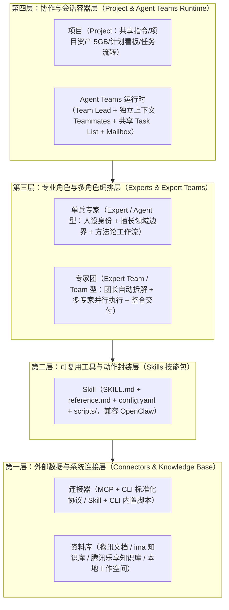

# 腾讯 WorkBuddy（产品代号 1831）全栈架构与专家团机制一手深度调研（argon 独立版）

> **调研声明**：本报告由 `argon` 独立撰写，全部事实直接取自腾讯云官方文档中心 **WorkBuddy Enterprise（产品编号 `1831`）** 与国际站对应文档（产品编号 `1316`）的原始页面（更新日期覆盖 2026 年 7 月至 2026 年 11 月 5 日），绝不参考、转述或依赖任何其他助手的文稿。
> **事实与判断分离原则**：第一至第八节严格陈述腾讯云官方一手文档记载的客观事实并附带精确文档编号与 URL；第九节独立阐述 `argon` 对本项目的架构判断与取舍建议。

---

## 一、 官方一手文档索引（腾讯云 `product/1831` 目录树核查）

以下为本次直接抓取并核验的腾讯云 `1831` 官方一手文档页面：

| 模块分类 | 官方文档标题 | 官方 URL（`cloud.tencent.com/document/product/1831/*`） | 官方最近更新时间 |
| :--- | :--- | :--- | :--- |
| **产品与版本** | 产品简介 | [`/document/product/1831/134384`](https://cloud.tencent.com/document/product/1831/134384) | 2026-09-23 |
| **产品与版本** | 版本说明（旗舰版/专享版/私有化 & Buddy One/企微套件） | [`/document/product/1831/134332`](https://cloud.tencent.com/document/product/1831/134332) | 2026-10-30 |
| **产品与版本** | 专享版 5.30.0 版本（含 WorkBuddy 5.11.0 专家团上新） | [`/document/product/1831/140565`](https://cloud.tencent.com/document/product/1831/140565) | 2026-11-05 |
| **产品与版本** | 专享版 5.10.0 版本（安全中心、云端沙箱人机双写等） | [`/document/product/1831/139967`](https://cloud.tencent.com/document/product/1831/139967) | 2026-10-23 |
| **核心能力层** | 专家（单兵专家与专家团使用、创建、分享与管理） | [`/document/product/1831/134393`](https://cloud.tencent.com/document/product/1831/134393) | 2026-10-15 |
| **核心能力层** | 企业控制台 — 专家管理（分类、精选、下发策略、内置默认状态） | [`/document/product/1831/134421`](https://cloud.tencent.com/document/product/1831/134421) | 2026-10-28 |
| **核心能力层** | 技能（Skill 安装、上传、查找、创建与安全提示） | [`/document/product/1831/134432`](https://cloud.tencent.com/document/product/1831/134432) | 2026-09-07 |
| **核心能力层** | 连接器（MCP+CLI / Skill+CLI、按需连接与重连） | [`/document/product/1831/134525`](https://cloud.tencent.com/document/product/1831/134525) | 2026-11-03 |
| **协作与工作台** | 新建任务栏（本地 AI 工作台：Default / Ask / Plan 模式） | [`/document/product/1831/134391`](https://cloud.tencent.com/document/product/1831/134391) | 2026-08-03 |
| **协作与工作台** | 项目（项目资产、本地/云端任务模式、任务分享与流转、计划看板） | [`/document/product/1831/138797`](https://cloud.tencent.com/document/product/1831/138797) | 2026-09-24 |
| **协作与工作台** | 右侧边栏（任务概览浮层、产物、工作空间、变更、浏览器、终端） | [`/document/product/1831/134400`](https://cloud.tencent.com/document/product/1831/134400) | 2026-11-03 |
| **多智能体引擎** | Agent Teams（团队领导、成员、共享任务列表、信箱、委派模式） | [`/document/product/1831/137017`](https://cloud.tencent.com/document/product/1831/137017) | 2026-08-26 |
| **多智能体引擎** | 插件 API 参考（`plugin.json`、Skills、Agents、Hooks、MCP/LSP） | [`/document/product/1831/137036`](https://cloud.tencent.com/document/product/1831/137036) | 2026-08-26 |
| **托管智能体 WMA** | WorkBuddy Managed Agents — Agents 构建、A2A 与版本管理 | [`/document/product/1831/140282`](https://cloud.tencent.com/document/product/1831/140282) | 2026-10-28 |
| **托管智能体 WMA** | Agent Manifest v2.0 字段说明与强校验规则 | [`/document/product/1831/139534`](https://cloud.tencent.com/document/product/1831/139534) | 2026-10-16 |
| **自动化与外联** | 助理（远程任务：微信/企微/QQ/钉钉/飞书遥控电脑端） | [`/document/product/1831/134392`](https://cloud.tencent.com/document/product/1831/134392) | 2026-09-16 |
| **自动化与外联** | 自动化（本地定时任务、模板与小程序推送） | [`/document/product/1831/134399`](https://cloud.tencent.com/document/product/1831/134399) | 2026-09-07 |
| **安全、记忆与计费** | 默认权限与安全沙箱 | [`/document/product/1831/134401`](https://cloud.tencent.com/document/product/1831/134401) | 2026-11-03 |
| **安全、记忆与计费** | 记忆（每晚自动提取、跨平台导入、零积分消耗） | [`/document/product/1831/134444`](https://cloud.tencent.com/document/product/1831/134444) | 2026-07-20 |
| **安全、记忆与计费** | 计费说明 & 积分（Credits）说明 | [`/document/product/1831/134334`](https://cloud.tencent.com/document/product/1831/134334) / [`134339`](https://cloud.tencent.com/document/product/1831/134339) | 2026-10-27 |

---

## 二、 产品矩阵全景与企业版套件划分（官方事实）

根据 [`1831` 全局目录树](https://cloud.tencent.com/document/product/1831) 与 [版本说明（134332）](https://cloud.tencent.com/document/product/1831/134332)，腾讯云 `WorkBuddy Enterprise` 并非单一聊天软件，而是由**四大核心子系统**与**两类企业套件**组成的完整生态：

### 2.1 四大核心子系统
1. **WorkBuddy（全场景 AI 办公工作台，客户端/Web 端）**：面向日常办公、深度调研、项目协作、专业任务分析与设计创意的桌面端/云端工作台（最新客户端版本为 2026 年 11 月发布的 `v5.11.0`）。
2. **CodeBuddy（AI 研发套件：CodeBuddy IDE + CodeBuddy 插件 + CodeBuddy Code CLI/SDK）**：面向软件工程研发的智能 IDE、IDE 插件与命令行/SDK 工具（包含底层 `Subagents`、`Agent Teams`、`Hooks`、`Workflow stdio 协议`、`ACP 协议`）。
3. **WorkBuddy Managed Agents（简称 WMA，云端托管智能体开发与运行平台）**：提供云端 Agent 构建、版本管理、**Agent Manifest v2.0** 声明、**A2A（Agent-to-Agent）** 协议暴露与路由、VPC 私有访问/公网 API、Webhook 自动化任务投递及 OpenAPI 接口。
4. **企业控制台（Enterprise Admin Console）**：统一管理组织架构与认证源（飞书/钉钉/企微/AD/Entra ID/LDAP/OIDC/SAML2.0/CAS）、AI 资源管理（知识库、模型、Playbook、技能、套件、专家、自定义指令、连接器）、安全中心、可观测中心与积分用量治理。

### 2.2 三档企业部署版本与两类旗舰版权益套件
根据 [版本说明（134332）](https://cloud.tencent.com/document/product/1831/134332)：
- **部署版本**：
  - **旗舰版**（腾讯云共享 VPC，1 人起购，**198 元/人/月** 或 2,376 元/人/年，赠送 **2,000 Credits/人/月** 团队共享池）。
  - **专享版**（腾讯云专享 VPC，100 人起购，**316 元/人/月** 或 3,792 元/人/年，赠送 **2,000 Credits/人/月** 团队共享池，增加专属网络访问与专属企业插件）。
  - **私有化企业版**（企业私有化部署，无 Credits 用量限制）。
- **旗舰版二选一权益类型（创建企业后不可切换）**：
  1. **Buddy One 智能体套件**：包含 `WorkBuddy + CodeBuddy`，并原生内置五大腾讯办公协同产品（**腾讯文档**、**腾讯乐享知识库**、**腾讯设计 Ardot**、**腾讯网盘［每席 50GB］**、**安全与效能运营平台**）。
  2. **企业微信联合套件**：仅支持企业微信扫码登录并直接复用企微通讯录；核心能力是让 WorkBuddy 在授权范围内直接获取企微上下文（群聊、文档、会议、微盘）并在企微内给 WorkBuddy 派活（不含 CodeBuddy 与上述独立办公协同产品包）。

---

## 三、 “连接器 — 技能 — 专家/专家团 — 项目”四层能力架构（官方事实）

WorkBuddy 在官方文档 [专家（134393）](https://cloud.tencent.com/document/product/1831/134393)、[技能（134432）](https://cloud.tencent.com/document/product/1831/134432)、[连接器（134525）](https://cloud.tencent.com/document/product/1831/134525) 中明确定义了能力解耦的四层结构：



### 3.1 官方对 Skill、专家、专家团的三维界定
在 [专家（134393）](https://cloud.tencent.com/document/product/1831/134393) 中，官方用一张标准对比表界定了三者的职责边界：

| 维度 | Skill（技能） | 专家（Agent 型） | 专家团（Team 型） |
| :--- | :--- | :--- | :--- |
| **核心机制** | **工具能力封装** | **“角色切换”机制** | **“协作执行”机制** |
| **组成关系** | 工具能力：封装可执行脚本与工作流，让 AI “能做某件事” | AI 顾问：通过“人设 + 方法论 + 工具链”配置懂某个垂直领域的 AI 角色 | AI 协作团队：由多位专家分工协作，由**团长**自动拆解、并行执行并整合交付 |
| **适用场景** | 需要 AI 具备某种具体工具动作（如生成 PPT、合并 Excel、发邮件） | 有一个明确的单点领域问题（如文档评审、后端代码审查、数据分析） | 任务复杂，需要跨角色、多专长配合完成完整闭环交付 |

---

## 四、 专家与专家团（Experts & Expert Teams）全生命周期机制（官方事实）

### 4.1 权限零特权原则与“按需连接引导（Just-in-time Connection）”
根据 [专家（134393）](https://cloud.tencent.com/document/product/1831/134393) 与 [连接器（134525）](https://cloud.tencent.com/document/product/1831/134525)：
- **专家本身不主动获取系统权限**：专家仅处理用户主动提供的对话与上传文件；只有当专家挂载了 `Skill` 或 `MCP 连接器` 时，才会在用户授权下间接访问本地文件或外部服务。
- **按需懒加载连接引导**：
  - 部分专家依赖外部连接器（如腾讯文档、TAPD、QQ 邮箱、腾讯乐享）。
  - **不会在会话开始时一次性弹窗罗列全部依赖**，而是**仅在任务执行到某一步实际需要调用该未连接服务时**，在输入框上方动态弹出“连接引导卡片”（展示服务名称与头像）。
  - 用户点击卡片上的**「连接」**（或遇到凭证过期点击**「重新连接」**）完成扫码/OAuth 授权后，**WorkBuddy 会自动继续当前任务并自动重试刚才失败的那一步，无需重新发起对话**（同一失败步骤重连后自动重试一次）。

### 4.2 专家与专家团的召唤、会话隔离与客户端创建
根据 [专家（134393）](https://cloud.tencent.com/document/product/1831/134393) 与 [5.30.0 版本记录（140565）](https://cloud.tencent.com/document/product/1831/140565)：
- **卡片信息差异**：
  - **单兵专家卡片**：展示能力介绍、擅长领域、任务示例。
  - **专家团卡片**：展示能力介绍、擅长领域、**团队成员（Team Members）**、任务示例。
- **专家团会话的强制隔离规则**：
  - 在已经使用**专家团**的会话中，若用户通过搜索召唤其他专家，系统会弹窗提示：**「当前会话已使用专家团，切换其他专家需要开启新对话」**。
  - 用户确认后，系统会先回到新对话态再完成召唤，**新专家绝不会回绑到当前专家团会话中**。
- **对话式引导创建专家**：
  - 用户在客户端点击「我的专家 > 创建专家」后，系统直接进入**创建对话**，由内置的“专家管理工具”通过多轮对话引导用户完成四项核心配置：
    1. **头像与显示名称**（要求短角色名如“文档评审官”，避免“专家1”）；
    2. **人设身份**（要求写“是谁 + 有什么背景”，避免写成任务本身）；
    3. **擅长领域**（要求写清边界，**同时说明“做什么”和“不做什么”**，避免“什么都行”）；
    4. **提示词**（要求写清工作流程、输出格式与约束，最好附带示例）。
  - **不可变约束**：专家名称在创建前确认后**不可修改**（若需改名需重新创建）；但创建后可通过「修改专家」进入修改对话，迭代优化角色定位、任务范围、工作方法和输入要求。
- **链接分享的副本隔离语义**：
  - 客户端「分享专家」仅生成召唤链接供团队成员使用，**不会将专家上架到公开专家市场**。
  - 其他成员通过分享链接召唤的是该专家的**独立副本**，其使用不会影响原作者的配置；但原作者一旦删除该专家，已分享链接将失效。

### 4.3 企业控制台对专家与专家团的治理管控
根据 [专家管理（134421）](https://cloud.tencent.com/document/product/1831/134421) 与 [5.30.0 版本记录（140565）](https://cloud.tencent.com/document/product/1831/140565)：
- **双来源管理**：区分 **`企业自建`**（企业管理员上传维护，在客户端“企业市场”按分类展示）与 **`内置市场`**（平台预置开箱即用）。
- **企业专家元数据模型**：包含 `头像`、`专家标识`（全局唯一语义化 ID，如 `frontend-expert`，**发布后不可修改**）、`显示名称`、`职业`、`分类`（上传前必须先有分类，否则阻断上传）、`归属部门`、`版本`（默认 `v1.0`）、`描述`（≤500 字）、`状态`、`可见范围`、`启用状态`。
- **企业级专家团创建与下发**：在 `v5.30.0`（对应客户端 `v5.11.0`）中，企业控制台「专家管理」正式支持**创建专家团并统一下发**，成员可在客户端**「项目」**中直接使用专家团。
- **“新增内置专家默认状态”管控（先审后用机制）**：
  - 企业全局管理员可将官方后续新增内置专家的默认状态设为**「默认禁用」**（系统默认为「默认启用」）。
  - 设为「默认禁用」后，官方每批新推出的内置专家进入企业清单时自动处于禁用态，不会下发至员工客户端，必须经企业管理员审核并手动启用后员工方可见可用。
- **精选专家管理与叠加可见范围**：
  - 支持配置客户端顶部「精选专家区」（总开关 + 最多 20 个精选席位，支持实时预览）。
  - 分类可见范围与专家/技能自身可见范围**叠加生效（取交集）**。

---

## 五、 底层多智能体协作引擎：Agent Teams 运行时深度拆解（官方事实）

腾讯云在 [`1831/137017`（Agent Teams）](https://cloud.tencent.com/document/product/1831/137017) 中完整披露了其多智能体团队运行时的底层架构、通信协议、权限优先级与工程局限。

### 5.1 子代理（Sub-agents）与 Agent Teams 的架构分野
官方文档明确对比了单会话内的 `Sub-agents` 与多实例协同的 `Agent Teams`：

| 对比维度 | 子代理（Sub-agents） | 多智能体团队（Agent Teams） |
| :--- | :--- | :--- |
| **上下文窗口** | 独立上下文窗口，执行完毕将结果返回给调用者 | 独立上下文窗口，各实例**完全独立** |
| **通信拓扑** | **星型单向**：只能向主代理报告结果 | **全互联 + 直连**：成员之间可直接发消息；人类用户也可绕过领导直接与任意成员对话 |
| **任务协调机制** | 主代理集中管理所有工作 | **共享任务列表（Task List）**：支持领导指派，也支持成员完成后**自主认领**下一个未阻塞任务 |
| **Token 消耗** | 较低（仅摘要结果汇回主上下文） | 较高（每个成员均为独立运行的完整实例） |
| **最佳适用场景** | 聚焦型独立子任务，只关心最终结果 | 需要多视角并行探索、相互质疑辩论（如竞争性假设调试）或跨层接口协同的复杂工程 |

### 5.2 Agent Teams 的四大核心运行组件与本地存储结构
1. **团队领导（Team Lead）**：创建团队、生成成员、协调工作与汇总最终成果的主会话（整个生命周期内领导角色固定，不可转让，且不支持嵌套创建子团队）。
2. **团队成员（Teammates）**：进程内（in-process）独立运行的实例，各自拥有独立上下文窗口。生成时自动加载项目级上下文（`CODEBUDDY.md`、MCP 服务器、Skills）与领导下发的初始 Prompt，但**绝不继承领导的历史对话记录**。
3. **共享任务列表（Task List）**：
   - 本地持久化路径：`~/.codebuddy/tasks/{team-name}/`（团队配置位于 `~/.codebuddy/teams/{team-name}/config.json`）。
   - **三态流转与 DAG 依赖解锁**：任务包含 `待处理`、`进行中`、`已完成` 三种状态，支持设置任务间依赖关系——当上游被依赖任务标记完成后，下游阻塞任务**自动解除阻塞**。
   - **双模派单**：既支持领导显式指定分配，也支持成员在完成当前任务后**自动从共享任务列表中认领下一个未分配且未阻塞的任务**（官方建议每个成员维持 5~6 个任务粒度最佳）。
4. **消息系统（Mailbox）**：
   - 本地持久化路径：`~/.codebuddy/teams/{team-name}/inboxes/{member}.json`。
   - **五种标准消息原语**：
     - `message`：点对点向指定成员发送消息；
     - `broadcast`：向全部成员广播（官方文档特别警告：Token 消耗随成员数线性增长，需谨慎使用）；
     - `shutdown_request` / `shutdown_response`：领导发起优雅关闭请求，成员完成当前工具调用后可接受退出或附带理由拒绝；
     - `plan_approval_response`：领导对成员所提交实施计划的批准或驳回响应。
   - **已完成成员的自动唤醒重启机制**：已经完成任务退出的成员仍保留在 `@` 列表中；一旦收到人类或其它成员发来的新消息，系统**自动重新启动该成员实例**继续工作，无需人工手动拉起。

### 5.3 两大核心工程护栏：“先交计划后实施”与“委派模式（Delegate Mode）”
1. **成员实施前计划审批（Plan Approval）**：
   - 针对高风险或架构级子任务，可要求成员在修改代码/文件前先处于计划模式（Plan Mode），向 Team Lead 发送计划审批请求。
   - Team Lead 审核后返回批准或拒绝（附带修改反馈）；被拒绝的成员保持在计划模式修改方案并重新提交，直至获批后才解锁写操作。
2. **委派模式（Delegate Mode —— 解决“团长自己下场干活”的顽疾）**：
   - 官方文档坦承：“*默认情况下，领导可能会自己动手实现任务，而不是等成员完成。*”
   - 用户按 `Shift+Tab` 即可将 Team Lead 切换至**委派模式（Delegate Mode）**。在此模式下：
     - **强制剥夺领导的执行工具**：Team Lead 被限制**只能调用 5 个协调类工具**（`Agent`、`TaskStop`、`SendMessage`、`AskUserQuestion`、`StructuredOutput`），**严禁直接探索代码、运行命令或编辑文件**。
     - **成员权限豁免（不继承委派限制）**：委派模式的工具限制仅约束 Team Lead 自身；派生的 Subagent/Teammates 默认使用完整的 `default` 权限模式，且强制走标准 subagent 路径（不走 fork 路径），确保成员具备完整干活能力。

### 5.4 人机直连交互体验
- **输入框 `@` 提及与 `@all` 广播**：输入 `@` 触发带颜色标识与状态标记（`●` 工作中、`✓` 已完成、`✗` 失败、`—` 已取消）的成员自动补全，可直接向任一成员下达补充指令。
- **实时状态栏**：输入框下方常驻显示 `Team (N active) · @member1 ● @member2 ✓`，实时渲染每个成员的 Token 消耗与工具调用次数。
- **键盘焦点导航（Focus Navigation）**：输入框为空时按 `↓` 进入成员切换模式，`←/→` 选择成员，`Enter` 切入该成员专属视图（完整展示该成员独立对话历史、实时进度与 Token 消耗，输入框直接变为向该成员发消息；输入 `@main` 路由回领导，`Ctrl+O` 一键返回主视图）。

### 5.5 官方披露的 Agent Teams 七项已知工程限制
在 [`1831/137017` 文末](https://cloud.tencent.com/document/product/1831/137017)，腾讯云实事求是地列出了当前多智能体团队的 7 项已知工程局限：
1. **无会话恢复**：`/resume` 和 `/rewind` 无法恢复已生成的团队成员实例，恢复会话后需让领导重新生成成员。
2. **任务状态可能滞后**：成员有时未能及时将已完成任务标记为 `已完成`，导致下游依赖任务一直处于阻塞态，需人工或领导巡检更新状态。
3. **优雅关闭存在延迟**：成员收到关闭请求后会等待当前正在执行的请求或工具调用结束后才退出。
4. **单会话单团队限制**：每个主会话同一时刻只能管理一个团队，必须先关闭所有活跃成员并执行 `清理团队` 后才能创建新团队。
5. **不支持嵌套团队**：成员无法再创建子团队，只有顶层 Team Lead 可管理团队。
6. **领导角色固定**：创建团队的会话终生为领导，不可动态禅让。
7. **文件并发写冲突风险**：若两个成员同时编辑同一文件会导致互相覆盖，拆分任务时必须确保各成员负责互不重叠的文件集合。

---

## 六、 项目工作台（Project）、任务流转与右侧多标签产物面板（官方事实）

### 6.1 “项目 — 任务 — 计划 — 资产”四维协同模型
根据 [项目（138797）](https://cloud.tencent.com/document/product/1831/138797)：
- **项目（Project）**：团队协作的核心容器，统一绑定**项目指令**（所有任务自动继承的 AI 行为规则）、**连接器**（区分管理员配的**公共授权**与成员本地保存的**个人授权**，**多人协作任务强制仅允许使用公共授权连接器**）、**项目专家/专家团**、**项目 Skill** 与**项目资产**（每个项目独立 5GB 腾讯网盘空间，支持通过 RAG 向量检索或 `read-file` 注入任务上下文）。
- **本地任务 vs 云端任务双模式切换**：
  - **本地任务（本机模式）**：脚本与文件操作在本机工作空间执行，支持访问内网、本地软件与开启“允许完全访问”，需保持电脑开机。
  - **云端任务（云上模式）**：在腾讯云隔离沙箱执行，无需本机开机，适合跨设备、定时任务与多人云端协作。
- **任务分享（Share）vs 任务流转（Transfer/Handoff）**：
  - **分享**：生成邀请链接，让其他成员直接进入**当前同一个任务会话**共同参与。
  - **流转**：将任务产出物连同完整上下文**移交**给他人。触发流转时，系统会**将原任务的完整上下文（对话记录、工具调用记录、中间产物）深拷贝到全新的会话**中，接收方在独立新会话中接续推进，既免去了重复交代背景，又不会污染原会话。
- **项目计划（多视图看板）**：独立于对话会话的工作事项跟踪器，原生提供 **看板（Kanban）、列表、表格、甘特图、日历** 五种视图，支持负责人指派、起止时间、筛选与分组。
- **积分归属铁律**：项目任务中的所有对话（含多人协作任务）**统一消耗“任务所有者（创建者）”的积分**，且仅任务所有者有权切换该任务使用的模型。

### 6.2 右侧边栏与产物人机共编
根据 [右侧边栏（134400）](https://cloud.tencent.com/document/product/1831/134400) 与 [5.10.0 更新记录（139967）](https://cloud.tencent.com/document/product/1831/139967)：
- **右上角「任务概览」浮层**：实时汇总当前对话生成的全部**产物文件清单**与**任务进程（执行步骤树）**。
- **右侧多标签页工作区**：支持同时打开多个**产物**、多个**内置浏览器**（支持登录态持久复用与操作本地 Chrome/Edge）、多个**终端**，以及唯一的**工作空间文件树**与**变更（Diff 差异对比）**标签页。
- **产物人机双写与局部 AI 编辑**：
  - 云端沙箱内的 Markdown 产物支持**人机双写与划词评论**；
  - HTML / Word 产物支持一键在「预览态」与「编辑态」间切换；
  - 本地 Excel 在右侧栏打开后，选中单元格区域右键可直接触发**「AI 编辑」**对局部选区做原地修改。

---

## 七、 Agent Manifest v2.0 与插件规范（Plugin API）（官方事实）

### 7.1 Agent Manifest v2.0 强类型版本契约
根据 [Agent Manifest 字段说明（139534）](https://cloud.tencent.com/document/product/1831/139534)，WorkBuddy Managed Agents 使用 JSON 格式的 `Manifest v2.0` 作为 Agent 的版本级能力声明：

```json
{
  "version": "2.0",
  "system_prompt": "你是一个数据分析助手。",
  "skills": [
    { "type": "builtin", "id": "skill_2108966609670115328", "version": "1.0.0" },
    { "type": "custom", "id": "skill_2187654321098765432" },
    { "type": "authorized", "id": "skill_2209876543210987654", "auth_enterprise_id": "fyfq9rkft8n4" }
  ],
  "experts": [
    { "type": "custom", "id": "ex_3LpzJRabpekC", "version": "2.1.0" }
  ],
  "mcp_servers": [
    { "name": "my-search", "url": "https://mcp.example.com/search", "transport": "sse", "protocolVersion": "2025-03-26" }
  ],
  "subagents": [],
  "metadata": {
    "welcome_message": "您好，请上传需要分析的报表。",
    "suggested_questions": ["分析本季度营收波动原因", "核对三表勾稽关系"]
  }
}
```

**核心架构约束**：
1. **体积与原子校验**：序列化后上限 **256 KiB**；任一字段不合法则**整体拒绝**，绝不部分生效。
2. **三类资源引用（`SkillRef` / `ExpertRef`）**：`type` 严格枚举为 `builtin`（平台内置）、`custom`（本企业自建）、`authorized`（跨企业授权引用，需配 `auth_enterprise_id`）；物理包下载地址由平台运行时自动解析补齐，禁止调用方硬编码 URL。
3. **严禁明文凭据**：`mcp_servers` 若携带 `headers` 或 `env` 字段会在校验阶段直接报错拒绝，所有鉴权由系统运行时统一注入。
4. **系统托管键剥离**：`metadata` 中若传入 `model`、`description`、`agentName` 会被系统自动覆盖或剥离（因为 `model` 由版本级独立参数管理，`description` 由接口独立字段管理）。

### 7.2 插件架构（`plugin.json`）与插件子代理安全沙箱
根据 [插件 API 参考（137036）](https://cloud.tencent.com/document/product/1831/137036)：
- 插件可同时打包五类组件：**`Skills`（`skills/*/SKILL.md`）**、**`Agents`（`agents/*.md`）**、**`Hooks`（`hooks/hooks.json`，支持 `SessionStart`、`UserPromptSubmit`、`PreToolUse`、`PostToolUse`、`PermissionRequest` 等拦截）**、**`MCP Servers`**、**`LSP Servers`**。
- **插件内子代理（Agents）的声明与安全阉割**：
  - 采用 Markdown Frontmatter 定义：`name`、`description`、`model`、`effort`、`maxTurns`、`tools`、`disallowedTools`、`skills`、`memory`、`background`、`isolation`。
  - 其中 `isolation` 的唯一合法值为 **`"worktree"`**（即 Git Worktree 隔离）。
  - **安全阉割硬规则**：出于安全原因，**插件自带的 Agent 严禁声明 `hooks`、`mcpServers` 和 `permissionMode` 字段**，防止第三方插件子代理越权篡改宿主权限或外连未知 MCP 服务。

---

## 八、 安全沙箱、分层记忆与远程助理（官方事实）

1. **双档权限模式与五层沙箱保护（[`1831/134401`](https://cloud.tencent.com/document/product/1831/134401)）**：
   - **默认权限**：以当前任务的**工作空间（Workspace 文件夹）**为边界。工作空间内普通文件读写直接放行；一旦触发四类高风险动作（① 写入受保护/敏感路径、② 删除受保护文件/重要目录/批量删除、③ 执行脚本/命令/外部程序、④ 命中安全中心规则的网络访问），**立即暂停并弹窗请求人工确认**。
   - **沙箱纵深兜底**：命令优先在 Bash 沙箱约束下运行；删除操作默认移入回收站（v5.10.0）；Windows 下修改已有文件前自动生成备份；`@文件` 改为仅注入路径、按需读取以降低上下文与积分开销（v5.10.0）。
2. **每晚离线提炼的个人记忆系统（[`1831/134444`](https://cloud.tencent.com/document/product/1831/134444)）**：
   - **每晚异步整理**：每晚自动从当天会话历史中抽取事实信息、偏好习惯、人物关系、近期跟进事项，次日通过注入系统提示词及历史检索生效。
   - **平台自费零积分消耗**：官方文档明确承诺，记忆提取由 WorkBuddy 平台自费完成，**不向用户额外消耗任何 Token 或积分（Credits）**。
   - **跨平台记忆迁移**：提供标准导出 Prompt，支持用户一键从其它 AI 助手导入个人使用习惯记忆。
3. **IM 远程助理与本地自动化的边界（[`1831/134392`](https://cloud.tencent.com/document/product/1831/134392), [`134399`](https://cloud.tencent.com/document/product/1831/134399)）**：
   - **助理（远程控制）**：支持通过微信、微信客服号（直接扫码）、企业微信、QQ 机器人、钉钉、飞书向电脑端发消息派活。**架构约束**：远程任务固定使用专属的 `助理` 文件夹作为工作目录，且**所有远程指令集中在唯一一个不可清空历史的会话中串行处理**（区别于本地普通任务的多会话并行）。

---

## 九、 argon 的独立架构判断：WorkBuddy 的得失剖析与我方方案映射

通过对腾讯云 `1831` 全套一手文档的深度拆解，我认为 WorkBuddy 是目前国内将“技能 — 单兵专家 — 专家团 — 项目看板 — 企业治理”结合得最完整的标杆产品，但其演进过程中暴露出的架构折中与工程痛点同样为我们提供了极有价值的反面教材。

### 9.1 WorkBuddy 值得我方直接吸收的五大架构精华
1. **“Skill（动作工具）$\neq$ Expert（单点顾问）$\neq$ Expert Team（多角色协同）”的清晰分层**：
   - 映射到我方系统：我们的“四表勾稽检验”、“MD&A 交叉印证”、“杜邦分解”、“三表预测建模”应定义为 `knowlab` 中细粒度、可独立评测与复用的 **方法组件（Method / Skill）**；而“财务分析与预测专家”是挂载了通用分析模板与这批方法池的 **专家（Expert）**；当需要“财务专家 + 行业研报专家 + 法务合规专家”联合作战时，则组装为 **专家团（Expert Team）**。
2. **Manifest v2.0 的“纯引用（`type + id + version`）+ 零明文凭据”设计**：
   - 映射到我方 `knowmart` 与 `knowbench`：专家与专家团的版本发布单（Manifest）必须采用不可变版本引用，严禁把下游专家的 Prompt 或数据源密钥硬编码进上游包里；运行时由 `knowbench` 根据租户/项目的授权绑定动态注入。
3. **Team Lead 的“委派模式（Delegate Mode）”与“实施前计划审批（Plan Approval）”**：
   - 映射到我方 `专家团使用方案`：必须从工具集层面限制专家团团长，禁止团长越权调用成员领域的底层分析脚本，强制团长只行使**任务拆解、看板调度、计划审批、异常仲裁与终稿统稿**五项职权。
4. **任务流转（Handoff）的“上下文+中间产物深拷贝”与右侧产物栏机制**：
   - 映射到我方 `knowbench`：专家之间、以及人与专家之间的交接，必须以**结构化产物文件（Artifact）+ 轻量执行摘要**为载体，并在工作台右侧提供实时产物预览、版本对比（Diff）与溯源高亮。
5. **“按需连接引导（Just-in-time Connection）”与断点续跑**：
   - 映射到我方数据契约：当动态专家或专家团在执行中途发现缺少某份底稿或知识库未挂载时，不应直接报错终止整个长链路任务，而应挂起当前节点（`WAITING_INPUT`）、弹出补数交互卡，待用户或作者补齐数据后**原地断点续跑**。

### 9.2 WorkBuddy 暴露的四大工程短板及我方必须在架构上超越之处
1. **短板一：Agent Teams 依赖成员 LLM 自己调工具更新任务状态，导致“状态滞后与下游死锁”**
   - **一手证据**：[`1831/137017` 已知限制第 2 条](https://cloud.tencent.com/document/product/1831/137017) 明确承认：“*任务状态可能滞后：成员有时未能及时标记任务为已完成，导致依赖任务被阻塞*”；且 [`1831/140565`（v5.11.0 修复记录）](https://cloud.tencent.com/document/product/1831/140565) 也记录了“*修复专家团任务中断后无法完成、点继续报服务异常的问题*”。
   - **我方超越方案**：在 `knowbench` 的任务看板引擎中，**绝不能完全靠成员 LLM 凭自觉调工具去改任务状态**！任务状态的流转（`PENDING -> RUNNING -> VERIFYING -> COMPLETED / FAILED`）以及 DAG 下游解锁，必须由 **`knowbench` 确定性工作流状态机（Orchestrator Harness）** 在捕获到成员产物的确定性验收通过信号后**由引擎强制原子更新**，并支持持久化 Checkpoint 断点恢复（彻底解决 WorkBuddy `/resume` 无法恢复团队成员的缺陷）。
2. **短板二：客户端对话式创建的专家只是“一段大 Prompt”，缺乏结构化方法编排与确定性质量门禁**
   - **一手证据**：[`1831/134393`](https://cloud.tencent.com/document/product/1831/134393) 中客户端创建专家仅配置“名称 + 人设 + 擅长领域 + 一段提示词”，导致固定流程与动态选方法难以统一，也无法对专业计算（如财务勾稽恒等式）做刚性托底。
   - **我方超越方案**：在 `knowlab` 中，我们将专家内部架构设计为**“统一阶段骨架模板（Universal Stage Template）+ 可选原子方法图谱（Selectable Method Graph）+ 确定性校验算子（Deterministic Validators）”**三合一结构，既允许 AI 根据题目与数据动态裁剪方法，又保证每一个被选中的方法都有严格的输入契约、计算脚本与输出验收规则。
3. **短板三：WorkBuddy 缺乏面向专业方法作者的“题单级数据集选配与双轨对标评测台”**
   - **一手证据**：WorkBuddy 的客户端与企业控制台侧重于办公提效与权限分发，虽然在 v5.10.0 提到了简单的企业智能体评测，但没有针对复杂垂直领域（如多公司、多年份财报题单）的“按题绑定测试数据包、方法级命中率回放、固定专家 vs 动态专家 A/B 对标”机制。
   - **我方超越方案**：在 `knowlab` 孵化方案中专门构建**题单驱动的孵化评测矩阵（Question-Dataset Binding & A/B Replay Harness）**，让作者能够针对验证题单中的每一道题显式勾选/排除特定数据源（如故意拿掉某年报的 MD&A 章节测试专家的动态降级能力）。
4. **短板四：WorkBuddy 的商业化仅停留在“席位订阅 + Token 积分池抵扣”，缺乏外部专家作者与团队组装者的多方市场权益结算**
   - **一手证据**：[`1831/134334`](https://cloud.tencent.com/document/product/1831/134334) 显示其商业模式为腾讯自营席位费 + Credits 资源包，跨企业仅支持简单的 `authorized` ID 绑定，没有真正的第三方作者定价、版本衍生授权与专家团组合分账契约。
   - **我方超越方案**：在 `knowmart` 方案中，围绕单兵专家与专家团建立完整的**“公开能力契约挂牌 + 语义化版本演进 + 成员专家被团引用的组合授权（Composite Licensing）与计量分润 + 成员下架/升级的快照隔离兜底”**机制。
