# 数据拓扑：云端真源在 knowbase，knowfeed 供给，应用使用，各栏展示

> **状态**：第四版，重写稿（2026-10-26 所有者定稿：「可以，用新稿替换数据拓扑.md」）。取代 10-18 第三版和 10-19、10-23、10-23 晚三次改定；旧决定现在算什么，见第二十节「沿革」。
>
> **来源**：所有者与 Opus 10-26 逐条讨论的七条（[讨论记录](数据拓扑重构/数据拓扑重构-opus/讨论记录.md)，所有者原话都在那里，本页不重复）；Fable、Kimi、Luna、Qwen 的评审与 Opus 的处置（[评审](数据拓扑重构/评审/opus-response.md)）；[重构大纲](数据拓扑重构/数据拓扑重构-opus/重构大纲.md)第二稿。
>
> **本页只定架构**：数据放在哪、归谁、谁能读、怎么进来、怎么用、怎么删、合规上怎么说。接口、表结构、采集体系怎么搭放在 SDD。
>
> **地图位置**（按 [架构总纲](架构总纲.md)）：全图里第 7 层产品线与第 6 层应用层的数据归属那一块；其中同意依据、绑定、运行授权也是横切的安全规矩。
>
> 相关：[运行拓扑](运行拓扑.md)（网络与交付链）、[constraints](../design/rules/constraints.md)（C-D 数据规矩、C-L 合规边界）、SDD [0042](../design/SDD/modules/0042-knowledge-bases.md)（知识库）、[0037](../design/SDD/modules/0037-idea-avatar-expert.md)（knowlab 两端）、[0026](../design/SDD/modules/0026-knowlab.md)（knowlab）、[0018](../design/SDD/modules/0018-advisor-market.md)（knowmart）。

## 一、为什么重构

10-23 那一版跑起来以后，有四件事不对：

1. **knowbench 本地知识库没有用处**。它和项目目录重复：专家本来就在用户电脑的项目目录里读写。为它却多出一整套钉住、核摘要、分块回读、link 目录权限。
2. **上传、采集、读的分工不清**。三个应用各有上传，代采落进发起的那一边，同一个人的数据在 knowbase 里按应用各存一份。
3. **用户手挑数据太繁琐**。每次请专家都要对着专家的数据要求，一份份去选。
4. **knowlab 只有平台代为孵化**，要新增用户自助。两种模式在数据上的要求差别很大。

有一个取舍要说在前面：删掉本地知识库以后，用户电脑上的文件要给云端的专家用，只能先上传到云端。本地文件只在一种情况下不用上传：专家在用户电脑上的项目目录里就地干活。

## 二、根本原则与角色

1. **云端真源只有 knowbase**：云端的来源数据、版本、使用权、授权，都以 knowbase 为准。备份、缓存、检索索引可以有，但要标明来自哪一版，不能自成一份主档（C-D1、C-D14）。
2. **knowfeed 是供给的门，不是真源**：它负责采集，把采来的交给 knowbase；它不在读的路上。
3. **应用是使用者，知识库栏和 knowmart 是展示者**：knowbench、knowlab，以及专家，是使用数据的；各应用里的「知识库」栏和 knowmart，只是展示 knowbase 里的数据，自己不存。knowbench、knowlab 的知识库栏，和 knowmart 卖方的展示栏是同一类东西。
4. **数据分供给和需求**：供给是采集（归 knowfeed）和上传（归 knowbase web端）；需求是应用要用数据，先找 knowbase，要不到再经 knowfeed 补。
5. **一份数据只存一份**：买卖、给几个应用用、绑给专家，都不复制，只多一条使用权、展示或绑定。
6. **本地项目目录归用户自管**：用户自己放、自己管，专家在里面就地读写。平台对它不钉版本、不核摘要、不做数值验收、不留读数痕迹。口号上可以说「两个真源」（本地项目目录、云端 knowbase），但两者不是同一种意义上的真源。
7. **平台是特殊的用户，但也是用户**：平台就是几个账号（做专家的 sig-am、做质检对照与运营的账号等），数据放在自己的第一区，按普通用户的规矩隔离、授权、过两道关。平台的「特殊」只在职能上：有管理端和运营角色，能受理、审核，能做平台孵化、平台测试。不为平台单设数据区或特权通道（所有者 10-26）。

## 三、谁管什么

**各端**：

| 端 | 管什么 |
| --- | --- |
| knowfeed web端 | 用户提采集需求，看自己提过的请求、进度和质检结果 |
| knowfeed 后端 | 受理采集请求（来自 knowfeed web端，和各应用后端代用户提的）；受理前先查重；建采集作业、采、抽表、质检；交给 knowbase 入库；回请求编号、通知进度 |
| knowfeed 管理端 | 通常的管理职能；按渠道做资格审核（第 7.3 节） |
| knowbase web端 | 用户上传；「我的数据」总栏；每份数据的展示按钮；把产出转为数据（第六节） |
| knowbase 后端 | 存储、检索、统计；按描述查和授权裁决（第八、十二节）；收 knowfeed 入库；对已有数据的操作（成交加使用权、搬旧资料、签运行授权） |
| knowbase 管理端 | 通常的管理职能 |

**knowbase web端是唯一直接对用户的例外。** 其余照老规矩：各应用的前端只连自己的后端，由后端凭服务身份去找 knowbase、knowfeed。旧稿「knowbase 不直接对前端，只有管理端」这一句改掉，理由是：上传、展示、绑定这些同意，必须是用户本人的登录动作，正好落在 knowbase web端上。

**各应用的业务记录仍归各应用**：

| 谁 | 管什么 |
| --- | --- |
| knowlab | 创意、受理单、准专家、测试、测试集、专家版本；孵化和测试各用哪种模式 |
| knowmart | 供需条目（专家、知识）、驻场规则、「待上架」状态、订单与履约 |
| knowbench | 委托、会话记录、项目；委托钉住了哪几版、解析清单 |
| knowfeed | 采集请求与采集作业的生命周期 |

**「用户」是谁**：各应用的网页端用同一套账号（Casdoor 组织 sunmoonai），有了账号就能进全部应用，登录一次、各应用自动登录（单点登录，会话 12 小时）；管理端走 built-in 组织，按 admin、operator 角色。现在没有开放注册，账号由管理员建（2026-10-26 核：sunmoonai 3 个用户，built-in 只有管理员）；开放以后，在任意一处注册一次就能用所有应用。同一个人在不同应用里能看到哪些数据，由 knowbase 总栏的展示按钮管（第六节），存储上不分应用。

## 四、拓扑图

实线是数据流向，虚线是依据、绑定与授权。

```mermaid
flowchart TB
  subgraph PC[用户电脑]
    P[项目目录：用户自管<br/>专家就地读写，平台不钉不核]
  end

  subgraph CLOUD[云端]
    FW[knowfeed web端<br/>提采集需求、看进度]
    F[knowfeed 后端：采集请求与作业<br/>查重、采、抽表、质检]
    subgraph KB[knowbase：云端真源]
      O[公开原件层<br/>原件 + 派生版本（抽表、检索索引）]
      Z1[第一区 用户自己的（平台账号也一样）<br/>上传的、为他采集的私有来源、产出区]
      Z2[第二区 用户名下对公开原件的引用]
      R[使用权、展示（同意依据）、绑定、运行授权、留痕]
    end
    KW[knowbase web端<br/>上传、总栏、展示按钮]
    BENCH[knowbench：委托、会话<br/>知识库栏 = 展示]
    LAB[knowlab：孵化、测试<br/>知识库栏 = 展示]
    MART[knowmart：条目、交易<br/>卖方展示栏、待上架]
  end

  U[用户] -->|上传| KW --> Z1
  U -.->|展示按钮、绑定：本人登录动作| R
  U -->|提采集需求| FW --> F
  BENCH & LAB -->|1 按描述查、读| KB
  BENCH & LAB -->|2 缺了：用户确认一次，代提| F
  F -->|3 采到、质检后入库，记着是谁为哪件任务要的| O
  O -.->|任务解析到时在他名下记引用| Z2
  MART -.->|成交：给买家加使用权| R
  LAB -->|专家上架| MART -->|请专家| BENCH
  P -->|link 就地读写| BENCH
```



## 五、knowbase 里的数据

### 5.1 五样东西分开

| 东西 | 是什么 | 归谁管 |
| --- | --- | --- |
| 数据与不可变版本 | 内容、摘要、来源、修订关系 | knowbase |
| 使用权 | 某个用户凭什么（上传、采集、购买）能怎么用某份数据 | knowbase |
| 展示 | 这份数据给了哪些用途（某个应用、某位专家、某次平台过程、knowmart）。展示就是同意依据（第 12.2 节） | knowbase |
| 绑定 | 某件任务、某个测试集、某一版专家依赖哪几版 | 业务归各应用，引用 knowbase 的版本；专家绑定存在 knowbase |
| 交易 | 订单与履约 | knowmart；成交后经受限接口，请 knowbase 建使用权 |

「一份」指的是一个权威版本。备份、受控缓存、可重建的索引都允许存在。内容相同不等于来源和权利相同：去重只省存储，不合并不同用户的许可依据和删除责任。

### 5.2 两区

区管的是谁看得见、谁能读，不管东西存在哪：

| | 第一区 用户自己的 | 第二区 用户名下的公开原件引用 |
| --- | --- | --- |
| 里面是什么 | 他上传的；为他采集来的非公开来源；他的产出区；他对买来的数据的使用权 | 他的任务要过的公开披露原件（引用公开原件层） |
| 归谁 | 这个用户 | 这个用户（原件是公开的，「他要了这一份」这条事实归他） |
| 别人看得见吗 | 看不见，除非他展示、绑定、出售 | 看不见：没有目录、不能浏览、不能搜「谁要过什么」 |

- **公开原件层只是存储层，读它的单位始终是「某个用户名下的一条引用」。** 引用在用户的任务解析到这份原件、用户确认后记上（第八节）；引用记明由哪件任务、按哪条声明匹配到的。没有引用就读不到。
- 即使是我们自己的采集任务采来的公开原件，用户也只能经自己名下的引用拿到。
- 用户上传的文件，不会因为内容和某份公开原件一样就进公开原件层：第一区的东西永远在第一区。
- **平台账号也只有这两区**：第三方授权的数据（如东方财富 F10 这类第三方整理的数）、平台研究结论、内部质检对照，都在平台账号自己的第一区；许可用法按来源条款写，第三方授权的一般是「只许本人用」，所以绑不进专家、上不了架。旧稿的「第三区 平台私有」取消（所有者 10-26）。

### 5.3 统一描述

自动解析（第八节）能不能成，取决于描述。knowbase 里每份数据带四组描述：

| 组 | 内容 | 谁写 |
| --- | --- | --- |
| 是什么 | 主体（证券代码与巨潮机构编号）、类型（年报、季报、公告、行情……，封闭枚举）、期间（日期区间）、格式 | 采集来的由 knowfeed 入库时写；上传的由用户写，或自动识别后用户确认 |
| 从哪来 | 公开披露、为某用户采集、用户上传、买来的、产出转来的 | 系统 |
| 许可用法 | 只许本人用、可以经专家给别人用、可以出售 | 公开原件由系统定为「可以经专家给别人用」；其他渠道代采来的，按渠道审核时定的写；用户上传的由用户声明；买来的继承卖家条目的转卖设置，不得升档（第七、十一节） |
| 需求来源与展示 | 谁、为哪个应用的哪件任务或草稿要的；展示给了哪些用途 | 系统；展示由用户在总栏点。两者都是多值的关系 |

- **受控词表归 knowbase**，有版本号。专家的数据要求用同一套词写，和描述是同一份定义（第 8.1 节）。
- **描述带确认状态**：只有入库质检过的、或用户确认过的描述，才参与解析；自动识别出来、还没确认的，只能作为提议。
- **描述和内容分开记版本**：改描述不产生新的内容版本，但要留改动记录。

### 5.4 版本：原件版本和派生版本分开固定

- 原件有版本，派生版本也有版本，各自固定。任务、测试集、专家绑定，钉的都是具体的「原件版本 + 派生版本」。上传的和买来的同样按版本钉。
- **换了抽取器、修正了数字，就产生新的派生版本，不改旧的。** 钉住旧版本的照旧读旧版本。
- 抽取结果被发现有错：标记受影响的版本，通知引用它的任务、测试集和专家的作者，不覆盖旧结果。

### 5.5 原件怎么认、更正、去重

- 原件除了「渠道 + 发行人 + 报告 + 期间 + 版本」，还要记来源标识、获取时间、内容摘要。
- 来源网站换了同名文件：新增一个版本，旧的保留。
- 公司发更正公告：算这份报告的新版本，旧版本保留；钉旧版本的照旧读旧版本，并提醒引用它的用户和作者有新版。
- 同一份报告来自两个渠道：两条来源记录都保留；确认内容相同后，可以共用文件内容。
- 去重与读回核摘要沿用 knowfeed 现有的做法：内容相同就不新增原件，只引用已有的那条；读回时摘要对不上直接报错，不返回内容。

## 六、knowbase 总栏与展示按钮

- **总栏只显示「我名下有的」**，分四类：我上传的、为我采集的、买来的、产出。分类以后可能加，不写死。
- **每份数据旁边有展示按钮**：knowbench、knowlab，以及我名下的每位专家。选了，这份数据就直接出现在那个应用的知识库栏里，或者绑给那位专家（第十节）。
- **默认值**：
  - 账号级开关「新数据默认展示给我的全部应用」，默认开；
  - 为某件任务采集来的，按需求来源自动展示给那个应用；
  - 从应用里点直达链接上传的，默认展示给来源应用。
  - 栏里可以批量勾选。
- **选 knowmart**：这份数据先进卖家在 knowmart 的「待上架」，卖家在 knowmart 填完介绍、样张、价格、驻场规则才真正上架。「待上架」这个状态归 knowmart，knowbase 只记「展示给 knowmart」。
- **买来的**：只能看、不能改、不能上架，许可继承卖家的转卖设置。

## 七、供给：上传与采集

### 7.1 上传

- **上传只在 knowbase web端**，knowbench、knowlab、knowmart 都没有上传入口。
- 上传时用户写描述（或确认自动识别出的描述），并声明许可档。
- **从应用直达上传**：只在一种情况下出现，就是解析发现缺的是采不来的私有资料（第 8.2 节）。这时报错，附一个直达 knowbase 上传页的链接，传完自动展示给来源应用，再回到原页面。
  - 「自动展示给来源应用」这个同意，由 knowbase 在自己的上传事务里记下，不能让应用后端事后去声明。
  - 回跳地址只限我们自己的几个应用（白名单），跨应用跳转要过 Origin 和 CSRF 校验（C-I6）。

### 7.2 采集（代采）

```text
用户的任务解析出缺的公开披露（或用户在 knowfeed web端自己提）
（候选来自披露渠道的公开索引，不来自我们库里有什么）
        │  用户确认一次（第 8.2 节）
        ▼
原件层已有这一份？ ──是──▶ 在他名下记一条引用（第二区）
        │否
        ▼
knowfeed 建采集作业 → 采、抽表、质检
        │
        ▼
knowbase 登记原件与派生版本（带出处、质检结果），在他名下记一条引用，按需求来源展示
```

- **请求和作业分开**：请求记的是谁、为哪件任务要了这一份，是「用户指定」的证据，不能合并，取消一条请求不等于取消作业；作业是「把这一份下载下来」，可以几条请求共用。同一个用户、同一份描述还没办完的请求，合成一个。
- **代采请求归 knowfeed**，有自己的生命周期：要了、排队、采到、质检、进了他名下，全程留痕。失败的、中止的、没批下来的，记录也留着。
- **中途失败可以补**：原件存好了、引用没登记上，重试时补上引用，不重新下载，也不生成重复的数据。
- **命中与否给用户看的内容一样**，不显示「别人要过」。命中的秒到，没命中的要排队；从快慢看得出平台取过这份公开文件，但分不出是谁要的。
- **第一版**（所有者 10-18 定，照旧）：只开巨潮一个渠道的 A 股定期报告（年报、半年报、季报），只抽三张报表；不限公司，按来源自动受理，不按公司清单。
- **配额**：命中已有的只省下载和抽表的成本，请求频率和每人引用的数量照样有限制。
- **运营不能替用户提**：用户的任务里由应用后端代提可以，但必须经用户确认（第 8.2 节）；运营或模型不能自己扩大用户的需求。
- **质检结果给用户看**：哪几项没对上照实标；原件照样给。

### 7.3 两道关

1. **采的时候审有权采**：渠道白名单就是第一道关。巨潮这类法定公开披露，有权采是显然的。knowfeed 管理端的资格审核只针对白名单外、付费、要证照的渠道，每个渠道审一次，不按请求逐条审，不重建运营审批队列。渠道审过以后，这个来源许可的用法写进它采来的每份数据的「许可用法」里。
2. **卖的时候审有权卖**：由 knowmart 后端审。卖家上架数据时，核这份数据是不是「可以出售」；专家上架时，核它绑的每份数据是不是「可以经专家给别人用」，绑了「只许本人用」的一律拒。必要时让卖家补证明，和 knowmart 现有的主体实名、类目证照审核是同一类事。
- **绑定本身不审**：作者在 knowlab 绑来自己孵化、测试，是自己用。
- **公开披露原件和平台抽出来的表不能当知识卖**：原件人人可取，没有可卖的东西；抽出来的表是平台加工的，拿去卖等于平台在市场上卖数据（C-L2）。

## 八、需求：应用要数据时自动解析

不再有「选数据」。哪一步要数据，应用就按专家声明的数据要求去 knowbase 找；找不到，经用户确认后交给 knowfeed 去补。

### 8.1 声明分两层

| 层 | 谁定 | 写什么 |
| --- | --- | --- |
| 声明模板（在专家里） | 作者在 knowlab 写定 | 类型、期间规则（「最近 3 个完整年度」这类相对规则，或固定期间；能写「截至任务日期已披露」）、格式、份数、必填或可选、来源限制（只要公开披露原件，还是也接受上传）、表与列 |
| 任务参数（每件任务） | 请专家的人发起任务时给 | 主体（公司、证券代码），必要时覆盖期间 |

- 声明的结构和词表是有版本的跨应用契约，只定义一处；现在 knowmart、knowbench、knowlab 里三份逐字段相同的定义，收成这一份。
- knowlab 的测试集是一组显式的（主体、期间）组合，作者确认后钉在草稿上（第九节）。

### 8.2 流程

1. **应用后端按声明问 knowbase**：按描述精确查。只接受精确的键（主体、类型、期间、格式），只回答「这一份有没有」，不回答「有什么」。每一样得到下面结果之一：

   | 结果 | 怎么办 |
   | --- | --- |
   | 在本应用能用的范围里 | 定下这一版 |
   | 用户有，但没展示给本应用（只对本人的数据提示） | 请用户到 knowbase 放开，不自动替他勾 |
   | 公开披露，他名下还没有引用 | 列进待确认清单 |
   | 确定缺失，可以采 | 列进待确认清单 |
   | 确定缺失，采不来（私有资料） | 告诉用户去 knowbase 上传，附直达链接（第 7.1 节） |
   | 暂时判断不了（knowbase 不可用、正在导入） | 不补采；任务停下等，或者报错 |
   | 存在但不能用（被禁用、无权） | 不补采，照实告诉用户 |

2. **用户确认一次**：把待确认清单列给用户，例如「要为这件任务取得这 N 份公开披露，其中 M 份要新取，预计多久」，用户点一次。这一次确认连同清单、任务编号、声明快照一起留痕，就是「用户指定」的证据。已有的直接在他名下记引用；要新取的批量提给 knowfeed，每条请求都带这次确认的编号。免费、收费、要审核的差别只标在清单上，流程一样。
3. **等数据**：任务进入「等数据」，状态可以查，页面上能和卡死分开；超过时限就转成用户看得见的失败，已定下的部分带着走，以后补的时候不重新采。
4. **供给完成的判据**：原件已由 knowbase 接管、版本能定位、权限能校验、任务要的读法已经就绪，才恢复任务。下载完成、登记了地址、通知发出去了，都不算完成。读原文不用等全文索引；要读表的步骤，等表抽好。
5. **开跑前列出解析结果**：默认直接跑，用户也可以换一份；换过的记成偏好，下次同一个使用者解析同一个声明时优先用。不选是默认，不是禁止。
6. **开跑**：这时才向 knowbase 申请运行授权，申请和钉住同时完成（第 12.3 节）。

### 8.3 歧义与时点

- 有好几个候选、又认不准它们是否等价时（比如母公司口径和合并口径、原披露和更正版），按写明的优先策略选；选不出来就返回「有歧义」，不随便取第一份，也不恢复每次手挑的老流程。解析时公开原件优先于上传的。
- 「默认最新」只在声明允许时用，而且要写清「截至什么时候能拿到的最新」。
- 首次解析形成一份**解析清单**：需求、匹配理由、版本、时间条件。它作为任务的一部分存下来，重试时读同一份清单。

### 8.4 缺了怎么办

- **必填的缺了，不算成功**：依赖它的步骤可以等，可以失败，也可以经用户明确变更需求以后再继续；和它无关的步骤可以先做。
- **可选的缺了可以降级**：任务照做，但记明不完整、缺了什么。
- 运行中临时冒出来的需求，同样分必填、可选，同样经用户确认；模型不能用一句「补不上」就悄悄改掉专家原来的声明。knowlab 的固定测试集缺数据时，不能自动换成另一家公司或另一版接着算。

### 8.5 谁做什么

- **knowbase**：执行按描述查、确定匹配、版本定位和授权裁决。
- **应用**（knowbench、knowlab）：各自编排需求、确认、等待、取消和恢复。knowlab 定好的测试输入交给 knowbench 执行时，不再解析一次。
- **钉住层不推倒重来**：解析的产物还是现在委托钉数据那一套（槽位、版本、摘要复核、数值验收、格子地址）；按声明核格式、份数、表头的校验原样保留，用来核机器挑的结果。
- 原来「同一项目上次请这位专家用的那几份」的查法，改作解析偏好的来源。

## 九、knowlab

### 9.1 和 knowbench 不一样的地方

knowbench 是「用专家干活」：一件委托，用请的人的数据跑一次，自动解析合适。knowlab 是「做专家、测专家」，有五处不同：

1. **测试集**：测试要的是一组特意挑的数据，正常的和刁钻的都要有。解析器按声明找出候选，提议一组测试集，作者确认或增删后钉住。公开披露的候选来自披露渠道的公开索引，不来自我们库里有什么。
2. **跨版本反复用**：测试集钉在草稿上，钉的是摘要，绝不跟着出新版；同一组数据测第 1 版、第 2 版，才比得出好坏。只有数据要求变了才重新解析（现有的「绑定过期」机制）。测试集版本和专家版本分开编号。
3. **声明还在写**：作者边写声明边测，声明一变，测试集就跟着重核。
4. **专家绑的数据**在 knowlab 这一侧定：作者在 knowbase 总栏绑给自己名下的专家，测试时和测试集一起读（第十节）。
5. **谁的任务谁解析**：测试在 knowbench 上跑，但测试集和测试运行授权由 knowlab 定和申请，knowbench 只照授权读那几份。

另外：辅助孵化只看格式，从 knowlab 能用的范围里取样；knowlab 向 knowfeed 要数据常常一次一批，需求来源记 knowlab 和草稿。

### 9.2 孵化、测试各自可选自助或平台

模式按过程选，不是整个 knowlab 一起换：孵化可以选自助或平台，测试也可以选自助或平台，两者可以组合。比如平台孵化加自助测试：用户不想让平台看到敏感数据，平台只照方法孵化，测试由用户用自己的数据做。我们自己做「财务分析与预测」，按普通用户身份走自助。

| | 自助 | 平台 |
| --- | --- | --- |
| 谁会看到数据 | 只有用户本人和机器（他自己的模型 key、他自己的沙箱） | 还有我们的运营（人），以及平台跑的测试（机器） |
| 同意 | 不另外同意 | 用户明确授权「这几份给平台看、给平台测」，范围是这一次过程：平台孵化只给孵化用的那几份；平台测试只给这次测试的测试集，按测试编号 |
| 测试集谁定 | 作者自己确认 | 运营按用户的验收用例提议，用户确认 |
| 缺数据谁提 | 用户自己，经解析和确认 | 运营不能替用户提，只能请用户确认 |
| 能用哪些数据 | 用户能用的范围 | 只用用户授权给这次过程的数据，加上他名下的公开原件引用；不混入平台账号自己的数据（守则 6） |
| 留痕 | 照平时 | 运营每看一次、每测一次都留痕，用户看得到谁在什么时候看了什么 |
| 结束以后 | — | 这次过程结束、用户撤回、或者不受理，平台立即读不到 |
| 在哪跑、证据存哪 | 在用户自己的 link 上跑，授权与留痕照旧走 knowbase、knowlab；结论、数值、判定理由作为测试证据上传进产出区，原始产出留在本地 | 在平台的测试电脑上跑，产出进产出区 |
| 过两道门 | 平台在测试电脑上凭测试授权，按钉住的测试集机器重跑一遍；审核员看结果，不看原始数据；确实要看原始数据，另请用户同意 | 运营本来就看过，照现在的做法 |

- **数据栏不分两套**：knowlab 只有一个知识库栏，差别在谁能读。
- **平台这一侧区分两种主体**：运营（人）和机器执行者，授权和留痕分开记。同意文本里写明：运营写下的清单、受理意见，可能引用你数据的片段。授权撤得掉以后的读取，撤不掉已经写下的东西。
- **能互转**：自助做到一半转平台，同时请用户授权；平台转回自助，平台的授权立即撤。
- **受理**：平台孵化要先受理（受理单）；自助孵化不用受理；只请平台测试的，过一道轻受理。
- 每个准专家版本、每次测试，都记下是自助还是平台做的；过门时据此决定要不要机器重跑。

## 十、专家与数据

专家是一种特殊的应用。它要绑数据时，作者在 knowbase 总栏的展示按钮里选这位专家。

1. **谁能绑**：只有专家的作者能绑，绑他自己上传的、代采来的数据都可以；能不能随专家给别人用，看许可用法（第 7.3 节）。绑公开原件时，绑的是原件层的引用，不复制内容；别人请这位专家时，按他自己的任务在他名下记引用。
2. **用专家的人能看到什么**：只承诺到「没有浏览、下载入口，产出里可能引用」，并照实告诉作者。专家现在跑在请的人的电脑上，用的是他的模型 key，绑定的原文会进入他看得到的上下文和记录。要真正保密，得等有了云端受控执行再说。
3. **钉版本**：每一版专家绑的是数据的固定版本，knowlab 测的就是这一版。绑定清单随专家版本冻结，算进版本摘要；改绑定就是出新一版专家，买家原来用的那一版不变。
4. **和请的人的数据并存**：绑的是专家自带的（方法文档、行业词典这类）；数据要求是每次由请的人提供的。
5. **删除**：作者在栏里删只是拿掉；还有哪一版专家在用，真源就不删。绑的数据失效了（被禁用、许可失效），在售的专家转「待处理」并通知作者，和 0018 资质过期自动下架用同一套机制。

- **作者绑定就是同意依据的一种**（旧守则 5「授权给别人要有作者的同意」以这种形式接回来）。
- **授权要多一种形态：受益人不是所有者**。读的是作者的数据，用于请专家的那个人的委托。留痕要把两个人都记下。
- 解绑、下架的历史要留痕，记下哪份数据、哪一版专家、什么时候，第二道关事后能查到当时凭什么放行。
- 专家清单从「数据要求和绑定不得并存」改成「可以并存」，这是语义变更。按 C-C10 定是出清单 v2，还是在 v1 里只放宽校验、不动模型，由 SDD 定；旧格式的专家怎么过渡写进第二十节。

## 十一、knowmart：展示与交易

- **买卖就是给买家加一条使用权**，真源仍只有一份，不复制。买家拿到的是当初交易的那一版；卖家后来更新，买家不跟着变。
- 买来的数据出现在买家 knowbase 总栏的「买来的」里，展示给哪个应用由买家自己选。
- **不变量**：
  - 同一笔交易重试，只产生一次有效的使用权；
  - 成交以对应版本的使用权可用为准，失败可以恢复。
- **空间**：一份被多人买走的资料，算在卖家的空间里，直到最后一个使用权失效；公开原件层不算任何人的空间。
- **下架**：
  - 卖家下架或删除，不影响买家已有的使用权；
  - 平台因违规下架，收回买家的使用权，留痕。
- **卖家注销**：买家不受影响，条目上的卖家名改成匿名。只有内容本身属于必须删除的个人信息时，才清除它，并通知、补偿买家（第十三节）。
- 上架要审资质（C-L4，10-23 晚定）；卖的时候审有权卖（第 7.3 节）。

## 十二、谁能读

### 12.1 读的规则

区对（第一、二区），并且满足下面两种之一，否则就当这份数据不存在：

- **本人**：请求里带着用户本人的登录凭据（他在 knowbase web端或各应用页面上看、管自己的数据，应用只是转交）。光有服务身份加一个用户名，不算本人。
- **凭运行授权**：任何应用凭服务身份替他读（测试、委托、会话、孵化、平台过程），一律要有一条有效的运行授权。

**同一套检查适用于一切取用方式**：按格子读、下载、预览、导出、检索、缓存返回，都按对象核一遍。**检索的范围 = 这个用户名下已钉住的那几版**，不在整个公开原件层里搜；第一区的内容不能从检索口漏给别人。

### 12.2 四样东西，各管一件事

| 东西 | 回答什么 | 谁留下 |
| --- | --- | --- |
| 使用权 | 他能怎么用这份数据 | knowbase，依据上传、采集、购买 |
| 同意依据 | 他同意给哪种用途用 | 用户本人的登录动作，有三种：在总栏点展示（给某个应用、knowmart）、作者把数据绑给专家、给平台的按过程授权 |
| 绑定 | 某件任务、某个测试集、某一版专家依赖哪几版 | 各应用（任务、测试集）；knowbase（专家绑定）。必须落在同意依据的范围内 |
| 运行授权 | 某个执行者在某个过程、某段时间里，可以读哪几版 | 应用凭绑定向 knowbase 申请，knowbase 校验后签发。**只有它能拿来读** |

解析只负责得出要用哪几版。签不签授权由 knowbase 裁决，解析器自己不签。

### 12.3 运行授权的种类

| 种类 | 什么时候申请 | 可读什么 | 到什么时候失效 |
| --- | --- | --- | --- |
| 委托 | 解析完、开跑那一刻 | 解析清单里定下的那几版，加上专家绑定的那几版（受益人不是所有者） | 委托结束就撤；兜底 7 天 |
| 测试 | 每次测试开跑时 | 测试集与专家绑定的那几版 | 测试结束就撤；兜底 7 天 |
| 会话 | knowbench 聊天、工作中模型第一次读某份时 | 展示给 knowbench 的数据；第一次读时钉版本，这段会话后面都读这一版 | 会话结束就撤；兜底 24 小时 |
| 孵化 | 辅助孵化开始时 | 只读格式（表头、报告期），不读内容 | 孵化结束就撤；兜底 6 小时 |
| 平台过程 | 用户授权平台孵化或平台测试时 | 用户授权给这次过程的那几版；运营和机器分开记 | 过程结束、用户撤回、不受理时立即撤 |

- 授权在解析阶段不签，开跑时才签，并且和钉住同时完成，免得「等数据」把有效期吃掉。
- 会话里不再逐份选：模型可以用的范围就是展示给 knowbench 的数据，按需去查；聊天界面上随手列出这段话读了哪几份。新展示的数据，从下一次会话起才进范围；取消展示，立即停止新的读取申请。

### 12.4 守则

1. **同意依据只能来自用户本人**：授权里的用户身份和他的同意，必须来自能验证的用户凭据，或已有的同意依据，不能由调用的应用自由声明。任务里自动记的公开原件引用，依据是用户确认过的那份清单（第 8.2 节），引用行记明出自哪件任务、哪次确认。
2. **运行授权只能在同意依据和绑定的范围内**，范围只能更小，不能更大。
3. **哪个应用只能做哪件事**：
   - knowlab 只能写测试集、申请测试授权；
   - knowmart 只能写交易，并请 knowbase 建使用权；
   - knowbench 只能写委托和会话的绑定、申请运行授权；
   - 展示和绑定只能由用户本人在 knowbase web端做；
   - 越界就拒。
4. **委托凭据要保留「用户是谁」和「代办应用是谁」**，由 knowbase 自己验证（已用 OAuth 令牌交换实现，0042）。不转发浏览器 Cookie、ID Token。
5. **作者绑定即同意**：数据随专家给别人用，依据是作者把它绑给专家的那个动作；许可用法不允许的，绑了也不能随专家上架（第 7.3 节）。
6. **平台按用户对待，代用户干活时不混入自己的数据**：平台账号的数据和普通用户的一样隔离、走同一套授权检查；平台人员代用户干活（平台孵化、平台测试）时，只用这个用户授权的数据，不混入平台账号自己的数据，否则就是平台把自己的数据塞进用户的专家（C-L1、C-L2）。
7. **能撤，也有兜底的上限时间**：撤销消息丢了，到点也自动失效。
8. **申请不到就不开跑**：拿不到运行授权就不开始；确认不了授权有效就停止读取，不退回旧接口、不退回手选来绕过检查。
9. **每次读都留痕**：谁读、凭哪条运行授权、读了哪份哪一版，受益人和所有者不同时两个都记。按调用记，不按格子记；只记编号，不记数值；留一年，律师答复后再调。

### 12.5 统计的边界

- 统计只在用户名下已经引用的数据上做，再加上用量、配额、留痕方面的统计。
- 不做跨全市场的筛选、排序、排名，也不做跨用户的内容统计，否则就成了平台在选股（C-L1、C-L2）。
- 全市场统计要先过律师。

## 十三、删除、撤权、清除

按动作分，不笼统说「删除」：

| 动作 | 对新的发现与使用 | 对已有的引用、使用权、在跑的 |
| --- | --- | --- |
| 从栏里拿掉、取消展示、作者删、卖家下架 | 停 | 已有的合法引用照旧：买家的使用权、钉住的测试与专家版本；在跑的授权到期或任务结束为止 |
| 撤回某次过程的授权（平台模式） | 停 | 之后的读取立即停；保留审计和证据，不等于允许继续处理 |
| 数据被禁用、许可失效、平台违规下架 | 停 | 按依据处理，不因为历史绑定或正在运行而豁免；在售专家转「待处理」；违规下架收回买家使用权 |
| 注销、依法删除个人信息 | 停 | 停止所有不再有依据的处理，按适用的保留与删除规则执行（个人信息保护法第 47 条）；真删的清单里要包括产出区和描述字段 |

- **平时一律逻辑删**：内容不真删，还在用的照旧可读，用完了也不真删。
- **真删只有这几种**：
  - 注销；
  - 依法删除个人信息；
  - 已有的两条：证件照片审过、留一年后清掉；读数留痕留一年到期。
- **测试证据拆成两半**：结论、数值、判定理由可以长期留；其中引用的原始数据内容，随依法清除一起清。因此复现不了的，判「证据不可复现」，不判专家不合格。
- **跨应用的步骤有「处理中」状态**：下架、撤权、清除都要有查得到的处理中状态，可以安全重试；没做完之前不重新开放读取。沿用现有的发件箱、收件箱和幂等机制。
- **撤销只能挡住以后的读取**：已经交给运行进程的数据不会自动消失，它留在那次产出和会话记录里，按它们的留存规则处理。
- **导出**：用户自己第一区的数据，随时可以导出。

## 十四、专家的产出

产出是结果，不是来源。AI 的产出可能有错，自动混进数据，就会被下一位专家当成事实来读。

| 在哪干的 | 产出放哪 |
| --- | --- |
| 用户电脑上（他自己的 link） | 在项目目录里。云端只记一份清单（文件名、摘要、哪件任务产的），不存内容；这份清单是声明，不是证据 |
| 云端（比如平台测试跑在我们的测试电脑上） | knowbase 产出区，归这个用户；总栏第四类「产出」；不在解析范围里 |
| knowlab 测试 | 测试证据，钉在测试编号上，只增不改，过门时审核员看的就是它；存在产出区，knowlab 只记引用。自助测试只上传结论、数值、判定理由（第 9.2 节） |

- **转为数据由用户自己做**：在 knowbase 里点「转为数据」，它才进第一区、才能被解析到。转的时候自动带上出处（哪位专家哪一版、哪件任务、用了哪几份数据的哪几版），新建一个版本和来源关系。
- **转为数据不升级许可**：上游的限制带进新的使用判断，许可默认「只许本人用」，不能因为点了一下转换就拿到比原来更宽的权利。
- 本地产出要转为数据，先上传。
- 产出不做版本树，按（任务，运行编号）天然唯一，重跑就是新的一份。
- 数值验收只适用于钉在 knowbase 里的内容。

## 十五、knowbase 的职责、地位与故障规则

- **职责**：云端来源数据的主档，加上使用权、同意依据、绑定（专家）、运行授权、留痕。检索和索引都是派生的（C-D5）。
- **检索坏了不挡读数**：检索不可用时，仍然可以按固定版本直接读（C-D15）。
- **确认不了授权就停**：不退回旧接口、不退回手选来绕过检查（守则 8）。
- **解析接口不可用**：任务停在「等数据」，不触发补采（第 8.2 节）。
- **knowfeed 不在读的路上**：它挂了只影响补数据，已经入库的读、已经签的授权都不受影响。
- **一级服务**：每次测试、每次委托都要经过它。冷建时，它的备份和恢复排在别的应用前面；上线门那条（备份能恢复、做过一次恢复演练，C-R10）它先过。
- **恢复要覆盖全部**：数据文件、版本与描述、使用权、同意依据、绑定、运行授权和撤销记录。恢复演练要专门核：恢复旧备份后，已撤销的授权不会重新生效。
- **空间上限**按用户算：第一区按实际占用；第二区只是引用、共用原件，不计入他的空间，只受代采配额限制；卖出去的算卖家的（第十一节）。
- **检索索引也分区**：用户上传的文件做检索时，索引按区和所有者分开，一个索引里不混区。

## 十六、抽表与年报读法

### 16.1 抽表是加工：每个数都能追回原件的哪一页

取回原件是跑腿；从 PDF 里抽数字是平台在加工，抽错了就是平台带进来的错。原件和派生版本会被多个用户复用，所以每个数都要能追回原件的哪一页，质检没对上的照实标出来。这是复用说得过去的前提，也满足「原始证据先存、带出处」（C-D13）和《金融信息服务管理规定》的「来源可追溯」。

抽出来的每一行都存下来，作为原件的派生版本进公开原件层，格子地址指向它。现在 knowfeed 只取 6 个关键数做核对，逐行的结果没有地方存。

### 16.2 年报怎么入库、模型怎么读（2026-10-19 定，照旧）

一份原件（年报、季报、半年报）进来后，留**三种读法**，都挂在这一版原件上，都能追回原件的哪一页：

| 读法 | 是什么 | 给谁用 | 怎么读 |
| --- | --- | --- | --- |
| 抽好的表 | 派生版本：每张报表一张表，行是科目、列是期间，每格是原文的数，带单位、合并或母公司、原件页码 | 数字：三张表、主要会计数据、非经常性损益这类 | 按「表、科目、期间」取格子，计算一律交给计算工具（0030），模型不抄数 |
| 文字检索 | 派生的检索索引：原文按段切好，每段带页码 | 文字：经营情况、风险、渠道、会计政策这类 | 按意思找出几段原文，引用时带页码；范围只在他名下钉住的版本里 |
| 原文按页 | 原件抽出的文字，按原件的页切，每页在模型一次看得到的大小以内 | 核对、找不到时兜底 | 按页读 |

- **数字不走检索**：检索按意思相近找段落，适合文字，找精确的数不可靠。数字一律走抽好的表。
- **放在 knowbase，用 PostgreSQL**：不另起别的数据库；文字检索的向量也放 PostgreSQL。检索和索引是派生的，坏了不挡按固定版本读表、读原文。
- **抽表要自查，自查不过照实标出**：查勾稽平不平、方法要用的科目每期都有没有、单位写了没有。没过的格子标出来，模型取到时看得见「这一格质检没对上」。
- **改了抽取就是新的派生版本**（第 5.4 节）：钉住旧版的照旧读旧版。
- **核抽取对不对，由平台在入库时做，用独立的办法**：
  1. 两种读法互核：一套固定程序按版面抽，一套模型读，两套逐格比，对不上的标出来交人看。
  2. 报表自己的勾稽：资产 = 负债 + 所有者权益，净利润接到所有者权益变动表，期末现金接得上现金流量表，同一个数两处印的要相等。
  3. 人核过的数进测试用例。

  核的结果照实标在格子上，专家不用每次跑时自己再核一遍。
- **同一来源核不出错**（所有者 10-19）：抄得准不准归入库这一步核；「对照官方披露」改成拿专家的分析结论，到年报的管理层讨论与分析里找公司自己怎么说，每条判「支持」或「不支持」，不挡后面的步骤，平台只核判支持的那些引文（SDD [0036](../design/SDD/modules/0036-quote-check.md)、[0035](../design/SDD/modules/0035-method-amendment.md)）。
- **模型读的东西要在它一次看得到的大小以内**：表按页、原文按页、检索结果按条数，都留余量；放不下就分页（待办账 137）。

### 16.3 knowfeed 抽表要补的（10-18 定，照旧，放进 knowfeed 的 SDD）

1. 抽表从年报扩到季报、半年报。
2. 抽出的每一行都存下来，作为派生版本（第 16.1 节）。
3. 统一科目名。
4. 银行、保险另配科目表。
5. 抽不出或勾稽不平时，给用户一句照实的说明：原件取到了、哪几张表没抽出来、为什么。原件照样给，他可以自己上传整理好的表；错的数不悄悄混进去。

## 十七、我们自己怎么用数据

- **我们的账号都按普通用户走**：做专家的 sig-am、做质检对照与运营的账号，数据各在自己的第一区，规矩和别的用户一样。
- **孵化「财务分析与预测」**：以 sig-am 在 knowlab 走自助，只用它自己第一区的数据和名下的公开原件引用，不借别的平台账号的数据。第 2 版等新的声明格式（第 8.1 节）定了再孵化。
- **工程测试**（C-L3 允许用我们的数据）：要用就复制一份，以测试账号上传进它自己的第一区。
- **平台模式不混入平台账号自己的数据**（守则 6、第 9.2 节）。

## 十八、合规上怎么说

口径如实改（所有者 10-26，D1）：从「用户逐份指定、平台跑腿」，改成**用户发起任务，系统在约定的范围内自动选择和补充；平台不提供自己的数据**。

| 环节 | 谁做 | 平台的角色 |
| --- | --- | --- |
| 发起任务、给出要分析的主体 | 用户 | 不选、不推荐、不预置清单、不给人看目录 |
| 要哪些数据 | 专家的声明（方法来自用户），加上用户确认的取得清单 | 按声明精确匹配，只答「这一份有没有」 |
| 同意哪些数据给哪种用途 | 用户本人（展示、绑定、按过程授权） | 只记下他的同意 |
| 取回公开披露原件 | 平台 | 跑腿；请求带着用户的确认编号 |
| 整理成表 | 平台 | 加工：不改数，每个数带出处到页，质检结果照实写 |
| 怎么算、怎么判断 | 用户的专家（方法来自用户） | 只提供计算工具 |
| 结果给谁 | 用户自己 | 不给别人，不拿去宣传 |

- **「用户指定」落在三处，都查得到**：任务参数里的主体；一次确认的取得清单（连同任务编号、声明快照留痕）；展示与绑定的动作。第二区的引用和读数留痕，就是这条证据链。
- **「没有目录」的检验条件**：
  - 按描述查只接受精确的键，只答有没有，不答有什么；
  - 解析和测试集的候选来自披露渠道的公开索引；
  - 检索只在钉住的版本里搜；
  - 同一个用户短时间里大量查不同的描述，要限流；
  - 不开任何列出、浏览、模糊搜公开原件层的接口。
- **统计的边界**见第 12.5 节；公开原件和平台抽的表不卖，见第 7.3 节；平台按用户对待、代用户干活不混入自己的数据，见守则 6。
- **C-L2 按新口径重写**，原文是「平台不提供数据，只按用户指定取回公开披露……」。问律师的问题（0026 第五节）也按新口径问：问「用户发起任务、平台按专家声明精确取回并整理成表、方法来自用户、结果只给用户自己」，并问「荐股软件」规定的范围；第 9 问照旧问金融信息服务的规定。
- **《金融信息服务管理规定》**（网信办，2019-02-01 施行）：我们可能算「金融信息服务提供者」，要配审核人员，有内容审核和信息安全制度，来源要能追溯，不得传播虚假金融信息。

## 十九、兼容与迁移

只写结果，不写脚本；做法放进 SDD 0042 改版。

1. 旧的「用户 × 应用」条目，迁成一份数据加若干条展示，迁移后可见范围不能变大。
2. 已成交的复制件保留为买家的一份；新的成交只加使用权，不回头合并。
3. 已冻结的测试、专家版本、运行引用，标识和摘要始终能定位；复现不了的旧记录照实说明原因，不装成能复现。
4. 关掉本地入口和删掉旧执行路径分两步做；只读的老委托和还在跑的委托分开处理。`source='local'` 的老委托只读留着，界面上显示「本地来源已退役」。
5. 旧的运行授权到期或撤销后自然退出，不会因为新的展示规则拿到更宽的范围。
6. 迁移只扩不缩：先扩表、回填、切读、切写，最后才收；旧的写入口 fail-closed，不无期限双写；历史用过的枚举值（比如 `purchase-copy`）留给历史记录，不删。
7. knowfeed 拆旧线的顺序：先关写入口（关注清单自动批准、运营代用户发起、F10 进第二区），再迁数据，最后清界面。被打断的采集批次不会自己恢复，所以不能先清数据。
8. 现在放在 knowfeed SQLite 里的数据集（东方财富 F10 这类第三方整理的数）迁进平台账号的第一区，许可用法记「只许本人用」，不进第二区。
9. **生产库现状**（2026-10-26 只读查过）：没有本地来源的委托、没有成交复制出来的行、没有授权和读数留痕，只有 10 条上传的资料。所以第 2、4 条实际上不用写数据迁移。
10. **落地时间**（架构总纲第六节第 10 条第五版）：现在这批验完就打 `kind-flux-final`；本页的重构另起一轮，发到那时在用的集群，不再发到旧 kind。

## 二十、沿革

| 旧决定 | 现在 |
| --- | --- |
| 10-18 甲：knowbase 是云端来源数据及其版本、访问授权的唯一权威 | 仍有效（第二节） |
| 10-18 三区；第三区一律不接受授权 | 10-26 改为两区：平台是特殊的用户，但也是用户，数据在平台账号自己的第一区；保留的只有守则 6 那条行为规矩（第 5.2 节、守则 6） |
| 10-18 公开原件和派生版本只存一份，经第二区引用访问 | 仍有效；引用改为任务解析、用户确认时自动记（第 5.2、8.2 节） |
| 10-18 原件版本和派生版本分开固定 | 仍有效，推广到上传与买来的（第 5.4 节） |
| 10-18 读的规则：本人或运行授权 | 仍有效（第 12.1 节） |
| 10-18 三层：同意依据 → 绑定 → 运行授权；守则 9 条 | 仍有效，内容改写（第 12.2–12.4 节） |
| 10-18 删除：先阻止、在跑的跑完、再撤、最后删 | 改为按动作分，平时逻辑删（第十三节） |
| 10-18 代采：用户指定、knowfeed 跑腿、只能由用户发起 | 仍是用户指定，改为在任务里由应用代提、用户确认一次（第 7.2、8.2 节） |
| 10-18 第一版只开巨潮定期报告、按来源自动受理 | 仍有效（第 7.2 节） |
| 10-18 本地知识库：原文件不进云端存储 | 10-26 删掉本地知识库；本地用的放项目目录（第二节） |
| 10-18 用户管数据的入口放工作台 → 10-23 各应用各管自己的知识库 | 10-26 改为只在 knowbase web端管，各应用只展示（第三、六节） |
| 10-19 年报三种读法、抽表自查、同一来源核不出错 | 仍有效（第十六节） |
| 10-23 三个应用相互独立、各有知识库、不互相拿 | 存储合并成一份，独立改为展示上的独立，由展示按钮管（第六节） |
| 10-23 专家不绑数据 | 10-26 改为专家可以绑数据（第十节）；「授权给别人要有作者的同意」以「作者绑定即同意」接回 |
| 10-23 买来的知识拉回买家的知识库（复制） | 改为加使用权，不复制（第十一节） |
| 10-23 卖家下架、删除不影响买家 | 仍有效（第十一节） |
| 10-23 代采落进发起那一边的知识库 | 改为按需求来源自动展示（第六节） |
| 10-23 晚：会话授权，用户在对话里选几份 | 改为范围是展示给 knowbench 的数据，模型按需查、首读钉版本（第 12.3 节） |
| 10-23 晚：应用之间挪资料只能下载再上传 | 作废：一份数据可以展示给好几个应用 |
| 10-23 晚：knowmart 知识上架要审资质 | 仍有效（第十一节） |
| 0037「交付不带绑定」、清单「数据要求和绑定不得并存」 | 改为可以并存；清单出 v2 还是在 v1 里放宽，由 SDD 定。旧格式专家（只有绑定、没有声明）照旧能跑，到「财务分析与预测」第 2 版上架为止（第十节） |

## 二十一、还没定

- 渠道条款白名单：除了巨潮，还开哪些渠道，各自的条款允许怎么用（关系到第 7.3 节第一道关审什么）。
- 深证信等官方接口要不要签约。
- 律师意见的范围（0026 第五节），按第十八节的新口径问。
- 驻场规则的内容：什么能卖、条目写什么、上架怎么审。
- 什么时候开放注册：现在各应用在 Casdoor 里都关着注册和访客登录，账号由管理员建；开放以后注册一次即可用所有应用，开放前要定注册方式（手机、邮箱、实名）与上线前的审核。
- 2026-10-18 撤口子时留下、要在搬家时一并清理的：工作台到 knowbase 的旧检索服务关系（`KNOWBASE_RETRIEVAL_URL`）、knowbase 验沙箱令牌的公钥、网页预览样例里的内置专家。现在清了没有，待核。
