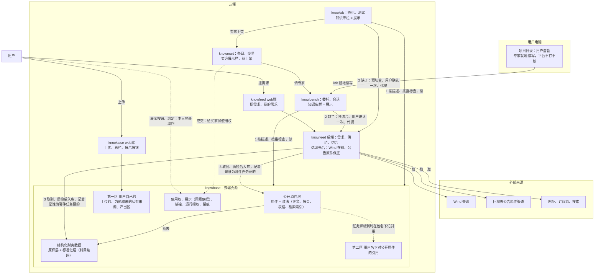

# 数据拓扑：云端真源在 knowbase，knowfeed 供给，应用使用，各栏展示

> **状态**：2026-11-09 按最新架构重写（所有者：「两者整合并根据最新架构重写数据拓扑.md」）。骨架是 10-26 第四版；补上 10-27 存储与描述的十三条、10-28 请专家两档（⑭）与不留兼容（⑰），以及 11-06 至 11-08 选源的三条；已经办完的迁移只在第二十节留结果。旧决定现在算什么，见第二十节「沿革」。
>
> **来源**：决定原文都在 [decisions](../design/decisions.md)（「数据第四版」10-26、「数据第四版开工中的讨论」10-27 至 10-28 的 ①–⑱、11-06「同一个数先问 Wind」、11-07「数据需求只说要什么」、11-08「Wind 取不到一律转巨潮」）。讨论与评审的过程稿原来放在 `docs/总纲/数据拓扑重构/`：10-26 第一轮讨论、评审与重构大纲见提交 `149d6353`；第二至第四轮评审、采集讨论记录、Wind W0 评估、开工交接、待你决定、发版前补齐计划、交 Fable 的 gitops 清单、方法库复核，2026-11-09 删除，原文见本仓提交 `cd049767f`。同一目录里专家方案相关的几份挪到了 [专家方案设计/参考资料](专家方案设计/参考资料/)，联调证据挪到了 `scripts/results/第二轨联调/`。
>
> **本页只定架构**：数据放在哪、归谁、谁能读、怎么进来、怎么用、怎么删、合规上怎么说。接口、表结构、采集体系怎么搭放在 SDD；代码现在做到哪，看 [project-guide](../project-guide/repos/) 各应用的说明。
>
> **地图位置**（按 [架构总纲](架构总纲.md)）：全图里第 7 层产品线与第 6 层应用层的数据归属那一块；其中同意依据、绑定、运行授权也是横切的安全规矩。
>
> 相关：[运行拓扑](运行拓扑.md)（网络与交付链）、[constraints](../design/rules/constraints.md)（C-D 数据规矩、C-L 合规边界）；SDD [0043](../design/SDD/modules/0043-data-v4.md)（本页的落地）、[0044](../design/SDD/modules/0044-knowbase-web.md)（knowbase web端）、[0045](../design/SDD/modules/0045-knowfeed-supply.md)（knowfeed 供给）、[0046](../design/SDD/modules/0046-knowlab-self-service.md)（knowlab 自助与平台）、[0047](../design/SDD/modules/0047-public-disclosures-facts-search.md)（公开原件、结构化财务数据、检索与存储分层）、[0048](../design/SDD/modules/0048-model-data-tools.md)（模型怎么取数据）、[0049](../design/SDD/modules/0049-document-types.md)（资料的描述）、[0051](../design/SDD/modules/0051-source-order.md)（选源的先后）、[0052](../design/SDD/modules/0052-contract-hygiene.md)（跨应用契约）。

## 一、为什么这样分

10-23 那一版跑起来以后，有四件事不对，第四版就是为了解决它们：

1. **knowbench 本地知识库没有用处**。它和项目目录重复：专家本来就在用户电脑的项目目录里读写。为它却多出一整套钉住、核摘要、分块回读、link 目录权限。
2. **上传、采集、读的分工不清**。三个应用各有上传，代采落进发起的那一边，同一个人的数据在 knowbase 里按应用各存一份。
3. **用户手挑数据太繁琐**。每次请专家都要对着专家的数据要求，一份份去选。
4. **knowlab 只有平台代为孵化**，要新增用户自助。两种模式在数据上的要求差别很大。

有一个取舍要说在前面：删掉本地知识库以后，用户电脑上的文件要给云端的专家用，只能先上传到云端。本地文件只在一种情况下不用上传：专家在用户电脑上的项目目录里就地干活。

## 二、根本原则与角色

1. **云端真源只有 knowbase**：云端的来源数据、版本、使用权、授权，都以它为准。备份、缓存、检索索引可以有，但要标明来自哪一版，不能自成一份主档（C-D1、C-D14）。
2. **knowfeed 是供给的门，不是真源**：它负责取数据（采集、查询、加工），把取来的交给 knowbase；它不在读的路上。
3. **应用是使用者，知识库栏和 knowmart 是展示者**：knowbench、knowlab，以及专家，是使用数据的；各应用里的「知识库」栏和 knowmart，只是展示 knowbase 里的数据，自己不存。
4. **数据分供给和需求**：供给是 knowfeed 取（采集、查询、加工）和用户上传（归 knowbase web端）；需求是应用要用数据，先找 knowbase，要不到再经 knowfeed 补。
5. **需求只说要什么，取法归供给端**（11-07）：需求写主体、期间、要哪份资料或哪些数、口径，不写渠道、不写取法；从哪个渠道、用什么办法取，只在 knowfeed 一处定（第 7.4 节）。
6. **一份数据只存一份**：买卖、给几个应用用、绑给专家，都不复制，只多一条使用权、展示或绑定。
7. **本地项目目录归用户自管**：用户自己放、自己管，专家在里面就地读写。平台对它不钉版本、不核摘要、不做数值验收、不留读数痕迹。口号上可以说「两个真源」（本地项目目录、云端 knowbase），但两者不是同一种意义上的真源。
8. **平台是特殊的用户，但也是用户**：账号不分类型，平台人员用的账号和别的账号一样，数据放在各自的第一区，按普通用户的规矩隔离、授权、过两道关（10-29 叫法，见 [叫法](../project-guide/叫法.md)）。平台的「特殊」只在职能上：有管理端和运营角色，能受理、审核，能做平台孵化、平台测试。不为平台单设数据区或特权通道（所有者 10-26）。本页说「平台跑腿、平台加工」时，指 knowfeed、knowbase 替提需求的用户做事，是系统在做；公开原件层不是「平台的数据」，是用户们要过的公开披露存一处的共用副本，归保留编号 `public:disclosure`（10-27 ①）。

## 三、谁管什么

**各端**：

| 端 | 管什么 |
| --- | --- |
| knowfeed web端 | 用户提需求（精确描述、给网址、订阅、按主题找；提交即确认，由 knowbase 记本人确认）；「我的需求」看进度、取消、再试 |
| knowfeed 后端 | 需求侧：受理需求单（核格式、凭证、配额、重复），管需求的一生，需求状态只由它通知；供给侧：来源目录与渠道（公告原件渠道如巨潮，供应商查询渠道如 Wind）、适配器、作业与调度、原件留存与加工、质检，交 knowbase 拿回执；**选源先后只在这里**（第 7.4 节）；切合：预切合与正式切合（SDD 0045） |
| knowfeed 管理端 | 通常的管理职能；来源目录与渠道审核（按渠道、通用网页按网站，审一次）、渠道先后、待审网站、缺口清单、队列监控 |
| knowbase web端 | 用户上传（含从应用来的直达上传）；「我的数据」总栏；每份数据的展示按钮、绑给专家、交给 knowmart 待上架；把产出转为数据；给平台的授权与撤回；谁读过（SDD 0044） |
| knowbase 后端 | 资料、读法、结构化财务数据（原样层与标准化层，第 5.6 节）的存储；检索与统计；按描述查、按指标查、解析和授权裁决（第八、十二节）；收 knowfeed 入库并回执；对已有数据的操作（成交加使用权、签运行授权、替应用写产出） |
| knowbase 管理端 | 通常的管理职能 |

**knowbase web端是唯一直接对用户的例外。** 其余照老规矩：各应用的前端只连自己的后端，由后端凭服务身份去找 knowbase、knowfeed。上传、展示、绑定这些同意，必须是用户本人的登录动作，所以落在 knowbase web端上。

**各应用的业务记录仍归各应用**：

| 谁 | 管什么 |
| --- | --- |
| knowlab | 创意、受理单、准专家、测试、测试集、专家版本；孵化和测试各用哪种模式 |
| knowmart | 供需条目（专家、知识）、驻场规则、「待上架」状态、订单与履约 |
| knowbench | 委托、会话记录、项目；委托钉住了哪几版、解析清单 |
| knowfeed | 需求单与需求依据、请求、作业与尝试、订阅、来源目录与渠道审核记录 |

**「用户」是谁**：各应用的网页端用同一套账号（Casdoor 组织 sunmoonai），有了账号就能进全部应用，登录一次、各应用自动登录（单点登录，会话 12 小时）；管理端走 built-in 组织，按 admin、operator 角色。现在没有开放注册，账号由管理员建；开放以后，在任意一处注册一次就能用所有应用。同一个人在不同应用里能看到哪些数据，由 knowbase 总栏的展示按钮管（第六节），存储上不分应用。

## 四、拓扑图

实线是数据流向，虚线是依据、绑定与授权。

## 五、knowbase 里的数据

### 5.1 五样东西分开

| 东西 | 是什么 | 归谁管 |
| --- | --- | --- |
| 数据与不可变版本 | 内容、摘要、内容来源、派生关系 | knowbase |
| 使用权 | 某个用户凭什么（取得依据：上传、采集、购买、确认引用、产出）能怎么用某份数据；买家只到交易那一版 | knowbase |
| 展示 | 这份数据给了哪些用途（某个应用、某位专家、某次平台过程、knowmart）。展示就是同意依据（第 12.2 节） | knowbase |
| 绑定 | 某件任务、某个测试集、某一版专家依赖哪几版 | 业务归各应用，引用 knowbase 的版本；专家绑定存在 knowbase |
| 交易 | 订单与履约 | knowmart；成交后经受限接口，请 knowbase 建使用权 |

**内容来源和取得依据分开**：内容来源挂在资料与版本上；用户取得它的依据挂在使用权与引用上。同一份内容，卖家是「我上传的」，买家是「买来的」，总栏按当前用户的取得依据分类。

「一份」指的是一个权威版本。备份、受控缓存、可重建的索引都允许存在。内容相同不等于来源和权利相同：去重只省存储，不合并不同用户的许可依据和删除责任。

### 5.2 两区

区管的是谁看得见、谁能读，不管东西存在哪：

| | 第一区 用户自己的 | 第二区 用户名下的公开原件引用 |
| --- | --- | --- |
| 里面是什么 | 他上传的；为他取来的非公开来源；他的产出区；他对买来的数据的使用权 | 他的任务要过的公开披露原件（引用公开原件层；引用就是取得依据为「引用」的使用权，10-27 ①） |
| 归谁 | 这个用户 | 这个用户（原件是公开的，「他要了这一份」这条事实归他） |
| 别人看得见吗 | 看不见，除非他展示、绑定、出售 | 看不见「他要过什么」；公开原件本身全市场可搜可读（见下） |

- **公开原件层对所有用户可读**（10-27 ②⑪）：经网页全文搜、跨全市场查事实都能读到，受资格、权限、平台总开关管（开关现在默认开，正式对外开放前按律师意见确认），每次读照样留痕。
- **引用照旧要记，用途是钉住与证据链**：用户的任务解析到这份原件、用户确认后记上（第八节），记明由哪件任务、按哪条需求匹配到的；运行时钉的是引用对应的那一版。「他要过什么」只有他自己看得见。
- 用户上传的文件，不会因为内容和某份公开原件一样就进公开原件层：第一区的东西永远在第一区。
- **平台人员用的账号也只有这两区**：第三方授权的数据、平台研究结论、内部质检对照，都在那个账号自己的第一区；许可用法按来源条款写，第三方授权的一般是「只许本人用」，所以绑不进专家、上不了架。

### 5.3 资料的描述：分维度（0049）

自动解析（第八节）能不能成，取决于描述。描述分维度并列（10-27 ⑬，取代「一棵树分两层」）：

| 维度 | 用途 | 内容 |
| --- | --- | --- |
| 类型、主体、期间、版本形态 | **认这一份的键** | 类型的大类按发布者（公告、研报、资讯、简报、政策法规、统计数据、其他），细类是文献类型（年报、半年报、一季报、三季报、临时公告、招股书……）；主体是证券代码或机构编号；期间分报告期间、源站披露时间、平台获取时间三个；版本形态如全文、摘要、英文版 |
| 事项、行业、语言、格式、研报属性 | **只用来筛选**，可空、可多选 | 上交所临时公告的事项分类收在「事项」里；研报另记来源机构、研究员、行业、盈利预测、评级 |

另外三组描述照旧：**内容来源**（公开披露、为某用户取来、用户上传、产出转来，系统写）；**许可用法**（只许本人用、可以经专家给别人用、可以出售；公开原件由系统定为「可以经专家给别人用」，渠道取来的按渠道审核时定的写，用户上传的由用户声明，买来的继承卖家的转卖设置、不得升档）；**需求来源与展示**（谁、为哪个应用的哪件任务要的，展示给了哪些用途）。

- **受控词表归 knowbase**，有版本号；需求和描述用同一套词，是同一份定义。
- **描述带确认状态**：只有入库质检过的、或用户确认过的描述，才参与解析；自动识别出来、还没确认的，只能作为提议。
- **描述和内容分开记版本**：改描述不产生新的内容版本，但要留改动记录。

### 5.4 内容版本与读法

- **两个词分开**：**内容版本**指内容的替换（更正版、用户重传的修订）；**读法**指同一个内容版本的派生形态（正文、按页文字、表格、检索索引），读法也有版本，加工器升级、质检标记改变都产生新的读法版本。任务、测试集、专家绑定，钉的都是「内容版本 + 读法版本」。上传的和买来的同样这样钉；买家拿的是交易那一个内容版本，含它今后的读法。
- **换了抽取器、修正了数字，就产生新的读法版本，不改旧的。** 钉住旧版本的照旧读旧版本。
- 抽取结果被发现有错：标记受影响的版本，通知引用它的任务、测试集和专家的作者，不覆盖旧结果。
- **钉住的是一个不可变的输入组合**：内容版本、读法版本、各自摘要。清单的绑定、测试集、运行授权、格子地址、数值验收都引用同一组合。

### 5.5 原件怎么认、更正、去重

- 原件除了「渠道 + 发行人 + 报告 + 期间 + 版本」，还要记来源标识、获取时间、内容摘要。
- 来源网站换了同名文件：新增一个版本，旧的保留。
- 公司发更正公告：算这份报告的新版本，旧版本保留；钉旧版本的照旧读旧版本，并提醒引用它的用户和作者有新版。
- 同一份报告来自两个渠道：两条来源记录都保留；确认内容相同后，可以共用文件内容。
- 去重与读回核摘要：内容相同就不新增原件，只引用已有的那条；读回时摘要对不上直接报错，不返回内容。

### 5.6 结构化财务数据：原样层与标准化层（0047）

三大表这类数，**从年报等定期报告的原件 PDF 抽**，不取交易所的 XBRL 数据（10-27 ⑥⑧）。抽好的表是原件某个内容版本的一种读法，内容是一批事实行，一个数一行：

| 层 | 存什么 |
| --- | --- |
| **原样层** | 报表上印的科目名原文、数值、单位、页码、行序；用户上传的杂乱表格也进这一层（表名、单元格位置照原样） |
| **标准化层** | 对到统一的科目编码、换算到统一单位的数，记由原样层哪几行得来、用的哪条对照规则；认得出才进，认不出不硬套 |

- **科目编码**以财政部《企业会计准则通用分类标准》（XBRL）为底，科目表带版本，分一般工商业、银行、保险、证券四类（10-27 ⑦）。
- 每一行记主体、出自哪份资料哪一版哪个读法版本、科目、期末日、覆盖时长（全年、半年、单季、年初至今、时点）、合并或母公司、单位、币种、页码；要看宽表的由视图或接口当场转。
- **重述的数各挂在出自的那份报告上**：「当期原始披露」（首次出现它的那份报告）和「最新调整后」（最后一份）都能算；需求不写口径时默认当期原始披露（11-07）。
- 从别的渠道取来的数（比如 Wind）也进这两层：渠道的原样回答作一份资料，照实记取自哪个渠道，它的表格读法里原样层记渠道字段原文，标准化层记科目编码（第 7.5 节）。同一个数两个渠道都取过、又不一样：两行都留，标「待核」，不让后来的盖掉前面的（0051 第 2.3 节）。

## 六、knowbase 总栏与展示按钮

- **总栏只显示「我名下有的」**，分四类：我上传的、为我取来的、买来的、产出。分类以后可能加，不写死。
- **每份数据旁边有展示按钮**：knowbench、knowlab，以及我名下的每位专家。选了，这份数据就直接出现在那个应用的知识库栏里，或者绑给那位专家（第十节）。
- **默认值**：
  - 账号级开关「新数据默认展示给我的全部应用」，默认开，只对「我上传的」「为我取来的」生效，买来的、产出转来的由用户点；用户第一次进 knowbase web端时把这个开关亮出来，点一下就是依据；
  - 为某件任务取来的，按需求来源自动展示给那个应用；
  - 从应用里点直达链接上传的，默认展示给来源应用；
  - 栏里可以批量勾选。
- **选 knowmart**：这份数据先进卖家在 knowmart 的「待上架」，卖家在 knowmart 填完介绍、样张、价格、驻场规则才真正上架。「待上架」这个状态归 knowmart，knowbase 只记「展示给 knowmart」。
- **买来的**：只能看、不能改、不能上架，许可继承卖家的转卖设置。
- 「展示给 knowbench」同时覆盖委托和会话，页面写明；取消「绑给专家」只影响下一版，已交付的版本照旧（第十节）。

## 七、供给：上传与取数据

### 7.1 上传

- **上传只在 knowbase web端**，knowbench、knowlab、knowmart 都没有上传入口。
- 上传时用户写描述（或确认自动识别出的描述），并声明许可档。
- **从应用直达上传**：解析发现缺的是取不来的私有资料（第 8.2 节）时出现。这时报错，附一个直达 knowbase 上传页的链接（带来源应用、来处引用和预填的描述），传完自动展示给来源应用，再回到原页面。
  - 「自动展示给来源应用」这个同意，由 knowbase 在自己的上传事务里记下，不能让应用后端事后去声明。
  - 回跳地址只限我们自己的几个应用（白名单），跨应用跳转要过 Origin 和 CSRF 校验（C-I6）。
- **上传的也走加工**：正文、按页文字、表格，类型对得上的走领域插件（如年报抽表），扫描版与检索索引由 knowbase 经 RAGFlow 做；结果挂在那份上传下、只有上传者能读。上传时页面写明，本人采用即是加工依据；knowfeed 凭只限这一份的「加工」授权处理、不留副本。

### 7.2 需求、供给、切合

需求和供给分开，最后切合（所有者 10-26）；只写通用结构，具体网站只是渠道实例。细节见 SDD [0045](../design/SDD/modules/0045-knowfeed-supply.md)、[0051](../design/SDD/modules/0051-source-order.md)。

**需求侧**：
- **两种要法并列**（11-07）：
  - **要资料**：一份或几份资料，按描述（第 5.3 节：主体、类型、期间、版本形态……）；
  - **要数**：主体、期间（期末日）、指标（knowbase 科目表的编码，如 `IS.REVENUE` 营业收入）、口径（合并或母公司；全年、半年、单季、年初至今；当期原始披露或最新调整后，默认当期原始披露）。
- 两种都**只说要什么**：不写渠道、不写取法、不写供应商字段。要逐页核原件的方法，另要那份年报（要资料），不靠限定取法。
- 提的方式有四种：精确描述；给网址；订阅（一次说好，以后新的自动取；必须有截止日、每月上限；本人在 knowbase 留一条长期、可撤的范围同意，每轮凭它取）；按主题找（先列候选，用户勾了再取；第一版只在用户指定的网站与审核过的政府、交易所、监管渠道里搜，通用搜索接口等律师意见）。
- 需求单用统一词表；一张单对应一次确认，各项各有状态。
- 提出主体分三层：提出方（用户本人、应用代提、专家运行中经 knowbench 提、订阅生成）、归属用户（永远是一个用户，平台人员用的账号也是）、代办链。入口只有 knowfeed web端与各应用接口；运营不能替用户提，knowbase 不提，knowfeed 只在执行订阅时生成。
- 需求的一生只往前走：待确认 → 已提交 → 已受理 → 取数中 → 已就绪（或已拒绝、无法满足、部分就绪、失败、超时、已取消）；不能改，只能撤了重提；**需求状态只由 knowfeed 通知**。

**供给侧**：
- 渠道登记在来源目录里，加渠道不改代码；登记「能提供什么」用同一套词表。取法分几类：有目录的公告原件渠道（如巨潮）、供应商查询（如 Wind，按自然语言问、回结构化表格）、订阅源、通用网页（兜底）、搜索服务。
- 适配器统一四个动作（列、取、看新的、搜），通用适配器之外，特殊渠道写插件；供应商查询渠道按供应商自己的工具问（第 7.5 节）。
- 作业按渠道排队限速，四档先后、同档按用户轮流；需求依据挂在合流的请求上、请求挂在跨用户共享的作业上。
- 原件一个字节不改先存，交 knowbase 拿到回执后再留 30 天；加工归 knowfeed（正文、按页文字、表格整理、描述识别、领域插件），检索索引与扫描版解析归 knowbase（经 RAGFlow，knowfeed 不碰）。
- 任意网址与无头浏览器有执行层的安全边界：拒内部与元数据地址、每次重定向重核、浏览器单独一个工作负载、不挂密钥、只出公网（工程边界，不是合规审批）。网页渲染工作负载归平台，还没起（`SUPPLY_RENDER_URL`，11-08 记账）。
- 质检三层（取回、加工、对得上需求），不挡原件交付、照实标出；交 knowbase 拿回执，公开披露的进公开原件层记第二区引用，非公开的内容存一份、每人各得一份自己名下的资料。
- **主动采全市场**（10-27 ④⑩）：平台账号像普通用户一样建订阅，knowfeed 按订阅采，原件进公开原件层。范围是 A 股沪深北全部上市公司，先后为：定期报告近 5 年（2021 年报起）→ 招股书 → 定期报告补到 2015 年 → 新公告从订阅开始日起天天采 → 历史公告回填近 1 年；更早的按需采。全量前先挑 100 家（含银行、券商、保险）实测大小、耗时、抽表准确率、索引占用，再定节奏与存储。

**切合**：
- 确认之前先预切合：只查来源目录（这类能不能取、网站待审没有、候选渠道的许可档、按队列估的预计时间），不在确认前替用户问渠道，也不看 knowbase 已有什么；确认时记下供给条件快照，之后换渠道只在满足快照的渠道之间换，不满足就回「当前供给条件不满足」让用户调整。
- 受理后正式切合：要数的先问 knowbase 标准化层有没有；要资料的先问 knowbase 原件与读法是否都有（原件有缺读法只补加工）；没有的按渠道先后去取（第 7.4 节）；给网址看落在哪个渠道或网站（网站待审就等审核）；订阅找会「看新的」的渠道；按主题找的候选先预切合再给用户勾。
- 取不到的类型记进「缺口清单」，按需求补渠道。

**照旧的几条**：命中照实——内容与读法都已齐的立即就绪，看得出「这份公开披露以前有别的用户要过」，看不出是谁，不做假的「办理中」；配额（请求频率、在途单数、订阅条数）；运营或模型不能自己扩大用户的需求；质检结果给用户看；中途失败可以补，不重新下载。

### 7.3 两道关

1. **取的时候审有权取**：渠道审核就是第一道关，由 knowfeed 管理端做，每个渠道审一次，不按请求逐条审；通用网页按网站审，用户给的网址落在没审过的网站上，需求等审核。取数据这一层只管取，不管合规。渠道审过以后，许可用法写进它取来的每份数据里。
2. **卖的时候审有权卖**：由 knowmart 后端审（knowlab 运营审核门预查）。卖家上架数据时，核这份数据是不是「可以出售」；专家分两种：交付到本人自用的，绑了「只许本人用」的也可以；公开供别人用的，所绑每份要「可以经专家给别人用」，有「只许本人用」的拒；自用转公开时重查。必要时让卖家补证明。
- **绑定本身不审**：作者在 knowlab 绑来自己孵化、测试，是自己用。
- **公开披露原件和平台抽出来的表不能当知识卖**：原件人人可取，没有可卖的东西；抽出来的表是平台加工的，拿去卖等于平台在市场上卖数据（C-L2）。

### 7.4 选源的先后只在 knowfeed 一处（0051）

- **先后 = 渠道的 `priority`**，在 knowfeed 管理端调。**默认同一个数先问 Wind、公告原件保底**（11-06，所有者：「为何官方优先，官方保底才对啊，因为官方下载太慢」）。
- **Wind 取不到一律转巨潮等公告原件渠道，Wind 本身不自动重试**（11-08）：没有数、额度用完、认证失败、渠道停用、结果不确定，都转；不重试是为了不重复扣费。
- **要原件、要页码的项不交 Wind**：逐页核原件的方法要的是那份年报（要资料），只走公告原件渠道。
- 用户确认时可以去掉 Wind，只走公告原件。
- 应用不知道有哪些供应商：knowbench 的数据步不再写「优先用 Wind」，模型不写渠道（0051 第 2.5 节第 8 步）。

### 7.5 Wind 渠道

- **是什么**：knowfeed 的一个供应商查询渠道（`wind-platform`），凭证在服务端单份保管；所有账号都能用（11-04，`audience=all_users`），各自确认、各自收私有副本，共享同一个付费额度。
- **用量**：所有者 11-02 授权真实调用不限次数，直到供应商额度耗尽；额度耗尽或认证失效就整条渠道暂停；先不加每人每日上限（11-08，已知风险：任一用户都能把额度耗光）。调用一律串行、受每分钟限速，结果不明的收费请求不自动重放。
- **回答怎么入库**：Wind 的原样回答作一份资料，照实记取自 Wind；能对上科目编码和口径的，进它的表格读法（原样层记 Wind 列名原文，标准化层记科目编码，第 5.6 节）。Wind 的链接和摘要不能当原件或页码。
- **对照要先核过才登记**（0051 第 2.3 节）：某个科目、某个口径登记进「科目编码 + 口径 → Wind 问法」对照之前，先拿几家公司几年的数和年报原文逐个比；给不出某个口径的就不登记。
- **11-08 实测的口径**（luna 回执）：年报、半年报、年初至今累计、合并与母公司都能取，回包期间有时只在列名里，多行、重复列要按期间挑；**单季回成累计值、首次披露和追溯调整丢了「归母」限定且没有版本信息，这三种不登记**，要的转巨潮；Wind 的数是亿元、供应商精度，不拿来做 1 元的恒等核验。登记对照的代码随 0051 第 4 步做，还没做。

## 八、需求：应用要数据时自动解析

不再有「选数据」：用户不用逐份去翻、去选。每件委托要什么数据，由委托里用户自己的模型按专家逻辑和用户问题提出，用户在这张清单上确认、可改；应用按清单去 knowbase 找，找不到的经用户确认后交给 knowfeed 去补（10-28 ⑭、[请专家方案设计](专家方案设计/专家使用方案/opus/请专家方案设计.md)）。

### 8.1 每件委托要什么数据：模型提出、用户确认

| 谁 | 做什么 |
| --- | --- |
| 作者（knowlab） | 写逻辑，**不写数据需求声明**：作者不知道用户会问什么，限不了（所有者 10-28：「无法限，作者根本不知道问题怎么限制」）。要提示模型「这一步一般要什么数据」，写在步骤说明里，只作提示。作者自己的数据另外挑定，随清单冻结（第十节） |
| 模型（委托里的「定数据」那一步，用户自己的模型、在用户的委托里跑） | 读专家逻辑和用户问题（动态专家读排好的计划和所选方法），按第 7.2 节的两种要法提出要哪些：要资料的写主体（或不限主体）、类型、期间规则（固定期间、「最近 3 个完整年度」、「最近 N 个月内披露的」，能写「截至任务日期已披露」）、版本形态、事项、格式、份数、读法、为什么要、是不是必需；要数的写主体、期间、科目编码、口径。主体用「查主体」工具查代码，不自己编；一次最多 20 样。不写渠道、不写取法 |
| 用户（knowbench 请专家的人；knowlab 里是作者本人） | 在解析过的清单上确认、换一份、改主体或期间、去掉、自己加一样 |

- 「一样数据的描述」的结构和词表是有版本的跨应用契约，只定义一处（knowbase 管）。
- 清单 = 逻辑 + 作者挑选的数据；用户确认的数据不进清单，记在委托的输入上。
- knowlab 的测试集是「测试问题 + 作者确认的数据」，作者确认后钉在草稿上（第九节）。
- 动态专家先排计划、再定数据：执行计划决定本任务的数据需求，步骤中发现新缺口仍能再提，改计划不自动扩大已确认的需求（[方法与专家包](../design/SDD/architecture/methods.md)「与数据和 Wind 的关系」）。专家怎么执行，正在 [专家方案设计](专家方案设计/README.md) 里重新设计。

### 8.2 流程

1. **应用后端按清单问 knowbase**：
   - 要数的，在**标准化层**按（主体、期末日、科目编码、口径）找本人有授权的那几行；都有就直接给，不派作业。
   - 要资料的，按描述精确查，只接受精确的键（第 5.3 节「认这一份的键」），只回答「这一份有没有」，不回答「有什么」。

   每一样得到下面结果之一：

   | 结果 | 怎么办 |
   | --- | --- |
   | 在本应用能用的范围里 | 定下这一版 |
   | 用户有，但没展示给本应用（只对本人的数据提示） | 请用户到 knowbase 放开，不自动替他勾 |
   | 待确认（他名下还没有，不分平台已有还是要新取） | 列进待确认清单 |
   | 确定缺失，取不来（私有资料） | 告诉用户去 knowbase 上传，附直达链接（第 7.1 节） |
   | 暂时判断不了（knowbase 不可用、正在导入） | 不补取；任务停下等，或者报错 |
   | 存在但不能用（被禁用、无权） | 不补取，照实告诉用户 |

2. **预切合、用户确认一次**：应用先向 knowfeed 预切合待确认的那几项，再把清单列给用户：只写总数和预计多久（按全部要新取算），每项标许可档，满足不了的直接标出；用户可以取消部分条目（可选的取消即降级，必需的取消即变更需求），然后点一次。这一次确认连同清单修订、任务编号、清单快照一起留痕，就是「用户指定」的证据；确认 7 天内有效，只对这张清单修订的条目有效。确认时同时记下供给条件快照。之后分三支：本人已有、都齐的直接用；本人没有但内容与读法（或标准化层的数）都齐的，knowbase 按确认立即建关系、完成；缺的才由应用交 knowfeed，每条带这次确认的编号。订阅范围内每轮凭订阅范围同意，不逐份确认。**确认不能被跳过**：账号设置、应用默认、模型调用都不能免确认。
3. **等数据**：任务进入「等数据」，进度向 knowfeed 查，就绪通知也由 knowfeed 发（knowbase 收下回执后同一事务排通知）；恢复时另核当前状态与清单修订，重复或乱序的通知不重复开跑；超过时限就转成用户看得见的失败，已定下的部分带着走，以后补的时候不重新取。
4. **供给完成的判据**：原件或数已由 knowbase 接管、版本能定位、权限能校验、任务要的读法已经就绪，才恢复任务。下载完成、登记了地址、通知发出去了，都不算完成。读原文不用等全文索引；要读表的步骤，等表抽好。
5. **列出解析结果**：用户在清单上确认，也可以换一份、改、去掉、加；换过的记成偏好（按用户 × 使用者 × 描述，只记选哪份、不记免确认，词表改版或资料不可用时失效），下次优先用。没取到的，停下问用户照现有的接着做（产出标「数据不全」）还是取消。
6. **确认即签**：用户确认时本人在场，这时才向 knowbase 申请运行授权，申请和钉住同时完成（第 12.3 节）；要等补取的，齐了由执行应用凭本人那次确认续签（7 天内、对得上这件任务与这张清单），自动接着跑，不再等用户回来点开跑（10-27 ⑫）。

### 8.3 歧义与时点

- 有好几个候选、又认不准它们是否等价时（比如母公司口径和合并口径、原披露和更正版），按写明的优先策略选；选不出来就返回「有歧义」，不随便取第一份，也不恢复每次手挑的老流程。解析时公开原件优先于上传的。
- 「默认最新」只在提出时写明才用，而且要写清「截至什么时候能拿到的最新」；要数的口径不写时默认当期原始披露（第 5.6 节）。
- 首次解析形成一份**解析清单**：需求、匹配理由、版本、时间条件。它作为任务的一部分存下来，重试时读同一份清单。

### 8.4 缺了怎么办

- **必需的缺了，不算成功**：标为必需、用户确认过的没取到，停下问用户：照现有的接着做（产出标「数据不全」，不算完整的成功），或者取消。
- **不是必需的缺了可以降级**：任务照做，但记明不完整、缺了什么。
- 运行中临时冒出来的需求，用同一个「提出数据」工具，同样经用户确认；模型不能用一句「补不上」就悄悄改掉用户确认过的清单。knowlab 的固定测试集缺数据时，不能自动换成另一家公司或另一版接着算。

### 8.5 谁做什么

- **knowbase**：执行按描述查、按指标查、确定匹配、版本定位和授权裁决。
- **knowfeed**：选源、取数据、入库、通知；应用不知道有哪些供应商。
- **应用**（knowbench、knowlab）：各自编排需求、确认、等待、取消和恢复。knowlab 定好的测试输入交给 knowbench 执行时，不再解析一次。
- **钉住层不推倒重来**：解析的产物还是委托钉数据那一套（槽位、版本、摘要复核、数值验收、格子地址）；按描述核格式、份数、表头的校验原样保留，用来核机器挑的结果。
- 模型取数据走 knowbench 的数据 MCP 中继，由 knowbase 凭运行授权供数（0048）。

## 九、knowlab

### 9.1 和 knowbench 不一样的地方

knowbench 是「用专家干活」：一件委托，用请的人的数据跑一次，自动解析合适。knowlab 是「做专家、测专家」，有五处不同：

1. **测试集**：测试要的是一组特意挑的数据，正常的和刁钻的都要有。**测试集的数据由作者挑**：作者写测试问题，走同一个「定数据」，模型提、作者确认；平台不从全市场「提议几家」（否则就是平台替用户挑公司）。作者确认后钉住。
2. **跨版本反复用**：测试集钉在草稿上，钉的是摘要，绝不跟着出新版；同一组数据测第 1 版、第 2 版，才比得出好坏。作者要换数据才出测试集的新版本，重测不让模型重提。测试集版本和专家版本分开编号；每次测试记下用的是哪一版测试集。
3. **逻辑还在改**：作者边改逻辑边测；逻辑变了要不要换测试数据，由作者定。
4. **专家绑的数据**在 knowlab 这一侧定：作者在 knowbase 总栏绑给自己名下的专家，测试时和测试集一起读（第十节）。
5. **谁的任务谁解析**：测试在 knowbench 上跑，但测试集和测试运行授权由 knowlab 定和申请，knowbench 只照授权读那几份。

另外：辅助孵化只看格式，从 knowlab 能用的范围里取样；knowlab 向 knowfeed 要数据常常一次一批，需求来源记 knowlab 和草稿。

### 9.2 孵化、测试各自可选自助或平台

流程、组合与切换、页面见 SDD [0046](../design/SDD/modules/0046-knowlab-self-service.md)。

模式按过程选，不是整个 knowlab 一起换：孵化可以选自助或平台，测试也可以选自助或平台，两者可以组合。比如平台孵化加自助测试：用户不想让平台看到敏感数据，平台只照方法孵化，测试由用户用自己的数据做。我们自己做「财务分析与预测」，按普通用户身份走自助。

| | 自助 | 平台 |
| --- | --- | --- |
| 谁会看到数据 | 平台的人看不到；过门时平台会为审核重跑一次（在他的账号、他的电脑上，decisions ⑯），没人看数据，产出只进他的产出区 | 还有我们的运营（人），以及平台跑的测试（机器） |
| 同意 | 不另外同意 | 用户明确授权「这几份给平台看、给平台测」，范围是这一次过程 |
| 测试集谁定 | 作者自己确认 | 运营按用户的验收用例提议，用户确认 |
| 缺数据谁提 | 用户自己，经解析和确认 | 运营不能替用户提，只能请用户确认 |
| 能用哪些数据 | 用户能用的范围 | 只用用户授权给这次过程的数据，加上他名下的公开原件引用；不混入平台人员用的账号自己的数据（守则 6） |
| 留痕 | 照平时 | 运营每看一次、每测一次都留痕，用户看得到 |
| 结束以后 | — | 这次过程结束、用户撤回、或者不受理，平台立即读不到 |
| 在哪跑、证据存哪 | 在用户自己的 link 上跑；结论、数值、判定理由作为测试证据上传进产出区，原始产出留在本地 | 在作者的账号、作者的电脑上跑，用作者的 key（decisions ⑯），产出进产出区 |
| 过两道门 | 用户「提交交付」时同时记两种范围：机器重跑要读的冻结输入，审核员能看的清单与结果；平台建新运行编号、凭新的机器授权重跑，审核员看结果、不看原始数据 | 运营本来就看过，照现在的做法 |

- **数据栏不分两套**：knowlab 只有一个知识库栏，差别在谁能读。
- **平台这一侧区分两种主体**：运营（人）和机器执行者，授权和留痕分开记。
- **能互转**：自助做到一半转平台，同时请用户授权；平台转回自助，平台的授权立即撤。
- **受理**：平台孵化要先受理；自助孵化不用受理；只请平台测试的，过一道轻受理。
- **交付**：交出去的是清单，绑定的数据留在 knowbase，不复制进 knowmart；审核员看测试证据，要用户交审时给的「这次交付过程」授权，审完即撤；审核和特批放行不能是作者本人（11-08）。

## 十、专家与数据

专家是一种特殊的应用。它要绑数据时，作者在 knowbase 总栏的展示按钮里选这位专家。

1. **谁能绑**：只有专家的作者能绑，绑他自己上传的、代取来的数据都可以；能不能随专家给别人用，看许可用法（第 7.3 节）。绑公开原件时，绑的是原件层的引用，不复制内容；别人请这位专家时，按他自己的任务在他名下记引用。
2. **用专家的人能看到什么**：只承诺到「没有浏览、下载入口，产出里可能引用」，并照实告诉作者。专家现在跑在请的人的沙箱里、用他的模型 key，绑定的原文会进入他看得到的上下文和记录。要真正保密，得等有了云端受控执行再说。
3. **钉版本**：每一版专家绑的是数据的固定输入组合，knowlab 测的就是这一版。绑定清单和绑定的同意都随专家版本冻结，算进版本摘要；总栏上的按钮只管下一版还绑不绑，取消它不撤已冻结的；改绑定就是出新一版专家，买家原来用的那一版不变。
4. **和请的人的数据并存**：绑的是专家自带的（方法文档、行业词典这类）；请的人的数据每件委托由「定数据」那一步提出、他确认。
5. **删除**：作者在栏里删只是拿掉；还有哪一版专家在用，真源就不删。绑的数据失效了（被禁用、许可失效），在售的专家转「待处理」并通知作者。

- **绑定关系存在 knowbase**；名下专家的名录由 knowlab 建版本时推给 knowbase，绑定时只认推来的。
- **作者绑定就是同意依据的一种**。
- **授权要多一种形态：受益人不是所有者**。读的是作者的数据，用于请专家的那个人的委托。留痕要把两个人都记下。
- 解绑、下架的历史要留痕，第二道关事后能查到当时凭什么放行。

## 十一、knowmart：展示与交易

- **knowmart 是所有用户的供给与需求的展示场所，每个用户一家小店**（所有者 10-26）：首页列有在架供给或公开需求的小店，点进去是小店详情页；不做推荐、榜单、销量排序；用户的供给（自己的专家、要卖的知识）和需求都放进「我的小店」（SDD 0018 第十一节）。
- **买卖就是给买家加一条使用权**，真源仍只有一份，不复制。买家拿到的是当初交易的那一版；卖家后来更新，买家不跟着变。
- 买来的数据出现在买家 knowbase 总栏的「买来的」里，展示给哪个应用由买家自己选。
- **不变量**：同一笔交易重试，只产生一次有效的使用权；成交以对应版本的使用权可用为准，失败可以恢复。
- **空间**：一份被多人买走的资料，算在卖家的空间里，直到最后一个使用权失效；公开原件层不算任何人的空间。
- **下架**：卖家下架或删除，不影响买家已有的使用权；平台因违规下架，收回买家的使用权，留痕（跨三个应用的收回还没做，待办账「M2」）。
- **卖家注销**：买家不受影响，条目上的卖家名改成匿名。只有内容本身属于必须删除的个人信息时，才清除它，并通知、补偿买家（第十三节）。**买家注销**：他的使用权随之终止，内容不清除。
- 买来的能下载；`no_resale` 限的是上架、交给 knowmart、绑给公开专家，不限下载。
- **卖家把许可档改低、关店**：只影响新的销售与公开用途；买家已有的使用权按交易时的依据照旧可读。授权检查按本次使用的依据判断，不只看资料当前的许可档。
- 上架要审资质（C-L4）；卖的时候审有权卖，自用与公开分开查（第 7.3 节）。

## 十二、谁能读

### 12.1 读的规则

区对（第一、二区），并且满足下面两种之一，否则就当这份数据不存在：

- **本人**：请求里带着用户本人的登录凭据（他在 knowbase web端或各应用页面上看、管自己的数据，应用只是转交）。光有服务身份加一个用户名，不算本人。
- **凭运行授权**：任何应用凭服务身份替他读（测试、委托、会话、孵化、平台过程），一律要有一条有效的运行授权。

**同一套检查适用于一切取用方式**：按格子读、按指标读、下载、预览、导出、检索、缓存返回，都按对象核一遍。专家、会话找证据片段的检索，范围是这个用户名下已钉住的那几版；网页全文搜和跨全市场查公开原件，过资格、权限、平台总开关这道门（第 5.2 节）；第一区的内容不能从检索口漏给别人。

### 12.2 四样东西，各管一件事

| 东西 | 回答什么 | 谁留下 |
| --- | --- | --- |
| 使用权 | 他能怎么用这份数据 | knowbase，依据上传、取来、购买、引用、产出 |
| 同意依据 | 他同意给哪种用途用 | 用户本人的登录动作，有五种：在总栏点展示、作者把数据绑给专家（交付时随版本冻结）、给平台的按过程授权、订阅的长期范围同意、上传时采用加工 |
| 绑定 | 某件任务、某个测试集、某一版专家依赖哪几版 | 各应用（任务、测试集）；knowbase（专家绑定）。必须落在同意依据的范围内 |
| 运行授权 | 某个执行者在某个过程、某段时间里，可以读哪几版 | 应用凭绑定向 knowbase 申请，knowbase 校验后签发。**只有它能拿来读** |

解析只负责得出要用哪几版。签不签授权由 knowbase 裁决，解析器自己不签。

**一份运行授权可以有多项，每项各记依据与所有者**：钉住的输入组合、权利依据（展示同意、使用权、冻结的绑定同意、第二区引用）、内容所有者；外层记过程与执行主体。一件委托可以同时读请的人自己的、买来的（卖家所有）、作者绑定的三种数据。

### 12.3 运行授权的种类

| 种类 | 什么时候申请 | 可读什么 | 到什么时候失效 |
| --- | --- | --- | --- |
| 委托 | 解析完、用户确认那一刻；补取齐了由执行应用凭那次确认续签 | 解析清单里定下的那几版，加上专家绑定的那几版（受益人不是所有者） | 委托结束就撤；兜底 7 天 |
| 测试 | 每次测试开跑时 | 测试集与专家绑定的那几版 | 测试结束就撤；兜底 7 天 |
| 会话 | knowbench 聊天、工作中模型第一次读某份时，每份签一条小授权 | 展示给 knowbench 的数据；第一次读时钉组合，这段会话后面都读这一版 | 会话结束一并撤；兜底 24 小时 |
| 孵化 | 辅助孵化开始时 | 只读格式（表头、报告期），不读内容 | 孵化结束就撤；兜底 6 小时 |
| 加工 | knowfeed 加工用户上传的、重新加工取来的 | 只限一个内容版本、一个目的；只能写回读法 | 作业结束就撤 |
| 平台过程 | 用户授权平台孵化、平台测试、交付时交审，或自助测试过门重跑 | 用户授权给这次过程的那几版；运营和机器分开记 | 过程结束、用户撤回、不受理时立即撤 |

- 授权在解析阶段不签，确认时才签，并且和钉住同时完成，免得「等数据」把有效期吃掉。
- **运行中追加需求**：任务在步骤边界停在「等数据」，用户确认后**新签一条独立授权**覆盖新的几项，不扩大已签的；清单出新修订，已读的不重读。
- 会话里不再逐份选：模型可以用的范围就是展示给 knowbench 的数据，按需去查，每首读一份签一条小授权；单段会话累计读到 50 份时提示一次，不挡。新展示的数据，从下一次会话起才进范围；取消展示，立即停止新的读取申请。

### 12.4 守则

1. **同意依据只能来自用户本人**：授权里的用户身份和他的同意，必须来自能验证的用户凭据，或已有的同意依据，不能由调用的应用自由声明。任务里自动记的公开原件引用，依据是用户确认过的那份清单（第 8.2 节）。
2. **运行授权只能在同意依据和绑定的范围内**，范围只能更小，不能更大。
3. **哪个应用只能做哪件事**：knowlab 只能写测试集、申请测试授权与平台过程授权；knowmart 只能写交易，并请 knowbase 建使用权；knowbench 只能写委托和会话的绑定、申请运行授权、替用户写产出；knowfeed 只能凭加工授权读指定的一份、写回读法，交需求单与回执；展示和绑定只能由用户本人在 knowbase web端做；越界就拒。
4. **委托凭据要保留「用户是谁」和「代办应用是谁」**，由 knowbase 自己验证（OAuth 令牌交换，0042）。不转发浏览器 Cookie、ID Token。
5. **作者绑定即同意**：数据随专家给别人用，依据是作者把它绑给专家的那个动作；许可用法不允许的，绑了也不能随专家上架。
6. **平台按用户对待，代用户干活时不混入自己的数据**：平台人员代用户干活（平台孵化、平台测试）时，只用这个用户授权的数据，不混入平台人员用的账号自己的数据（C-L1、C-L2）。
7. **能撤，也有兜底的上限时间**：撤销消息丢了，到点也自动失效。
8. **申请不到就不开跑**：拿不到运行授权就不开始；确认不了授权有效就停止读取，不退回旧接口、不退回手选来绕过检查。
9. **每次读都留痕**：谁读、凭哪条运行授权、读了哪份哪一版，受益人和所有者不同时两个都记。按调用记，不按格子记；只记编号，不记数值；留一年，律师答复后再调。

### 12.5 统计的边界

- **跨全市场的筛选、排序、排名、统计做全**，和网页全文搜同一道门：资格、权限、平台总开关（现在默认开，对外开放前按律师意见确认）。knowfeed、knowbase 是基础设施，本身不带投资逻辑；能不能选股、排名是用户的资格问题，有资格的用户（包括将来有资质时平台人员用的账号，它也是作为用户）就该有这个能力（所有者 10-27）。条件由用户或他的专家给，C-L1「投资逻辑只来自用户」照旧管专家方法归谁。
- **不做跨用户的内容统计**（如「多少用户在看某家公司」）：别的用户的私人数据归他们自己，knowbase 不拿来汇总给别人看。
- 用量、配额、留痕方面的统计照做。

## 十三、删除、撤权、清除

按动作分，不笼统说「删除」：

| 动作 | 对新的发现与使用 | 对已有的引用、使用权、在跑的 |
| --- | --- | --- |
| 从栏里拿掉、取消展示、作者删、卖家下架、卖家改低许可、关店 | 停（新的销售与公开用途） | 已有的合法引用照旧：买家的使用权、钉住的测试与专家版本；在跑的授权到期或任务结束为止 |
| 撤回某次过程的授权（平台模式） | 停 | 之后的读取立即停；保留审计和证据，不等于允许继续处理 |
| 数据被禁用、平台违规下架 | 停 | 按依据处理，不因为历史绑定或正在运行而豁免；在售专家转「待处理」；违规下架收回买家使用权 |
| 注销、依法删除个人信息 | 停 | 停止所有不再有依据的处理，按适用的保留与删除规则执行（个人信息保护法第 47 条）；真删的清单里要包括产出区、描述字段、RAGFlow 里的文档、结构化数据里出自它的行，以及 knowfeed 的 30 天原件、作业里的内容片段、搜索与列的缓存、需求单里的说明与网址 |

- **删除写明对象**：撤某个人的关系，不删仍被别人合法引用的共享内容与索引；只有真正清除内容才删原件、读法和 RAGFlow 文档，并等所有回执。
- **平时一律逻辑删**：内容不真删，还在用的照旧可读，用完了也不真删。
- **真删只有这几种**：注销；依法删除个人信息；证件照片审过、留一年后清掉；读数留痕留一年到期。
- **测试证据拆成两半**：结论、数值、判定理由可以长期留；其中引用的原始数据内容，随依法清除一起清。因此复现不了的，判「证据不可复现」，不判专家不合格。
- **跨应用的步骤有「处理中」状态**：下架、撤权、清除都要有查得到的处理中状态，可以安全重试；没做完之前不重新开放读取。沿用现有的发件箱、收件箱和幂等机制。
- **撤销只能挡住以后的读取**：已经交给运行进程的数据不会自动消失，它留在那次产出和会话记录里，按它们的留存规则处理。
- **导出**：用户自己第一区的数据，随时可以导出。

## 十四、专家的产出

产出是结果，不是来源。AI 的产出可能有错，自动混进数据，就会被下一位专家当成事实来读。

| 在哪干的 | 产出放哪 |
| --- | --- |
| 用户电脑上（他自己的 link） | 在项目目录里；交付那一刻取成稿的指纹，由 knowbench 替用户写一份进 knowbase 产出区（见下） |
| 云端（比如平台人员在平台电脑上跑） | knowbase 产出区，归这个用户；总栏第四类「产出」；不在解析范围里 |
| knowlab 测试 | 测试证据，钉在测试编号上，只增不改，过门时审核员看的就是它；存在产出区，knowlab 只记引用。自助测试只上传结论、数值、判定理由（第 9.2 节） |

- **产出由应用替用户写**：knowbench 后端以服务身份经一条专门的写入路写进产出区（`knowbase:user-data-output`；只能写产出区，按任务与运行编号幂等，算用户空间），带运行授权的引用、委托起止时间、是否不完整，写进去以后核回显的出处。这条路由 knowbench 的开关 `WORKBENCH_OUTPUT_WRITE_ENABLED` 控制，11-08 定随下次 knowbench 发版打开，和 knowbase 那边同批发。
- **产出的许可有上限**（10-30 knowbench 与 knowbase 的约定，11-08 补齐）：按这件委托凭授权真读过的、加上会话时间窗里读过的数据算上限，产出的许可不能比它们宽；一份都没读的不设上限；不带运行授权引用的，只许本人用。回显按存下的出处算。
- **转为数据由用户自己做**：在 knowbase 里点「转为数据」，它才进第一区、才能被解析到。转的时候自动带上出处（哪位专家哪一版、哪件任务、用了哪几份数据的哪几版），新建一个版本和来源关系。转为数据不升级许可，默认「只许本人用」。
- 本地产出要转为数据，先上传。
- 产出不做版本树，按（任务，运行编号）天然唯一，重跑就是新的一份。
- 数值验收只适用于钉在 knowbase 里的内容。

## 十五、knowbase 的职责、地位与故障规则

- **职责**：云端来源数据的主档，加上使用权、同意依据、绑定（专家）、运行授权、留痕。检索和索引都是派生的（C-D5）。
- **检索坏了不挡读数**：检索不可用时，仍然可以按固定版本直接读（C-D15）。
- **确认不了授权就停**：不退回旧接口、不退回手选来绕过检查（守则 8）。
- **解析接口不可用**：任务停在「等数据」，不触发补取（第 8.2 节）。
- **knowfeed 不在读的路上**：它挂了只影响补数据，已经入库的读、已经签的授权都不受影响。
- **一级服务**：每次测试、每次委托都要经过它。冷建时，它的备份和恢复排在别的应用前面；上线门那条（备份能恢复、做过一次恢复演练，C-R10）它先过。
- **恢复要覆盖全部**：数据文件、版本与描述、结构化数据、使用权、同意依据、绑定、运行授权和撤销记录。恢复演练要专门核：恢复旧备份后，已撤销的授权不会重新生效。
- **空间上限**按用户算：第一区按实际占用；第二区只是引用、共用原件，不计入他的空间，只受代取配额限制；卖出去的算卖家的（第十一节）。

## 十六、读法、检索与存储

### 16.1 抽表是加工：每个数都能追回原件的哪一页

取回原件是跑腿；从 PDF 里抽数字是平台在加工，抽错了就是平台带进来的错。原件和派生版本会被多个用户复用，所以每个数都要能追回原件的哪一页，质检没对上的照实标出来。这是复用说得过去的前提，也满足「原始证据先存、带出处」（C-D13）和《金融信息服务管理规定》的「来源可追溯」。抽出来的每一行都存下来，进第 5.6 节的原样层，格子地址指向它。

### 16.2 一份定期报告的三种读法（10-19 定；存储 10-26、10-27 改）

| 读法 | 是什么 | 给谁用 | 怎么读 |
| --- | --- | --- | --- |
| 抽好的表 | 一批事实行（原样层与标准化层，第 5.6 节），每格是原文的数，带单位、合并或母公司、原件页码 | 数字：三张表、主要会计数据、非经常性损益这类 | 按「表、科目、期间」或按指标取，计算一律交给计算工具（0030），模型不抄数 |
| 文字检索 | 派生的检索索引：原文按段切好，每段带页码 | 文字：经营情况、风险、渠道、会计政策这类 | 按意思找出几段原文，引用时带页码；范围只在他名下钉住的版本里 |
| 原文按页 | 原件抽出的文字，按原件的页切，每页在模型一次看得到的大小以内 | 核对、找不到时兜底 | 按页读 |

- **数字不走检索**：检索按意思相近找段落，适合文字，找精确的数不可靠。数字一律走抽好的表。
- **抽表要自查，自查不过照实标出**：勾稽平不平、方法要用的科目每期都有没有、单位写了没有；「主要会计数据」与三大表互核（同一份原件，不算第三方对照）。没过的格子标出来，模型取到时看得见「这一格质检没对上」。核的结果照实标在格子上，专家不用每次跑时自己再核一遍。
- **同一来源核不出错**（所有者 10-19）：抄得准不准归入库这一步核；专家的「对照官方披露」是拿分析结论，到年报的管理层讨论与分析里找公司自己怎么说（SDD [0036](../design/SDD/modules/0036-quote-check.md)、[0035](../design/SDD/modules/0035-method-amendment.md)）。
- **模型读的东西要在它一次看得到的大小以内**：表按页、原文按页、检索结果按条数，都留余量；放不下就分页。
- **银行、保险、证券**另配科目表，另做专家；「财务分析与预测」现在不处理这三类（10-28 ⑱）。

### 16.3 检索与存储的分工（10-27 ③⑤）

| 东西 | 放哪 |
| --- | --- |
| 原件 | 对象存储；本地做热层，放满 N 天经生命周期分层转到宿主机大盘，再复制一份到云上低频存储做备份（归平台实施） |
| 正文、按页文字、事实行 | knowbase 的 PostgreSQL（读法分表；表格单元的基础地址是读法版本、表或工作表、物理行列；科目、期间、单位、口径是领域插件给的语义标注） |
| 专家、会话找证据片段的检索 | RAGFlow（关键词加向量，由 Infinity 担） |
| 给人用的网页全文搜 | Elasticsearch（业务索引与日志分开设身份与保留策略） |

- 两个索引都从 knowbase 存的正文读法与变更事件建，是派生的、能重建。
- **只有 knowbase 碰 RAGFlow**：检索一律经 knowbase，先核授权，只把钉住的那几版对应的文档编号交给 RAGFlow，编号集合为空时不调用、直接回空；扫描版与复杂版面由 knowbase 建索引时交 RAGFlow 解析、取回完整结果存成读法，knowfeed 不碰 RAGFlow。
- 删除写明对象，真正清除内容才删 RAGFlow 文档，拿到回执才算删完。数据集按「内容类型 × 解析配置」分、由运维预建，不按用户分；「检索索引就绪」是单独一种读法状态。

## 十七、我们自己怎么用数据

- **我们的账号都按普通用户走**：做专家的、做质检对照与运营的账号，数据各在自己的第一区，规矩和别的用户一样。
- **孵化「财务分析与预测」**：作者在 knowlab 走自助，只用作者自己第一区的数据和名下的公开原件引用，不借别的账号的数据。
- **工程测试**（C-L3 允许用我们的数据）：要用就复制一份，以平台人员用的账号（如 knowbot-tester）上传进它自己的第一区。
- **平台模式不混入平台人员用的账号自己的数据**（守则 6、第 9.2 节）。
- **平台人员用的账号一人一个**（10-29），口令在密钥库，点的动作留痕到那个人。

## 十八、合规上怎么说

口径如实改（所有者 10-26，D1）：从「用户逐份指定、平台跑腿」，改成**用户发起任务，系统在约定的范围内自动选择和补充；平台不提供自己的数据**。

| 环节 | 谁做 | 平台的角色 |
| --- | --- | --- |
| 发起任务、给出要分析的主体 | 用户 | 不选、不推荐、不预置清单 |
| 要哪些数据 | 用户自己的模型按专家逻辑和用户问题提出、用户确认的数据清单，加上用户确认的取得清单 | 按清单精确匹配，只答「这一份有没有」；从哪个渠道取由 knowfeed 按登记的先后定 |
| 同意哪些数据给哪种用途 | 用户本人（展示、绑定、按过程授权） | 只记下他的同意 |
| 取回公开披露原件、问供应商 | 平台 | 跑腿；请求带着用户的确认编号；供应商的数照实记来自哪里 |
| 整理成表 | 平台 | 加工：不改数，每个数带出处，质检结果照实写 |
| 怎么算、怎么判断 | 用户的专家（方法来自用户） | 只提供计算工具 |
| 结果给谁 | 用户自己 | 不给别人，不拿去宣传 |

- **「用户指定」落在四处，都查得到**：用户确认过的数据清单（连同模型提出的原样、用户改了什么）；一次确认的取得清单（连同任务编号、清单快照、供给条件快照留痕）；建订阅时确认的范围；展示与绑定的动作。
- **命中照实**：看得出「这份公开披露以前有别的用户要过」，看不出是谁；公开原件层是用户们要过的公开披露的共用副本，不是平台的数据。第二区的引用和读数留痕，就是这条证据链。
- **服务做全，合规用资格、权限、开关管**（所有者 10-27：「法律规定的事可以通过资格审查/权限来解决，但是，服务本身要全功能」）：网页全文搜、全市场查询、全市场统计都做，平台总开关默认开，正式对外开放前按律师意见确认。按描述查只答有没有、同一用户短时间大量查不同描述要限流、确认不能被跳过、按主题找只列不挑，这几条照旧。
- **统计的边界**见第 12.5 节；公开原件和平台抽的表不卖，见第 7.3 节；平台按用户对待、代用户干活不混入自己的数据，见守则 6。
- **C-L2 按新口径**；问律师的问题（0026 第五节）也按新口径问，并问「荐股软件」规定的范围、金融信息服务的规定，以及平台账号订阅采全市场公开披露、网页上全市场全文搜需要什么资格、要配什么审核。供应商数据（Wind）的服务端使用许可、留存权、分发权还没核实，按渠道审核的第一道关补。
- **《金融信息服务管理规定》**（网信办，2019-02-01 施行）：我们可能算「金融信息服务提供者」，要配审核人员，有内容审核和信息安全制度，来源要能追溯，不得传播虚假金融信息。

## 十九、不留旧版兼容

产品还没上线，旧格式、旧接口直接删，不留兼容分支（10-28 ⑰，所有者：「我很反感v1的兼容。我们是全新的，为何要兼容？」）。已经办完的：

- 本地知识库、各应用自己的知识库与上传、旧的「用户 × 应用」条目、成交复制，按第四版收成一份真源（生产上 10-26 只读查过：没有本地来源的委托、没有成交复制出来的行、没有授权和读数留痕，只有 10 条上传的资料，导出备份后迁移）。
- 旧 SQLite 数据集（0008、0009）退役，东方财富 F10 不再采也不迁；knowfeed 的证券专线、自己的通用文档模型与旧界面删掉，巨潮改登记为渠道实例。
- 「财务分析与预测」旧的第 1 版废弃，清单 v1 的专家直接删。

还要守的：已冻结的测试、专家版本、运行引用，标识和摘要始终能定位，复现不了的旧记录照实说明原因；迁移只扩不缩，历史用过的枚举值留给历史记录。

## 二十、沿革

| 旧决定 | 现在 |
| --- | --- |
| 10-18 knowbase 是云端来源数据及其版本、访问授权的唯一权威 | 仍有效（第二节） |
| 10-18 三区；第三区一律不接受授权 | 10-26 改为两区：平台是特殊的用户，但也是用户；保留守则 6（第 5.2 节、守则 6） |
| 10-18 公开原件和派生版本只存一份，经第二区引用访问 | 只存一份仍有效；10-27 改为公开原件层对所有用户可读，引用的用途改为钉住与证据链（第 5.2 节） |
| 10-18 原件版本和派生版本分开固定 | 仍有效，推广到上传与买来的（第 5.4 节） |
| 10-18 读的规则：本人或运行授权；三层：同意依据 → 绑定 → 运行授权 | 仍有效（第十二节） |
| 10-18 删除：先阻止、在跑的跑完、再撤、最后删 | 改为按动作分，平时逻辑删（第十三节） |
| 10-18 代采：用户指定、knowfeed 跑腿、只能由用户发起 | 仍是用户指定，改为在任务里由应用代提、用户确认一次（第 7.2、8.2 节） |
| 10-18 第一版只开巨潮定期报告、按来源自动受理 | 10-26 改为通用的需求、供给、切合，巨潮只是渠道实例（第 7.2 节）；10-27 加主动采全市场 |
| 10-18 本地知识库 | 10-26 删掉；本地用的放项目目录（第二节） |
| 10-18 用户管数据的入口放工作台 → 10-23 各应用各管自己的知识库 | 10-26 改为只在 knowbase web端管，各应用只展示（第三、六节） |
| 10-19 年报三种读法、抽表自查、同一来源核不出错 | 仍有效（第十六节） |
| 10-19 文字检索的向量也放 PostgreSQL | 10-26 改为 RAGFlow；10-27 定 RAGFlow（Infinity）给专家与会话、Elasticsearch 给网页全文搜（第 16.3 节） |
| 10-23 三个应用相互独立、各有知识库 | 存储合并成一份，独立改为展示上的独立（第六节） |
| 10-23 专家不绑数据 | 10-26 改为专家可以绑数据，作者绑定即同意（第十节） |
| 10-23 买来的知识拉回买家的知识库（复制） | 改为加使用权，不复制（第十一节） |
| 10-23 晚：会话授权，用户在对话里选几份 | 改为范围是展示给 knowbench 的数据，每首读一份签一条小授权（第 12.3 节） |
| 10-26 统计只在用户名下已引用的数据上做、不做跨全市场的筛选排名；不开任何列出、浏览、模糊搜公开原件层的接口 | 10-27 改为做全，用资格、权限、平台总开关管（第 12.5、十八节） |
| 10-26 描述的类型一棵封闭枚举 | 10-27 改为分维度，类型的大类按发布者（第 5.3 节，0049） |
| 10-26 ④ 前半句「按专家声明（模板 + 任务参数）自动解析」、测试集主体由作者给 | 10-28 改为：清单 = 逻辑 + 作者挑选的数据，不再有数据需求声明；每件委托由用户自己的模型提出数据，用户确认（第八节，⑭） |
| 10-26 v1 专家的兼容分支 | 10-28 取消，不留兼容（第十九节，⑰） |
| 双轨计划 10.1「官方优先」的默认先后 | 11-06 改为同一个数先问 Wind、公告原件保底；11-08 Wind 取不到一律转巨潮、不自动重试（第 7.4 节） |
| 资料需求可以点名取法（`source_query`，指定 Wind 渠道与工具） | 11-07 改为需求只说要什么，取法归供给端；`source_query` 过渡后不留（第二节第 5 条、第 7.2 节，0051、0052） |

## 二十一、还没定

- 来源目录还要登记哪些渠道，各自的条款允许怎么用；按主题找用哪家搜索接口及其条款；深证信等官方接口要不要签约。
- Wind 数据的服务端使用许可、原始响应留存权和分发权（第 7.5 节）。
- 律师意见的范围（0026 第五节），按第十八节的新口径问。
- 驻场规则的内容：什么能卖、条目写什么、上架怎么审。
- 什么时候开放注册：开放前要定注册方式（手机、邮箱、实名）与上线前的审核。
- 存储分层里宿主机大盘与云上备份的落点（归平台）。
- 2026-10-18 撤口子时留下、要一并清理的：工作台到 knowbase 的旧检索服务关系（`KNOWBASE_RETRIEVAL_URL`）、knowbase 验沙箱令牌的公钥、网页预览样例里的内置专家。现在清了没有，待核。
