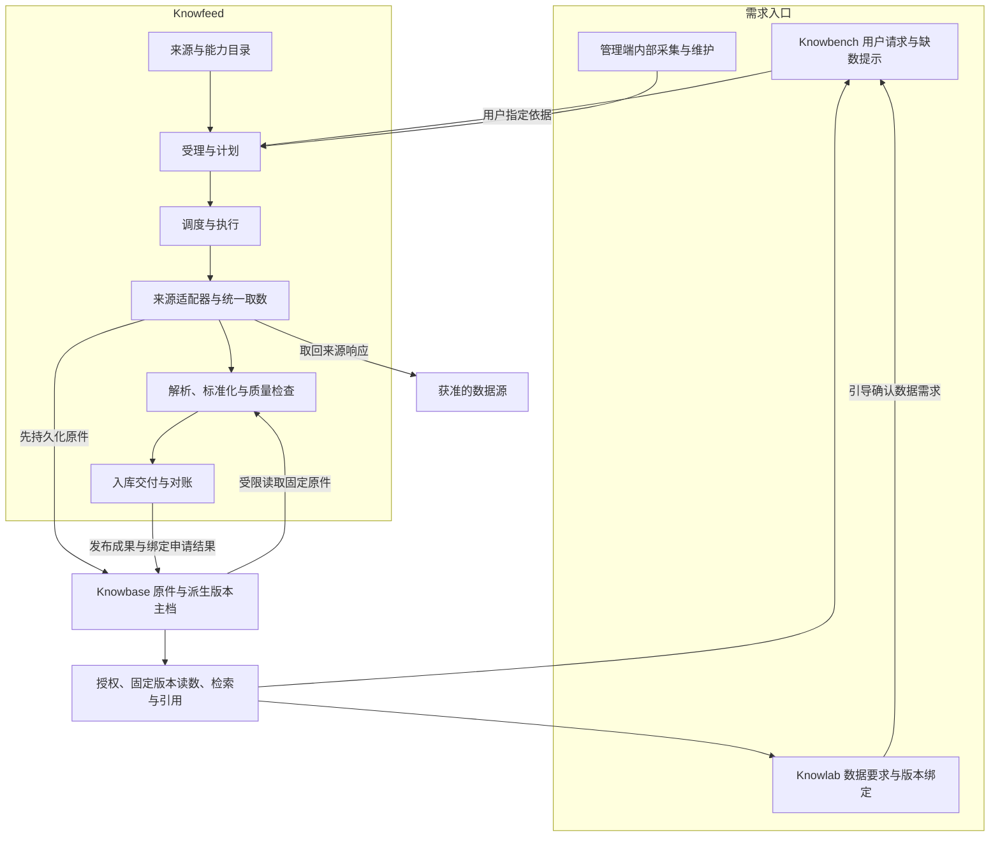

**借鉴 AKShare 构建 SunMoonAI 自有采集体系：架构建议稿**

2026-10-24。以本地 AKShare、Knowfeed 和 Sunmoonun 当前检出的源码与架构为依据。本文提出目标架构与分期，不代表功能已经实现或来源接口当前在线可用；没有修改业务实现、安装组件、运行采集或部署。

跨应用的数据归属、用户凭据、迁移与验收细节接续 [数据接入方案](/home/zymun/worktrees/luna/human-ai-turn/data-integration-2026-10-24/proposal.md)。正式架构依据仍是 [数据拓扑](/home/zymun/worktrees/luna/sunmoonun/docs/总纲/数据拓扑.md)和 [约束](/home/zymun/worktrees/luna/sunmoonun/docs/design/rules/constraints.md)，本文不替换已定规则。

**一、目标：拥有自己的数据源能力、采集运行体系和数据证据链**

业务上，用户和应用说清“需要什么数据”；系统检查是否已有可用且有权使用的固定版本，缺失时才采集或重新加工；完成后由 Knowbase 提供可追溯、可复现的数据。

工程上，新增一个来源主要增加该来源的适配代码、规格和测试，不再重复编写排队、重试、存储、去重、权限与通知代码。来源网站改变时，能识别是哪一段出了问题，用留存原件修复并重放，不必所有数据重采。

本体系的完成标准是“数据需求得到可验证的交付”，不是“HTTP 返回 200”或“函数返回一个 DataFrame”。交付应明确原件是否已存、范围是否完整、哪些派生能力可用、质量问题、固定版本和可使用主体。

**二、从 AKShare 借什么，自己补什么**

本地 `/home/zymun/akshare` 当前版本文件为 1.18.81；其中接口统计文档标的是较早的 1.18.80，记录约 1,099 个对外接口，不能当作本次重新验证的可用接口数。静态扫描当前目录得到 405 个 Python 文件，其中 319 个直接导入 requests，5 个导入 curl_cffi；这说明把全部函数简单包成一个服务，并不能自动获得统一的取数约束。扫描未运行任何接口。

抽样代码见 [巨潮披露](/home/zymun/akshare/akshare/stock_feature/stock_disclosure_cninfo.py)、[东方财富三大报表](/home/zymun/akshare/akshare/stock_feature/stock_three_report_em.py)、[请求工具](/home/zymun/akshare/akshare/request.py)。报表接口已经积累了“先识别公司类型、再取报告期、每五期分批请求”等知识；同时，请求、分页、解析和 DataFrame 组织常在同一个函数里，部分调用没有显式超时。以上是本地抽样事实，不是对整个上游项目的全面质量判断。

| 借鉴的资产 | 在我们体系中的落点 |
| --- | --- |
| 来源地址、请求参数、分页规则 | 来源适配器 |
| 不同市场和公司的源站编码 | 身份映射与能力输入规格 |
| 返回字段、单位、报告期处理 | 来源解析器、版本化映射 |
| 丰富的接口索引和使用示例 | 内部能力目录、文档与测试样例 |
| 修复记录中的边界情况 | 原件回归集、来源健康探针 |

我们自己补齐：需求与授权、任务计划、全局限速、断点恢复、原件接管、版本和时间、质量、跨源冲突、入库回执、访问隔离、成本与运维。

建议保留 AKShare 仓作为研究参考，按能力逐个移植。参考的 commit、函数、文件和许可记录在适配器元数据里；移植代码保留应有声明。现有 F-INFO-09 已定运行时不依赖 AKShare，继续执行。AKShare 可用于离线对照研究，但生产采集不可通过调用它绕过自己的网络、原件和调度边界。

**三、系统边界：Knowfeed 是采集运行方，Knowbase 是来源数据权威方**



| 事实 | 唯一负责方 |
| --- | --- |
| 来源适配规则、采集能力、来源运行政策 | Knowfeed |
| 代采申请、采集计划、执行进度、限速与恢复游标 | Knowfeed |
| 云端原件、派生结果、版本、归属、引用和访问授权 | Knowbase |
| 具体方法需要的数据项和使用条件 | Knowlab 的用户草稿/方法，交付后归专家版本 |
| 运行中缺数、等待恢复、计算结果、运行记录 | Knowbench |
| 交付专家及其数据版本绑定 | Knowmart |
| 服务关系、存储与网络权限、镜像发布与恢复 | Sunmoonun |

Knowfeed 保存的是采集执行账和原件引用。可有受控的故障暂存，不能成为长期第二主档；用户运行不从 Knowfeed 下载或查询数据。Knowbase 内部的向量、全文索引和缓存均可重建，不能承担唯一原件保存。

逻辑模块先放在现有后端，运行角色按资源需要拆 Worker；暂不新建采集微服务集群，也不引入另一套工作流引擎。

**四、能力目录：按业务能力定义，按来源实现**

不能只用 `rss/api/scrapy/playwright` 作为全部分类：它们描述取数方式，而“公司定期报告”“财务报表”“宏观时间序列”描述业务。采用彼此独立的维度：

| 维度 | 例子 | 用途 |
| --- | --- | --- |
| 数据领域 | 证券披露、财务报表、资讯、宏观、基金 | 组织数据模型与文档 |
| 来源 | 巨潮、交易所、统计机构、获准的第三方 | 权限、限速、出处、健康 |
| 能力 | 定期报告列表、报告原文、披露表格 | 业务请求的稳定入口 |
| 传输方式 | HTTP JSON、RSS/Atom、HTML、文件、浏览器 | 分配执行资源 |
| 产物类型 | 原件、文本页、表格、时间序列、事件 | 确定处理和入库契约 |
| 用途与可见范围 | 用户代采、平台内部、测试 | 决定能否受理及交付到哪个数据区 |

同一种业务能力可以有多个来源实现；同一来源可以有多个能力。来源替换必须经过语义与使用范围判断，不能因为主源失败就偷偷改用第三方整理的数据。

能力规格建议包含：稳定 ID、版本、参数 schema、支持的市场和报告类型、预期产物、允许用途、请求/文件限制、分页方式、原件识别方式、处理器、输出 schema、测试夹具、维护负责人、AKShare 参考出处。以下仅为目标形状示例：

```yaml
capability: disclosure.periodic_reports
version: 1
source: cninfo
input_schema: periodic-report-selection/v1
outputs:
  - disclosure-index/v1
  - disclosure-original/v1
transport: http
processor: cninfo-financial-statements
allowed_purposes:
  - user_requested_disclosure
  - platform_internal
```

规格中的处理器必须是代码中登记的实现，不能让用户传 Python 模块名、脚本、任意 URL 或动态代码来执行。

目录有三个真源，职责不重叠：发布包中的不可变能力规格定义“代码能做什么”；Knowfeed 数据库中的来源政策定义“当前允许做什么、启停和额度”；部署配置定义“资源、端点和秘密引用”。有效执行权限取三者的约束交集，运行计划固定所用版本和政策快照。

内部能力目录可以很丰富；用户只能看允许的能力、公开披露索引和本人数据，不能浏览平台库存或其他人的申请。

**五、Knowfeed 的八个模块**

| 模块 | 负责的事情 | 主要输入/输出 |
| --- | --- | --- |
| 1 来源与能力登记 | 来源标识、范围、策略、健康、能力版本、维护责任 | 能力规格与政策版本 |
| 2 需求受理 | 用户依据、参数、配额、幂等、取消和范围确认 | 本人申请和具体需求 |
| 3 计划生成 | 查覆盖、复用已有原件/派生、拆分页与文件任务、预算 | 固定版本的执行计划 |
| 4 调度执行 | 排队、优先级、租约、限速、检查点、失败恢复 | 作业与尝试记录 |
| 5 来源适配与传输 | 组请求、列表发现、分页、下载、网络边界 | 原始响应及采集证据 |
| 6 解析标准化 | 读取原件、抽表、科目映射、单位与期间标记 | 带完整血缘的派生候选 |
| 7 质量与复核 | 结构、覆盖、勾稽、跨版差异、人工复核 | 分层质量报告与可用能力 |
| 8 交付与运维 | Knowbase 入库回执、用户引用、通知、对账、死信 | 可使用的版本引用与运维状态 |

这是责任划分，不要求八个独立服务或八条独立部署流水线。维持现有 domain/application/infrastructure/interfaces 分层：状态规则在领域层，流程在应用层，HTTP/存储/队列适配在基础设施层，Web/Admin/Internal 只调同一个应用服务。

**六、采集器协议：只写来源差异，通用能力由上下文提供**

采集器使用框架提供的上下文获取能力：受控请求、原件归档、分页检查点、预算检查、取消检查、结构化问题报告。自身负责输入到请求的映射和导航响应的解析，不直接创建数据库连接、不直接写桶、不自行重试或 sleep，也不返回脱离原件的最终业务主档。

建议将来源能力拆为三个可独立测试的步骤：

1. **发现**：根据明确范围取得来源索引，产生稳定条目标识与候选原件地址。
2. **获取**：下载原件或数据响应，框架持久化后返回原件引用。
3. **解析**：从固定原件解析导航信息或业务记录，记录解析器与 schema 版本。

分页不要求先把所有请求列出来。可先生成一个有界根计划，索引原件保存后，根据真实结果逐步扩展任务图，每次扩展都记账和检查预算。动态发现出的 URL 必须重新通过来源与网络校验，不能因为来自一个合法响应就被无条件信任。

当前证券接口的 `CollectContext.fetch` 已经遵循“取回并留存后才把内容交给采集器”；这是统一接口的良好起点。[现有协议](/home/zymun/worktrees/luna/knowfeed-app/knowfeed-backend/app/app/application/securities/collectors/base.py)。通用 RSS/API 和证券采集应逐步共享传输、原件交接和执行记录，而不是强行把所有业务变成“发现一批网页链接”。

来源专用解析与格式处理器分离：巨潮适配器解决如何找到和下载报告；PDF 文本/表格处理器解决如何读取固定文件；财务标准化解决科目、口径和期间。新来源提供相同类型的文件时可以复用后两者。

浏览器是取数执行方式，OCR 是原件处理方式，不能混成一种采集器。现有 Scrapy/Playwright 适配器主要接收外部结果，不能当作浏览器采集运行器已经建好。引入时必须纳入同一计划、证据、预算和网络约束。

**七、统一网络边界与资源控制**

以现有 `fetch_crawl_url` 为基础，统一处理超时、DNS/重定向校验、公网地址范围、压缩后大小限制、响应大小和错误分类。来源适配器不能再各自使用 requests/curl_cffi 绕开它。

请求策略按来源设置：允许域名与方法、允许的公开查询参数、最大页数和字节数、全局并发、请求间隔、超时、Retry-After、熔断恢复。一个域名被多个能力使用时，共享来源额度；不能每个 Worker 各自限速而总量失控。

当前通用爬取有 PostgreSQL 跨进程来源锁，但它不等于整个采集体系都已统一限流。需要让证券、API、RSS 和将来的浏览器任务都进入同一准入协议，并核实其覆盖情况。初期可延续现有数据库协调，容量证明需要时再优化限速实现。

限速等待通过任务的下次可运行时间表示，不让 Worker 长时间阻塞睡眠。响应 429 按来源策略退避；来源连续故障熔断，有限探测恢复；认证或站点要求改变进入维护状态，避免无限重试。

浏览器和重型 PDF/OCR 任务隔离 CPU、内存和出网策略；浏览器还需约束子资源请求、重定向、下载和会话生命周期，不能只检查首次导航 URL。所有下载和处理运行非特权，文件大小、页数和处理时间受限。

库层约束、代码审查和依赖检查加上执行环境网络策略共同防止旁路。原始正文保留可校验字节；HTTP 元数据只保存必要且已去掉凭据的字段，Cookie、Authorization 等不进日志或任务 payload。原文解压与解码阶段必须明确，分别记录所需摘要，不把解析后的 JSON 重编码当作原始响应。

**八、调度模型：用户请求、共享作业、执行尝试分别记**

| 对象 | 职责 | 不能混淆的点 |
| --- | --- | --- |
| Request | 谁在什么依据下要什么、来自哪里、何时取消 | 用户的请求事实不可因物理复用而合并丢失 |
| Plan | 使用哪些来源/版本、范围、阶段依赖、预算 | 固定已确认范围；运行中不能悄悄换来源和语义 |
| Job | 一份可共享的具体工作，如下载一份报告 | 可被多个请求引用；取消一个请求不一定取消作业 |
| Attempt | 一次执行、租约、开始结束、错误 | 重试新增尝试，不覆盖历史 |
| Checkpoint | 已完成页/条目和待续游标 | 页面成功持久化后才前移 |
| Delivery | 向 Knowbase 交付及回执的流程记录 | 不能把“发出了消息”等同于数据可用 |

支持四种触发：用户指定的按需采集、明确授权的订阅更新、内部计划任务、历史补采/修复重放。用户第一次要某份报告，不自动变成无限期订阅；订阅必须有明确范围、期限和配额。内部来源维护也不能自动给所有用户增加数据引用。

优先级建议为当前用户等待的任务、授权订阅更新、内部常规任务、历史回填；每用户与每来源设公平额度，避免大范围回填饿死短任务。每个计划限制请求数、总字节、处理页数、执行时长，以及可选 OCR/模型费用。

发现目录与正文下载分开调度；原件没变化不重抽，处理器没变化不重新生成派生结果。现有 Celery Beat 的每五秒推进持久任务不是来源更新调度，两者需明确分开。

执行采用至少一次投递、幂等持久化与失效租约隔离，不能宣称网络调用恰好一次。来源请求可能重复，但原件版本、派生成果和用户引用不能因重投重复产生。Worker 被杀或连接中断后，恢复必须从已确认检查点开始。

现有证券批次在发现被中断时标记 interrupted 并终止；细粒度断点恢复是新增能力，不能把现状说成已经支持。继续使用已有 Outbox/Inbox、租约、死信与对账体系，不另建一套通用 DAG 平台。

**九、增量、完整性、去重与时间**

增量以来源真实特征决定，不使用全平台统一的“取今天到昨天”规则：

- 游标来源：保存并验证游标，最后一页处理并持久化后才推进完成水位。
- 按时间分页：重叠扫描一段窗口，捕捉延迟发布和更正，再按来源标识去重。
- 易变列表：记录扫描窗口、首尾标识和稳定排序；必要时重复核窗口边界，不能把翻页期间的变化当作完整快照。
- 文件来源：ETag/Last-Modified 只作优化，原件身份仍以来源标识和内容哈希核定；定期重核更正。
- 仅提供滚动窗口的接口：明确可覆盖的时间范围，不能承诺能回填来源已经不提供的历史。

去重分四层：

| 层 | 键的含义 |
| --- | --- |
| 请求幂等 | 用户/调用方 + 幂等键 + 参数摘要 |
| 采集复用 | 来源、能力、实体、报告/期间、选版策略与必要的刷新代次 |
| 文件去重 | 确定安全数据区内的内容摘要；相同内容仍保留各自来源记录 |
| 派生复用 | 输入原件版本集合 + 处理器/规则/schema/配置版本 |

复用必须附覆盖证明：预期几份、发现几份、取到几份、哪些缺失、是否完整、最后何时查过。空列表要区分真实无数据、来源拒绝、响应变形和暂时失败；HTTP 200 也可能是错误页。

至少保留数据所属期间、来源披露时间、首次观测/获取时间、Knowbase 入库可用时间；修订再记更正关系。未来做历史时点研究时，要明确是“当时公开可知”还是“当时本系统已知”，不能用今天获取的追溯修订数据冒充过去已知数据。

**十、Knowbase 的数据模型与读取方式**

Knowbase 接管原件、派生数据及访问授权；Knowfeed 的业务主表只记录任务和这些对象的稳定引用。

建议模型按数据形态设计，而不是每接一个 AKShare 函数就建一张表：

| 模型族 | 内容 |
| --- | --- |
| 来源与实体映射引用 | 发行人/证券的稳定标识及来源编码、有效期间；Knowbase 管可供引用的映射版本，Knowfeed 保留源适配配置 |
| 原件和版本 | 来源标识、原件文件、披露/获取时间、hash、更正关系 |
| 文档派生 | 按页文字、段落、表格坐标、处理器与页码 |
| 财务事实 | 原文科目和标准科目、值、单位、币种、报告期、口径、原件页码、质量 |
| 通用时间序列 | 指标、对象、频率、时点/期间、单位、来源版本、修订关系 |
| 事件 | 事件类型、对象、发生/公布时间、来源及更正关系 |
| 数据集快照 | 一组固定原件/派生版本的不可变 manifest 和覆盖说明 |
| 用户归属与授权 | 三区、用户引用、同意依据、绑定、运行授权、撤销与读取审计 |

一期只实现披露、财务表格和文档读法，其他模型族保留清楚的扩展边界。不要把所有业务都塞进一个没有约束的 JSON 字段，也不要一开始设计几百张空表。

统一科目与格式不等于统一改写原数：保留原文值与单位，标准化值另列并记录转换规则。空、零、不适用、未披露、无法识别必须区分。银行、保险、一般企业分别使用适用的科目与检查规则；跨源冲突并存并标记，不以“最后入库覆盖”解决。

报告单元格的完整身份至少包括原件版本、派生版本、表类型、合并/母公司口径、科目、期间、币种和单位。单季度数从累计数推导时另存推导关系，不能标成原文直接披露。

三种读取能力：数字按格/表；文字按授权范围检索；原文按页。数值计算继续交 Knowbench 计算工具；Knowbase 提供证据，不写投资方法。索引失效不影响固定版本的原文与表格读取。

已交付专家固定到明确 manifest/原件/派生版本。`latest` 仅用于发现候选，不能进入永久绑定。更正产生新版本，旧版仍能按授权读取；需要暂停使用已知坏版本时，记录明确禁用状态而非静默替换内容。

**十一、质量体系与人工处理**

| 层级 | 检查 | 对可用性的影响 |
| --- | --- | --- |
| 传输 | 请求状态、类型、大小、文件签名、内容摘要 | 原件是否完整、可接管 |
| 结构 | JSON schema、PDF 可读性、表头、字段、日期 | 是否能产生该类派生结果 |
| 覆盖 | 预期报告、页、期间、科目是否齐全 | 标记完整/部分，不伪报完成 |
| 业务 | 资产负债勾稽、跨期口径、单位、重复与异常 | 标记表/格问题及适用性 |
| 独立核验 | 独立抽取、原文不同位置核对、人工真值 | 降低系统性错列和错单位风险 |
| 跨版本 | 同源更正、抽取器升级结果差异 | 决定是否发布新派生版本并通知引用者 |

原件完整性、派生质量和业务方法适用性分别记录。原件有效但抽表失败，原件照样可用；不能识别的数字不猜；质检不平有问题对象和证据，不只一个整体 quality_passed 布尔值。

人工复核需要保存“原件坐标/页码、原抽取值、候选修正、理由、操作者、时间”，修正写成新派生版本，不直接 UPDATE 已发布的值。人工动作也不能把第三方数据改标签变成用户代采。

模型/OCR 可以参与难版式识别，但应是有预算、可停用的处理器：记录模型或引擎版本、输入摘要、实际输出和核验结果。复现不能依赖再次调用模型恰好给出同样答案，必须保留实际产物。同一解析器跑两次不是独立核验。

**十二、入库、访问与应用集成**

正式入库流程：创建 Knowbase 导入会话 → 上传并核原件 → 获得固定原件引用 → 处理 → 提交派生结果/质量/血缘 → Knowbase 发布 → 建用户引用 → 回执与通知。长流程异步，原件字节不经过消息队列。

Knowfeed 只能通过受控入库协议交付；可采用流式接口或由 Knowbase 签发的限定对象上传能力，不获得 Knowbase 桶的通用管理权限。原件持久化未确认前保留暂存；确认后按保留规则回收，存储压力下不擅自删除主档。

三类对外能力分清：

- **采集 API（Knowfeed）**：创建明确需求、看本人进度、撤回、查可交付引用，不直接返回来源数据。
- **数据 API（Knowbase）**：上传、本人数据、固定版本、授权、页/格/检索/引文读取。
- **应用工具（Knowbench/Knowlab）**：把用户意图变成上述调用，保存业务引用；不调用某个 AKShare 函数，不知道来源 URL。

未来 Python SDK 也只封装这些服务契约：提交需求返回 request_id，读取返回带版本和出处的数据。不能在一个看似只读的 `get_data()` 中偷偷触发外网采集。CLI、后台页面和 API 应调用同一个应用服务。

Knowlab 绑定版本和发起测试；Knowbench 凭本次运行授权读取；Knowmart 交付固定绑定。服务令牌不等于用户授权，跨应用用户键必须映射受信主体，不能信请求体自报身份。新契约在提供方维护 schema，调用方持锁，两端一起测试。

一期用户代采仍仅开放巨潮定期披露。行情、研报、宏观、新闻、基金等可逐步成为内部或已获准的采集能力，是否交付用户须单独符合来源政策和项目范围；“AKShare 有这个函数”不是开放依据。

**十三、采集器生命周期：让接口坏了以后修得动**

每个能力经历：候选登记 → 来源研究 → 适配实现 → 原件回归 → 有界联网探针 → 小范围试运行 → 正式启用 → 维护/停用/退役。没有负责人、输入输出规格和回归材料的适配器不算生产能力。

测试分四类：

1. **纯解析回放**：真实原件的最小脱敏夹具，测试字段变化、空值、单位、错列、分页终止和错误响应，不在单元测试联网。
2. **可信期望**：人工核定的关键数和覆盖情况，不能只比较新旧两个解析器的输出相同。
3. **运行故障**：进程中断、租约丢失、重投、超时、429、Knowbase 故障、回执丢失、取消并发。
4. **来源探针**：少量、限频、限预算的真实请求，只判该能力此刻是否可用；与日常 CI 分开，结果带时间。

上游变化分开诊断：连接失败、来源拒绝、字段结构变更、内容为空、解析失败、质量下降。统计预期字段、记录数量、覆盖率和单位分布等信号，不能只看成功率。

升级新适配器时先用旧原件回放，再对小批新原件比较；计划固定适配器和处理器版本，已有任务不混跑不同语义。出现差异保留旧数据与问题单，修复后发新派生版本。自动生成适配代码可以作为开发辅助，但必须经过审查与测试再进入静态注册表，不能在线让模型写脚本后直接执行。

**十四、存储、运行观测与规模演进**

存储约束应进入计划和调度：按每份报告平均大小、请求量、保留版本、派生倍数、重放暂存和备份估算容量；没有测量前不承诺“全市场全历史”。优先精确按需、内容复用和原件不变不重算。公开原件复用不改变第一区私有文件的逻辑隔离。

热/冷位置由 Knowbase 管理，引用只认稳定对象和版本。冷原件不可即时读取时提供恢复任务与进度，不把它说成丢失，也不让 Knowfeed 直接绕去读某台宿主机目录。备份是独立能力，冷存储不是备份。

管理界面建议包括来源与能力、请求、执行计划、原件/入库回执、质量复核、故障与重放六类视图。用户只看本人需求进度和可用结果，不看维护字段或其他用户需求。

监测指标至少包括来源成功率和耗时、限速/熔断、队列等待、覆盖率、原件复用率、解析失败和差异、质量问题、入库/引用欠账、死信、存储增长、处理成本。告警应指向具体来源/阶段/请求，不能只有“某 Worker 不健康”。

初期沿用 FastAPI + Celery + RabbitMQ + PostgreSQL + 对象存储：

- API 受理与查询；Scheduler 产生到期任务和对账工作。
- 网络采集 Worker 按来源准入；CPU 处理 Worker 负责 PDF/表格；交付任务推进 Knowbase 回执。
- 现有数据库/任务账是权威，Redis 等缓存只作可丢的加速。
- 只有出现可测的资源隔离需求才增加 Worker 队列和进程角色；继续走同一应用部署机制。
- 浏览器/OCR 大依赖是否需要专用执行镜像，等需要该能力时核资源与发布成本；不提前为所有可能的数据源搭基础设施。

跨应用调度不共享数据库或内部 Celery 队列。幂等命令与事件经版本化契约和现有 Outbox/Inbox 交接。各阶段都有超时、有限退避、死信/人工处理和对账方法。

**十五、从现有代码演进的顺序**

| 阶段 | 交付范围 | 完成判据 |
| --- | --- | --- |
| 0 固定边界与契约 | 来源/能力/请求/产物模型，用户依据、主档、版本和错误语义 | 同一需求在四应用之间只有一种解释 |
| 1 统一采集内核 | 公共传输、原件交接、预算、日志、幂等；巨潮与 F10 分开配置用途 | 现有采集器接入框架，不再各自处理通用副作用 |
| 2 披露纵向闭环 | 一份年报→Knowbase 原件→三表派生→用户引用→Knowlab 绑定→Knowbench 运行 | 真正从用户指定走到受权的固定版本读取 |
| 3 覆盖与可靠性 | 半年报/季报、金融企业格式、完整科目留存、部分失败、检查点、增量更正 | 新旧版本可复现，中断与重投不丢不重，明确标注不支持格式 |
| 4 运维化与历史迁移 | 来源健康、探针、差异、人工修复、回填、主档迁移、旧路径退役 | 故障可定位修复，Knowbase 是唯一来源主档 |
| 5 受控扩展领域 | 按明确需求新增获准资讯/API/时间序列等能力 | 新来源只增加适配/规格/测试，通用流程无需复制 |

第一批不是移植全部 1,099 个接口，而是建立可复用的两三类样板：法定披露原件与抽表、内部 JSON 表格来源、已有 RSS/资讯发现。这三类分别验证文件、结构化响应、列表与正文两阶段链路。用户代采和内部采集共享框架但不共享可见权限。

保留并改造现有 Knowfeed 采集器、HTTP 边界、Outbox/Inbox、PDF 抽取和质量规则；补充完整派生留存、分阶段恢复与来源健康。Knowbase 补主档和授权，Knowlab 迁出上传主档，Knowbench 改读取适配器。旧混合财务数据集和现行版本查询不能原样充当新用户供数接口。

**十六、最终验收：体系应该具备的十个性质**

1. 用户只描述数据需求，不必知道 AKShare 函数、站点 API 或文件存放位置。
2. 新来源不复制调度、存储、重试、权限逻辑；所有外部取数有统一记录和限制。
3. 每个派生值能追到固定原件、处理版本和页码/字段。
4. 查询不会暗中采集；采集成功、原件可用、派生完整和用户有权使用分别判断。
5. 重试、重复消息和并发申请不会产生重复主档，也不会泄露他人需求。
6. 断点恢复有明确覆盖和游标依据，不把残缺结果标成完整。
7. 旧专家不因新采集或修正自动换数，历史时点与修订语义可解释。
8. 来源变更可以通过原件回放定位并修复，尽量不重采。
9. Knowbase 主档、授权和撤销可以一起备份恢复；索引坏了不丢原件，权限不明就停读。
10. 全链路中的任何应用、缓存、工具和 SDK 都不能绕过数据区、用户指定和运行授权。

这套架构的核心资产是：**版本化的数据源知识、统一的采集执行能力、Knowbase 中可追溯的数据，以及能够持续修复数据源变化的测试与运维机制。** AKShare 提供了很好的来源研究起点，平台价值在于把这些知识组织成可长期运行和可信使用的体系。
