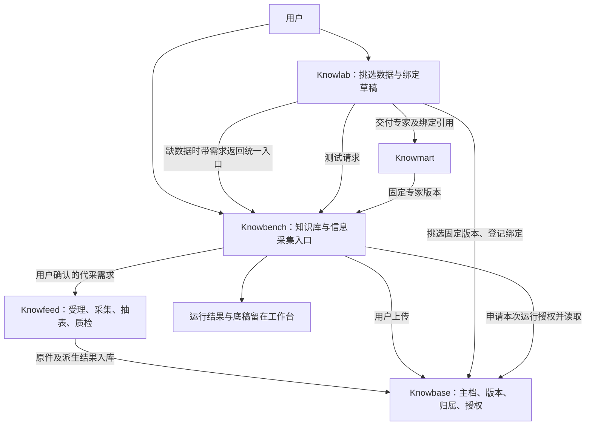

**Knowbench / Knowlab 数据需求 → Knowfeed 采集 → Knowbase 主档：现状分析与接入方案**

2026-10-24。本文是方案草稿，区分现有事实、已定架构和实施建议；没有修改应用代码、部署声明或既有架构决定，没有运行集群或联网采集。

**一、结论与分析范围**

这件事的架构方向已经定过，主要依据是 [数据拓扑](/home/zymun/worktrees/luna/sunmoonun/docs/总纲/数据拓扑.md)，尤其是 2026-10-18 的三区、用户代采、同意与授权，以及 10-19 补充的三种读取方式。需要补的是实现、迁移和跨应用闭环。

目标是：**Knowbench 承载用户的数据管理与运行，Knowlab 选择和绑定数据，Knowfeed 负责采集任务，Knowbase 负责云端来源数据、版本与访问授权，Knowmart 保存专家与数据版本的绑定。** Knowbench、Knowlab 不再各写采集器，也不再各自保存来源数据的主档。

“保存到 Knowbase”意味着由 Knowbase 控制对象持久化、版本发布、引用关系、授权与删除。仅在 Knowbase 表里登记一个 Knowfeed 桶地址，不足以完成这一目标。它也不等于把所有 PDF 二进制塞进 PostgreSQL：文件可存 Knowbase 管理的对象存储，结构化表、版本、权限和审计存其逻辑数据库。

本次检查覆盖 sunmoonun 的总纲、项目总览、代码地图、约束、相关模块设计、待办账、服务关系部署配置与历史联调说明，并对照四个应用的采集、数据登记、上传、读取、运行和鉴权代码。没有逐文件审计全部基础设施，也没有把历史回执当作当前线上运行证明。

检查时的后端 / 文档 HEAD：

| 仓 | 提交 |
| --- | --- |
| sunmoonun | c2ce7751 |
| knowfeed-backend | 6239d22 |
| knowbase-backend | ad1e2ed |
| knowlab-backend | e328702 |
| knowbench-backend | 44888e2 |

上述五个工作树检查时均无未提交改动。

**二、Sunmoonun 在整个系统中的位置**

Sunmoonun 是部署与设计仓，承载项目规则、平台运行环境、发布链和跨应用服务关系。业务实现仍在各应用仓，不宜把采集或数据授权服务写进部署脚本。

[架构总纲](/home/zymun/worktrees/luna/sunmoonun/docs/总纲/架构总纲.md)将系统分为物料、站点、宿主、集群、平台、应用、产品线七层，另有交付链、身份秘密、环境参数三条横向规则。本次接入主要落在应用层和产品线；基础设施承担身份、存储、队列、网络与部署支持。

两条产品线需要在数据引用处衔接：

- 数据线：Knowfeed → Knowbase。
- 专家线：Knowlab → Knowmart → Knowbench。
- 接合点：专家版本引用 Knowbase 的固定数据版本，运行方取得对应授权后读取。

可直接复用的底座有：各应用独立逻辑库、FastAPI 三面接口、同镜像 API/Worker/Scheduler 角色、Outbox/Inbox、版本化 HTTP 契约、服务身份、对象存储、前端跨应用跳转机制。无需新建一个“数据中台”应用或第二套任务协调系统。

需要注意文档的新旧关系：

- 项目总览仍有“用户数据存 Knowlab”“用户只上传”“Knowlab 空应用”等旧表述，当前代码和新数据拓扑已经不同。
- 0008-info-intake 的“按公司申请、关注清单自动批准、显示其他申请人数”是旧实现依据，新数据拓扑改为用户指定具体披露、按来源自动受理、隐藏他人申请情况。
- 部分应用 AGENTS.md 仍指向不存在的并列 k8s 和旧 docs/dev-investment-agent 路径，本次按 sunmoonun 的真实入口解析。
- 以下涉及数据来源的限制是在执行项目既定规则，不是在给出法律合规结论。技术接入不改变这些规则。

**三、代码目前走到哪里**

| 环节 | 已有事实 | 距目标的差距 |
| --- | --- | --- |
| Knowfeed 采集 | 巨潮年报与东方财富 F10 采集器，原响应存档、重试、去重 | 用户代采需要单独走巨潮披露；年报之外的定期报告与金融企业格式尚需补齐 |
| Knowfeed 申请 | 用户提交、多人加入、管理员审批、关注清单、进度查询 | 粒度是公司而非具体报告；仍按旧规则处理，缺新的用户归属凭据与入库引用完成条件 |
| Knowfeed 后处理 | 原件、报表数据、SQLite 数据集、质量报告；采集→建库→登记持久任务 | 新方案需原件与完整抽表结果分别版本化，第三方数据不能混入用户代采成果 |
| Knowbase 登记 | 数据集 ID、版本、对象位置、哈希；重复登记幂等 | 仍以来源桶中的 SQLite 为数据来源，没有新三区、用户引用、同意依据和运行授权闭环 |
| Knowbase 查询 | 数据目录、SQL/语义查询、MCP，下载文件到缓存并核哈希 | 按当前版本解析，旧版被替代后不再在该查询目录中提供；不能直接用于固定历史版本读取 |
| Knowlab 数据 | 上传 PDF/Excel/CSV/文本，独立存储，按页、表、格和引文读取 | 应迁到 Knowbase；Knowlab 只保留草稿业务和版本绑定 |
| Knowbench 运行 | 校验任务、专家清单与数据绑定，再通过 KnowlabDataClient 取数 | 数据源要替换为 Knowbase；加入每次运行授权，不重写已有运行和计算体系 |
| 缺数据入口 | data.missing 事件、管理端汇总、用户侧提示卡 | 尚不是用户确认→代采→入库→恢复任务的闭环 |
| 运行隔离 | 已停止向用户沙箱默认注入旧 Knowbase MCP 令牌 | 旧令牌相关代码和部署关系仍有遗留；不能为了接通数据恢复旧的全库读取方式 |

关键证据：

- [Knowfeed 申请服务](/home/zymun/worktrees/luna/knowfeed-app/knowfeed-backend/app/app/application/securities/request_service.py:58)与[采集器组装](/home/zymun/worktrees/luna/knowfeed-app/knowfeed-backend/app/app/bootstrap/securities.py:84)。
- [Knowbase 登记接口](/home/zymun/worktrees/luna/knowbase-app/knowbase-backend/app/app/interfaces/endpoints/knowledge_routes.py:211)：201 主要表示元数据登记完成，并不在此同步完成文件接管和用户授权。
- [Knowbase 数据集模型](/home/zymun/worktrees/luna/knowbase-app/knowbase-backend/app/app/infrastructure/models/datasets.py:20)与[现行版本查询](/home/zymun/worktrees/luna/knowbase-app/knowbase-backend/app/app/application/services/dataset_catalog.py:80)。
- [Knowlab 上传服务](/home/zymun/worktrees/luna/knowlab-app/knowlab-backend/app/app/application/services/knowbot_data.py:31)与[读取服务](/home/zymun/worktrees/luna/knowlab-app/knowlab-backend/app/app/application/services/knowbot_data_read.py:65)。
- [Knowbench 数据客户端](/home/zymun/worktrees/luna/knowbench-app/knowbench-backend/app/app/infrastructure/external/knowlab_data_client.py:26)、[运行范围校验](/home/zymun/worktrees/luna/knowbench-app/knowbench-backend/app/app/application/workbench/knowbot_data.py:86)、[停止默认发 Knowbase 令牌](/home/zymun/worktrees/luna/knowbench-app/knowbench-backend/app/app/application/workbench/provisioning.py:254)。

部署源码仍声明 Knowlab 自己的上传桶，以及 Knowbase 对 Knowfeed 来源桶的读取关系；这进一步说明主档迁移尚未完成。不能把“采集→登记→旧 MCP 查询”的历史联调成功当作新架构已经完成。

**四、目标职责与数据流**

| 应用 | 拥有的业务事实 | 数据读写边界 |
| --- | --- | --- |
| Knowbench | 会话、委托、运行、产出、缺数需求的上下文 | 调 Knowfeed 提需求，调 Knowbase 上传/查询/申请授权；不持来源主档 |
| Knowlab | 想法、草稿、测试记录、草稿绑定 | 挑选并绑定 Knowbase 版本；测试交 Knowbench；不爬取、不新增上传主档 |
| Knowfeed | 来源适配、代采申请、共享采集任务、采集证据、处理进度 | 仅对允许来源取数；通过 Knowbase 入库契约交付原件与派生物，不对用户运行供数 |
| Knowbase | 来源数据、原件与派生版本、归属、同意、引用、授权、读数审计 | 保存主档并统一执行访问控制；提供固定版本读取 |
| Knowmart | 专家版本与交付事实 | 保留数据绑定引用；交付完成前向 Knowbase 建立对应依赖关系 |
| Sunmoonun | 跨仓设计、部署真源、服务身份和网络关系 | 配置、部署、验证上述关系，不保存应用业务主档 |

**五、不是所有数据需求都要触发采集**

| 需求 | 路径 |
| --- | --- |
| 用户已有文件 | 工作台统一上传入口 → Knowbase 第一区；Knowlab 引导过去上传后回来选择 |
| 用户已有可用版本 | Knowbase 返回本人可用的版本；用户选择绑定，零采集 |
| 用户指定公开披露 | 用户确认具体报告 → Knowfeed → Knowbase 公开原件层 → 用户第二区引用 |
| 本地目录里的文件 | 仍由本地代理按既有规则就地读取；用户主动上传才成为云端来源数据 |
| 原件已有但派生结果不满足需求 | 重新处理指定原件，生成新派生版本；不重复下载原件 |
| 数据已经有，但无访问权限 | 提示选择或取得授权；不自动重新采集绕开权限 |
| 来源暂不支持 | 告知不支持，允许用户上传有权使用的文件；不让模型自行搜索替代来源 |

第一期代采按已定范围：巨潮、A 股定期报告、用户指定公司和报告期，先交付三张财务报表。已有的 RSS/API/网页采集可继续作为内部采集能力，但不因这次接入自动进入用户代采范围。

东方财富 F10 整理数据进入平台私有区，不能把原有混合 SQLite 数据集整体换个标签交给用户。公开披露的抽取派生数据可以挂在对应原件下供第二区引用，不应与第三方数据混淆。

**六、从缺数据到能使用的完整过程**

以“在 Knowlab 测试一个需要某公司 2023—2025 年财报的专家”为例：

1. Knowlab 根据用户的方法和已选数据列出缺口：缺哪家公司的哪种报告、哪些期间、需要表格还是文字。模型可以提出候选需求，用户确认后才形成代采指令；已有明确授权范围内的拆单不反复询问。
2. 用户进入工作台统一“信息采集”入口，确认来源、报告范围与用途。后端记录真实用户身份、来源应用、草稿/委托引用、确认的范围和幂等键。页面可嵌入或跳转，但申请业务只由 Knowfeed 实现一次。
3. Knowfeed 校验来源范围、配额和用户指定依据。按来源自动受理，不再以“是否在平台关注公司清单”决定用户的资格。
4. Knowfeed 通过受限内部接口问 Knowbase：这一份精确原件和所需派生版本是否已完整持久化。用户能选择的报告来自披露渠道索引，不来自平台已有库目录。
5. 命中：在用户名下建立第二区引用；不重新抓取。未命中：关联或创建一个共享采集任务，取回原件。
6. 原件先经 Knowbase 接管并核哈希，再进行抽表和质检。抽表任务以固定原件版本为输入，输出完整行、单位、页码和问题清单。Knowfeed 负责证券处理任务，Knowbase 保存成果。
7. Knowbase 分别发布原件状态和派生能力状态，并确认用户引用已建立。原件到了但表没抽全，可以显示“原件可用，部分表暂不可用”，不能把全部数据标成成功，也不能丢掉已保存的原件。
8. Knowfeed 收到入库回执，更新该用户申请的进度。Knowbench/Knowlab 只持进度投影，必要时向 Knowfeed 查证；事件丢失可通过对账补齐。
9. 用户在 Knowlab 选择这几版数据，确认用于草稿；Knowbase 记录同意依据和绑定。拿到数据不自动等于同意用于任意专家。
10. Knowlab 发起测试，Knowbench 凭有效绑定和同意依据申请本次测试授权。Knowbase 签发后才能启动需数据的步骤。
11. 专家通过现有工作台工具按格、按页、按段读取；工作台和 Knowbase 各核一遍运行范围。数值计算交已有计算工具，来源引用进入测试证据。
12. 测试成功交付时，Knowmart 登记同样的固定数据绑定。用户请专家运行，再申请新的运行授权；不会复用测试授权。

在 Knowbench 运行中发现缺数时，沿用现有任务等待/交互机制承载“等待数据”，不要给任务账本另造一套平行状态机。跨天采集不占着模型 turn 或运行锁等；保存检查点，数据到齐后核验版本与授权再恢复。若补充数据改变了已交付专家的固定绑定，应先产生新版本并测试，不能偷偷更改旧版本。

**七、Knowbase 怎么存，怎么固定版本**

三区与公共原件层保持现有架构决定：

| 范围 | 保存什么 | 使用规则 |
| --- | --- | --- |
| 第一区：用户自带 | 用户上传原件及其派生结果 | 按所有者隔离；即使哈希与公开原件相同，也不自动变成公共资料 |
| 公开原件层 | 披露原件、出处、原件版本、抽表派生版本 | 可以复用文件内容，但不能提供绕过用户归属的公开数据目录 |
| 第二区：用户代采 | 用户对指定公开原件及版本的引用 | 用户申请过才属于其可用数据，内容复用不等于权限复用 |
| 第三区：平台私有 | 第三方数据、内部研究、内部质检对照 | 用户运行授权接口一律拒绝，不能通过检索或缓存绕开 |

建议在 Knowbase 建立以下实体，名称是概念建议，不是现有数据库表名：

| 实体 | 类别与用途 | 版本、审计与下游引用 |
| --- | --- | --- |
| 原件与原件版本 | 主档、原始证据；来源标识、披露日期、获取时间、字节哈希、对象版本 | 不覆盖；保留更正和多来源关系 |
| 派生版本 | 抽取或标准化结果 | 固定原件输入、处理器版本、科目目录版本、配置摘要、结果哈希 |
| 用户数据引用 | 所有者对第一/二区数据的归属 | 独立于物理文件去重；有撤销和删除状态 |
| 同意依据 | 用户对用途与范围的确认 | 记录已验证主体、范围摘要、时间、版本；不是读令牌 |
| 绑定 | 业务对象到固定数据版本的依赖 | Knowlab 草稿、Knowmart 专家、必要的工作台委托引用；不是读权限 |
| 运行授权 | 有期限的访问许可 | 绑定运行、调用应用、用户、版本集、操作范围；可撤销 |
| 读数留痕 | 运行审计 | 记录主体、授权、数据版本、操作和结果状态，不记录数值或凭据 |

采集请求/执行任务归 Knowfeed；委托与产出归 Knowbench。每个新增实体须按 C-D12 补齐唯一主档、数据类别、版本审计和失效规则，不能把一张申请表同时当作数据主档与运行授权。

原件识别至少包含：来源渠道、发行人、披露标识、报告类型、报告期、获取到的字节哈希。来源网站替换同名文件，新增原件版本；抽取器修了一个数字，新增派生版本。

跨应用绑定建议携带：Knowbase 数据标识、原件版本、派生版本、内容摘要、用户引用标识、绑定标识。运行时必须精确解析这些版本，不能把 `latest` 当持久绑定。同一个专家的重复运行应能重现同一输入；用户选择升级后生成新绑定并重新测试。

三种读法分别落地：

- **表格**：结构化结果进 Knowbase PostgreSQL，保存原文数值（精确十进制）、单位、币种、合并/母公司口径、期间起止、时点/期间性质、原文科目、标准科目、页码及质检标记。累计数不能无说明地当成单季度数。
- **文字检索**：作为可重建的派生索引，按用户和数据区限制结果，引用固定到原件版本与页码。新披露链沿用总纲已定的 PostgreSQL 方向；具体检索实现另行验证，不新起 MySQL，也不为本次接入强行重写全部旧 RAGFlow 文档管线。
- **原文按页**：核对和兜底；用 PDF 的物理页码，印刷页码另存，避免引用歧义。工具结果按字节与条数分页，沿用已修复的输出大小控制。

RAG、缓存、SQLite 导出都不是主档。现有 SQLite 可作为迁移输入或版本化导出格式保留，但用户运行的权威版本和权限必须回到 Knowbase。

**八、入库协议：真正接管文件，不能只登记位置**

建议扩展为版本化的“导入会话”流程，复用已有任务投递机制：

1. Knowfeed 带请求标识、来源、大小上限、预期哈希等创建导入会话；Knowbase 返回导入 ID 和限定的上传方式。
2. Knowfeed 传原件。可以用 Knowbase 的流式上传接口，也可以由 Knowbase 签发仅允许写入指定暂存对象、短时有效的上传能力；两者都由 Knowbase 管理协议与落点，Knowfeed 不持有其桶的通用读写凭据。
3. Knowbase 服务端核大小、哈希、对象实际存在与内容类型，建立不可变原件版本，返回“原件已持久化”回执。仅收到登记 JSON 不算完成。
4. Knowfeed 提交以该原件版本为输入的派生成果与质检报告；Knowbase 验证父版本、schema、成果完整性后发布派生版本。
5. Knowbase 根据已验证的用户指定依据建立用户引用，返回最终完成回执；采集任务此时才能报告该用户可用。

大文件不在 HTTP 同步请求中等待整个采集过程。同步受理快速返回任务/会话标识，长工作在 Worker 中推进。

Knowfeed 可以有有界的故障暂存文件，但不得永久保留另一份可独立发布的来源主档。尚未取得 Knowbase 持久化回执前，暂存不能清；取得回执后按明确保留期清理，作业证据中保留来源、请求信息、哈希和 Knowbase 标识。Knowbase 不可用时显示入库等待，不把暂存文件当成正式供数入口。

证券披露的源适配、抽表与质检继续由 Knowfeed 的处理任务负责，避免丢掉既有成果；Knowlab 现有通用上传解析迁到 Knowbase。重抽已保存的公共原件时，Knowbase 给处理任务限定版本的内部处理权限，不能给它任意读用户上传区的能力。

**九、用户身份、绑定与运行授权**

这是迁移的前置能力。服务身份只能证明“哪个应用在调用”，不能证明“用户本人同意了”。请求体填 `owner_subject`、链接带 `user_id`，都不能成为归属或授权依据。

统一用户键应依据受信身份提供方的稳定主体（包括 issuer 和必要的组织限定），各应用本地 `actor_id` 做显式映射；不能假设四个库的本地 UUID 相同。现有 Knowfeed 申请使用本地 actor_id，迁移时必须映射，不能直接复制成 Knowbase owner。

推荐能力边界：

| 调用方 | 可做 | 不可做 |
| --- | --- | --- |
| Knowfeed | 对用户确认的范围执行采集、提交原件与派生版本、查询自己的任务回执 | 自行决定用户身份、扩大申请范围、给用户读第三方区的权限 |
| Knowlab | 凭用户有效同意记录草稿绑定；用受限格式读取辅助孵化 | 自己伪造用户同意、直接创建运行授权 |
| Knowmart | 为交付的固定专家版本登记继承自草稿的绑定 | 偷换数据版本或扩大用户已同意的范围 |
| Knowbench | 凭同意和绑定申请本次运行授权，再受限读取 | 自签一张 Knowbase 全库通行令牌 |
| Knowbase | 验身份、记同意、确认归属、签发和撤销授权、每次读检查 | 根据调用方自报用户名直接授权 |

三层仍分开：用户同意依据 → 固定版本绑定 → 某次运行授权。读数据只接受本人有效凭据，或适用本次操作的有效运行授权；长期同意和绑定本身不能直接拿来读。

委托凭据的具体机制尚未在项目中落地，不能假定 Casdoor 现有部署已经支持令牌交换。建议先做限范围身份探针；优先复用实际支持的委托机制。若不支持，第一版可由 Knowbase 自己的登录确认页完成身份与范围确认，再签发受限委托凭据。工作台与 Knowlab 仍提供统一入口；凭据经后端受控通道使用，不在业务链接里携带访问令牌，不跨应用转发 Cookie 或 ID Token。

长采集完成时用户的短期登录凭据可能早已过期，因此应持久保存“已验证的范围依据”的记录标识，不把短期令牌长期塞进队列。完成登记时重新核该依据是否被撤销；用户撤回后即使共享任务仍完成，也不能自动在其名下创建引用。

运行授权建议绑定用户、调用服务、运行/测试编号、固定版本集合、允许操作、有效期与撤销状态。工作台工具保持现有名称和任务校验，后端适配器改连 Knowbase；模型无需接触服务凭据。每次读取都校验，缓存命中也一样。暂停等人时可在已批准时限内续期，不能无限续；终态撤销授权，超时兜底失效。

普通聊天、本地工作与专家运行可以有不同工具策略。本次“统一采集”要求对受数据边界约束的专家运行同时限制外部搜索、任意 HTTP 和模型提供方工具旁路，不是关闭模型调用本身。待办账 149 已记录专家调用网络搜索的问题；当前 THREAD_CONFIG 中未见对应禁用项。实施时必须对钉住的运行时版本做行为验证，不能只在提示词里说“不要上网”。

**十、跨应用契约与可靠性**

以下是建议新增或升级的能力，不是声称已经存在的接口；正式 URL、schema 和主版本在设计冻结时确定。

| 提供方 | 能力 | 消费方 |
| --- | --- | --- |
| Knowfeed | 提交/取消本人代采申请、查进度、返回精确结果引用 | Knowbench；Knowlab 通过统一入口或同一客户端能力使用 |
| Knowbase | 上传与导入会话、原件/派生版本完成回执 | Knowfeed、用户入口 |
| Knowbase | 本人可用数据列表、精确版本和格式查询 | Knowbench、Knowlab |
| Knowbase | 同意、绑定、绑定迁移/删除流程 | Knowlab、Knowmart、Knowbench 的对应角色 |
| Knowbase | 运行授权申请、续期、撤销与有效性检查 | Knowbench |
| Knowbase | 固定版本读页、读表、读格、检索、验证引文 | Knowbench 运行与验收；本人预览 |
| Knowfeed/Knowbase | 申请进度、入库完成、版本问题、撤销与删除事件 | 相关业务应用 |

契约 schema 真源归提供方，调用方持锁；复用 common/backend/service-client 和关系级身份。新增 Knowbench→Knowfeed、Knowbench→Knowbase、Knowlab→Knowbase、Knowmart→Knowbase 等所需关系时，同步核接收方身份、网络策略和角色进程；runner 的数值验收也需要合法读数能力，不能只给 API 配。

现有 knowbot-data/v1 是 Knowlab 提供的上传数据契约。迁移可以保持面向模型的工具名称，但新的身份、版本和授权语义应发新契约版本，不能用旧名悄悄改变含义。旧消费者的 `extra=forbid` 会拒绝额外字段，任何演进都要双端校验。

事件由现有 Outbox 投递，消费方 Inbox 幂等，跨应用传递仍遵守版本化契约，不跨库、不直接消费对方内部 Celery 队列。消息里只传标识、摘要、状态，不塞 PDF、原始表格或访问凭据。

建议的可靠性基线如下，具体数值是实施起点，不是现网参数：

| 操作 | 超时与重试 | 幂等与最终去向 | 对账 |
| --- | --- | --- | --- |
| 提交申请 | 受理调用约 10 秒，返回异步标识；超时后先按键查询，不盲目新建 | 用户+幂等键+请求摘要；同键异内容冲突 | 用户申请与内部共享作业关联 |
| 拉取原件 | 复用现有下载大小、时间限制；瞬时失败按有限退避重试 | 来源标识+明确版本策略；失败进入可重试阶段 | 采集记录、原件哈希与导入回执 |
| 完成入库 | 控制调用约 10 秒，大文件另有有界传输时限 | 导入 ID+内容哈希；永久格式错误不重试，瞬时故障有限重投后进死信 | 暂存对象、已发布版本、申请是否有用户引用 |
| 通知进度 | 失败退避，事件必须带唯一 ID 与状态版本 | 重复无副作用；乱序不能倒退；耗尽进入死信 | 按申请 ID/导入 ID 拉取权威状态 |
| 申请授权/读数 | 有限超时；暂不可用可以短暂重试 | 无授权不开跑；过期/撤销/越权不重试、不回退旧接口 | 运行终态与未撤授权定期核对 |

采集去重和用户请求去重分开：两个人要同一份报告，可以共用一个采集作业，但各自有申请和用户引用。不能继续用“同一公司只有一个申请”覆盖不同报告范围；用户也不能看到其他人的姓名、理由、人数或申请列表。

采集、入库、用户引用各自拥有阶段状态。Knowfeed 的进度是这些权威结果的投影，别在四个应用都保存可独立修改的完整采集状态机。

**十一、失败、质量与撤回如何处理**

| 情形 | 应有行为 |
| --- | --- |
| 下载失败 | 标清哪份报告失败；其他报告可以继续，按所需范围展示部分完成 |
| 下载成功、Knowbase 不可用 | 保留有界暂存及恢复记录，停在等待入库；恢复后续传，不伪装为可用 |
| 原件已接管、抽表失败 | 原件可用，失败的表不可用；用户看到原因，可上传整理好的表到第一区 |
| 单元格或勾稽质检失败 | 留存问题与证据，不把错误格子当成普通可靠数；是否允许运行由方法的明确数据要求判定 |
| 原件与派生已入库、用户引用失败 | 重试补引用，不重新下载或重抽 |
| 入库已成功、通知失败 | 不回滚数据；重投通知并定期对账 |
| 两用户共用作业，其中一人撤回 | 只撤其申请和待建引用；另一人的作业与引用继续 |
| 网站更正报告 | 新原件和派生版本，通知受影响绑定；旧专家不自动换数据 |
| 抽取器发现错误 | 标记受影响版本，修复产生新派生版本；通知作者，必要时阻止新运行使用已知坏版本 |
| 没有权限或权限无法确认 | 统一拒绝，避免泄露对象是否存在；不通过重新采集或旧 MCP 绕过 |

质量应分为“原件完整可读”“派生结果覆盖与可信度”“某个方法的需求是否满足”三件事。旧接口只收 `quality_passed=true` 的整体数据集，不能直接承担这种部分可用语义。原件永远先保存，检索/抽表失败不能导致原件消失。

两种独立抽取、报表勾稽和人工核过的样例按数据拓扑实施。任何模型参与抽取都只生成候选并带处理版本、成本和校验记录，不能猜缺失数后标为通过；具体模型和花费政策应在实施设计中验证，不能把模型二次读取当成绝对正确的基准。

删除遵循已定流程：显示依赖 → 禁止新的绑定和新运行授权 → 现有运行在原授权期限内结束 → 下架受影响专家并撤权 → 删除用户文件或用户引用。第二区删引用不等于删除共享公开原件。阻止新运行和签发授权必须在 Knowbase 的本地事务中一致，避免删除期间还授出新权限。跨应用步骤可查、可重试，未完成时不重新开放。

**十二、迁移：保留现有能力，逐步更换主档**

遵循项目既定 `expand → backfill → reconcile → switch read → switch write → observe → contract`，不长期双写。

1. **补主档与权限基础**：Knowbase 增加三区、原件/派生版本、用户引用、同意、绑定、授权、精确版本读取。旧接口暂限旧内部用途；新路径默认拒绝未授权。
2. **迁 Knowlab 数据**：用受控导出/导入任务把文件及哈希、版本、所有者、草稿/专家依赖转入 Knowbase，不跨库直接改表。保留旧 dataset_id/version/sha256 到新标识的映射，禁止改写已交付清单和其摘要。
3. **核身份和同意**：用可信主体映射，而不是用户名或本地 UUID 猜身份；旧数据绑定不自动等于符合新协议的用户同意。缺少可验证依据的绑定必须在新运行前由用户确认，不批量伪造授权。
4. **迁公开原件和内部数据**：Knowfeed 的巨潮原件可导入公开原件层；老的巨潮+东方财富混合数据集先按内部区隔离，逐项核来源。进入用户第二区仍需用户的指定依据，不能把平台历史库自动塞给所有用户。
5. **兼容旧专家读取**：在明确的迁移窗口内，旧 Knowlab 读接口可作为受控转发适配，实际读取 Knowbase，执行同样授权；不能授权失败后退回 Knowlab 文件。受影响运行要受控排空或在截止时间内完成，不能无期限保留旁路。
6. **切新读与新写**：Knowbench 数据端口改用 Knowbase，新增上传只由 Knowbase 接收；切换短窗口需要写入冻结或有截止时间的增量回填，避免复制期间漏新上传。切写时旧写入口明确拒绝。
7. **观察与收口**：对账文件数、大小、哈希、所有者、绑定、读取结果；验证回滚和重新前滚。确认后下线旧存储写权限、旧查询关系及过期契约，按既定保留流程处理旧文件。不能先删桶再验证。

抽表代码的迁移与复用按职责进行：Knowfeed 保留证券源和处理流水线，Knowlab 不再拥有用户来源数据解析主档；共同读取结果使用 Knowbase 契约。为避免重复实现，不在 Knowbench/Knowlab 复制 PDF 抽取器、AKShare 或站点适配代码。

**十三、建议实施顺序与每步交付物**

| 阶段 | 主要工作 | 能交付什么 |
| --- | --- | --- |
| A 架构与契约冻结 | 对齐数据拓扑与旧文档；验证用户委托凭据；固定请求、版本、授权及失败语义 | 跨应用契约、实体归属、身份映射、迁移与回滚设计 |
| B Knowbase 主档 | 用户上传区、原件/派生版本、用户引用、固定版本读取和授权 | 用户上传一份文件后，授权内读取并可撤销 |
| C Knowfeed 代采 | 精确报告申请、巨潮路径、导入会话、完整抽表、质量状态 | 用户指定一份报告，原件与可用派生结果进入本人第二区 |
| D 工作台入口 | 知识库、信息采集、状态卡、缺数交互、读取适配器 | 缺数→用户确认→进度→选择版本→受控恢复 |
| E Knowlab/Knowmart | 选择并绑定版本、测试授权、交付绑定 | 同一固定数据版本用于测试、交付和用户运行 |
| F 历史迁移与部署收口 | 回填、对账、切读切写、撤旧身份、恢复演练 | 主档只归 Knowbase，无重复采集与授权旁路 |

第一条纵向演示建议只选“一位用户、一个指定公司、一份年报、三张表、一个测试草稿”。它必须从真实用户确认开始，走到 Knowbase 精确版本读取并完成一次测试；不能用管理员预塞数据或绕过授权代替。随后扩到半年报、季报、金融类报表、多人共享原件和历史专家迁移；选择小样例不改变最终已定支持范围。

Sunmoonun 的变更落在应用部署配置和共用服务身份机制：新增关系、独立存储权限、网络路径、迁移 Job、备份与恢复、运行配置和发布顺序。按提供方先发布、消费者再切换，继续固定镜像与契约摘要；不用部署脚本写业务数据，不新建第二套发布入口。

**十四、验收重点与仍需验证的事项**

至少覆盖这些跨应用用例：

1. 新用户请求一份报告，落盘核哈希、生成版本、建立本人引用后才能显示可用。
2. 第二个用户请求同一原件，不重复下载，分别有引用，互相看不到申请信息。
3. 同用户重复提交同键不新增；同键不同范围返回冲突。
4. 原件已有但抽表版本缺失，只处理原件；原件成功而抽表失败仍可查看原件。
5. 注册、消息消费、建立引用任一步中断，重放不会重复生成版本或丢任务。
6. 更新后旧专家仍读旧版本；校验其引用、数值、计算和引文证据一致。
7. 用户甲无法读乙的上传、代采引用、表格、检索结果、缓存或下载；服务自报用户不被接受。
8. 第三区即使给出正确数据 ID，也不能获得用户运行授权。
9. 授权到期、撤销、运行终态后读数被拒；拿不到授权不开跑，不回退旧接口。
10. 数字从表读取且保留单位/期间/页码，文字引用回查固定原件；大结果分页，不截掉中间内容。
11. 删除期间不接受新运行授权；共享原件不因某用户删除引用而被误删。
12. Knowbase 的检索不可用仍可按固定版本读表和原文；授权服务不可用则停读。
13. 备份恢复同时覆盖文件、元数据、同意、绑定、授权、撤销；恢复旧备份不能让已撤销授权重新生效。可通过独立撤销检查点/恢复代次使旧运行凭据失效，恢复后重新验证再签发。
14. Knowlab 迁移数量、哈希、主体、依赖对账通过；旧写凭据被拒、迁移单 head、回滚与再前滚通过。
15. 专家运行不能经网络搜索、任意 HTTP、额外 MCP 或旧平台数据入口绕开 Knowbase；按真实钉版运行时验证。

运行监测重点是：申请排队年龄、下载/抽取/入库阶段停滞、用户引用欠账、死信与对账差异、授权拒绝/到期/撤销、工具读取时延、未引用暂存对象及存储增长。关联 request_id、job_id、import_id、version_id、run_id，日志不含令牌和文件内容。

实施前需验证的具体事项已收敛为：用户委托凭据的实际支持、当前主体映射、已有数据和运行的数量、抽表对不同报告/公司类型的覆盖、上传方式与大小限制、暂存/备份的容量、当前部署版本。它们影响具体实现与上线安排，不影响“Knowfeed 采、Knowbase 管、Knowlab 绑、Knowbench 用”的职责方向。

优先级最高的三个审查点是：**Knowbase 是否真正接管主档；调用方能否伪造用户或扩大权限；更正、重跑和迁移后能否仍读到原来固定的版本。** 这三点成立，再扩采集品种、页面和检索能力。
