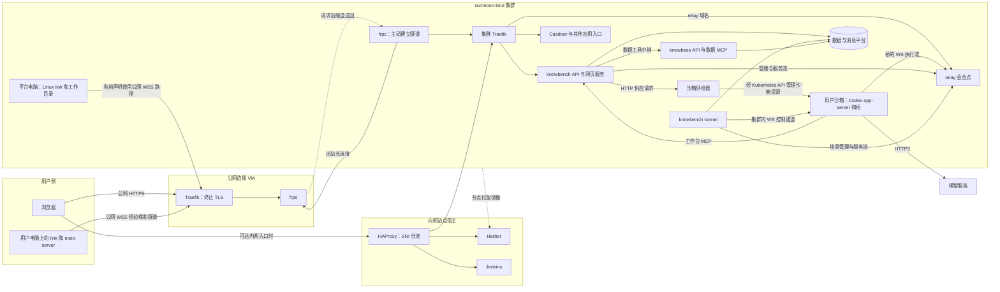

# 运行拓扑

> **地图位置**：按[架构总纲](架构总纲.md)，本文描述第 2 层站点、第 3 层宿主、第 5 层平台与应用之间的运行连接，以及横切 A 交付链。数据归属见[数据拓扑](数据拓扑.md)，应用内部见[项目总览](../project-guide/overall-architecture.md)。
>
> **核对日期：2026-11-13。**“当前”指本轮核对的源码和已提交部署声明，不是对所有线上实例的实时验收。knowbench-backend 核对至 `3cb341f`；部署参数以当前仓库的站点文件、组件配置和渲染声明为准。实际生效版本须结合集群源、工作负载及发布回执核对，不能只看工作区代码。
>
> - 站点与共享参数：[site.yaml](../../infrastructure/environments/kind/site.yaml)；边缘入口：[edge/config.yaml](../../infrastructure/edge/config.yaml)；组件说明：[平台代码地图](../design/平台代码地图.md)。
> - 发布源指针：[flux-source.yaml](../../infrastructure/environments/kind/flux-source.yaml)；发布与恢复操作：[Flux 手册](../../infrastructure/flux/README.md)及[Jenkins 手册](../../infrastructure/jenkins/README.md)。本文不复制易变的镜像或声明摘要。
> - 账号、电脑、link、令牌与配对：[账号-电脑-link-会合点](../project-guide/账号-电脑-link-会合点.md)。目标拓扑及风险裁定见[拓扑设计](../design/SDD/architecture/topology.md)，与本文当前实现分开阅读。

# 一、站点层与宿主层：东西在哪、谁连谁

## 1. 当前声明中的站点与组件

当前开发站点配置为 WSL 宿主上的 `sunmoon-kind`，公网入口为独立云 VM。边缘运行 Traefik 和 frps；内网集群运行 frpc、Traefik、relay、供给器、用户沙箱和各应用。Harbor、Jenkins 和宿主入口 HAProxy 属于内网站点的宿主服务。

“内网只出站”描述内网站点通过 frpc 主动建立公网隧道、执行端主动连 relay 的方式，不表示集群内部服务不能接受连接。runner 连接沙箱 app-server、API 连接供给器都是集群内连接。本地 link 的公网通信也由执行端发起，本机接入页的回环监听另有范围限制。



图中的 link 连接承载双向消息；实际文件与命令执行请求由沙箱桥经 relay 发往配对的执行端。平台电脑是另一类执行端，并不是 Codex 编排沙箱本身，也不表示每个账号同时使用两台电脑。

### 1.1 公网入口与内网入口

| 路径或域名 | 当前配置与边界 |
| --- | --- |
| `knowbench`、`knowmart`、`casdoor`、`relay` | 边缘与 frpc 名单均已包含，域名由 `site_domain` 拼接；当前开发站点为 `dev.sunmoonai.com`，公网 HTTPS 端口由 `public_port` 配置为 30443 |
| Casdoor 公网路径 | 由 `edge_path_allowlist` 放行登录、登出、注册、验证码等所需路径，未放行路径拒绝；不能概括为只开放登录页 |
| 其余应用、管理端、Harbor、Jenkins | 当前不在上述边缘公网域名名单中；按宿主 HAProxy 的 SNI 路由从可达的内网入口访问，具体路由以入口配置为准 |
| 用户电脑 link | 经公网 relay 域名发起 WSS，流量沿边缘、frp 隧道和集群入口到 relay |
| 用户沙箱桥与后端 relay 客户端 | 当前声明使用集群内 `ws://relay.…:47100`，不必绕公网边缘 |
| 工作台 MCP | 配给沙箱的是集群内 `http://knowbench-api.…:8000/api/mcp/workbench`；路由检查 Bearer 身份及工具权限，不能仅因使用内网地址就声称该路径在公网不可达 |

依据：[边缘配置](../../infrastructure/edge/config.yaml)、[frpc 配置](../../gitops/components/ingress-platform/frpc/config.yaml)、[宿主入口配置](../../infrastructure/entry/config.yaml)、[knowbench 运行声明](../../gitops/components/app-platform/knowbench-app/knowbench-backend/runtime/workload.yaml)和[供给器运行声明](../../gitops/components/sandbox-platform/provisioner/workload.yaml)。knowbench 未按 Casdoor 那样配置路径白名单；是否允许某一 MCP 请求还要看应用鉴权，不能用旧文中的“`/mcp/` 不对外”代替实际边界。

以上证明的是仓库已配置相应路由；公网实际可用性仍须结合已部署配置与请求验收。旧文“knowmart 尚待加入名单”的记录不再作为当前声明说明。

## 2. 三条主要运行链路

### 2.1 控制链：网页命令怎样交给 Codex

```text
浏览器 → knowbench API → workbench_commands
                         ↓
                    runner 取命令
                         ↓ 集群内 WebSocket，使用 app-server 令牌
                 沙箱 Codex app-server
                         ↓ 通知、结果、审批请求
                runner → 运行记录与页面事件
```

`WsAppServerConnector` 使用沙箱记录的 `app_server_url`。供给器返回的地址为 `ws://<沙箱服务>.<命名空间>.svc.cluster.local:47800`。**正常模型轮次控制不是由 relay 的管理口转发给 Codex。**

runner 是 knowbench 后端的独立进程角色，入口为 `python -m app.bootstrap.runner`，与 API 使用同一后端镜像。它维护连接、处理排队命令和运行事件；专家步骤由 `Advisor` 等协作推进，状态、交互及费用经既有账本机制处理。本文所称 runtime 是这些组件共同承担的运行机制，不是 Runner 类的另一个名字。

### 2.2 执行链：文件和命令在哪里执行

```text
Codex app-server → 沙箱侧桥 → relay → 配对的 link / exec-server
                                            ↓
                              用户电脑或平台电脑的获准工作目录
```

当前沙箱入口配置远端执行环境，`include_local=false`；不能将执行端离线理解为自动回退到编排沙箱执行。工作区、项目目录、文件和网络权限由实际执行端与请求策略共同约束，不是仅靠提示词限制。

本地 link 在用户电脑运行；平台电脑运行同一客户端体系的 Linux 包，使用自己的持久卷和工作目录，按已配置账号接入。平台电脑的声明见[platform-computer/workload.yaml](../../gitops/components/app-platform/knowbench-app/knowbench-backend/platform-computer/workload.yaml)。它没有取代用户沙箱中的模型编排角色。

relay 的管理通道用于身份、公钥及吊销等管理；服务流允许工作台按授权直接请求执行端完成文件或目录等服务。这些通道与沙箱执行流有不同用途，不能统称为“给 Codex 下指令的管理口”。

### 2.3 数据链：模型怎样读取平台数据

```text
Codex → knowbench 的 /api/mcp/workbench
              ↓ 校验用户、任务或会话，映射运行授权，签工具范围令牌
         knowbase 数据 MCP → 按实际授权读取并返回
```

当前 `DataRelay` 发现并中继 knowbase 数据工具，把工作台的 `task` / `conversation` 转换为 knowbase 的运行授权或会话范围。专家步骤使用任务授权；普通对话使用获准的会话范围，不能利用对话参数绕过正在执行的专家任务范围。

knowlab 负责孵化、方法版本及测试等流程，knowmart 负责目录、交付版本及使用资格；不能把它们写成所有读数请求必经的数据服务。knowlab 测试可以关联测试授权，但实际数据工具调用仍由 knowbench 转给 knowbase。

沙箱入口和供给器源码仍保留可选 knowbase MCP 配置分支；本轮核对的 knowbench 供应主路径不再给沙箱发 knowbase 令牌，而是配置工作台 MCP。可选代码能力、当前供应配置和某个历史沙箱实际加载的配置要分别核对，不能在图中画成沙箱默认直连全部应用 MCP。

## 3. 各管什么

| 组件 | 所在位置与职责 | 边界 |
| --- | --- | --- |
| 浏览器 | 用户侧界面：登录、设置、发消息、看成果、回应交互 | 不承担 Codex 的远端命令执行 |
| 用户电脑 link | 用户电脑上的执行端，管理获准目录和本机权限 | 不承担模型轮次；本机接入页的回环端口不等于公网入站服务 |
| 平台电脑 | 集群内按配置运行的 Linux link 与工作目录 | 是执行端，不是用户的 Codex 编排沙箱 |
| 边缘 Traefik、frps / 内网 frpc | TLS 终止、域名和路径分流、隧道转发 | 不替代应用用户鉴权或 relay 配对 |
| 宿主 HAProxy | 内网入口按 SNI 转发到集群、Harbor、Jenkins 等 | 不在这一层解密业务 TLS；监听和路由范围以配置为准 |
| relay | 当前部署声明位于集群；配对、鉴权、透传执行流及服务流 | 不运行模型，不作为项目文件存储；具有连接状态，不等于无状态 HTTP 代理 |
| 供给器 | 接收 knowbench 供应服务请求，经 Kubernetes API 管理沙箱 Deployment、Service、PVC、Secret 与 NetworkPolicy | 用专用令牌鉴权，与本地 link 无直接控制关系 |
| 用户沙箱 | Codex app-server、桥、模型配置及持久会话；发起模型 HTTPS 请求和已配置 MCP 调用 | 模型 key 经供应流程进入 Kubernetes Secret，入口再写入 PVC 中受限权限的 `auth.json`；不能理解为秘密只存在数据库或只存在 PVC |
| knowbench API | 网页及 MCP 接口，供应请求、连接身份与业务服务入口 | 创建沙箱的入口归 API 供应服务，不归 runner 命令循环 |
| knowbench runner | 维护沙箱连接、处理命令与事件，协同专家推进、等待恢复和记账 | 不独自承担所有业务判定，不是 Celery worker |
| knowbase / knowfeed / knowlab / knowmart | 分别承接数据、供给、孵化与市场职责 | 具体数据归属与授权见数据拓扑，不从部署位置推导访问权 |
| PostgreSQL、Redis、消息与对象存储等 | 为应用提供持久化、事件、消息和产物存储 | 各组件身份与存储真源按组件配置管理 |

沙箱 NetworkPolicy 声明允许 DNS、TCP 443、应用命名空间 API 端口及 relay 端口，并允许应用侧连接 app-server。特别是 443 规则没有限定目的地址，不能表述为“碰不到集群别的东西”或“只允许访问某一家模型”。网络声明、集群网络插件的实际执行和应用层授权共同决定可访问范围；本轮没有进行隔离穿透测试。源码见[供给器](../../infrastructure/applications/component-images/sandbox-platform/provisioner/provisioner.py)。

## 4. 一次「工作」的顺序

1. 用户在浏览器登录 Casdoor，进入工作台；当前 BYOK 流程在设置中登记模型 key，由后端加密保存。
2. 拉起或更新沙箱时，knowbench API 调用 `SandboxProvisioning`，读取本次所需配置并请求供给器；供给器创建或更新用户沙箱资源，返回 app-server 地址和访问令牌。
3. 接入执行电脑：用户电脑安装 link、在浏览器批准账号绑定，并配置工作区；平台电脑按其部署与账号配置接入。执行端主动连接 relay，工作台核对当前可用环境。项目目录位于获准工作区内。
4. 用户在项目中发消息，API 将命令排队；runner 通过集群内 app-server WebSocket 启动 Codex 轮次。
5. Codex 需要操作项目文件或运行命令时，通过沙箱桥、relay 到对应执行端，由执行端检查目录和权限后处理。
6. Codex 使用工作台 MCP 时，请求进入 knowbench；读取平台数据的工具再由 knowbench 按任务或会话授权转给 knowbase。模型请求由沙箱向模型服务发出。
7. runner 接收轮次结果与审批事件，关联运行记录并更新页面。专家委托还由 Advisor 等执行步骤验收、返工、等待与后续推进；普通工作不能因此被描述成已经具备新方案中的通用方法 DAG。

## 5. 当前组件名与代码入口

下表中的 `app/app/` 路径相对于 `knowbench-app/knowbench-backend`，`agent/` 相对于 `sunmoon-link`，`infrastructure/` 与 `gitops/` 相对于本仓。这些路径用于定位实现。

| 名称 | 代码或声明位置 | 当前含义 |
| --- | --- | --- |
| runner | `app/app/bootstrap/runner.py`；`app/app/application/workbench/runner.py` | 后端独立运行角色；声明名仍为 `knowbench-runner`，旧稿“将改名 manager”不能当成已实现 |
| Advisor / Ledger | `app/app/application/workbench/advisor.py`、`ledger.py` | 专家推进与运行记账的协作组件 |
| 沙箱供应 | `app/app/interfaces/endpoints/workbench_routes.py`；`app/app/application/workbench/provisioning.py` | API 的供应路由与应用服务 |
| Codex 连接 | `app/app/infrastructure/workbench/app_server_client.py` | 使用 app-server 地址连接沙箱 |
| 工作台 MCP 与数据中继 | `app/app/interfaces/mcp/workbench_mcp.py`；`app/app/application/workbench/data_relay.py` | 对外工具接口及 knowbase 数据工具中继 |
| 本地 link | `agent/`，包名 `@sunmoon/agent` | 用户电脑或平台电脑上的执行客户端 |
| relay | `infrastructure/applications/component-images/relay/` | 会合点源码；运行声明在 `gitops/components/relay-platform/relay/` |
| 沙箱与供给器 | `infrastructure/applications/component-images/sandbox-platform/` | 编排环境、桥及沙箱供应源码 |
| API / worker / scheduler | 后端相应进程角色 | 网页接口、Celery 后台任务与定时调度，与 runner 分工不同 |

供应端保留 Kubernetes 资源管理权，knowbench 通过受限供应接口提出请求。这一职责分离仍成立；具体服务账号和资源权限以供给器 RBAC 声明为准，不能只用“只会建一种东西”代替权限边界。

# 二、横切 A 交付链：版本怎么进集群

当前交付链是：应用源码构建镜像并进入 Harbor，渲染声明提交到 Git，发布为 OCI 声明包，晋级后由 Flux 拉取和调和。宿主 Jenkins 已有 release 流水线，调用同一套 Make / Ansible 入口，不是尚待建设的后续步骤。Argo CD、冷建和上云的历史规划见第三部分，不混入当前发布说明。

## 1. 文件分成输入和声明

输入由人维护。声明由渲染生成，位于 `gitops/`，Flux 按它维持集群。手改声明会在下次暂存时被重写。`infrastructure/` 里的 Make 与 Ansible 是渲染和发布程序，Flux 不读取；发布打包的也只是 `gitops/`。

| 输入 | 位置 | 内容 |
|---|---|---|
| 业务源码 | 应用仓库；本仓用 [sources.yaml](../../infrastructure/applications/sources.yaml) 固定修订 | 程序行为。它先变成镜像，再由镜像摘要进入声明 |
| 组件参数 | `gitops/components/<对象>/config.yaml` | 开关、用户名、端口、资源、代次。真实口令不写在这里 |
| 环境身份 | [site.yaml](../../infrastructure/environments/kind/site.yaml) | 集群名、仓库地址、各平台命名空间 |
| 模板 | 组件目录 `*.yaml.j2` | 把参数填成 Service、Deployment、Ingress 等 |
| 准备任务 | 组件目录 `prepare.yaml` | 填模板之前在本机执行：校验、口令与 TLS、模板要用的计算值 |
| 阶段清单 | 组件目录 `stage.yaml` | 本组件有哪些阶段、依赖谁、用哪份准备任务、生成哪些文件 |
| 镜像锁 | 组件 `image.lock.*`，官方镜像在物料锁 | 要运行的镜像摘要 |
| 私有输入 | 本机 `services_config_dir`，不进 Git | 口令、令牌、私钥的主份与备份 |

声明是已提交的这些 YAML：工作负载、Service、IngressRoute、每个阶段目录的 `kustomization.yaml`、SOPS 密文 Secret，以及阶段图 `gitops/clusters/kind/stages.yaml`。

以 relay 为例。`config.yaml` 写 `relay_port: 47100`，模板写 `port: {{ relay_port }}`。阶段清单写阶段名 `relay`、依赖 `traefik`、准备任务 `prepare.yaml`、资源 `workload.yaml` 和两份密文。渲染之后才有 `workload.yaml`。改端口改 config，再渲染、暂存。六个应用（tpl、knowfeed、knowbase、knowbench、knowlab、knowmart）各自有 config 和阶段清单，共用 `app-platform/common` 的准备任务。

## 2. 阶段

阶段清单里的每一项，会变成阶段图里的一条指令。这条指令的 kind 是 `Kustomization`，apiVersion 是 `kustomize.toolkit.fluxcd.io/v1`，放在 `flux-system`。它是 Flux 控制器的自定义资源，称为 Flux Kustomization。它不是 Pod，也不描述容器。

一条指令写明：

- `sourceRef`：拉哪一个已晋级的 OCI 包
- `path`：包内哪一个目录
- `dependsOn`：哪些阶段 Ready 之后才开始
- `interval`：多久重新核对一次
- `healthChecks`：这个目录怎样算就绪
- `prune: false` 与 `deletionPolicy: Orphan`：指令不再提到的对象留在集群里

控制器拉包，用该目录的 `kustomization.yaml` 把清单拼成具体对象，应用到集群，并按健康检查等待。到点再核对一次，把漂移改回声明。受管对象的重启、维护和恢复按组件手册处理，不通过临时修改声明绕过发布链。

组件目录里的 `kustomization.yaml` 是另一份文件：Kustomize 的资源清单，列出本目录有哪些 YAML。Flux Kustomization 决定何时、对哪个目录使用那份清单。阶段图中每条指令的 `path` 指向一个含这份清单的目录。

一个组件可以有多个阶段。Casdoor 的建库阶段指向 `database` 目录，依赖 `postgresql`；初始化阶段再依赖建库阶段。依赖未 Ready 时，后一阶段不开始。阶段清单里 `enabled` 为假时，这次渲染不产生该指令；已经在跑的对象不会因此停止。

阶段清单还给本机渲染器两件集群指令里没有的信息：`prepare` 指向准备任务；`resources` 以及有的阶段上的 `render` 列表指出要生成哪些文件。阶段图由 [stages.py](../../infrastructure/components/stages.py) 扫描全部阶段清单得到。

后文的 Make 目标 `stage` 与「阶段」同字，含义不同。阶段是集群里的这条指令。`stage` 是把渲染结果写入 `gitops` 工作区，下文称为暂存。

## 3. 两种摘要

镜像摘要标识 Harbor 里的一个容器镜像。工作负载写成 `仓库/项目/名字@sha256:…`。节点按这个摘要拉取。

声明摘要标识 Harbor 里的一整包 `gitops`。发布时从某次 Git 提交导出并推成 OCI，得到另一个 `sha256`。集群里的 Flux 拉的是这个包；包内的工作负载再按镜像摘要拉容器。

Git 修订是导出该包的那次提交，40 位哈希。它与声明摘要来自同一次发布。晋级时保留这次修订。写入源指针的那次新提交只含指针文件，不用它替换修订。

## 4. 从修改到集群

```text
（自研镜像）构建 → 渲染 → 暂存 → 提交 → 发布 → 晋级 → 部署 → 检查
```

官方镜像从物料锁进入渲染；应用及自研组件按本次变化构建所需镜像。修改业务源码或镜像内文件通常需要重建；纯部署参数修改通常走渲染、暂存与发布。文档修改本身不触发部署。

链上有两份候选，都是「已经生成、尚未成为集群正在使用的版本」。

**声明候选**是渲染写出的 YAML，目录在 `infrastructure/.build/components/`。内容是工作负载、密文 Secret、阶段目录的 `kustomization.yaml`，以及用 `topology-render` 时的阶段图。它供人审阅。暂存会重新执行准备与渲染，再将当次结果拷进 `gitops/`，因此还需审阅最终暂存差异。只留在 `.build/` 里的候选不会被发布，因为发布器只打包已提交的 `gitops/`。

**发布候选**是发布之后的 `infrastructure/.build/flux/source-candidate.yaml`。它记下 Harbor 里新 OCI 包的仓库、声明摘要、Git 修订、路径和是否要 SOPS。晋级才把这五个字段写进 `flux-source.yaml`。发布候选不改变集群正在拉的包。

### 构建镜像并写入 image.lock

自研镜像先构建、推到 Harbor，再把得到的镜像摘要写进组件目录的 `image.lock`。这是镜像进入声明之前的交接，还不是声明摘要。

应用构建从 `sources.yaml` 锁定的 Git 对象导出配方，打出 `linux/amd64` 镜像并推到 Harbor。发布方核对清单摘要。组件下的 `image.lock` 记下仓库名、成品摘要、源码修订和部署代次，例如 `tpl-backend/image.lock.yaml` 里的 `digest`。官方镜像不走这次构建，摘要来自物料锁。

**构建核对提交号**（[build.yaml](../../infrastructure/applications/build.yaml)）：实际检出必须匹配 `sources.yaml` 指定的组件构建修订，父仓 gitlink 则与 `*_parent_revision`（缺省为组件构建修订）核对；构建修订还须通过相对父仓 gitlink 基线的祖先关系检查。通常两者相同，但代码已支持显式的后代修订覆盖。不能再写成所有情形都必须是同一个提交号，也不能仅因父仓提交变化就推断所有组件必须重建；本次构建范围和镜像锁仍须由发布计划核对。

`image.lock` 留在 `gitops/` 里，和 config 一样供下次渲染读取。模板把它写成工作负载里的 `名字@sha256:…`。此时 Harbor 里多了一个镜像，集群仍按旧声明包运行，直到这次锁进入新的声明包并被晋级、部署。

### 渲染

平台组件和应用共用 [render.yaml](../../infrastructure/components/render.yaml)。日常按对象选择：`OBJECT=data-platform/postgresql`、`OBJECT=app-platform/tpl-app` 或 `OBJECT=all`。渲染时 `components_action=render`，例如 `components-render OBJECT=app-platform/tpl-app`。

内部顺序是：按 `OBJECT` 选出阶段；核对本机集群身份；运行选中对象的 `prepare.yaml`；把模板写到 `infrastructure/.build/components/<对象>/`；为保留卷生成 `storage.yaml`，并写出该阶段的 `kustomization.yaml`。

准备任务在填模板之前运行。它读取 config、镜像锁和已有私有输入，不合格则停止；没有口令或令牌时生成并备份，已有的不覆盖；签发 TLS；把这些材料加密成 `*.sops.yaml`；算出模板要用的值，例如 rollout 的输入摘要。有的准备任务自己把模板写进候选目录，通用渲染器再渲染阶段清单 `render` 列表里的模板。knowbase 的 provider 准备任务可能访问远端 RAGFlow。这些是本机副作用，不是向集群 apply。

渲染不修改 `gitops/`，也不修改阶段图。要看阶段图候选，用 `topology-render`，结果在 `.build/components/cluster-stages.yaml`。

### 暂存

日常入口是 `platform-stage OBJECT=...`，平台组件和应用都走这一条，内部调用 `components-stage` 及 `topology-stage`。应用暂存例如 `platform-stage OBJECT=app-platform/tpl-app`。

暂存使用这份剧本，`components_action=stage`。它先把准备和渲染再做一遍，候选仍写入 `.build/components/`，再拷贝到 `gitops/components/<对象>/`。随后 `topology-stage` 把阶段图写回 `gitops/clusters/kind/stages.yaml`。选中单个对象时，未被选中的阶段须与已提交内容相同。`OBJECT=all` 重写整份阶段图，其中包含应用阶段，不会按应用再暂存一遍。

分成两次命令时，先渲染再暂存。只执行暂存也可以，因为它内部先渲染。暂存之后再渲染，只会刷新 `.build/`，不会改掉已经拷进 `gitops/` 的文件。

渲染和暂存都会创建私有目录、证书和身份备份，并为选中的保留卷准备节点上的空目录。已有数据目录不递归改权限。ELK 的准备任务还会设置宿主 sysctl。

暂存之后，工作区里有了新声明，尚未提交，集群仍运行旧的已晋级包。只渲染不暂存时，发布器看不到这次修改。只改 config 或模板而不暂存时，`gitops/` 里仍是上次生成的 YAML。

### 提交

审阅 `.build/` 或暂存后的 `gitops/`：公开对象的结构，以及 Secret 是否为 SOPS 密文，再提交。发布器要求 `gitops/` 工作区干净。`flux-release` 本身不承担 Git 推送；Jenkins release 在末尾推送提交、标签及回执，日常文档或代码交回则按仓库协作规则使用同步脚本推送。两者不要混为“本仓不自动 push”。

组件 README 可以单独修改，不参与「工作区是否等于已晋级 Git 对象」的字节比较。配置、模板、锁、密文和运行声明仍须一致。

### 发布

`make -C infrastructure flux-release` 依次做这些事：

1. 读取 `HEAD`，确认 `gitops/` 干净。
2. `git archive HEAD:gitops`，只打包这次提交里的声明。
3. 对 `clusters/kind` 和每个含 `kustomization.yaml` 的目录做 kustomize，确认能构建。
4. 拒绝明文 Secret。Secret 须带 SOPS age、加密范围和 MAC。
5. 用 `flux push artifact` 推到当前站点 `registry_address` 下的 `platform/deployments-kind`，标签名为 `git-<提交号>`。
6. 把 `repository`、声明摘要 `digest`、Git 修订 `revision`、包内入口 `path`（`./clusters/kind`）、`requires_sops` 写入 `infrastructure/.build/flux/source-candidate.yaml`。

标签是这次推送的名字。以后引用声明摘要。发布不修改 `flux-source.yaml`，现网仍拉旧包。

### 晋级

把发布候选的这五个字段写入 `flux-source.yaml`，再本地提交。这里的候选是 `source-candidate.yaml`，不是 `.build/components/` 里的声明候选。`requires_sops` 为 true 时，集群须用 SOPS 解密包内 Secret，不能靠关闭开关绕过。

晋级只更新已批准的源指针，不执行 apply。若工作区声明与源指针引用的 Git 对象不一致，`platform-deploy` 的发布一致性检查会拒绝；`platform-check` 仍可用于检查当前运行环境。

### 部署

`flux-source-apply` 把已晋级指针应用到集群里的 Flux 源，并等待该代次 Ready。源 Ready 表示包已经拉到，不表示其中的 Job、Pod 和业务已经通过。

`platform-deploy` 先核对工作区与已晋级 Git 对象一致，再执行 source-apply，然后做模块检查。它不部署工作区里尚未发布的修改。整套声明是一个 OCI 包。对象选择限制相应入口的操作或检查范围，但源指针更新后，Flux 仍按整包阶段图调和；不能据此承诺只有选中的组件可能发生变化。依赖阶段须已启用且 Ready。

### 检查

`platform-check` 与组件 verify 按对象检查数据库登录、镜像摘要、阶段 Ready、应用 API 等。入口检查的目标以具体检查器及站点配置为准；内网宿主入口通过不等于公网边缘链路已通过，也不等于浏览器登录和全部业务功能已验收。

## 5. 包进入集群之后

Flux 读取阶段图，按 `dependsOn` 调和各目录，把漂移改回声明。`prune: false` 与 `deletionPolicy: Orphan` 使从声明中去掉的对象留在集群里。退回旧声明也不会卸掉新加的对象。退役要另定范围，按 UID 处理。

数据库 schema、初始化账号和持久卷不随 Git 退回。退回声明之后，数据要另做与该版本匹配的恢复。维护前保存原 `flux-source.yaml`。

## 6. Jenkins 当前承接哪些步骤

[ci/release.groovy](../../ci/release.groovy)已实现从核对到推送回执的流程：

```text
核对 → 改钉 → 构建 → 暂存 → 计划 → 提交 → 发布候选
                                               ↓
                                           人工批准
                                               ↓
                           写源指针 → 部署 → 检查 → 推送与回执
```

应用目标支持六个应用，也支持显式的 `sandbox` 目标；无差异时可以结束为未构建。流水线审批在晋级之前，发布候选不等于获准部署。流水线代码和具体 Jenkins 作业配置、某次作业是否成功也应分别核对。

日常发布入口及参数见[Jenkins 手册](../../infrastructure/jenkins/README.md)。控制器不可用时按已授权的发布卡执行同一套公开入口；这不增加另一条发布体系，也不省略候选核对和批准。

# 三、目标拓扑与后续规划

## 1. 会合点迁至边缘

[拓扑设计](../design/SDD/architecture/topology.md)中的目标方案把 relay 放在公网边缘，执行端与沙箱向边缘发起连接，内网业务 HTTP 仍通过出站隧道提供。当前声明仍把 relay 部署在集群，不能把目标位置画作已部署位置。

边缘“不存业务数据”不意味着 relay 没有活连接、配对和吊销状态；迁移时还需核对身份、公钥、状态恢复、地址和网络策略。当前 runner 与 app-server 的控制连接是独立链路，relay 迁移并不自动要求它改经 relay 管理口。

## 2. 冷建、Argo CD 与上云

旧文引用的冷建 `sunmoonai-kind`、将 Flux 换成 Argo CD、迁至虚拟机或生产站点等，属于[架构总纲](架构总纲.md)和相关 SDD 中的规划。当前站点文件仍为 `sunmoon-kind`，阶段图仍使用 Flux Kustomization，不能把历史阶段名当成迁移已完成的证据。

共享站点参数已集中到 `infrastructure/environments/kind/site.yaml` 等入口，但部分发布实现仍具有 kind 专用路径与断言。换站点需要验证建群、入口、存储、仓库、秘密与身份、声明渲染及调和器兼容性；不能承诺只改几个环境变量或沿用旧 OCI 摘要即可上云。声明内容发生变化时必须生成对应的新声明摘要。

冷建、流量切换、数据迁移、旧环境退役各有独立范围和验收，操作以届时确认的方案与维护手册为准。本文只保留规划与当前实现的边界，不作为执行旧迁移步骤的授权。

## 相关

- 分层与归属：[架构总纲](架构总纲.md)；数据职责：[数据拓扑](数据拓扑.md)；代码入口：[平台代码地图](../design/平台代码地图.md)。
- 边缘：[edge/README.md](../../infrastructure/edge/README.md)；宿主入口：[entry/README.md](../../infrastructure/entry/README.md)。
- 沙箱启动：[entrypoint.sh](../../infrastructure/applications/component-images/sandbox-platform/image/entrypoint.sh)；供给器：[provisioner.py](../../infrastructure/applications/component-images/sandbox-platform/provisioner/provisioner.py)；会合点：[relay.py](../../infrastructure/applications/component-images/relay/relay.py)。
- 当前应用声明：[knowbench runtime](../../gitops/components/app-platform/knowbench-app/knowbench-backend/runtime/workload.yaml)；平台电脑：[platform-computer](../../gitops/components/app-platform/knowbench-app/knowbench-backend/platform-computer/workload.yaml)。
- 发布与调和：[Jenkins](../../infrastructure/jenkins/README.md)、[Flux](../../infrastructure/flux/README.md)、[阶段图](../../gitops/clusters/kind/stages.yaml)。
