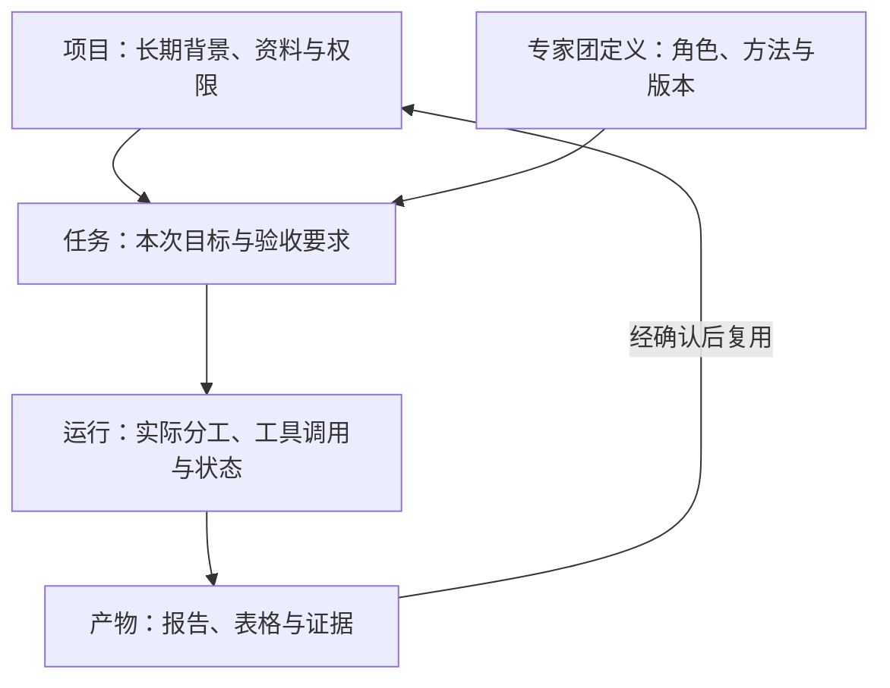

# WorkBuddy 详细介绍与产品设计参考

资料核对日期：2026-11-08。

本文延续 [三家专家团产品比较](./agent-team.md)，重点介绍 WorkBuddy 的专家团、工作台、项目与开发平台，以及对我们开发同类产品的启示。

本文基于官方公开资料，未进行登录后的产品实测。消费版、企业版和开发者平台能力分别说明；文中的说明性示例、架构建议与研发判断不代表腾讯已实现的功能。

## 1. 为什么 WorkBuddy 与我们的产品接近

**WorkBuddy 最接近我们产品的地方，是它把“专业角色、工作方法、工具和协作流程”组织成了用户可以直接调用的专家团。** 用户交给它一个目标，平台负责安排不同角色处理材料、调用工具并形成交付物。

研究它时，最值得关注的是三个相互关联的对象：**专家团如何被定义、一次任务如何被执行、完成后的成果如何继续复用。**

## 2. 整体产品结构

为了便于理解，可以把它整理成下面这几层。这是对产品关系的归纳，并非腾讯公布的内部系统架构。

| 层次 | 用户看到什么 | 解决什么问题 |
| --- | --- | --- |
| 工作入口 | 对话、任务、工作目录 | 我要做什么，处理哪些材料 |
| 专业能力 | 专家、专家团 | 谁来做，如何分工 |
| 方法与工具 | Skills、连接器、MCP | 按什么方法做，能够访问哪些系统 |
| 持续工作空间 | 项目、资料、任务产物 | 如何复用背景，让工作持续推进 |
| 自动化执行 | 本地助理、云端任务、定时工作 | 在哪里运行，何时运行 |
| 企业与开发平台 | 管理后台、Open API、WMA | 如何统一管理，如何接入自己的产品 |

这些能力分布在不同产品与版本中，并非安装客户端后就全部默认可用。[工作台说明](https://cloud.tencent.com/document/product/1831/134391)、[项目说明](https://cloud.tencent.com/document/product/1831/138797)、[开放接口](https://open.workbuddy.cn/docs/openapi)

## 3. 专家、技能、连接器与专家团的区别

专家提供特定领域的角色视角、方法和输出要求；技能提供可以复用的处理步骤或工具用法；专家团再把多个角色组织起来，由团长分派任务、整合结果。独立步骤可以并行，有前后依赖的步骤需要顺序推进。[专家中心](https://intl.cloud.tencent.com/zh/document/product/1316/84498)

用一个我们自己的例子说明：

| 对象 | 说明性示例 | 主要价值 |
| --- | --- | --- |
| 专家 | 企业财务分析员 | 知道应检查哪些指标、怎样解释异常 |
| 技能 | 提取财报表格并计算同比变化 | 把一种具体方法反复使用 |
| 连接器 | 访问获授权的企业资料库 | 提供实际数据与操作能力 |
| 专家团 | 企业研究团队 | 组织财务、行业、风险等不同角色共同交付 |

**专家名称本身不产生专业能力。** 能力来自适当的工作方法、可靠的数据、可用的工具，以及对结果的检查。这个区分直接影响我们的开发方向：需要积累的是这些可执行、可验证的资产。

## 4. 普通用户如何使用专家团

用户进入专家入口，浏览或搜索专家团，查看能力介绍、团队成员和任务示例，然后召唤团队、描述需求。调用过程中如果需要尚未连接的服务，客户端可以提示授权，完成后继续任务。用户也可以通过创建对话配置自己的专家；个人创建与向市场发布是不同路径。[专家使用与创建](https://cloud.tencent.com/document/product/1831/134393)

我的判断是，这种设计把团队组织成本提前交给了能力作者。普通用户不需要先学习如何搭建多 Agent 系统，而是选择一套已经组织好的工作方法。

但这也意味着，专家团详情页必须帮助用户判断“是否适合我的任务”。对我们而言，一张好的专家团卡片至少应该解释：

- 需要提供哪些材料。
- 能形成什么具体产物。
- 哪些工作不在它的能力范围内。
- 需要连接哪些服务。
- 大致涉及哪些阶段，用户在哪些节点需要参与。

## 5. 团长如何组织专家协作

团长是专家团的协调中心。官方开发示例要求主理人组织团队、分配成员任务、汇总和转交阶段结果，并明确反对由主理人直接模拟所有成员的输出。这说明它希望成员真正参与执行。[专家团开发文档](https://open.workbuddy.cn/docs/expert-team)

这里有一个重要边界：**示例中的协作要求，不能直接证明运行时已经强制保证这些要求。** 例如，“必须完成复核才能输出报告”如果只写在提示词中，与系统检查复核状态后才允许交付，是两种不同的实现。

对我们的产品，我建议让模型决定如何开展探索，让系统保证关键步骤确实发生。特别是证据收集、计算校验和最终审批，不宜完全依赖模型自觉遵守流程。

## 6. 一项完整任务如何执行

假设用户提出：

> 根据我提供的三家公司资料，形成一份比较报告，说明各自优势、风险和仍然缺少的信息，并附上依据。

下面是按专家团思路设计的说明性流程，不是已经在 WorkBuddy 中实测过的结果。

| 阶段 | 负责人 | 工作内容 | 应当留下的产物 |
| --- | --- | --- | --- |
| 明确任务 | 团长 | 确认比较目的、材料范围和交付格式 | 任务计划与验收要求 |
| 整理资料 | 资料专家 | 识别文件、提取事实、标记时间与来源 | 证据清单 |
| 分项分析 | 不同领域专家 | 分析业务、财务、竞争和风险 | 各自的分析结果 |
| 处理矛盾 | 团长与相关成员 | 对不同口径、过期数据和矛盾结论进行核查 | 待确认问题与修正记录 |
| 独立复核 | 复核专家 | 检查关键数字、引用和推理跳跃 | 复核意见 |
| 交付 | 团长 | 形成统一报告，保留不确定项 | 报告、附表与来源 |
| 用户修改 | 团长重新组织 | 根据反馈修改受影响的部分 | 新版本及变更说明 |

在这个过程中，用户最需要看到的是阶段状态、待补充材料和最终产物。没有必要把所有内部消息都展示出来，但应该允许用户展开查看关键依据。

从研发角度看，难点在于**成员之间传递的是什么**。如果只传一段总结，后续角色很难核对；如果同时传递原始来源、计算结果、假设和未解决问题，团队才具备可靠复核的基础。

## 7. 专家团作为可打包、可分发的开发资产

开放平台的包结构包含插件配置、成员 Agent 定义、共享技能及可选工具依赖；配置中标识团队类型、主 Agent 和成员关系。角色定义使用 Markdown 文件，技能可以包含参考资料和脚本等资源。[专家团包规范](https://open.workbuddy.cn/docs/expert-team)

这意味着，一个团队可以由能力作者预先设计，再交给其他用户使用。

对我们的启示是，专家团应有独立版本。例如“企业研究团 1.2”新增了数据核对步骤后，历史任务仍应能说明自己使用的是哪个版本。否则用户无法判断，为什么同样的材料两次得到不同流程与结论。

我建议我们在团队定义中优先明确四种合同：

| 合同 | 应明确的内容 |
| --- | --- |
| 输入合同 | 必需材料、可选材料、缺失时如何处理 |
| 角色合同 | 每个成员的职责、输入与输出 |
| 协作合同 | 阶段依赖、交接条件、谁负责解决分歧 |
| 交付合同 | 文件格式、必需内容、检查项、完成标准 |

这些是我们的设计建议；不能据此认定 WorkBuddy 已经对全部合同提供强制校验。

## 8. Skills 与连接器如何提供实际能力

WorkBuddy 的技能可以封装脚本和工作流，支持安装、启停、导入以及通过任务描述查找或创建。技能执行可能涉及文件、外部服务和第三方接口，实际能力取决于所安装内容及授权。[技能说明](https://cloud.tencent.com/document/product/1831/134432)

可以用两个问题检查一个专家：

- 它是否知道正确的工作方法？
- 它是否有取得数据、计算和生成产物的工具？

例如，财务专家即使知道应计算哪些指标，没有可读取的报表和计算工具，也无法可靠完成工作。反过来，拥有表格工具但没有正确分析方法，也可能形成错误结论。

因此，我们的专家配置应该能够引用技能和连接器，而不是把所有东西塞进一段越来越长的提示词。

## 9. 项目如何支持持续工作

WorkBuddy 项目把指令、资料、专家、技能和连接器组织起来，任务可以复用这些配置，产物也可以保存为后续资料。项目连接器还区分公共授权与个人授权，不能理解为加入项目就获得所有成员的私人账户权限。[项目与资产](https://cloud.tencent.com/document/product/1831/138797)

这一点对我们很重要。同一项业务往往不会在一次对话里完成：第一次形成初稿，第二次补材料，第三次修改结论，之后定期更新。

我建议把我们的对象关系设计成：

这张图是我们的设计建议。它强调一个容易被忽略的区别：项目是长期背景，任务是一次目标，运行是实际执行，产物是交付结果。四者不应该都混在聊天记录中。

## 10. 本地执行、远程控制与云端任务

WorkBuddy 本地工作台允许设置工作目录、选择模型，并提供 Ask、Plan 和默认执行模式：分别对应查看问答、先审阅计划、直接开展常规工作。[本地工作台](https://cloud.tencent.com/document/product/1831/134391)

本地远程助理允许用户通过消息入口派活，但承接工作的电脑仍需保持可用；云端任务则有独立的开放接口。两者的运行条件不同。[远程助理](https://cloud.tencent.com/document/product/1831/134392)、[云端任务接口](https://open.workbuddy.cn/docs/openapi)

| 路径 | 对用户意味着什么 | 我们需要关注的设计问题 |
| --- | --- | --- |
| 本地执行 | 方便处理电脑中的文件和环境 | 目录权限、设备休眠、执行恢复 |
| 远程派给本地电脑 | 手机可以发任务，电脑负责执行 | 在线状态、身份绑定、失败通知 |
| 云端执行 | 使用托管环境承接工作 | 数据上传、凭证、持久化与成本 |

如果我们同时支持多种路径，任务界面应明确显示“在哪里执行”。设备离线时，也应告诉用户正在等待什么，而不是一直显示“运行中”。

## 11. 记忆、模型配置与自动组队

国际站设置文档介绍了本地记忆、对话记忆、查看与重置，以及自定义模型接入；同时区分“系统自动组建多 Agent 团队”和“用户主动选择专家团”，关闭前者不影响后者。具体可用性需要按地区和部署版本核实。[系统设置](https://intl.cloud.tencent.com/zh/document/product/1316/84502)

我认为这里有两个值得我们保留的边界。

一是**个人记忆与项目事实分开**。用户喜欢怎样的报告格式，可以作为偏好；某公司的最新营收，应保留来源与日期，不能因为模型记得就长期当作有效事实。

二是**自动委派与显式专家团分开**。系统临时增加一个子 Agent，是执行策略；用户主动选择“带独立复核的专家团”，则是在选择一种交付规格。后者的关键步骤不应随意省略。

## 12. 权限与执行安全

当前安全文档以工作空间和风险操作为边界：常规任务可以继续，敏感路径、重要删除及其他高风险动作可能要求确认。完全访问配置影响当前客户端中的已有及后续任务，而不只是当前一步。[权限与安全沙箱](https://cloud.tencent.com/document/product/1831/134401)

对我们的产品，尤其需要区分：

- 专家团被安装了。
- 某个服务已经连接。
- 本次任务被允许读取某些数据。
- 某个具体写入或发送动作已经获批。

这四件事不能用同一个授权状态表示。我们可以让专家负责提出动作，但由统一执行层检查账户、目标、范围和审批状态。

## 13. 开发者开放接口与 WMA

WorkBuddy 有两条不同的开放路径。

第一条是产品集成接口：通过用户授权连接本地助理或创建云端任务，接收实时交互并取得会话产物。它适合把 WorkBuddy 的工作能力接入其他应用。[Open API](https://open.workbuddy.cn/docs/openapi)

第二条是 **WorkBuddy Managed Agents，简称 WMA**。它是企业托管 Agent 平台，提供 Agent 定义、版本、会话、运行资源，以及 Python／TypeScript ADK 和 REST API；还包含版本路由和外部 A2A Agent 绑定等概念。[WMA 简介](https://cloud.tencent.com/document/api/1831/138581)

它们对我们的价值不同：

| 研究目的 | 更值得关注的部分 |
| --- | --- |
| 学习普通用户怎样选择和使用团队 | 专家中心、专家团和项目 |
| 学习如何制作可分发的团队资产 | 专家团包、Agent 定义和技能 |
| 把现有能力接入自己的业务界面 | Open API |
| 评估是否使用托管执行底座 | WMA |
| 研究组织内规模化使用 | 企业管理后台 |

需要明确：WMA 的平台能力不能直接算到所有消费者专家团用户头上；公开 API 也不能证明完整 WorkBuddy 产品开源。

## 14. 企业如何统一管理和分发专家团

专享版更新记录包含专家团下发、精选能力、技能安全扫描、调用统计、能力套件分发和运行时安全策略；还增加了定时任务历次运行的展示与产物通知。这些属于具体企业版本的能力。[企业版更新说明](https://cloud.tencent.com/document/product/1831/140565)

我的判断是，这部分决定它能否从“员工自己尝试的工具”变成企业统一采用的平台。企业需要知道谁在用什么版本、哪些部门可用、费用归谁、出了问题如何撤回。

## 15. 我们优先借鉴什么，重点验证什么

对我们而言，我会优先借鉴四项设计，并把另外三项作为需要超越或验证的重点。

值得先借鉴的是：

| 设计 | 我们可以如何落实 |
| --- | --- |
| 专家团作为独立能力资产 | 保存角色、技能、依赖、交付规格和版本 |
| 团长统一承接用户目标 | 用户面对一个入口，后台分工可展开查看 |
| 项目复用背景与产物 | 避免每次重新上传资料、解释业务规则 |
| 专家团与工具分离 | 方法可以升级，工具和账户可以替换 |

需要重点验证或做得更扎实的是：

1. **流程是否真正执行。** 能否证明相关专家实际完成了工作，关键阶段没有被跳过。
2. **结果是否有可核查依据。** 关键结论能否追溯到资料、时间和计算，复核是否发现了真实错误。
3. **失败后能否继续。** 中断、授权过期、输入变化后，能否恢复而不重复写入，也不丢失已完成工作。

我会把这三项作为我们首个专家团的验收条件：给同一任务加入一份矛盾资料、一次运行中断和一项缺失权限，观察系统能否发现、解释并正确处理。这样的测试，比增加更多专家角色更能检验产品是否已经具备实际交付能力。
